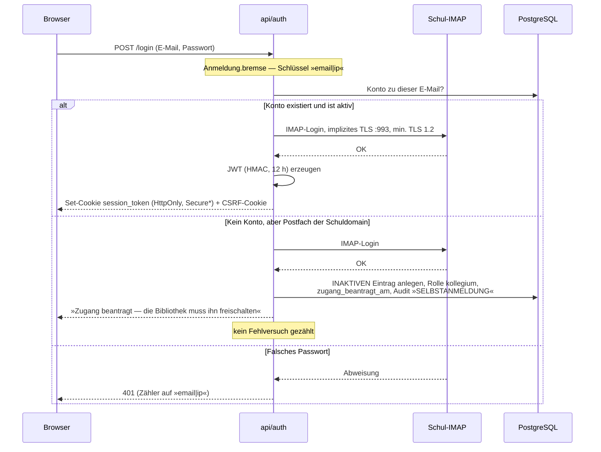
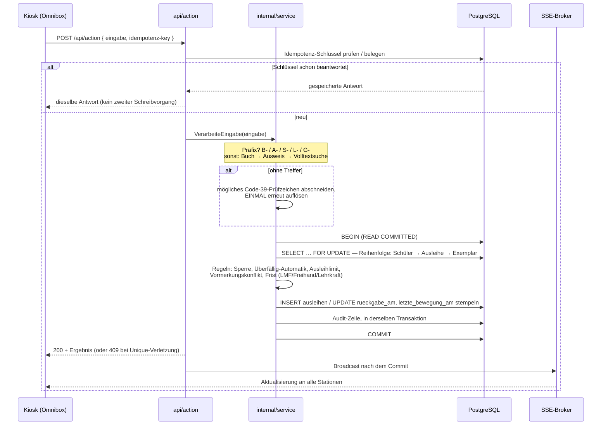
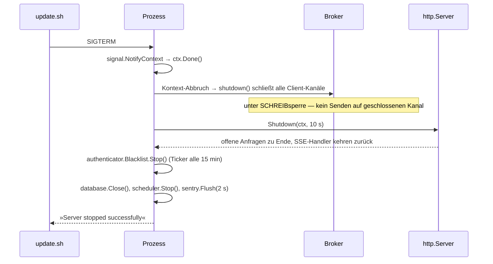

# arc42-Architekturdokumentation — Bibliothek (Schulbibliotheks-Software)

Stand: 21.10.2026 · Gliederung nach [arc42](https://arc42.org) (Template 8.2, deutsch) · jedes
Kapitel nennt seinen eigenen Stand

---

## Was das hier ist

Die Architekturdokumentation dieses Systems, gegliedert nach arc42, in dieser einen Datei. Sie
beschreibt den gebauten Stand: Jede Aussage ist am Code, an `schema.sql`, an den Migrationen,
am `Dockerfile`, an den CI-Workflows oder an einem Gate nachgelesen, und wo eine Fundstelle die
Aussage trägt, steht sie dabei. Was ein Paket oder eine Datei tut, sagt ihr Kommentar im Code;
hier steht, wie die Teile zusammenhängen und warum sie so gebaut sind.

| Frage                                                        | Dort steht die Antwort                                     |
| ------------------------------------------------------------ | ---------------------------------------------------------- |
| Wie ist das System gebaut, und **warum so**?                 | **hier** (arc42)                                           |
| Wo steht der Code zu einem Menüpunkt?                        | [WEGWEISER.md](WEGWEISER.md)                            |
| Wie heißt etwas im Code?                                     | [STIL.md](STIL.md)                                      |
| Welche fachliche Regel gilt genau?                           | [FACHKONZEPT.md](FACHKONZEPT.md)                        |
| Wie bediene ich das System?                                  | [HANDBUCH.md](HANDBUCH.md)                              |
| Wie betreibe, deploye, sichere ich es?                       | [DEPLOYMENT.md](DEPLOYMENT.md), [resilience_and_recovery.md](resilience_and_recovery.md) |
| Welche Schutzmaßnahme greift wo?                             | [SECURITY.md](SECURITY.md), [PII_MATRIX.de.md](PII_MATRIX.de.md) |
| Was muss **immer** wahr sein, und auf welcher Ebene?         | [invarianten.md](invarianten.md)                        |
| Welche Bugklassen kennt das Projekt, und wer detektiert sie? | [sweeps.md](sweeps.md)                                  |
| Was ist **offen**?                                           | [OFFEN.md](OFFEN.md) — die einzige Offen-Liste          |

Kapitel 11 nennt Risiken und bekannte Grenzen; was zu tun ist, steht nur in
[OFFEN.md](OFFEN.md).

---

## Die zwölf Kapitel

| #   | Kapitel                                                                    | Beantwortet                                                                       |
| --- | -------------------------------------------------------------------------- | --------------------------------------------------------------------------------- |
| 1   | [Einführung und Ziele](#1-einführung-und-ziele)                        | Was soll das System leisten, für wen, mit welchen Qualitätszielen                 |
| 2   | [Randbedingungen](#2-randbedingungen)                                   | Was war nicht verhandelbar — technisch, organisatorisch, konventionell            |
| 3   | [Kontextabgrenzung](#3-kontextabgrenzung)                               | Wer und was steht außen dran, über welche Schnittstelle                           |
| 4   | [Lösungsstrategie](#4-lösungsstrategie)                                | Die tragenden Entscheidungen in Kurzform, mit Begründung                          |
| 5   | [Bausteinsicht](#5-bausteinsicht)                                       | Statische Struktur: Pakete, Schichten, Verantwortungen, Level 1–3                 |
| 6   | [Laufzeitsicht](#6-laufzeitsicht)                                       | Zehn Szenarien im Ablauf — Scan, Login, Offline, Nachtlauf, Shutdown …            |
| 7   | [Verteilungssicht](#7-verteilungssicht)                                 | Container, Volumes, Ports, Reverse Proxy, CI/CD-Wege                              |
| 8   | [Querschnittliche Konzepte](#8-querschnittliche-konzepte)               | Sicherheit, Datenschutz, Persistenz, Nebenläufigkeit, Zeit, Fehler, Test …        |
| 9   | [Architekturentscheidungen](#9-architekturentscheidungen)               | 26 Entscheidungen als ADR: Stand, Grund, Folge, Fundstelle                        |
| 10  | [Qualitätsanforderungen](#10-qualitätsanforderungen)                    | Qualitätsbaum und messbare Szenarien samt zugehörigem Gate                        |
| 11  | [Risiken und technische Schulden](#11-risiken-und-technische-schulden)   | Was heute weh tut oder morgen weh tun wird — mit Einschätzung                     |
| 12  | [Glossar](#12-glossar)                                                   | Die Fachsprache des Hauses, deutsch, mit Code-Bezug                               |

---

## Lesewege

- **Neu im Code, zehn Minuten Zeit:** [WEGWEISER.md](WEGWEISER.md) — eine Seite: der Weg einer
  Anfrage, vom Menüpunkt zum Ordner, die Stelle für häufige Änderungen.
- **Neu im Projekt, eine Stunde Zeit:** Kapitel 1 → 4 → 5 (Level 1+2) → 12. Danach
  [FACHKONZEPT.md §1](FACHKONZEPT.md) für die Omnibox, weil daran der ganze Betrieb hängt.
- **Ich muss etwas ändern:** Kapitel 5 (welcher Baustein), 8 (welches Querschnittskonzept
  fasse ich an), 9 (ist das schon einmal entschieden worden), dann
  [invarianten.md](invarianten.md) und [sweeps.md](sweeps.md).
- **Ich muss es betreiben:** Kapitel 7 → [DEPLOYMENT.md](DEPLOYMENT.md) →
  [resilience_and_recovery.md](resilience_and_recovery.md).
- **Ich muss es beurteilen (Schule, Träger, Datenschutz):** Kapitel 1, 3, 10, 11 und
  [SECURITY.md](SECURITY.md).

---

## Wie diese Dokumentation gepflegt wird

1. **Kein Kapitel behauptet einen Stand, den es nicht hat.** Jedes Kapitel trägt unter seiner
   Überschrift eine `Stand:`-Zeile, das Dokument eine im Kopf; `docs/stand_angaben_test.go`
   prüft, dass kein im Text genanntes Datum jünger ist als der Kopf.
2. **Zahlen stehen an einer Stelle** (1.4), mit dem Tag der Messung; die Befehle dazu stehen im
   [Anhang von Kapitel 5](#anhang-die-zahlen-selbst-nachmessen).
3. **Fundstellen werden beim Namen genannt, nicht gezählt:** Datei-, Paket-, Constraint- und
   Indexnamen statt Zeilennummern. `docs/dateiverweise_test.go` hält jeden genannten Pfad gegen
   die Dateien des Repositorys.
4. **Das Dokument nennt, was gilt.** Wie es dazu kam, steht in der Commit-Nachricht, was eine
   Datei tut, in ihrem Kommentar.

---

## 1. Einführung und Ziele

Stand: 21.10.2026

---

### 1.1 Aufgabenstellung

**Bibliothek** ist die Verwaltungssoftware der Schulbibliothek einer Gesamtschule. Sie
löst eine Windows-Altanwendung (**Littera**) ab und deckt den vollständigen Betrieb ab:
Ausleihe und Rückgabe an der Scanner-Theke, Medienkatalog, Lernmittelverwaltung (LMF),
Mahnwesen, Vormerkungen, Inventur, Bestellwesen, Geräteausleihe, Leserdatei und die
datenschutzrechtlich vorgeschriebenen Löschroutinen.

**Das ist kein Produkt.** Es ist für **einen** konkreten Betrieb gebaut; die Entscheidungen
darin sind entsprechend konkret (eine feste Lernmittel-Stichtagsregel, ein einziger
Mailserver als Anmeldequelle, Barcodes eines Altbestands, die nicht neu geklebt werden
können). Wo diese Dokumentation eine Entscheidung „falsch" erscheinen lässt, lohnt der
Blick in [Kapitel 9](#9-architekturentscheidungen): fast immer ist die Randbedingung der
Grund, nicht der Geschmack.

#### Die tragenden fachlichen Anforderungen

| #  | Anforderung                                                                                                                                  | Fundstelle                                       |
| -- | -------------------------------------------------------------------------------------------------------------------------------------------- | ------------------------------------------------ |
| F1 | **Ein Eingabefeld für alle Scans** (Omnibox). Ohne Präfix wird in der Reihenfolge Buch → Ausweis → Volltextsuche aufgelöst.                   | `internal/service/omnibox.go`, FACHKONZEPT §1 |
| F2 | **Fristen** je Medienart: Lernmittel auf den Stichtag 31. Juli bzw. den Klassentermin des LMF-Plans, Freihand rollierend, Kollegium als Dauerleihe (gespeichert wird ein Jahr, überfällig wird sie nie). | `internal/service/frist.go`, `pkg/lmf`, `pkg/lmfplan` |
| F3 | **Bis zu 8 Kiosk-Stationen gleichzeitig** am selben Bestand, ohne Doppelbuchung und ohne Phantom-Erfolg.                                      | `migrations/033_unique_active_loan.sql`, `sse/`  |
| F4 | **Mahnwesen**: Mahnstufe steigt ausschließlich beim PDF-Druck (dem physischen Verwaltungsakt), nie beim Mailversand; Listen gehen an die Klassenleitung, nie an Schüler. | `api/mahnwesen/mahnbriefe.go`                          |
| F5 | **Schülerdaten unter DSGVO**: Löschfristen, Karenz, Anonymisierung, verschlüsselte Fotos, Auskunftsrecht, Audit-Trail.                        | `jobs/cron_dsgvo*.go`, `internal/crypto`, [SECURITY.md](SECURITY.md) |
| F6 | **Öffentliche Seiten ohne Anmeldung** (Katalog `/katalog`, Monitor `/monitor`) — Titeldaten ja, Personendaten nie.                            | `api/portal/opac.go`, `api/portal/monitor.go`, FACHKONZEPT §16 |
| F7 | **Kollegiums-Portal** mit Selbstanmeldung über das Schulpostfach, Klassensatz-Reservierung und Meldungen.                                     | `auth/selbstanmeldung.go`, `frontend/src/lib/KollegiumPortal.svelte` |
| F8 | **Altbestandsübernahme aus Littera**: Titel, Exemplare, Personen, offene Ausleihen — verlustfrei und nachweisbar.                             | `internal/littera`, `internal/uebernahme`, `cmd/littera-altbestand` |
| F9 | **Bestellwesen** bis zum Wareneingang, inklusive Bestätigungslink für Händler, die selbst etikettieren.                                       | `api/bestellung/bestellbestaetigung*.go`                   |
| F10| **Der Betrieb muss merken, wenn eine Funktion still nichts tut** (fehlende Einstellung, fehlendes Geheimnis, fehlgeschlagene Restore-Probe).  | `internal/bereitschaft/bereitschaft.go`, FACHKONZEPT §15   |

---

### 1.2 Qualitätsziele

Die fünf Ziele stehen in der Reihenfolge, in der bei einem Konflikt entschieden wird. Das
ist keine Rhetorik: Q1 vor Q5 heißt konkret, dass eine Buchung lieber mit **409 Conflict**
scheitert als „irgendwie" durchgeht, und Q2 vor Q4, dass eine Löschroutine auch dann läuft,
wenn dadurch eine Statistik ihre Zahlenbasis verliert.

| Prio | Qualitätsziel                          | Was damit konkret gemeint ist                                                                                                                                     | Wie es nachgewiesen wird                                                                                     |
| ---- | -------------------------------------- | ----------------------------------------------------------------------------------------------------------------------------------------------------------------- | ------------------------------------------------------------------------------------------------------------ |
| Q1   | **Korrektheit unter Nebenläufigkeit**  | Acht Stationen scannen gleichzeitig. Kein Exemplar hat zwei aktive Ausleihen, kein Doppelscan erzeugt eine zweite Buchung, kein Fehler wird als Erfolg quittiert. | Partielle Unique-Indizes (DB-Ebene), Idempotenz-Keys, `*_pg_test.go` gegen echtes Postgres, `phantom_erfolg_test.go` |
| Q2   | **Datenschutz-Konformität**            | Schülerdaten werden fristgerecht getilgt, Fotos verschlüsselt, öffentliche Seiten tragen keine Personendaten, jede Route ist nach PII-Stufe eingeordnet.          | `api/pii_matrix_test.go` hält [PII_MATRIX.de.md](PII_MATRIX.de.md) deckungsgleich mit dem Code; DSGVO-Cronjobs mit PG-Tests |
| Q3   | **Betriebstransparenz**                | Eine eingerichtete, aber nicht in Betrieb befindliche Funktion muss sich melden — nicht schweigen.                                                                 | Selbstprüfung der Betriebsbereitschaft + Bereitschafts-Wächter (täglich per Mail), `/health`                 |
| Q4   | **Bedienbarkeit an der Theke**            | Ein Scan, eine Reaktion, ohne Maus. Der Ausfall des Netzes darf den Betrieb nicht anhalten.                                                                        | Offline-Warteschlange (IndexedDB) + Nachbuch-Tür, Tastaturbedienung, WCAG 2.1 AA mit axe-Gate                |
| Q5   | **Änderbarkeit ohne Rückfall**         | Ein behobener Fehler bleibt behoben. Jede Bugklasse bekommt einen Detektor (eine „Ratsche"), nicht nur einen Fix.                                                  | [sweeps.md](sweeps.md), Drift-Gates (Migrationen, Compose-Variablen), Deadcode-Gate                       |

> **Die Gate-Regel des Projekts:** Der Anspruch ist nicht „es gibt Tests", sondern *jedes
> Gate muss man einmal rot gesehen haben*. Ein Gate, das seine Aussage nicht verlieren kann,
> prüft nichts. Deshalb führt `scripts/git-hooks/pre-push` auch eine **Skip-Bilanz**: Es
> sagt, was es *nicht* geprüft hat (die `*_pg_test.go` überspringen sich ohne
> `TEST_DATABASE_URL` still, mit grünem „ok" daneben).

#### Was ausdrücklich **kein** Ziel ist

- **Mandantenfähigkeit.** Eine Schule, eine Datenbank, ein Stack. Es gibt keine
  Schul-ID und keinen Mandanten-Schlüssel.
- **Konfigurierbarkeit als Produktmerkmal.** Was das Kollegium darf, steht fest in
  `db/rechte_vorgabe.go` und ist kein Schalter je Schule (Entscheidung vom 16.09.2026).
- **Skalierung über einen Host hinaus.** Der Entwurf zielt auf ~1.900 Leser und acht
  gleichzeitige Arbeitsplätze, nicht auf horizontale Skalierung. Der Prozess hält
  In-Memory-Zustand (SSE-Broker, Rechte-Cache, Rate-Limit-Zähler); mehrere Instanzen
  hinter einem Load Balancer wären ein Umbau, nicht eine Konfiguration
  ([Kapitel 11](#11-risiken-und-technische-schulden)).
- **Mehrsprachigkeit.** Die Oberfläche, die Fachsprache und der Code sind deutsch.

---

### 1.3 Stakeholder

| Rolle                                | Erwartung an das System                                                                                                            | Was daraus architektonisch folgt                                                                                     |
| ------------------------------------ | ---------------------------------------------------------------------------------------------------------------------------------- | -------------------------------------------------------------------------------------------------------------------- |
| **Bibliotheksleitung**               | Überblick, Mahnwesen, Bestellung, Statistik ohne Klarnamen; Systempflege nicht übernehmen müssen                                   | Eigene Rolle `leitung` = Admin **minus** `manage_users`/`manage_settings`, abgeleitet statt abgeschrieben (Migration 122) |
| **Bibliotheks-Mitarbeiter**          | Tagesgeschäft an der Theke, schnell, ohne Systemwissen                                                                             | Omnibox als einziges Eingabefeld; Fehler sprechen deutsch und sagen die nächste Handlung                             |
| **Helfer** (Eltern, Hilfskräfte)     | Ausleihe/Rückgabe und die Frage „habt ihr Band 3 noch da?" beantworten — ohne Zugriff auf Personendaten                            | Genau zwei Rechte (`perform_actions`, `view_books`), Grenze zu Personendaten über `view_students`                     |
| **Kollegium** (~160 Lehrkräfte)      | Selbst anmelden können, Klassensätze reservieren, LMF-Termine sehen, Probleme melden                                                | Selbstanmeldung über die Schuldomain mit **Freischaltung durch die Bibliothek**; Portal hängt am Recht `create_reservations`, nicht an der Rolle |
| **Schüler und Eltern**               | Sehen, ob ein Buch da ist — ohne Konto                                                                                             | Öffentlicher Katalog und Monitor, die ausschließlich Titeldaten liefern (PII-Stufe 0)                                |
| **Sekretariat / Schulleitung**        | Schülerdaten müssen ohne Doppelerfassung hereinkommen; Versetzung und Abgang müssen funktionieren                                   | LUSD-Import mit drei Zuordnungsstufen, Umbenennungs-Paarung und Karenzzeit ([LUSD.md](LUSD.md))                   |
| **Datenschutzbeauftragte(r)**        | Nachweisbare Fristen, Rechtsgrundlagen, Verarbeitungsverzeichnis, Auskunft                                                          | PII-Matrix je Route als Gate, automatische Löschroutinen, VVT- und Art.-13-Entwürfe unter `docs/datenschutz/`         |
| **Schulträger**                      | Nachweispflichten (Zugangs-/Abgangsbuch, Bestandsnachweis zum Stichtag), getrennte Töpfe Land/Träger                                | Bestandsbücher als eigene Reiter mit Druckblatt; Mittelherkunft an der Bestellung ([mittel_konzept.md](mittel_konzept.md)) |
| **Betreiber/Entwickler** (eine Person) | Ein Deploy darf nichts still zerstören; ein Fehler muss sich selbst melden; die Doku muss die Entscheidung tragen, nicht nur das Ergebnis | Gates, Drift-Tests, Selbstprüfung, Bereitschafts-Wächter, `OFFEN.md` als einzige Liste, Commit-Historie als Doku      |
| **Land (Lernmittelfreiheit)**         | Leihbücher nach Erlass behandeln: Fristen, Ersatzwert-Staffel, Bescheid statt Barzahlung                                            | `pkg/ersatzwert` (Staffel als Vorschlag mit Herleitung), `api/schaden/bescheid_*.go`, Gate `docs/ersatzwert_staffel_test.go`  |

---

### 1.4 Umfang in Zahlen (gemessen 21.10.2026)

| Gegenstand                        | Umfang                                    |
| --------------------------------- | ----------------------------------------- |
| Go-Produktivcode                  | 78.235 Zeilen                              |
| Go-Tests                          | 134.822 Zeilen in 939 Testdateien          |
| Svelte/JavaScript (`frontend/src`) | 85.684 Zeilen in 774 Dateien, davon 310 `.svelte` |
| e2e (Playwright, `frontend/e2e`)  | 168 Dateien, davon 163 Specs               |
| Registrierte HTTP-Routen          | 226                                        |
| Datenbank-Migrationen             | 167 Dateien, die höchste Nummer ist 164    |
| Tabellen / Sichten in `schema.sql`| 43 Tabellen, 2 Sichten (`schueler`, `view_buecher_bestand`) |

Die Befehle, mit denen diese Zahlen neu erhoben werden, stehen im
[Anhang von Kapitel 5](#anhang-die-zahlen-selbst-nachmessen): Eine gepflegte Zahl altert, ein
Messbefehl nicht.

---

## 2. Randbedingungen

Stand: 21.10.2026

Randbedingungen sind das, was **nicht zur Diskussion stand**. Sie erklären mehr von dieser
Architektur als jede Entwurfsvorliebe: Der Grund für die Omnibox, für IMAP als
Anmeldequelle und für die Nachsicht gegenüber alten Barcodes steht hier, nicht in
[Kapitel 4](#4-lösungsstrategie).

---

### 2.1 Technische Randbedingungen

| #  | Randbedingung                                                                 | Hintergrund und Konsequenz                                                                                                                                                                               |
| -- | ----------------------------------------------------------------------------- | -------------------------------------------------------------------------------------------------------------------------------------------------------------------------------------------------------- |
| T1 | **Go 1.27.3**, Version identisch in `go.mod` und `Dockerfile`                 | Zwei Versionen wären zwei Verhalten. Genutzt werden ausdrücklich neuere Fähigkeiten: Methoden-Routing im `net/http`-Mux (`GET /api/...`), `os.OpenRoot` gegen Path-Traversal, `slog` als Standard-Logger. |
| T2 | **Kein Web-Framework** — `net/http` mit `http.ServeMux`                       | Routing, Middleware-Kette und RBAC sind Eigenbau (`api/router.go`, `api/middleware.go`, `api/tuer/rechte.go`, `api/tuer/sitzung.go`). Preis: Die Kettenreihenfolge ist Handarbeit und braucht ein Gate (`geschuetzte_routen_test.go`). |
| T3 | **PostgreSQL 18** über `pgx/v5` (Pool), keine ORM-Schicht                     | SQL steht im Repository-Paket sichtbar da. Constraints sind ein Entwurfsmittel, nicht eine Absicherung „unten" — siehe [invarianten.md](invarianten.md).                                                |
| T4 | **CGO_ENABLED=1** für das Hauptbinary                                         | `chai2010/webp` (Cover-Dekodierung) braucht CGO. Folge: Der Build braucht `build-base` im Builder-Image; die CLI-Werkzeuge werden dagegen mit `CGO_ENABLED=0` gebaut.                                      |
| T5 | **Svelte 5 (Runes), Tailwind 4, Vite — kein TypeScript**                       | Typsicherheit kommt über JSDoc + `svelte-check --fail-on-warnings`, nicht über `.ts`. Eine Umstellung wäre ein Umbau von rund 300 Komponenten und ist bewusst nicht erfolgt.                                    |
| T6 | **Ein Host, ein Prozess**                                                      | Der Prozess hält Zustand im Speicher: SSE-Abonnenten, Rechte-Cache, Rate-Limit-Zähler, Idempotenz-Warteschleife. Eine zweite Instanz hinter einem Load Balancer wäre **nicht** nur Konfiguration.         |
| T7 | **Anmeldung gegen den Schul-Mailserver (IMAP)**                                | Die Anwendung speichert **kein** Benutzerpasswort; eine Passwortspalte gibt es seit Migration 012 nicht. Für die Dauer einer Anmeldung hält sie einen Prüfwert davon (Migration 155, A2). Folge: Die E-Mail **ist** die Identität, und `benutzer.email` schreiben zu dürfen heißt, ein Konto übernehmen zu können. |
| T8 | **Barcodes des Altbestands dürfen nicht neu geklebt werden**                   | Ausweise und Etiketten aus Littera tragen nackte Nummern ohne Präfix. Deshalb löst die Omnibox **ohne** Präfix der Reihe nach auf, und deshalb gibt es die Prüfzeichen-Nachsicht (`pkg/code39`).           |
| T9 | **Docker Compose hinter Caddy**, TLS per ACME                                  | Kein Kubernetes, kein Ingress-Controller. Die maßgebliche Caddy-Konfiguration liegt **auf dem Schulserver** (`/root/caddy/Caddyfile`, geschrieben von `update_caddy.sh`). |
| T10| **Der Betrieb läuft ggf. über HTTP im Schul-LAN**                              | Deshalb ist `COOKIE_SECURE` eine bewusst treffbare Betriebsentscheidung — Vorgabe `true` außerhalb lokaler Entwicklung, ein explizites `false` warnt laut, bricht aber nicht ab.                            |
| T11| **Zeitzone Europe/Berlin fachlich, UTC technisch**                              | Fristen pinnen `Europe/Berlin` im Code (`schulzeit.TagesEnde`), der Cron-Zeitplan ist auf UTC genagelt (`cron.WithLocation(time.UTC)`) — sonst verschluckt die Zeitumstellung den 02:30-Backup-Job.  |
| T12| **Lizenz EUPL-1.2**                                                             | Der Lizenztext steht in `LICENSE`, der Hinweis im Kopf von `main.go`; `frontend/package.json` nennt dieselbe Lizenz. Abhängigkeiten müssen dazu passen.                                                                                 |

---

### 2.2 Organisatorische und fachliche Randbedingungen

| #  | Randbedingung                                                        | Konsequenz für die Architektur                                                                                                                                                       |
| -- | -------------------------------------------------------------------- | ------------------------------------------------------------------------------------------------------------------------------------------------------------------------------------ |
| O1 | **Ein Entwickler, ein Betreiber — dieselbe Person**                   | Alles, was nur durch Disziplin funktioniert, funktioniert nicht. Daher: Gates statt Checklisten, Selbstprüfung statt Runbook-Gedächtnis, `OFFEN.md` als **einzige** Liste.            |
| O2 | **Der Betrieb läuft, während gebaut wird**                            | Migrationen müssen idempotent sein und beim Start von selbst laufen; ein Deploy darf offene SSE-Verbindungen nicht mit `os.Exit(1)` beenden (der Grund für den Broker-Umbau).         |
| O3 | **Lernmittelfreiheit ist Landesrecht**                                | Der Stichtag 31. Juli, die Ersatzwert-Staffel und der Bescheid-Weg (Konto statt Bargeld) sind Vorgaben, keine Produktentscheidungen. Die Staffel ist bewusst ein **Vorschlag mit Herleitung**, weil der Betrag im Ermessen der Schule liegt. |
| O4 | **~160 Lehrkräfte legt niemand von Hand an**                          | Selbstanmeldung über die Schuldomain ist Pflicht, die Freischaltung bleibt aber bei der Schule: IMAP beantwortet „wer bist du", nicht „darfst du rein".                               |
| O5 | **Zwei Anforderungen aus dem Anforderungsprotokoll vom 16.09.2026** | Alte Aufdrucke bleiben lesbar (A14), und ein Lernmittel kann über mehrere Jahre beim selben Kind bleiben (Mehrjahresband am Titel, Spalte `mehrjahresband`). Beides ist gebaut. Wie die übrigen der zwölf Punkte behandelt sind, steht in den Commits vom 17. und 22.09.2026, die begründeten Abweichungen im Mahnwesen in [mittel_konzept.md](mittel_konzept.md), Abschnitt 3. |
| O6 | **Kein Passwort-Selbstservice, kein Nutzerverzeichnis**                | Es gibt keinen „Passwort vergessen"-Pfad und keine Registrierung außer der Selbstanmeldung — beides liegt beim Schul-IT-Betrieb.                                                       |
| O7 | **Altbestand aus Littera muss verlustfrei übernommen werden**          | Übernahme als eigenes Kommando gegen dieselbe Datenbank, mit Savepoint **je Datensatz** und Abgleich gegen den tatsächlichen Zeilenzuwachs — ein abgebrochener Batch darf nicht alles mitnehmen. |
| O8 | **Datenschutz ist nachweispflichtig, nicht nur einzuhalten**            | Die PII-Einstufung je Route ist ein Dokument **mit Gate** (`api/pii_matrix_test.go`), nicht eine Zusage.                                                                              |

---

### 2.3 Konventionen

| Konvention                                        | Regel                                                                                                                                                                                                              | Durchsetzung                                                        |
| ------------------------------------------------- | ------------------------------------------------------------------------------------------------------------------------------------------------------------------------------------------------------------------ | ------------------------------------------------------------------- |
| **Namen, Sichtbarkeit, Kommentare**               | Eine Sache hat ein Wort, und das Fachwort ist deutsch; Verben, Kürzel, Türen, was öffentlich ist und was ein Kommentar sagt, regelt [STIL.md](STIL.md) nach Googles Regelwerk für Go. | `stil_ratsche_test.go` (Bestand je Paket, sinkt nur); `golangci-lint` (revive, Regel `exported`) |
| **Migrationen**                                   | `NNN_beschreibung.sql`, idempotent (`IF NOT EXISTS` / `DO $$ … EXCEPTION`), dedupliziert über `schema_migrations`; die Seed-Liste in `schema.sql` muss exakt den Dateien entsprechen.                               | `db/migrationen_drift_test.go`, `db/migrationen_nummern_test.go`, `db/migrationen_schema_paritaet_pg_test.go` |
| **Rows-Iteration**                                | Jede `rows.Next()`-Schleife endet mit `rows.Err()`. Ohne das gilt ein Verbindungsabbruch mitten in der Iteration als Erfolg — die Liste wäre still unvollständig.                                                   | `golangci-lint`, Review                                              |
| **Paketkommentar**                                | Jedes Go-Paket trägt genau einen Kommentar unmittelbar über der `package`-Zeile; er sagt in ein bis drei Sätzen, wofür das Paket da ist. So verlangt es Googles Regelwerk für Go, Abschnitt [Package comments](https://google.github.io/styleguide/go/decisions#package-comments). Ein Kommando beginnt mit `Command <Name>`. | `golangci-lint` (revive, Regel `package-comments`) |
| **Empfängername**                                 | Ein Typ nennt seinen Empfänger in jeder Methode gleich, kurz und nie `this` oder `self` (Googles Regelwerk für Go, [Receiver names](https://google.github.io/styleguide/go/decisions#receiver-names)). Die Türen eines Themas nennen ihn `t` ([STIL.md](STIL.md), Abschnitt 4). | `empfaenger_ratsche_test.go` (über alle Dateien eines Pakets), `golangci-lint` (revive, Regel `receiver-naming`, je Datei) |
| **Komponenten-Größe Frontend**                    | ≤ 200 Zeilen je **neuer** Komponente und je neuem JS-Modul; der Altbestand darüber darf nicht wachsen.                                                                                                                              | Ratsche `frontend/src/lib/frontend-hygiene-dateigroesse.test.js`     |
| **Eine Wahrheitsquelle für Menü und Router**      | Welche Seite eine Rolle erreicht, entscheidet `darfSehen()` in `frontend/src/lib/menue.js` — und nur diese Funktion.                                                                                                | `frontend/e2e/menue-fuehrt-irgendwohin.spec.js`                      |
| **Autorisierung pro Route**                       | Kein globaler Auth-Filter: jede nicht-öffentliche Route trägt `verlangeRecht(...)` oder, wo jede Sitzung genügt, `VerlangeAnmeldung()`; öffentliche Routen stehen in einer Allowlist.                        | `api/geschuetzte_routen_test.go`                                  |
| **Fundstellen beim Namen**                        | In der Dokumentation werden Constraint-, Index-, Datei- und Paketnamen genannt — keine Zeilennummern und keine Migrationsnummern als Beleg (eine Datei existiert weiter, auch wenn eine spätere Migration sie aufhebt). | `docs/invarianten_fundstellen_test.go`                               |
| **Stand-Angaben**                                 | Kein Dokument behauptet im Kopf einen Stand, unter dem es jüngere Vorgänge beschreibt.                                                                                                                             | `docs/stand_angaben_test.go` (jede `.md` unter `docs/`)              |
| **Keine Changelog-Datei**                         | Die Commit-Historie ist Teil der Dokumentation; Erledigtes wird aus `OFFEN.md` gelöscht, nicht archiviert.                                                                                                          | Entscheidung vom 15.09.2026                                          |
| **Jedes Gate einmal rot gesehen**                 | Ein Detektor, dessen Aussage nicht verloren gehen kann, prüft nichts. Neue Gates werden gegen den echten Fehlerfall gehalten, bevor sie grün bleiben dürfen.                                                        | [sweeps.md](sweeps.md) Regel 2; „Prüfung der Prüfungen"              |

---

### 2.4 Werkzeuge, die zur Architektur gehören

Diese Werkzeuge sind keine Beigabe: Ohne sie wären mehrere Entscheidungen in
[Kapitel 9](#9-architekturentscheidungen) nicht tragbar.

| Werkzeug                                | Rolle in der Architektur                                                                                            |
| --------------------------------------- | ------------------------------------------------------------------------------------------------------------------- |
| `golangci-lint` (`.golangci.yml`)       | Steht in CI **vor** allem anderen: Bricht er ab, laufen Tests, Deadcode-Gate und Restore-Probe nicht. Deshalb fragt ihn auch der Hook vor dem Push. |
| `scripts/deadcode_gate.sh` + Baseline   | Unerreichbarer Code täuscht Sicherheit vor: geschrieben, getestet und von niemandem aufgerufen. |
| `govulncheck` + `scripts/govulncheck-gate.sh`, `security/vuln-ausnahmen.json` | Schwachstellen-Gate mit **benannten, begründeten** Ausnahmen statt globalem Abschalten.               |
| `gosec`, CodeQL, Trivy, `npm audit`      | Vier unabhängige Blickwinkel; Befunde, die begründet keine sind, werden dokumentiert (`.jules/sentinel.md`).          |
| Playwright gegen den **gebauten Container** | e2e misst, was ausgeliefert wird — nicht einen Dev-Server.                                                       |
| `internal/pgtest`, `*_pg_test.go`        | Constraints kann man nicht mocken. Ohne `TEST_DATABASE_URL` überspringen sie sich still — deshalb die Skip-Bilanz.    |
| `internal/smtptest`, `internal/pdftest`  | Mail- und PDF-Pfade werden gegen eine Attrappe bzw. am erzeugten Dokument geprüft, nicht am Aufruf.                  |
| `scripts/api_inventar.sh`                | Erzeugt [api_inventar.md](api_inventar.md): alle Go-Routen gegen alle Frontend-Aufrufer, in **beide** Richtungen.  |

---

## 3. Kontextabgrenzung

Stand: 08.10.2026

---

### 3.1 Fachlicher Kontext

```mermaid
graph TB
    subgraph Schule
        MA[Bibliotheks-<br/>Mitarbeiter]
        LTG[Bibliotheks-<br/>leitung]
        HELF[Helfer]
        KOLL[Kollegium<br/>~160 Lehrkräfte]
        SEK[Sekretariat]
    end
    subgraph Öffentlich
        SCH[Schüler & Eltern]
        MON[Flur-Monitor]
    end
    subgraph Extern
        HAENDL[Buchhändler]
        MZ[Schulträger]
        DSB[Datenschutz-<br/>beauftragte]
    end

    SYS[("Bibliothek<br/>(dieses System)")]

    MA -->|Scan, Ausleihe, Rückgabe, Mahnwesen, Inventur| SYS
    LTG -->|Bestellung, Statistik, Bescheide| SYS
    HELF -->|Ausleihe/Rückgabe, Katalog lesen| SYS
    KOLL -->|Klassensatz-Reservierung, LMF-Plan, Anliegen| SYS
    SEK -->|LUSD-Bericht (Schülerdaten)| SYS
    SCH -->|Katalog /katalog, ohne Anmeldung| SYS
    SYS -->|Slideshow /monitor| MON
    SYS -->|Bestellmail + Barcodebogen| HAENDL
    HAENDL -->|Bestätigungslink /bestellung/token| SYS
    SYS -->|Zugangs-/Abgangsbuch, Bestandsnachweis| MZ
    SYS -->|Auskunft, VVT, Löschnachweis| DSB
    SYS -->|Mahnliste an Klassenleitung, Abgängerbrief, Bescheid| KOLL
```

#### Fachliche Nachbarn im Einzelnen

| Nachbar                     | Eingang in das System                                                                                       | Ausgang aus dem System                                                                                                | Besonderheit                                                                                                    |
| --------------------------- | ----------------------------------------------------------------------------------------------------------- | --------------------------------------------------------------------------------------------------------------------- | --------------------------------------------------------------------------------------------------------------- |
| **Bibliothekspersonal**     | Barcode-Scans, Stammdatenpflege, Mahnlauf, Inventurzählung, Wareneingang                                     | Bildschirm-Rückmeldung je Scan, PDFs (Mahnungen, Etiketten, Ausweise, Bescheide, Listen)                              | Bedienung ist auf **Tastatur und Scanner** ausgelegt; die Maus ist optional                                     |
| **Kollegium**               | Selbstanmeldung mit dem Schulpostfach, Reservierungen, Meldungen                                              | Portal-Ansichten (Klassensätze, LMF-Plan, Schulbücher als PDF), Terminbestätigungen                                    | Zugang entsteht **inaktiv** und wird von der Bibliothek freigeschaltet                                          |
| **Sekretariat**             | LUSD-Bericht als `.xlsx` **oder** Semikolon-CSV (LANIS-Klassenliste, UTF-8 mit BOM)                           | Abgleichbericht: neu, geändert, Umbenennung, Abgänger                                                                  | Die Kopfzeile wird **gesucht, nicht vorausgesetzt** — LUSD-Berichte tragen Titelzeilen darüber                  |
| **Schüler und Eltern**      | Suchanfragen im öffentlichen Katalog                                                                         | Titel, Cover, Verfügbarkeit                                                                                            | **Nie** Ausleiherdaten — PII-Stufe 0, im Gate `api/pii_matrix_test.go` festgehalten                              |
| **Buchhändler**             | Bestätigung über einen Token-Link, ohne Konto                                                                 | Bestellmail mit Positionsliste und Barcodebogen                                                                        | Der Token steht **im Pfad** und wird im Log maskiert (`maskiereToken`); gespeichert wird nur sein Hash           |
| **Schulträger**             | Nachweispflichten                                                                                             | Zugangs-/Abgangsbuch je Halbjahr, getrennt nach Land und Träger; Bestandsnachweis zum Stichtag (15.3./15.9.)           | Bücher ohne hinterlegte Bestellung erscheinen ausdrücklich „ohne Zuordnung" — die ehrliche Lücke statt einer Erfindung |
| **Datenschutzbeauftragte**  | Prüffragen                                                                                                    | DSGVO-Auskunft als PDF, PII-Matrix, VVT-Entwurf, Nachweis der Löschläufe im Audit-Trail                                | Die Audit-Tilgung ist die **bewusste Ausnahme** von der Append-only-Konvention                                  |

---

### 3.2 Technischer Kontext

```
                   ┌──────────────────────────────────────────┐
  Browser          │  Caddy (Host, ACME/Let's Encrypt)        │
  (SPA, PWA)  ────► │  flasch3.herzog-dupont.de :443          │
                   │  response_header_timeout 300s            │
                   │  read/write_timeout 600s                 │
                   └───────────────┬──────────────────────────┘
                                   │ HTTP, Docker-Netz
                                   ▼
        ┌───────────────────────────────────────────────────────────┐
        │  backend (Go, alpine, non-root »appuser«)                 │
        │  :8083 (Produktion) / :8084 (lokaler Stack)               │
        │  /api  JSON · /events SSE · /uploads Cover · /login       │
        │  /health                                                  │
        └───┬───────────┬────────────┬───────────┬──────────────────┘
            │ pgx/v5    │ IMAP 993   │ SMTP      │ HTTPS (Allowlist)
            ▼           ▼            ▼           ▼
     ┌────────────┐  ┌────────┐  ┌────────┐  ┌──────────────────────┐
     │ PostgreSQL │  │ Schul- │  │ Schul- │  │ DNB · OpenLibrary ·  │
     │ 18-alpine  │  │ Mail-  │  │ SMTP   │  │ Google Books         │
     │ :5432      │  │ server │  │ STARTTLS│ │ (Cover + Metadaten)  │
     └────────────┘  └────────┘  └────────┘  └──────────────────────┘
            │                                        ▲
            │ pg_dump → gzip → AES-256-GCM           │ nur öffentliche IPs
            ▼                                        │ (pkg/safehttp)
     ┌────────────────────┐   optional   ┌────────────────────────┐
     │ Volume /app/backups│ ───────────► │ S3-kompatibler Speicher│
     └────────────────────┘              └────────────────────────┘
                                          optional: Sentry (SENTRY_DSN)
```

#### Schnittstellen technisch

| Schnittstelle                    | Protokoll / Format                              | Richtung        | Absicherung                                                                                                                       |
| -------------------------------- | ----------------------------------------------- | --------------- | --------------------------------------------------------------------------------------------------------------------------------- |
| **Browser → Backend**            | HTTPS, JSON über `/api`, `POST /login`          | eingehend       | Security-Header/CSP, CORS auf die Schuldomain, Body-Limit 100 MB, Timeouts, Rate-Limit, CSRF (Double-Submit), JWT im HttpOnly-Cookie |
| **Backend → Browser (Echtzeit)** | Server-Sent Events, `GET /events`               | ausgehend       | Nur authentifiziert (`VerlangeAnmeldung`); Heartbeat alle 15 s; **kein** `WriteTimeout` am Server, weil der Strom nie endet     |
| **Statische Auslieferung**       | SPA aus `frontend/dist`, PWA-Service-Worker      | ausgehend       | Dateizugriffe OS-seitig an `dist/` gebunden (`os.OpenRoot`); ein unbekannter `/api/`-Pfad antwortet 404 statt App-Shell            |
| **Cover-Dateien**                | `GET /uploads/...`                              | ausgehend       | **Bewusst ohne Anmeldung** (Katalog/Monitor brauchen Cover); in der Allowlist von `geschuetzte_routen_test.go` vermerkt          |
| **Backend → PostgreSQL**         | Postgres-Wire über `pgx/v5`-Pool                | ausgehend       | Netz nur intern; Passwort aus `.env`; `pg_dump` erhält es über eine temporäre `.pgpass`, nicht über `PGPASSWORD`                    |
| **Backend → IMAP**               | IMAP über implizites TLS, Port 993, min. TLS 1.2 | ausgehend       | Feste Cipher-Auswahl; `IMAP_HOST=mock` akzeptiert in Entwicklung/Test jedes Passwort und wird beim Start laut protokolliert         |
| **Backend → SMTP**               | SMTP mit **erzwungenem** STARTTLS und Zertifikatsprüfung | ausgehend | Bietet der Server kein STARTTLS, bricht der Versand ab (`errSMTPKlartext`); nur ein ausdrückliches `SMTP_ALLOW_PLAINTEXT=true` erlaubt es. Kopfzeilen werden gegen CR/LF-Einschmuggelung geprüft |
| **Backend → Metadaten/Cover**    | HTTPS GET an eine **Host-Allowlist**             | ausgehend       | `pkg/coverquelle` baut die URL aus geprüften Teilen **neu** auf (Schema fest HTTPS, Host aus der Konstante); `pkg/safehttp` lehnt Verbindungen zu nicht-öffentlichen IPs ab (SSRF) |
| **Backend → S3 (optional)**      | S3-API über `minio-go`                           | ausgehend       | Nur aktiv, wenn `S3_ENDPOINT/ACCESS_KEY/SECRET_KEY/BUCKET` vollständig gesetzt sind; sonst überspringt der Job den Offsite-Upload und sagt das |
| **Backend → Sentry (optional)**  | HTTPS                                            | ausgehend       | Nur bei gesetztem `SENTRY_DSN`                                                                                                     |
| **Littera-Altbestand**           | CSV aus `mdb-export` (einmalig, CLI)             | eingehend       | Kein HTTP-Weg: eigenes Kommando `cmd/littera-altbestand` gegen dieselbe Datenbank, Savepoint je Datensatz                            |
| **Bestellbestätigung Händler**   | `GET/POST /bestellung/<token>` ohne Anmeldung     | eingehend       | Token einmalig, Hash gespeichert, im Log maskiert; die Bestätigung ist über `WHERE bestaetigt_am IS NULL` atomar                    |
| **Scanner / Kamera**             | USB-HID (Tastatureingabe) bzw. `html5-qrcode`     | eingehend       | Kein Gerätetreiber im System: Ein Handscanner ist eine Tastatur, die Kamera läuft im Browser                                        |
| **Drucker**                      | PDF-Download, Druck aus dem Browser              | ausgehend       | Etiketten/Ausweise als PDF mit festen Bogenmaßen; Gate `npm run test:druck` prüft die Drucksektionen                               |

#### Was ausdrücklich **nicht** angebunden ist

- **Kein Single-Sign-On** (kein LDAP, kein OAuth, kein Kerberos) — IMAP ist die einzige
  Identitätsquelle.
- **Keine Schnittstelle zur Schulverwaltung außer dem LUSD-Bericht als Datei.** Es gibt
  keinen Webservice, keine Datenbankkopplung und kein automatisches Nachladen.
- **Keine Zahlungsschnittstelle.** Forderungen werden über Bescheid und Rechnung
  abgewickelt; das System bucht keine Zahlungseingänge ein und nennt für Landes-Lernmittel
  ausdrücklich das Konto statt Bargeld.
- **Kein Push an Schüler oder Eltern.** Mahnlisten gehen an die Klassenleitung; Abgänger-
  und Schadensbriefe gehen über die Schule.
- **Kein externer Monitoring-Agent.** Das System stellt `/health` und die Selbstprüfung
  bereit und schickt den Bereitschafts-Wächter per Mail; ein externes Uptime-Signal ist als
  Handgriff offen ([OFFEN.md](OFFEN.md) 7.5).

---

## 4. Lösungsstrategie

Stand: 08.10.2026

Dieses Kapitel nennt die tragenden Entscheidungen in Kurzform und ordnet sie den
Qualitätszielen aus [Kapitel 1](#12-qualitätsziele) zu. Die
ausführliche Fassung mit Datum, Anlass und Folge steht in
[Kapitel 9](#9-architekturentscheidungen).

---

### 4.1 Die acht Leitentscheidungen

| #  | Entscheidung                                                                                     | Trägt                | Kurzbegründung                                                                                                                                                                                                 |
| -- | ------------------------------------------------------------------------------------------------ | -------------------- | -------------------------------------------------------------------------------------------------------------------------------------------------------------------------------------------------------------- |
| L1 | **Geschichteter Monolith**, ein Deployable: Handler → Service → Repository                        | Q5, Betrieb          | Ein Betreiber, ein Host, eine Datenbank. Ein Schnitt in Dienste würde Transaktionsgrenzen zerreißen, die heute die Korrektheit tragen (Ausleihe = eine Transaktion über Schüler, Ausleihe, Exemplar).            |
| L2 | **Die Datenbank ist die letzte Instanz**, nicht die Applikation                                   | Q1                   | Zwei Stationen können dieselbe Zeile ohne gemeinsame Sperre anfassen. Erst der partielle Unique-Index macht die zweite aktive Ausleihe *strukturell unmöglich*; Code-Prüfungen sind umgehbar, sobald ein zweiter Schreibpfad entsteht. |
| L3 | **Autorisierung pro Route, nicht global**                                                          | Q2                   | Eine globale Kette kennt die Route nicht, die sie schützt. `verlangeRecht` sitzt **hinter** dem Routing (nur dort ist `r.PathValue` gefüllt) und prüft Recht, Kontostatus und UUID-Form in einem Zug. Ein Coverage-Gate zählt jede ungeschützte Route auf. |
| L4 | **Echtzeit über SSE, ohne Event-Loop**                                                             | Q1, Q4, Betrieb      | Alle Stationen sehen denselben Zustand nach dem Commit. Der Broker hält seinen Zustand hinter einem `RWMutex` statt hinter Kanälen — die frühere Kanal-Bauweise verhinderte das Herunterfahren und machte **jeden** Deploy zum `os.Exit(1)`. |
| L5 | **Idempotenz als Vertrag der Schreibtüren**                                                        | Q1, Q4               | Ein Scan darf doppelt ankommen (Netz, Nachbuchen, nervöse Hand). Der Idempotenz-Key liefert die gespeicherte Antwort zurück; 5xx wird nie gecacht, damit ein Wiederholen möglich bleibt.                          |
| L6 | **Die Theke arbeitet auch ohne Netz weiter**                                                      | Q4                   | Scans landen in IndexedDB und gehen später durch die **Nachbuch-Tür**, die den Scan-Zeitpunkt buchen, einen Schlüssel genau einmal buchen und jede Abweichung als Meldung festhalten kann. Schweigen des Servers gilt nicht als Erfolg. |
| L7 | **Jede Bugklasse bekommt einen Detektor**                                                          | Q5                   | Ein Fix ohne Ratsche ist ein Rückfall auf Zeit. Das Register dieser Klassen und ihrer Detektoren ist [sweeps.md](sweeps.md); die Landkarte nennt zu jeder Ratsche auch, was sie systembedingt **nicht** sieht. |
| L8 | **Das System muss sich selbst melden**                                                             | Q3                   | Die wiederkehrende Fehlerart ist nicht der Absturz, sondern die fertige Funktion, die still nichts tut, weil eine Einstellung fehlt. Dagegen stehen die Selbstprüfung, der tägliche Bereitschafts-Wächter per Mail und die wöchentliche Restore-Probe. |

---

### 4.2 Wie die Qualitätsziele technisch erreicht werden

| Ziel                                    | Mittel                                                                                                                                                            | Näheres                          |
| --------------------------------------- | ----------------------------------------------------------------------------------------------------------------------------------------------------------------- | -------------------------------- |
| **Q1 Korrektheit unter Nebenläufigkeit** | Struktur in der Datenbank (partielle Unique-Indizes, Constraints, Fremdschlüssel), Transaktion mit Zeilensperren in fester Reihenfolge, Idempotenz-Schlüssel; eine Unique-Verletzung wird 409 statt eines stillen Erfolgs | 6.4, 8.4, 8.5, 8.6, A5, A7, A8   |
| **Q2 Datenschutz-Konformität**          | Eine Tabelle `leser` mit der Sicht `schueler`, Verschlüsselung am Ruhepunkt, Löschfristen als Nachtlauf in fester Reihenfolge, Einstufung jeder Route mit Gate, keine IP und kein Token im Log | 8.3, A10, A17, A20               |
| **Q3 Betriebstransparenz**              | `/health`, Selbstprüfung der Betriebsbereitschaft, Bereitschafts-Wächter per Mail, wöchentliche Restore-Probe, Start-Verweigerung bei Beispiel-Geheimnissen, Skip-Bilanz | 8.11, 8.14, A15, A17             |
| **Q4 Bedienbarkeit an der Theke**       | Ein Feld für alle Scans, Vorsilben, die auch ohne Netz tragen, Nachsicht für alte Aufdrucke, Sperre statt Abmeldung, gemessene Barrierefreiheit | 5.4.2, 6.5, 8.8, 8.13, A13, A14, A21 |
| **Q5 Änderbarkeit**                     | Testebenen mit klarer Zuständigkeit, Drift-Gates, Deadcode-Gate, eine Ratsche je Bugklasse, eine Wahrheitsquelle je Frage (Menü und Router fragen dieselbe Funktion, die Rechte der Leitung sind abgeleitet) | 2.3, 8.14, [sweeps.md](sweeps.md), A12 |

---

### 4.3 Bewusst nicht gewählte Alternativen

| Alternative                                  | Warum nicht                                                                                                                                                                        |
| -------------------------------------------- | ---------------------------------------------------------------------------------------------------------------------------------------------------------------------------------- |
| **Microservices**                            | Die Korrektheit der Ausleihe hängt an einer Transaktion über drei Tabellen. Verteilte Transaktionen wären ein Vielfaches an Komplexität für null fachlichen Gewinn bei acht Arbeitsplätzen. |
| **ORM (GORM/ent)**                            | Die kritischen Stellen sind Sperren, partielle Indizes und Sichten mit `CHECK OPTION`. Genau das ist der Teil, den ein ORM verdeckt.                                               |
| **Web-Framework (Gin/Chi/Echo)**              | Der Bedarf ist Methoden-Routing plus sechs Middlewares — das kann `net/http` seit Go 1.22 selbst. Der Preis (eigene Kette, eigene Gates) ist bezahlt und dokumentiert.             |
| **WebSockets statt SSE**                       | Der Datenfluss ist einseitig (Server → Stationen). SSE kommt ohne Protokoll-Upgrade durch den Reverse Proxy und reconnectet von selbst.                                            |
| **Eigene Benutzerverwaltung mit Passwörtern**   | Ein zweiter Passwortspeicher in einer Schule ist ein Risiko ohne Nutzen. Es gibt keine Passwortspalte. Nur für die Dauer einer Anmeldung liegt ein Prüfwert in `sitzungen`, der ohne den Schlüssel des Servers nichts preisgibt (A2).                                        |
| **Redis/Memcached für Cache und Rate-Limit**    | Ein Prozess, ein Host: In-Memory reicht und spart eine Betriebskomponente. Der Preis ist die fehlende horizontale Skalierbarkeit (dokumentiert in [Kapitel 11](#11-risiken-und-technische-schulden)). |
| **TypeScript im Frontend**                     | JSDoc mit `checkJs` und `svelte-check --fail-on-warnings` liefert die Prüfung ohne den Umbau von rund 300 Komponenten.                                                                |
| **Kubernetes**                                  | Ein Schulserver. `docker compose` plus `update.sh` ist die Betriebsform, die eine Person im Ernstfall noch versteht.                                                               |
| **Soft-Delete überall**                        | Wo die DSGVO Löschung verlangt, ist ein Soft-Delete keine Löschung. Es gibt Soft-Deletes im Bestand (Aussonderung mit Grund), aber die Abgänger-Tilgung ist ein Hard-Delete.        |

---

## 5. Bausteinsicht

Stand: 21.10.2026 · Befehle zum Messen im [Anhang](#anhang-die-zahlen-selbst-nachmessen)

---

### 5.1 Level 1 — Whitebox Gesamtsystem

```
┌──────────────────────────────────────────────────────────────────────────────┐
│  Bibliothek (ein Deployable)                                                 │
│                                                                              │
│  ┌────────────────────────────┐        ┌───────────────────────────────────┐ │
│  │  Frontend (SPA + PWA)      │        │  Backend (Go)                     │ │
│  │  Svelte 5 Runes, Tailwind  │◄──────►│  net/http, pgx/v5                 │ │
│  │  Ansichten, Stores, Druck  │  JSON  │  Türen, Fachlogik, Abfragen       │ │
│  │  IndexedDB-Warteschlange   │  SSE   │  Nachtläufe, Migrationen          │ │
│  └────────────────────────────┘        └──────────────┬────────────────────┘ │
│           ausgeliefert AUS dem Backend                │                       │
│           (frontend/dist, os.OpenRoot)                │ pgx-Pool              │
│                                                        ▼                      │
│                                          ┌───────────────────────────────┐   │
│                                          │  PostgreSQL 18                │   │
│                                          │  Tabellen, Sichten, Indizes   │   │
│                                          └───────────────────────────────┘   │
│                                                                              │
│  ┌──────────────────────────────────────────────────────────────────────────┐│
│  │  Einmal-/Betriebswerkzeuge (cmd/, 6 Kommandos) — NICHT über HTTP        ││
│  └──────────────────────────────────────────────────────────────────────────┘│
└──────────────────────────────────────────────────────────────────────────────┘
```

| Baustein                   | Verantwortung                                                                                         | Nicht verantwortlich für                                             |
| -------------------------- | ----------------------------------------------------------------------------------------------------- | -------------------------------------------------------------------- |
| **Frontend (SPA/PWA)**     | Bedienung, Ansichten, Offline-Warteschlange, Menü-Sichtbarkeit, Druckvorbereitung                     | Autorisierung (nur Blende — Autorität ist immer das Backend)          |
| **Backend (Go)**           | Routing, Auth/RBAC, Fachlogik, Persistenz, PDF, Mail, Hintergrundjobs, Echtzeit, Auslieferung der SPA  | Rendering der Oberfläche; Zustandshaltung über Prozessgrenzen hinweg  |
| **PostgreSQL**             | Datenhaltung **und Durchsetzung der Invarianten** (Constraints, partielle Unique-Indizes, Sichten)    | Geschäftsregeln, die Ermessen enthalten (Ersatzwert-Vorschlag, Übergehen eines Hinweises) |
| **cmd-Werkzeuge**          | Übernahme aus Littera und aus MySQL, Backup verschlüsseln und zurückspielen, Schlüsselwechsel (5.2.4) | Alles, was im laufenden Betrieb über die Oberfläche erreichbar sein muss |

---

### 5.2 Level 2 — Backend, Whitebox

#### 5.2.1 Die Anfragekette

```
HTTP-Anfrage
   │
   ├─ Log ────────────────────── jede Anfrage: Methode und Pfad, Token maskiert, ohne IP
   ├─ 0 Adresse ──────────────── Client-IP hinter dem Proxy (pkg/clientip), gelesen von Bremse und Türen
   ├─ 1 PanicRecovery ────────── fängt Panics, 500 statt Prozess-Ende
   ├─ 2 Sentry (Repanic: true) ─ Fehlerweitergabe, optional
   ├─ 3 SecurityHeaders ──────── CSP, HSTS, X-Content-Type-Options … (internal/middleware)
   ├─ 4 CORS ─────────────────── nur die konfigurierte Schuldomain (ALLOWED_ORIGIN)
   ├─ 5 Logging ──────────────── nur 5xx: Status, Methode, Pfad — ohne IP, Token maskiert
   ├─ 6 HTTPSRedirect ────────── nur wenn der Proxy es anzeigt
   ├─ 7 Lesefrist-Erweiterung ── hebt ReadTimeout für Import-Routen an (VOR dem Body-Lesen)
   ├─ 8 BodyLimit (100 MB) ───── MaxBytesReader, puffert nichts
   ├─ 9 Timeout ──────────────── Kontext-Deadline je Route (bearbeitungsfristVorgabe)
   ├─10 RateLimit ────────────── je Client-IP (pkg/clientip: genau ein Proxy-Hop)
   ├─11 CSRF ─────────────────── Double-Submit-Cookie, Refresh-Route ausgenommen
   ├─12 Kompression ──────────── gzip für JSON, den CSV-Export und die Textdateien der Oberfläche; der SSE-Strom läuft daran vorbei
   │
   ▼  http.ServeMux (Methoden-Routing, Go 1.22+)
   │
   ├─ verlangeRecht("…")
   │     └─ UUID-Pfadparameter prüfen  ← hier, weil r.PathValue erst nach dem Routing gefüllt ist
   │        → Cookie → JWT prüfen → Kontostatus in der DB → Recht (Cache 60 s, Epoche)
   ├─ VerlangeAnmeldung() — nur Routen ohne UUID im Pfad (api/uuid_pfadparameter_test.go)
   │     └─ Cookie → JWT prüfen → Kontostatus in der DB
   ▼
  Handler (api/<Thema>/, inventur/, auth/)
   ▼
  Service (internal/service/) — Regeln, Orchestrierung, Transaktionsklammer
   ▼
  Repository (repository/) — SQL, pgx, Mapping
   ▼
  PostgreSQL
   │
   └─ nach dem Commit: SSE-Broadcast an alle Stationen
```

> **Warum Auth nicht in der globalen Kette sitzt:** Eine Middleware außen um den Mux
> gelegt kennt die aufgelöste Route nicht: `r.PathValue("id")` ist vor dem Routing leer, eine
> UUID-Prüfung dort liefe **nie**. Deshalb sitzt sie in `verlangeRecht` (A4). Eine Allowlist
> von Pfaden neben der Rechtetabelle gibt es nicht; sie überstimmte die Rechte, die die
> Verwaltung vergibt (A3).

#### 5.2.2 Pakete des Backends

Was ein Paket tut, sagt sein Kommentar (`go doc ./<paket>`); die Tabelle ordnet die Pakete
ihrer Schicht zu. Wie groß sie sind, misst der [Anhang](#anhang-die-zahlen-selbst-nachmessen).

| Paket                   | Verantwortung                                                                                                                                                                   |
| ----------------------- | ------------------------------------------------------------------------------------------------------------------------------------------------------------------------------- |
| `main.go`               | Konfiguration lesen **und hart prüfen** (DSN, Länge der Schlüssel, IMAP, Secret-Guard), Pool, Migrationen, Rechte ab Werk, erster Admin, Übernahme der SMTP-Konfiguration, Broker, Zeitplan, Server, geordnetes Herunterfahren |
| `api/`                  | Router mit den Routenlisten (`routen_*.go`) und den Zugängen zu den Themen, Middleware, CSRF, die Bremsen für Anfragen und Anmeldungen, die Abmeldung                          |
| `api/tuer/`             | Was jede Tür braucht: Eingabe lesen und Antwort schreiben, Sitzung, Rechteprüfung mit Zwischenspeicher (5.4.3), Protokoll der Verwaltung, Uhr, Kopf der Briefe. Der Typ `Basis` trägt Datenbank, Anmeldung, Live-Leitung und Uhr; `api.Server` bettet ihn ein |
| `api/<Thema>/`          | Die Türen je Menüpunkt (A26): `lernmittel`, `inventurlauf`, `benutzer`, `portal`, `system`, `mahnwesen`, `schaden`, `katalog`, `druck`, `bestellung`, `leser`, `theke`        |
| `internal/service/`     | Fachlogik mit Transaktionsklammer: Ausleihe und Rückgabe (5.4.1), Omnibox (5.4.2), Nachbuchen, Geräte, Cover, Passbilder, Ersatzwert, Bestellungen, LMF-Plan und seine Fristen, Importe, Littera-Etiketten |
| `repository/`           | Die Datenbankschicht (A25): Abfragen, Schreibpfade, Zeilensperren, Bewegungsstempel, Protokoll, Einstellungen, die Anweisungen der Nachtläufe, der Anmeldung und der Theke     |
| `inventur/`             | Der Medienkatalog mit eigenen Türen und eigener Datenbankschicht (5.2.3)                                                                                                        |
| `auth/`                 | Anmeldung gegen IMAP, Token, Sperrliste widerrufener Token, Sperre nach Inaktivität mit Prüfwert des Passworts, Selbstanmeldung des Kollegiums                                 |
| `jobs/`                 | Zeitplan (UTC) und Nachtläufe: DSGVO-Kette, Protokoll-Aufbewahrung, Backup, Idempotenz-TTL, Vormerkungs-Verfall, Cover-Abgleich, Restore-Probe (5.4.5)                        |
| `internal/lusd/`        | Abgleich mit dem Export der LUSD: Datei lesen, Zeilen zuordnen, Vorschau, Umbenennungs-Paare, Anwenden in einer Transaktion ([LUSD.md](LUSD.md))                              |
| `internal/bereitschaft/` | Selbstprüfung der Betriebsbereitschaft: eine reine Funktion über eine Lage, je Bereich ein Befund mit Folge und Abhilfe; die Lage sammelt `api/system`                         |
| `internal/auskunft/`    | Auskunft nach Art. 15 DSGVO: Typen der Antwort, Pflichtangaben, das Blatt aus derselben Antwort                                                                                |
| `internal/buchetikett/` | Die Eingabe der Buchetiketten, die Druck-Center und Bestellung drucken (8.9)                                                                                                    |
| `internal/littera/`, `internal/uebernahme/` | Übernahme des Littera-Altbestands (5.2.4)                                                                                                                   |
| `internal/crypto/`, `internal/backupkrypto/`, `internal/ausweis/`, `internal/middleware/` | AES-256-GCM; scrypt und Dateiformat der Backups; Gültigkeit eines Ausweises; Security-Header                                    |
| `internal/pgtest/`, `smtptest/`, `pdftest/`, `xlsxtest/`, `testdaten/`, `testweg/`, `tuertest/`, `routertest/` | Prüfhilfen: gewöhnliche Pakete, die nur Tests einbinden                                                                   |
| `pdf/`                  | Erzeugte Dokumente: Briefe, Listen, Bescheid, Rechnung, Etiketten mit ihren Bogenformaten, Bestandsbücher (8.9)                                                                 |
| `mailservice/`          | Aufbau und Versand einer Mail, erzwungenes STARTTLS, Kopfzeilen-Härtung, die Konfiguration, mit der verschickt wird (8.10)                                                     |
| `sse/`                  | Broker und Tür für Server-Sent Events (5.4.4)                                                                                                                                   |
| `apierrors/`            | Einheitliche Fehlerantworten und ihre Abbildung auf HTTP-Status (8.6)                                                                                                          |
| `db/`                   | Verbindungspool, Lauf der Migrationen, Rechte je Rolle ab Werk (`rechte_vorgabe.go`), erster Admin, Übernahme der SMTP-Konfiguration                                           |
| `pkg/`                  | Regeln und Hilfen ohne Abhängigkeit zu den Schichten darüber (Tabelle unten)                                                                                                    |
| `cmd/`                  | Sechs Kommandos neben dem Server (5.2.4)                                                                                                                                        |
| `migrations/`           | Nummerierte, idempotente Schritte des Schemas; laufen beim Start                                                                                                                |
| `docs/` (Go-Anteil)     | Die Gates der Dokumente, nur Testdateien                                                                                                                                         |

##### Themen unter `api/`

- Ein Thema trägt seine Türen als Methoden am Typ `Tueren`. Er bettet einen Zeiger auf die
  `tuer.Basis` des Servers ein: Datenbank, Anmeldung, Live-Leitung und Uhr gibt es einmal, und
  was am Server gestellt wird (etwa die Uhr in einem Test), gilt für jedes Thema. Typ und
  Paketkommentar stehen in der Datei, die wie das Paket heißt (`api/lernmittel/lernmittel.go`).
- Zu welchem Thema eine Tür gehört, sagt die Stelle der Oberfläche, die sie ruft, nicht der Name
  ihrer Datei: der Menüpunkt, in den Einstellungen die Kategorie. Rufen Stellen mehrerer Themen
  eine Tür, steht sie bei dem Thema, dessen Daten sie liest.
- Adresse und Recht jeder Tür stehen in den Routenlisten in `api/` (`routen_*.go`). Sie
  erreichen ein Thema über einen klein geschriebenen Zugang des Servers
  (`s.lernmittel().LMFPlanSchreiben()`), der die Basis als Zeiger weiterreicht;
  `api/zugaenge_basis_test.go` hält das je Zugang. Außerhalb von `api/` erreicht niemand die
  Türen eines Themas.
- Kein Thema bindet ein anderes oder `api/` ein (`api/themen_ratsche_test.go`). Was zwei Themen
  brauchen, steht in `api/tuer` oder einer Schicht darunter: der Eintrag zur Konto-Anlage
  (`tuer.Basis.ProtokolliereKontoAnlage`), der Ersatzwert (`internal/service/ersatzwert_vorschlag.go`),
  die Buchetiketten (`internal/buchetikett`).
- Die Tests eines Themas stehen in seinem Ordner und bauen die Türen selbst
  (`&Tueren{Basis: &tuer.Basis{DB: …}}`); ohne Datenbank bekommen sie eine leere Basis. Ein
  Test über den ganzen Router steht dort als eigenes Testpaket (`package lernmittel_test`) und
  baut ihn mit `routertest.MitSitzung`.

##### Wo ein Test steht

- Bei dem Paket, dessen Regel er prüft: ein Test an der Datenbank für eine Abfrage in
  `repository/`, auch wenn er sie über eine Tür oder einen Dienst erreicht; ein Test des
  Ausleih-Dienstes in `internal/service`; ein Paar aus Go und SQL bei der Go-Seite; der Lauf
  einer Migration in `db/`.
- Braucht er eine Prüfhilfe, die sein Paket einbindet (`internal/testweg`,
  `internal/routertest`), steht er als Testpaket daneben (`package repository_test`), wie es
  Googles Regelwerk für diesen Fall vorsieht
  ([Test package](https://google.github.io/styleguide/go/decisions#test-package)).
- Titel, Exemplare, Schüler, Leser und Konten legt ein Test an der Datenbank über
  `internal/testdaten` an. Eigenes SQL schreibt er nur, wo kein Helfer genau dieselbe Zeile
  anlegt: mehrere Tupel, `ON CONFLICT`, Ausdrücke wie `NOW()`, andere Spalten. `testdaten`
  bindet kein Paket des Programms ein, jeder Test kann es nutzen.
- In `api/` stehen die Tests an Router, Middleware, CSRF und Abmeldung, die Prüfungen über alle
  Routen (Schutz, Rechte, Personendaten, Grenzen der Listen), die Schichtung und jeder Test, der
  Türen zweier Themen prüft.
- Eine Prüfung, die den ganzen Baum liest und keinem Paket gehört, steht im Wurzelpaket; ihre
  Blindheit steht im Kopf der Datei und in der Landkarte von [sweeps.md](sweeps.md) (Regel 7,
  gehalten von `docs/landkarte_ratschen_test.go`). Gehört die Regel einem Paket, steht die
  Prüfung dort, auch wenn sie dafür den Baum durchläuft
  (`repository/einstellungen_gelesene_schluessel_test.go`).

##### `repository/` bleibt ein Paket

Die Datenbankschicht wird nicht nach den Themen geteilt (A25): Protokoll, Einstellungen, Titel
und Leser brauchen mehrere Themen, und die Schreiber jeder Tabelle stehen in einem Paket.
Gefunden wird über den Namen der Datei, der wie ihre Sache heißt (`repository/auflagen.go`).

##### Tür und Abfrage

Für `api/`, `internal/service` und `repository/` gilt:

- **Die Tür** prüft Eingabe und Recht, öffnet die Transaktion, bestimmt die Reihenfolge der
  Schritte, entscheidet Status und Meldung und schreibt ins Protokoll. Neben ihr in ihrer Datei
  steht, was nur sie braucht: die Prüfung der Eingabe, Füll-Funktionen zwischen den Typen der
  Schichten, das Sammeln aus Datenbank und Einstellungen, der Versand ihrer Mail. Eine Regel,
  die ohne Anfrage gilt, steht bei ihrem Fach. Die Probe: Müsste eine zweite Stelle die
  Funktion nachformulieren, wenn eine andere Schicht dieselbe Antwort braucht?
- **Die Fachlogik** (`internal/service`) entscheidet, was gilt (Frist, Sperre, Schranke,
  Reihenfolge der Schritte), und formuliert keine Anweisung. Läuft sie in der Transaktion einer
  Tür, bekommt sie diese Transaktion und keinen Pool daneben (`service.KoppleLMFPlanFristen`):
  Mit beiden als Nachbar-Argumenten ließe sie sich am Pool rufen, und kein Compiler merkte es.
  Eine Funktion, die Zeilen sperrt, nimmt `pgx.Tx`; am Pool endete die Sperre mit der
  Anweisung.
- **Die Abfrage** steht in `repository/` als Funktion über `repository.Datenbank` (Pool oder
  Transaktion) und liefert ihren eigenen Zeilentyp. Die Typen der Schnittstellenbeschreibung
  bleiben an der Tür; bei gleichen Feldern genügt die Typumwandlung (`SignaturGruppe(zeile)`).
  Was mehrere Abfragen teilen, steht einmal: eine Bedingung (`coverNichtLokal`,
  `sqlCoverOderDNB`, die Wartenden in `vormerkung_nachruecken.go`), das Lesen der
  Einstellungen (`repository.LadeEinstellungen`), der Eintrag ins Protokoll
  (`repository.SchreibeAdminProtokoll`). Hängt die SET-Liste einer Änderung von den genannten
  Feldern ab, nennt `repository/` die Spalten in einem Typ der Änderung (`LeserAenderung`). Ein
  Fehler beim Lesen der Zeilen trägt `repository.ErrZeileUnlesbar`.
- **`repository/` und `pdf/` kennen einander nicht.** Die Tür füllt die Eingabe der Erzeuger aus
  den Zeilen. Hängt ein gedruckter Text an einer Regel, die `pdf/` nicht kennt, reicht sie ihn
  fertig: den Eigentumsvermerk nach dem Topf des Exemplars, Betreff und Vermerk einer
  Bestellung. Ein Blatt entsteht aus derselben Antwort wie die Ansicht am Bildschirm
  (`abgangsbuchBlatt`, `auskunft.Antwort`), und ein Test hält jedes Feld einer Füll-Funktion
  gegen seine Quelle (`api/bestellung/bestellung_fuellen_test.go`,
  `internal/buchetikett/buchetikett_test.go`).
- **Eine Regel, die auch `repository/` oder `internal/service` brauchen,** steht in `pkg/` und
  nicht in `api/`, das die beiden nicht einbinden können: `pkg/leserart` (Schüler oder
  Kollegium), `pkg/mitteltopf` (die zwei Töpfe einer Bestellung), `pkg/lmfplan` (Fristen nach
  Schultagen).
- **Die Nachtläufe** teilen sich ebenso: `jobs/` bestimmt Zeitpunkt, Einstellungen, Protokoll
  und Abbruch, die Anweisungen stehen in `repository/nachtlauf.go`. Wo eine Frist gilt, setzt die
  Funktion die Bedingung aus `repository/loeschfristen.go` selbst ein; der Aufrufer reicht nur
  die Frist. `repository/nachtlauf_ratsche_test.go` hält das.
- **`auth/` formuliert kein SQL.** Es behält, was eine fehlende Zeile bedeutet (nicht gesperrt,
  keine Sitzung, Selbstanmeldung), den Prüfwert des Passworts und die Antworten.

Zwei Ratschen halten die Schichtung. `schichtung_ratsche_test.go` liest jede Produktivdatei:
Anweisungen formuliert und schickt nur die Datenbankschicht (`repository/`, `inventur/`, `db/`,
der Schreiber der Littera-Übernahme, die Einmal-Werkzeuge; der Grund je Paket steht in der
Datei). Sie erkennt eine Anweisung an ihrem Text und am Aufruf, der sie abschickt (`Exec`,
`Query`, `QueryRow`, `SendBatch`, `CopyFrom`), auch wenn der Text erst aus Variablen entsteht;
was außerhalb noch Anweisungen trägt (die Restore-Probe in `jobs/`), führt sie als Bestand, der
nur sinken kann. `api/schichtung_test.go` führt die Dateien von `api/` ohne Tür als Bestand, der
nur kleiner werden kann.

##### Die `pkg/`-Pakete im Einzelnen

| Paket              | Zweck                                                                                                                             |
| ------------------ | --------------------------------------------------------------------------------------------------------------------------------- |
| `clientip`         | Echte Client-IP hinter dem Proxy — `X-Forwarded-For` wird **nur** von konfigurierten Proxies geglaubt (sonst wäre Rate-Limiting ein globaler DoS) |
| `safehttp`         | HTTP-Clients für **fremde** Ziele; Verbindungen zu nicht-öffentlichen IP-Adressen werden abgelehnt (SSRF)                          |
| `ratelimit`        | Die Bremse je Adresse: ein Vorrat von Anfragen je Sekunde, der sich wieder füllt                                                  |
| `coverquelle`      | Host-Allowlists für Cover und Metadaten; baut die URL aus geprüften Teilen **neu** auf (Parsing-Differential)                     |
| `coverdatei`       | Lokale WebP-Cover in einer Form, die die PDF-Bibliotheken einbetten können, und die eine Stelle, die ein Cover im Seitenverhältnis setzt (`BindeEin`) |
| `coverablage`      | Der Ort der lokal gespeicherten Cover, ohne Bildbibliothek, damit auch die ohne CGO gebauten Werkzeuge es einbinden können        |
| `betrag`           | Geldbeträge in der deutschen Form (zwei Nachkommastellen, Komma)                                                                  |
| `imageutil`        | Bildkonvertierung (JPEG/PNG/GIF/WebP → JPEG)                                                                                      |
| `csvutil`          | Schutz vor CSV-/Formel-Injection (CWE-1236) beim Export                                                                           |
| `pdfzeichen`       | Die eine Zeichenersetzung für alle PDFs (gofpdf druckt in cp1252) und das Kürzen eines Texts auf Zeichen, gedruckte Breite und Zelle; Ratsche `pdfzeichen_ratsche_test.go` |
| `xlsxgrenze`       | Die eine Tür zu einer hochgeladenen XLSX: Entpackgrenze, Abweisung verschlüsselter Container, Schranke gegen Abstürze der Bibliothek |
| `isbnutil`         | ISBN normalisieren                                                                                                                |
| `strichcode`       | Strichcode als PNG (Code 128, QR) für die Tür `GET /api/barcode` und die Erzeuger der PDFs                                        |
| `code39`           | Rechnet das Prüfzeichen heraus, das alte Aufdrucke in Code 39 tragen (A14)                                                         |
| `kennung`          | UUID-Form genau so prüfen, wie Postgres sie annimmt (nicht `urn:uuid:…`)                                                          |
| `schulzeit`        | „Jetzt" aus Sicht der Schule, Stichtage der Bestandskartei (15.3./15.9.), Kalendertag-Rechnung                                    |
| `lmf`              | Das Wissen über Lernmittel: Schuljahresfrist, Ausleihlimit, Katalogsichtbarkeit, Löschfrist                                       |
| `bestelllink`      | Der Bestätigungs-Link einer Bestellung: Geheimnis, Hash für die Datenbank, Adresse, Frist                                         |
| `leserart`         | Die Arten eines Lesers, ihr Wort, Schüler oder Kollegium, Zugang zu „Mein Portal"                                                 |
| `mitteltopf`       | Die zwei Töpfe, aus denen die Schule Bücher bezahlt: Wort, Träger, Betreff und Vermerk einer Bestellung, Reihenfolge in Berichten |
| `lmfplan`          | Feiertage (Osterformel), Ferientabelle, Fristen nach Schultagen, Terminlagen des LMF-Plans                                        |
| `ersatzwert`       | Schadensersatz-**Vorschlag** nach Staffel, **mit Herleitung** (der Betrag liegt im Ermessen der Schule)                           |
| `httpresp`         | Antwortkörper schreiben, wenn Status und Header schon draußen sind (dann bleibt nur Logging)                                       |
| `closeutil`        | Schließen mit protokolliertem, aber nicht behebbarem Fehler                                                                       |
| `logger`           | Log-Injection-Schutz für Werte, die nicht durch `slog` gehen (CWE-117)                                                            |
| `safego`           | Unbeaufsichtigte Goroutinen überleben ein Panic, ohne den Prozess mitzunehmen                                                     |

#### 5.2.3 Warum `inventur/` ein eigenes Untermodul ist

`inventur/` ist der Medienkatalog samt Beschaffung von Titeldaten und Covern. Es hat seine
**eigene** Datenbankschicht (`inventur/datenbank*.go`) und seine eigenen Türen
(`inventur.NewTueren`), die der Hauptrouter unter wenigen Pfadpräfixen einhängt:
`/api/books`, `/api/class-books`, `/api/portal/`, `/api/lookup/`, `/api/admin`, `/uploads/`.

Die Rechteprüfung kommt dabei **von außen hinein**: Der Hauptrouter übergibt die fertigen
Middleware-Wrapper (`VerlangeLesen`, `VerlangeAendern`, `VerlangeLoeschen`,
`VerlangeAnmeldung`) in der Konfiguration. Das Untermodul entscheidet also nicht selbst
über Rechte — es bekommt sie.

Das ist historisch gewachsen (der Katalog war ein eigenes Projekt) und bleibt so, weil die
Grenze sauber ist: Der Katalog kennt keine Ausleihen, keine Leser und kein Mahnwesen.

#### 5.2.4 Neben der Anfragekette: die Einmal-Werkzeuge

Sechs Kommandos laufen nicht über Handler, Service und Repository, sondern für sich gegen
dieselbe Datenbank oder die Dateien einer Sicherung ([SCRIPTS.md](SCRIPTS.md)):

| Kommando / Paket                             | Aufgabe                                                                                                                                         |
| -------------------------------------------- | ----------------------------------------------------------------------------------------------------------------------------------------------- |
| `cmd/littera-altbestand`, `internal/littera` | Liest den Littera-Export (`mdb-export`-CSVs), bildet ihn auf die Begriffe dieser Anwendung ab und schreibt ihn: Bestand, Personen, Barcodes, Verleih, Abgang |
| `cmd/littera-import`                         | Übernimmt ein Katalogisat aus Littera (MAB2 als XML)                                                                                           |
| `cmd/migrate`                                | Überträgt einmalig einen Bestand aus MySQL                                                                                                      |
| `internal/uebernahme`                        | Das Gemeinsame **jeder** Übernahme: Savepoint je Datensatz, Einordnung von Postgres-Fehlern nach SQLSTATE, ISBN-Prüfung, Spaltenbreiten, Protokoll mit getrennten Zählern für Abwertung und Ausfall |
| `cmd/encrypt-backup`, `cmd/restore-backup`, `cmd/rotate-encryption-key` | Sicherung verschlüsseln und zurückspielen, Schlüssel wechseln; sie liegen im Image (7.2)                                 |

`internal/uebernahme` ist ein eigenes Paket, weil die Härtung gegen echtes PostgreSQL in
`cmd/migrate` entstand: Eine zweite Fassung für Littera hätte dieselben Fehler noch einmal
gemacht, etwa den fehlenden Savepoint je Datensatz, mit dem ein Fehler den ganzen Batch mitnimmt.

#### 5.2.5 Fremdbibliotheken des Backends

Maßgeblich ist `go.mod`. Die Tabelle nennt, **wo** jede direkte Abhängigkeit eingesetzt wird,
gemessen über die Importe des Produktivcodes:

| Modul                                                          | eingesetzt in                                                    | Rolle                                                                                   |
| -------------------------------------------------------------- | ---------------------------------------------------------------- | --------------------------------------------------------------------------------------- |
| `jackc/pgx/v5`                                                 | überall, wo SQL läuft (`repository`, `db`, `api`, `auth`, `jobs`, `inventur`, `internal/*`, `cmd/*`) | Postgres-Treiber und Pool, keine ORM-Schicht (T3)                            |
| `golang-jwt/jwt/v5`                                            | `auth`                                                           | Sitzungs-Token HS256; die Prüfung akzeptiert nur HMAC (`auth/token.go`)                   |
| `emersion/go-imap`                                             | `auth`                                                           | Anmeldung gegen den Schul-Mailserver (A2)                                               |
| `go-playground/validator/v10`                                  | `api`                                                            | Strukturprüfung von Request-Körpern                                                     |
| `getsentry/sentry-go`                                          | `main.go`, `api`                                                 | Fehlerweitergabe, nur mit `SENTRY_DSN`                                                  |
| `chai2010/webp`                                                | `main.go`, `api`, `pkg/imageutil`                                | WebP-Dekodierung der Cover — der Grund für CGO (T4)                                     |
| `phpdave11/gofpdf`, `johnfercher/maroto/v2`                     | `pdf`, `api`, `inventur`, `internal/auskunft`, `pkg/coverdatei`  | Erzeugte Dokumente (8.9)                                                                |
| `boombuler/barcode`                                            | `pkg/strichcode`                                                 | Code 128 und QR auf Aufdrucken (A14); Code 39 nur im Test von `pkg/code39`              |
| `xuri/excelize/v2`                                             | `api`, `inventur`, `internal/lusd`, `pkg/xlsxgrenze`             | Excel lesen (`OpenReader`), nur über `pkg/xlsxgrenze`; geschrieben wird nur in Tests    |
| `robfig/cron/v3`                                               | `jobs`                                                           | Zeitplan der Hintergrundläufe, auf UTC (A16)                                            |
| `minio/minio-go/v7`                                            | `jobs`                                                           | optionaler S3-Upload des Backups (A17)                                                  |
| `google/uuid`                                                  | `api`, `repository`                                              | Kennungen erzeugen                                                                      |
| `klauspost/compress`                                           | `api`                                                            | gzip der Antworten (`api/kompression.go`)                                    |
| `golang.org/x/crypto`                                          | `auth`, `internal/backupkrypto`                                  | Argon2id für den Prüfwert der Sperre (`auth/pruefwert.go`), scrypt-Schlüsselableitung des Backups |
| `golang.org/x/image`, `golang.org/x/net`, `golang.org/x/text`  | `inventur`, `internal/service`, `repository`                     | Cover skalieren (`image/draw`); Zeichensatz-Erkennung (`html/charset`); Unicode-Normalisierung (`unicode/norm`) und Sortierung (`collate`) |
| `go-sql-driver/mysql`                                          | nur `cmd/migrate`                                                | Einmal-Werkzeug, nicht im Server                                                        |
| `pashagolub/pgxmock/v5`, `google/go-cmp`, `uudashr/gocognit`, `golang.org/x/tools` | nur `*_test.go`                     | Prüfhilfen; cmp vergleicht zusammengesetzte Werte, gocognit misst für `komplexitaet_ratsche_test.go`, x/tools lädt die Pakete mit Typen für `sichtbarkeit_ratsche_test.go` |

Nachmessen: `awk '/^require \(/{f=1;next} /^\)/{f=0} f&&!/indirect/{print $1}' go.mod` und je
Modul `grep -rl '"<modul>' --include='*.go' . | grep -v _test.go`.

---

### 5.3 Level 2 — Frontend, Whitebox

```
frontend/src
├─ main.js               Einstiegspunkt, Service-Worker-Registrierung
├─ App.svelte            App-Shell: Layout, Menü, SSE-Abonnement, Sperrbildschirm
├─ lib/                  Ansichten, Komponenten, Stores, Metadaten
│   ├─ Router.svelte     Client-Routing; fragt erlaubteBildschirme() aus menue.js
│   ├─ menue.js           EINZIGE Wahrheitsquelle: welche Rolle erreicht welche Seite
│   ├─ Omnibox.svelte    Das Eingabefeld der Theke
│   ├─ stores/*.svelte.js Geteilter Zustand (Runes-Singletons): authStore, uiStore,
│   │                     omnibox, offlineSync, druckWarteschlange, snackbars, mahnwesen*, …
│   └─ …                 Fachansichten (Leserakte, Buchakte, Mahnwesen, LmfPlan,
│                         DruckCenter, KollegiumPortal, Betriebsbereitschaft, Monitor, …)
├─ inventur/             Die Katalog-Oberfläche des Untermoduls (eigene lib/ + routes/)
└─ styles/, assets/
```

| Baustein             | Verantwortung                                                                                                     |
| -------------------- | ----------------------------------------------------------------------------------------------------------------- |
| `App.svelte`         | Rahmen, Navigation, SSE-Verbindung samt Reconnect-Guards, Leerlauf-Sperre                                         |
| `Router.svelte`      | Pfad → Ansicht, **mit derselben Sichtbarkeitsfunktion wie das Menü**                                              |
| `menue.js`            | `darfSehen()` — die einzige Stelle, an der Rolle/Recht über Sichtbarkeit entscheidet                              |
| `stores/omnibox`     | Zustand der Theke und Fassade; Eingabe, Rückfrage, Fokus, Zusammenführen. Sechs Teile: `omnibox<Teil>.svelte.js`    |
| `stores/offlineSync` | IndexedDB-Warteschlange; entfernt einen Eintrag **nur** bei einem endgültigen Serverurteil                         |
| `stores/authStore`   | Sitzungszustand, Rechte-Map für die Blende, Abmeldung                                                              |
| `stores/druckWarteschlange`  | Sammelt Etiketten/Ausweise für den Stapeldruck                                                                     |
| `inventur/`          | Katalogpflege, Import, Cover — spiegelt die Grenze des Backend-Untermoduls                                          |

**Regeln, die im Frontend architektonisch tragen:**

- **Die Autorität ist immer das Backend.** Menü-Blenden verhindern Verwirrung, nicht
  Zugriff: Jede Datenabfrage ist rechtegeschützt, eine erzwungene Ansicht endet in 403.
- **≤ 200 Zeilen je neuer Komponente und je neuem JS-Modul**, Altbestand darüber darf nicht wachsen (Ratsche).
- **Geteilter Zustand nur in `stores/*.svelte.js`**, Komponentenzustand lokal mit Runes.
- **Ein Store in Teilen hat eine Fassade.** Der Omnibox-Store steht in sieben Dateien:
  `stores/omnibox.svelte.js` mit dem Zustand der Theke und der Fassade, dazu die Teile
  `omniboxRueckmeldung`, `omniboxSuche`, `omniboxAntwort`, `omniboxOhneNetz`, `omniboxBuchung`
  und `omniboxReihe`. Bauteile und Tests laden nur die Fassade
  (`frontend-hygiene-omnibox-teile.test.js`). Ein Zustand lebt in genau einem Teil; die anderen
  bekommen Funktionen, kein geteiltes Objekt. Suche und Rückmeldung reicht die Fassade als
  Unterobjekte weiter (`omniboxStore.suche.…`, `omniboxStore.rueckmeldung.…`), damit der Aufruf
  den Teil nennt; den Ausweis-Merker ohne Netz über einen eigenen Setter, weil sein Setzen die
  wartenden Scans verwirft. An `/api/action` schickt nur `omniboxBuchung`
  (`frontend-hygiene-action-endpunkt.test.js`).
- **Ein Objektliteral mit Gettern trägt `/** @satisfies {object} */`.** In JS hat es sonst einen
  offenen Typ: „object literals have an open-ended type (an index signature) that allows adding
  and looking up properties that were not defined originally" (TypeScript Handbook, „Type
  Checking JavaScript Files"). svelte-check meldet dann keinen Zugriff auf einen Namen, den der
  Store nicht hat; gelesen liefert er `undefined`, geschrieben legt er still ein Feld an.
  `frontend-hygiene-geschlossene-typen.test.js` hält es.
- **Datenarrays in `.js`-Metadatendateien** (z. B. `rechteKategorien.js`) statt in
  Komponenten.
- **Logikfreie Teilkomponenten mit `{#snippet}` / `{@render}`** statt kopierter
  Markup-Blöcke.
- **Flat & Edge-to-Edge:** Trennung über `border-b`, nicht über Karten; Karten bleiben
  Modals, Toasts, Dropdowns und Cover-Kacheln. Gemeint sind die Flächen der Seite, nicht die
  Eingabefelder: Ein Textfeld läuft nicht über die volle Breite
  eines großen Bildschirms (Material 3, Text fields: „Text fields shouldn't span the full
  width of a large screen").
- **Rahmen oder Erhebung, nie beides.** In den Token von Material 3 trägt kein Bauteil einen
  Rahmen und eine Erhebung zugleich; welcher Teil weicht, entscheidet die Rolle des Bauteils
  (Dialog: Erhebung, Tabelle und umrandeter Knopf: Rahmen). Gemessen wird im Browser:
  `frontend/e2e/m3-bauform.spec.js`.
- **Eine Karte trägt einen Rahmen oder einen Flächenton, nicht beides.** Material 3, Cards,
  Specs: die umrandete Karte „Surface" mit „Outline variant", die gefüllte „Surface container
  highest" ohne Rahmen, die erhöhte „Surface container low" mit Schatten. Im Haus ist die
  Karte umrandet und zeigt die Fläche der Seite; ihre Ecke ist 12 px (`rounded-xl`). Den Ton
  hält `frontend-hygiene-karten.test.js` fern.
- **Ein Knopf ohne Fläche steht in der Hauptfarbe; trägt er nur ein Symbol, nicht.**
  Material 3, Buttons: „since there's no container, the label text color must always be
  recognizable from non-button text and elements" (Specs: „Text icon & label: Primary");
  Icon buttons, Specs: „Standard icon: On surface variant". In `ui/Button.svelte` sind das die
  Varianten `ghost` und `symbol`, auseinandergehalten von `frontend-hygiene-knoepfe.test.js`.
  Die Beschriftung nennt die Handlung („It describes the action that will occur").
- **Ein Knopf steht bei dem Inhalt, den er betrifft** (Material 3, Spacing: „buttons should be
  close to the content they're affecting"), nicht am fernen Rand der Zeile.
- **Ein leeres Pflichtfeld sperrt den Knopf nicht.** Der Klick nennt am Feld, was fehlt, und
  führt dorthin; der Fehlertext steht ab dem ersten Klick und geht, sobald das Feld gefüllt ist
  (`verlangt` in `BuchFormular.svelte`). Ein gesperrter Knopf sagt nicht, warum. Material 3,
  Text fields: „If only one error is possible, error text should describe how to avoid the
  error".
- **Den Fehlerzustand eines Felds setzt `ungueltig` an `ui/Feld`:** Rahmen, Beschriftung und
  Hinweis in `error`, rechts im Feld das Fehlersymbol, vor Knöpfen im Feld (Material 3, Text
  fields: „It's strongly recommended to show an error icon when the text field is in the error
  state"). Wer `ungueltig` nutzt, gibt immer true oder false, nie undefined: Davon hängt ab, ob
  das Feld die Hülle der Symbole hat, und käme sie erst mit dem Fehler, baute Svelte das Feld
  neu und nähme ihm den Fokus. Gemessen: `frontend/e2e/feld-fehlersymbol.spec.js`.
- **Ein Abschnitt, der nicht geladen wurde, zeigt keinen Leerzustand.** Nennt die Antwort ihn
  in `nicht_gelesen` (`GET /api/statistiken`) oder scheitert der Abruf einer Kachel, steht an
  der Stelle des Leerzustands `ui/LadeFehler` in der knappen Form: nur der Titel in der
  Fehlerrolle, etwa „Ladenhüter nicht geladen". Eine leere Liste hieße sonst „nichts da", bei
  den Ladenhütern sogar „gut". Material 3, Color roles: „Use error roles to communicate error
  states"; Grammar and punctuation: „Avoid using periods to end single sentences". Gemessen:
  `frontend/src/lib/Statistik.test.js`.
- **Ein Stil im `<style>` eines Bauteils schlägt jede Tailwind-Klasse des Aufrufers,** gleich
  welcher Spezifität: Tailwind legt seine Klassen in `@layer utilities`, die Stile der Bauteile
  stehen in keiner Schicht. Was der Aufrufer bestimmen soll, setzt das Bauteil deshalb nicht
  selbst (`ui/Tabelle` lässt die senkrechte Ausrichtung der Zellen offen).
- **Meldungen gehen über `snackbars.addToast` und stehen unten,** mittig über der Fläche rechts
  der Navigation (Material 3, Snackbar, „Placement": „Snackbars should be placed at the bottom
  of a UI, in front of the main content"). Eine Leiste am unteren Rand trägt sich mit
  `use:meldungenWeichenAus` ein; die Meldungen rücken dann über sie („can be nudged upwards to
  avoid overlapping with other UI elements near the bottom"), wie `setAnchorView` bei Android.
  Es steht eine Meldung zur Zeit: Eine neue ersetzt die stehende, auch eine mit Folgehandlung
  („Only one snackbar may be displayed at a time", „a snackbar with updated information can
  immediately replace an outdated snackbar"), wie `SnackbarManager.show` bei Android. Ohne
  Folgehandlung steht sie 5 s, mit 10 s; Maus oder Fokus auf ihr halten die Zeit an.
  Ein Bauteil zeigt keine eigene schwebende Meldung. Gemessen:
  `frontend/e2e/meldungen-unten.spec.js`, die Regel in `snackbars.test.js`.
- **Was jemand sieht, entscheidet das Recht der Route,** nicht die Rolle: `hatRecht` aus
  `menue.js` (Ratsche `frontend-hygiene-rechte.test.js`, [FACHKONZEPT.md §12.2](FACHKONZEPT.md)).
- **Suchen, Sortieren und Filtern einer gekappten Liste geschehen am Server.** Im Browser
  sortiert, ordnete die Liste nur die Zeilen um, die die Kappung durchgelassen hat
  ([sweeps.md](sweeps.md), „Sortierung hinter der Kappung"; sortierbare Spaltenköpfe:
  `ui/TabelleSortierKopf.svelte`).
- **Gekürzter Text braucht einen Weg zum Rest.** Material 3 („Text truncation"): „Don't cut
  off text without providing a way for users to view it." Wo es keinen gibt, läuft der Text
  um — auf Papier immer. Die Sprechblase des Hauses (`data-tip`, `actions/tooltip.js`)
  erscheint an einer Tabellenzelle nur mit der Maus und ist dort kein Weg für die Tastatur.

---

### 5.4 Level 3 — Ausgewählte Bausteine im Detail

#### 5.4.1 `internal/service` — Ausleihe

| Datei                      | Aufgabe                                                                                                         |
| -------------------------- | --------------------------------------------------------------------------------------------------------------- |
| `ausleihe.go`              | Der Dienst: Typ, Abhängigkeiten, Ergebnis                                                                       |
| `abfragen.go`              | Die Abfragen, die die Dienste brauchen, je nach Vorgang geschnitten ([STIL.md](STIL.md) 14)                     |
| `ausleihe_am_leser.go`     | Die Transaktionsklammer: Sperren in der Reihenfolge Schüler → Ausleihe → Exemplar, Limits, Vormerkungskonflikt  |
| `ausleih_vorgang.go`       | Ausleiher und Leihfrist laden                                                                                   |
| `ausleih_sperren.go`       | Die Sperren einer Ausleihe — ein Prüfweg für Buch, Gerät und Nachbuchen; Übergehen mit Protokoll                |
| `ausleihe_faelle.go`       | Ausleihe, eigene Rückgabe und Fremdrückgabe; ein Doppelscan wird 409 (`deuteAnlegeFehler`)                      |
| `rueckgabe.go`             | Rückgabe; stellt das Buch dem nächsten Wartenden bereit (`repository.SperreNaechsteWartendeVormerkung`)         |
| `frist.go`                 | Fristenberechnung je Medienart und Leserart                                                                     |
| `ausleih_einstellungen.go` | Was Ausleihe und Sperren aus den Einstellungen lesen                                                            |
| `fehler.go`                | Die Fehlerarten; an ihnen hängt der HTTP-Status                                                                 |

`BucheAmLeser` ist bewusst **eine** Tür für Ausleihe und Rückgabe: Wird ein
bereits ausgeliehenes Exemplar gescannt, entscheidet die Methode selbst, ob das eine
reguläre Rückgabe, eine Fremdrückgabe oder ein Konflikt ist. Zwei Türen wären zwei
Sperrreihenfolgen.

#### 5.4.2 `internal/service/omnibox.go` — der Scan-Dispatcher

```
VerarbeiteEingabe(eingabe)
   │
   ├─ verarbeite(eingabe)              ← der Schalter: Präfix B- / A- / S- / L- / G-,
   │                                     sonst Buch → Ausweis → Volltextsuche
   │
   ├─ istOhneTreffer(erg, err)?        ← erkennt BEIDE Formen: lauter ErrNichtGefunden
   │                                     und stille leere Trefferliste
   │
   └─ ja → Prüfzeichen abschneiden, EINMAL erneut verarbeiten
           (nur als zweiter Versuch — bei 43 möglichen Zeichen sieht jeder 43. gültige
            Code zufällig so aus, als hinge ein Prüfzeichen dran)
```

Ein Fehler, der **kein** `ErrNichtGefunden` ist (Datenbank weg, Sperre, Gerät ohne Checkliste),
gilt ausdrücklich nicht als „ohne Treffer": Ihn ein zweites Mal auszulösen hieße, eine
Sperrmeldung doppelt zu schreiben oder eine echte Störung zu verschleiern.

#### 5.4.3 `api/tuer/rechte.go` — Rechteprüfung mit Epoche

Der Rechte-Cache (60 s) hat einen Zähler, nicht nur einen Inhalt:

```
Rechte.aktuelleEpoche()  ──►  DB lesen  ──►  nur cachen, wenn die Epoche unverändert ist
                                              └─ sonst: Entscheidung ist überholt, nicht speichern
Rechte.Leere()  ──►  Cache leeren UND Epoche erhöhen
```

Ohne die Epoche könnte ein Leser, der **vor** einer Rechteänderung startet, den alten
Stand **nach** der Invalidierung zurückschreiben — und er wirkte bis zu 60 s weiter.

Die Datei trägt die Prüfung für eine Route (`PruefeRecht`) und die in einer Tür (`HatRecht`);
beide lesen denselben Zwischenspeicher. Eine Route, der jede Sitzung genügt, prüft
`VerlangeAnmeldung` in `api/tuer/sitzung.go`.
`verlangeRecht` steht beim Router (`api/middleware.go`): Es setzt die Prüfung der
Pfadparameter davor, und deren Liste gehört zu den Routen. Der Cache ist ein Feld der Basis
(`Basis.Rechte`, Typ `RechteCache`, der Nullwert ist leer); alle Themen teilen ihn über die eine
Basis des Servers.

#### 5.4.4 `sse/sse.go` — Broker ohne Event-Loop

| Eigenschaft            | Ausführung                                                                                           |
| ---------------------- | ---------------------------------------------------------------------------------------------------- |
| Zustand                | `map[chan string]struct{}` hinter `sync.RWMutex` — **keine** eigene Goroutine, keine Registerkanäle   |
| Verteilen              | In der Goroutine des Aufrufers, unter **Lese**sperre                                                  |
| Abmelden/Herunterfahren| Schließen der Kanäle unter **Schreib**sperre → kann sich mit dem Senden nie überschneiden             |
| Rückstau               | Puffer 10 je Client, `select`/`default`: ein langsamer Client wird übersprungen, nicht abgewartet     |
| Lebenszeichen          | Heartbeat alle 15 s als Dead-Man-Switch                                                               |
| Abbruch                | Kontext-Abbruch beim Shutdown; Zeitfenster 10 s in `main.go`                                          |

> **Wer hier einen „zentralen Event-Loop" wiederherstellt, baut einen Betriebsfehler
> zurück ein:** Mit Register-Kanälen endete jeder Deploy mit `os.Exit(1)` (A6).

#### 5.4.5 `jobs/` — der Zeitplan

| Job                              | Zeitplan (UTC)                  | Inhalt                                                                                                     |
| -------------------------------- | ------------------------------- | ---------------------------------------------------------------------------------------------------------- |
| `fuehreNaechtlicheDSGVOAus`      | `0 0 * * *`                     | Anonymisierung Ausleihen → Anonymisierung fälliger Schüler-PII → Hard-Delete Abgänger → Papierkorb der Kollegen → Lesehistorie → Anliegen → Klassensatz-Reservierungen → Nachbuch-Meldungen, **in dieser Reihenfolge** |
| `fuehreProtokollAufbewahrungAus` | `0 3 * * *`                     | Audit-Einträge jenseits der Frist löschen (Vorgabe 24 Monate)                                              |
| `BackupLauf.FuehreAus`           | `30 2 * * *`                    | `pg_dump` → gzip → AES-256-GCM (scrypt), Ablage im Volume, optional S3-Upload; Aufbewahrung an beiden Orten |
| Idempotenz-TTL                   | `17 * * * *`                    | Schlüssel älter als 24 h entfernen (**stündlicher Takt**, 24 h ist die Aufbewahrung)                        |
| Vormerkungs-Verfall              | `23 * * * *`                    | Abgelaufene „abholbereit"-Reservierungen abräumen                                                           |
| Cover-Sync                       | `0 */6 * * *` + on demand       | Worker-Pool (8), Re-Entrancy-Guard, Retry für FAILED                                                        |
| `fuehreRestoreProbeAus`          | `30 3 * * 0`                    | Jüngstes Backup in eine Wegwerf-Datenbank einspielen; Ergebnis wird Befund der Selbstprüfung                |

Daneben laufen **zwei** Starter im Prozess selbst: `starteDSGVOLauf` (beim Start und alle
24 h, nur `FuehreBearbeiterAnonymisierungAus` + `FuehreAbgaengerLoeschungAus` — **nicht**
`fuehreSchuelerAnonymisierungAus`) und `starteBereitschaftsWaechter` (3 Minuten nach dem Start,
danach alle 24 h). Der erste Lauf nach 3 Minuten ist Absicht: Ein Deploy mit kaputter
Umgebung meldet sich noch am selben Vormittag, nicht erst am nächsten Tag.

---

### 5.5 Wichtige Datenstrukturen (Auszug)

Vollständig: `schema.sql` und [invarianten.md](invarianten.md).

| Tabelle / Sicht                | Bedeutung                                                                                                        |
| ------------------------------ | ---------------------------------------------------------------------------------------------------------------- |
| `buecher_titel`                | Katalog: Metadaten (ISBN, Titel, Autor, Verlag, Jahrgang, `ist_lernmittel`), `erweiterte_eigenschaften JSONB`      |
| `buecher_exemplare`            | Bestand: das physische Stück (Barcode, Zustand, `standort`, `ist_ausleihbar`, `letzte_bewegung_am`)              |
| `ausleihen`                    | Aktive und historische Ausleihen; `exemplar_id` XOR `geraet_id`; aktiv = `rueckgabe_am IS NULL`                    |
| `leser`                        | **Alle** Entleiher mit ihrer `art` (`schueler`, `lehrkraft`, `liv`, `praktikum`, `sekretariat`, `uplus`, `fachbereich`), ein gemeinsamer Ausweis-Nummernkreis |
| `ausweisnummern_ausgeschieden` | Jede `A-`-Nummer, die eine Leserzeile verlassen hat — nur die Zahl, ohne Person; der Generator zählt über sie hinweg (Migration 146) |
| `schueler` (**Sicht**)         | `WHERE art = 'schueler'` + `WITH CHECK OPTION` — trägt die alte Bedeutung „wirklich Schüler" weiter               |
| `benutzer`                     | Anmeldekonten; `UNIQUE lower(email)`; **keine** Passwortspalte                                                    |
| `role_permissions`             | Die konfigurierbare Rechtematrix; Vorgabe kommt aus `db/rechte_vorgabe.go`                                                  |
| `vormerkungen`                 | Einzel-Vormerkungen inkl. Abholfach und Abholfrist                                                                |
| `klassensatz_reservierungen`   | Reservierungen des Kollegiums                                                                                     |
| `lmf_plaene`, `lmf_termine`, `lmf_termin_klassen`, `lmf_plan_freie_tage`, `lmf_plan_ausgelassen` | Büchertausch und -ausgabe je Klasse                            |
| `inventur_sessions`, `inventur_erfassungen`, `inventur_verluste` | Sitzungsgebundene Zählung, damit parallele Zählungen sich nicht überschreiben   |
| `schadensfaelle`, `schadensersatz_bescheide`, `schadensersatz_nummern` | Schaden, Forderung, Bescheid mit eigener Nummernfolge                     |
| `bestellungen_verlauf`, `bestellungen_positionen`, `lieferanten` | Bestellwesen inkl. Mittelherkunft (Land/Träger)                                 |
| `idempotency_keys`             | Schlüssel → gespeicherte Antwort (TTL 24 h)                                                                       |
| `audit_logs`                   | Ereignisprotokoll, `details JSONB`; append-only als **Konvention**, DSGVO-Tilgung als bewusste Ausnahme            |
| `revoked_tokens`               | Sperrliste abgemeldeter JWTs                                                                                      |
| `sitzungen`                    | eine Zeile je Anmeldung: Sperre nach Inaktivität und Prüfwert des Passworts, bis zum Abmelden oder Ablauf         |
| `schueler_fotos`               | AES-256-GCM verschlüsselte Passbilder (kein öffentliches Dateiverzeichnis)                                        |
| `system_einstellungen`         | Die Schalter der Einstellungskategorien (FACHKONZEPT §17); Lieferanten, Schlagworte und Mail in eigenen Tabellen   |
| `mail_settings_config`, `mail_vorlagen` | SMTP-Zugang (Passwort verschlüsselt) und Textvorlagen                                                    |
| `view_buecher_bestand` (Sicht) | Bestandszahlen je Titel für Katalog und Theke                                                                     |

---

### Anhang: Die Zahlen selbst nachmessen

```bash
# Migrationen
ls migrations/*.sql | wc -l

# Go-Produktivcode (unter frontend/node_modules liegt eine fremde Go-Datei, deshalb jedes
# node_modules ausschließen)
find . -name '*.go' -not -name '*_test.go' -not -path '*/node_modules/*' | xargs cat | wc -l

# Go-Tests
find . -name '*_test.go' -not -path '*/node_modules/*' | wc -l
find . -name '*_test.go' -not -path '*/node_modules/*' | xargs cat | wc -l

# Frontend — node_modules ausschließen: Vitest legt einen Cache unter
# frontend/src/lib/node_modules an (gitignored); mit ihm zählt der Befehl das Doppelte.
find frontend/src -name '*.svelte' -not -path '*/node_modules/*' | wc -l
find frontend/src \( -name '*.svelte' -o -name '*.js' \) -not -path '*/node_modules/*' | xargs cat | wc -l
ls frontend/e2e | wc -l

# Routen — ohne Testdateien, die für sich Routen anmelden, und mit inventur/, das seine
# Routen selbst anmeldet
grep -rhoE '\.(Handle|HandleFunc)\(' api inventur --include='*.go' --exclude='*_test.go' | wc -l

# Schema — „^", weil zwei Kommentarzeilen in schema.sql CREATE TABLE nennen
grep -c '^CREATE TABLE' schema.sql
```

Für das vollständige Routenverzeichnis samt Abgleich gegen die Frontend-Aufrufer in
**beide** Richtungen: `./scripts/api_inventar.sh` → [api_inventar.md](api_inventar.md).

---

## 6. Laufzeitsicht

Stand: 21.10.2026

Zehn Szenarien, ausgewählt nach einem Kriterium: **Wo ist die Architektur an der
Arbeit?** Der Normalfall („Liste laden, JSON zurückgeben") kommt nicht vor — er erklärt
nichts.

| #  | Szenario                                                     | Zeigt                                                       |
| -- | ------------------------------------------------------------ | ----------------------------------------------------------- |
| 1  | [Anmeldung](#61-anmeldung-imap--jwt--csrf)                   | Identität, Sitzung, Rechteprüfung                            |
| 2  | [Scan an der Theke](#62-scan-an-der-theke-der-kernablauf)          | Auflösung, Transaktion, Sperren, Konflikt, Echtzeit          |
| 3  | [Rückgabe mit Vormerkung](#63-rückgabe-mit-vormerkung)       | `SKIP LOCKED`, Nachrücken, Abholfach                         |
| 4  | [Doppelscan von zwei Stationen](#64-doppelscan-von-zwei-stationen) | Q1 im Ernstfall: warum der Index trägt                 |
| 5  | [Theke ohne Netz](#65-theke-ohne-netz--und-das-nachbuchen)    | Offline-Warteschlange, Uhrenversatz, neun Urteile            |
| 6  | [LUSD-Import](#66-lusd-import-zum-schuljahreswechsel)        | Zuordnung ohne Schlüssel, Karenz statt Sofort-Tilgung        |
| 7  | [Mahnlauf](#67-mahnlauf-und-die-mahnstufe)                   | Eine Schreibstelle, physischer Verwaltungsakt                |
| 8  | [Nachtlauf](#68-der-nachtlauf-dsgvo-backup-restore-probe)    | Reihenfolge, Verschlüsselung, Beweis statt Hoffnung          |
| 9  | [Bestellbestätigung durch den Händler](#69-bestellbestätigung-durch-den-händler) | Öffentlicher Token-Pfad, Atomarität      |
| 10 | [Deploy und Shutdown](#610-deploy-und-graceful-shutdown)     | Warum der Broker so gebaut ist                               |

---

### 6.1 Anmeldung (IMAP → JWT → CSRF)



\* `Secure` nach `ermittleCookieSecure()`: Vorgabe `true` außerhalb von
`local/development/test`; ein fehlender Wert warnt und wählt die **sichere** Richtung, ein
unlesbarer Wert bricht den Start ab.

**Bei jeder folgenden Anfrage** prüft `verlangeRecht`:

1. Cookie lesen → JWT verifizieren (HMAC-only, `alg=none` ausgeschlossen),
2. Sperrliste (`revoked_tokens`),
3. **Kontostatus live in der DB** (aktiv, nicht gelöscht) — deshalb braucht es keine
   zusätzliche „Zombie-Session"-Prüfung,
4. **Sperre nach Inaktivität** (`sitzungen`): Eine gesperrte Anmeldung bekommt **423**, bis
   das Passwort eingegeben ist,
5. Recht aus `role_permissions`, gecacht 60 s, abgesichert über den Epochenzähler,
6. UUID-Form der Pfadparameter.

Ein Datenbank-Aussetzer bei Schritt 2 bis 4 ergibt **503**, nicht 401: Eine 401 würde den
Arbeitsplatz abmelden, obwohl die Sitzung gültig ist. Aus demselben Grund ist „gesperrt" eine
423 und keine 401: Der Client zeigt den Sperrbildschirm und meldet nicht ab.

---

### 6.2 Scan an der Theke (der Kernablauf)



**Die vier Entscheidungen, die man an diesem Ablauf sieht:**

1. **Idempotenz vor Fachlogik.** Ein doppelt angekommener Scan darf keine zweite Buchung
   erzeugen — und keine zweite Sperrmeldung.
2. **Auflösung, dann Nachsicht.** Die Prüfzeichen-Korrektur greift nur, wenn der Scan *so
   wie er kam* nichts ergab, und nur einmal.
3. **Eine Tür für Ausleihe und Rückgabe.** Ist das Exemplar bereits ausgeliehen,
   entscheidet der Dienst selbst zwischen Rückgabe, Fremdrückgabe und Konflikt.
4. **Broadcast erst nach dem Commit.** Ein Broadcast davor würde einen Zustand verkünden,
   den ein Rollback gleich wieder einzieht.

---

### 6.3 Rückgabe mit Vormerkung

```
Rückgabe wird gebucht
   │
   ├─ SELECT … FROM vormerkungen v … FOR UPDATE OF v SKIP LOCKED
   │     └─ SKIP LOCKED, weil eine fremde Sperre auf einer ANDEREN Vormerkung
   │        den Rückgabevorgang sonst anhält — die Rückgabe darf nie warten
   │
   ├─ nächste wartende Vormerkung rückt nach → Status »abholbereit«, Abholfrist gesetzt
   ├─ Exemplar geht NICHT in den freien Bestand (reserviert liegt im Abholfach)
   └─ Theke bekommt den Abholfach-Hinweis: Titel + Frist, bewusst ohne IDs
```

Läuft die Abholfrist ab, räumt der stündliche Lauf (`23 * * * *`) die Reservierung ab. Ein
abholbereit reserviertes Exemplar geht in der Zwischenzeit nicht an Dritte — geprüft in
`pruefeVormerkungKonflikt`, mit einem eigenen PG-Test.

---

### 6.4 Doppelscan von zwei Stationen

Das ist der Fall, für den Q1 gebaut ist.

```
Station 1: Exemplar X → Schüler A        Station 2: Exemplar X → Schüler B
      │                                        │
      ├─ FOR UPDATE auf Schüler A              ├─ FOR UPDATE auf Schüler B
      │  (verschiedene Zeilen!)                │  (verschiedene Zeilen!)
      │                                        │
      ├─ keine gemeinsame Sperre ──────────────┤   ← hier trägt KEINE Zeilensperre
      │                                        │
      ├─ INSERT ausleihen (X, A) ✓             ├─ INSERT ausleihen (X, B)
      │                                        │      └─ uniq_ausleihen_aktiv_exemplar
      │                                        │         verweigert → SQLSTATE 23505
      └─ 200                                   └─ deuteAnlegeFehler → 409 Conflict
```

**Der Scan eines Exemplars sperrt nicht das Exemplar, sondern die aktive Ausleihe.** Zwei
Stationen, die dasselbe Exemplar für **verschiedene** Leser scannen, greifen daher auf
keine gemeinsame Zeile — der partielle Unique-Index ist an dieser Stelle **der einzige**
Schutz, nicht der Hosenträger zum Gürtel. Wer ihn entfernt, verliert die Zusage.

Welcher Pfad welche Zeile sperrt:

| Pfad                       | gesperrte Zeile                                                            | Fundstelle                                                     |
| -------------------------- | -------------------------------------------------------------------------- | -------------------------------------------------------------- |
| Scan eines Exemplars       | die **aktive Ausleihe** (`ausleihen`)                                      | `AusleihAbfragen.SperreOffene` (`repository/ausleihe.go`)               |
| Ausleihe an einen Schüler  | die **Leser**-Zeile                                                        | `SperreLeserzeile` (`repository/ausleihe_zeilensperren.go`)    |
| Rückgabe mit Vormerkung, Nachrücken | die **Vormerkung** — `FOR UPDATE OF v SKIP LOCKED`, damit der JOIN nicht auch die nur gelesene Leser-Zeile sperrt: Sie könnte sich mit der Ausleih-Logik verklemmen, und mit `SKIP LOCKED` fiele ein Wartender aus der Reihe, dessen Zeile eine Ausleihe gerade hält. Dass eine Sperre über einen Verbund ihre Tabelle nennt, hält `zeilensperre_verbund_ratsche_test.go` | `SperreNaechsteWartendeVormerkung` (`repository/vormerkung_theke.go`), `bedieneNaechstenWartenden` (`repository/vormerkung_nachruecken.go`) |
| Geräte-Ausleihe            | die aktive Geräte-Ausleihe                                                 | `SperreOffeneGeraeteAusleihe` (`repository/geraete_ausleihe.go`) |
| Nachbuchen                 | **zwei** Sperren in der festgelegten Folge: `leser`, dann `buecher_exemplare` | `SperreLeserzeile`, `SperreExemplarzeile` (`repository/ausleihe_zeilensperren.go`); die Folge bestimmt `internal/service/nachbuchen.go` |
| Verlust oder Schaden melden | die **Ausleihe**-Zeile — der Schuldner wird aus ihr gelesen, nicht aus dem Request | `repository/schaden_melden.go`                          |
| Rückgabe (Trigger, seit Migration 137) | die **Leser**-Zeile des Ausleihers, **nach** der Ausleihe — gegen die festgelegte Folge ([Kapitel 11](#11-risiken-und-technische-schulden), R2) | `trg_leser_stempel_rueckgabe` (`schema.sql`)          |
| Verlängerung                   | die **Ausleihe**-Zeile; die neue Frist rechnet Go                      | `verlaengereAusleihe` (`api/theke/ausleihe.go`)                      |
| Sperren und Aufheben am Leser | die **Leser**-Zeile                                                     | `LeserSperren` (`api/leser/leser_sperre.go`)                         |
| Auflagen zusammenfassen und lösen | erst die Advisory-Sperre der Auflagen, dann die **Titel**-Zeilen, nach `id` geordnet | `sperreAuflagen` (`repository/auflagen.go`)   |
| Schlagworte eines Titels, Schlagwort-Pflege | die **Titel**-Zeile bzw. die **Schlagwort**-Zeilen, mehrere nach `id` geordnet | `SetzeSchlagworte` (`repository/schlagworte.go`), `sperreSchlagwort` und `LoescheSchlagworte` (`repository/schlagworte_pflege.go`) |
| Bescheid, Inventur-Abschluss, Zusammenführen, Bestellmittel, Audit-System | jeweils die betroffene Zeile                  | `repository/bescheid_*.go`, `inventurlauf_abschluss.go`, `leser_zusammenfuehren.go`, `bestellung_mittel.go`, `forderung_erledigen.go` |

> **Warum hier die Ausleihe-Zeile steht:** „Verlust oder Schaden melden" sperrt die
> **Ausleihe**-Zeile, nicht das Exemplar (`FOR UPDATE OF a` an `ausleihen` in
> `repository/schaden_melden.go`) — und zwar mit Absicht: Zwei Klicks zugleich würden sonst
> beide den Prüfschritt passieren und je einen Schadensfall anlegen; der Schüler würde für
> dasselbe Buch doppelt belastet.

---

### 6.5 Theke ohne Netz — und das Nachbuchen

```mermaid
sequenceDiagram
    participant K as Kiosk (offline)
    participant IDB as IndexedDB
    participant N as POST /api/action/nachbuchen
    participant DB as PostgreSQL

    Note over K: Netz weg. Die Vorsilbe entscheidet jetzt allein,<br/>ob ein Scan Buch oder Ausweis ist — es gibt niemanden zu fragen.
    K->>IDB: Scan + gescannt_am + performance.now()-Marke
    Note over K: Netz zurück
    K->>N: Portion von 1–50 Einträgen (gescannt_am, gesendet_am, Schlüssel)
    N->>N: Uhrenversatz messen; ab Schwelle Logzeile »Uhr stellen«
    N->>DB: je Eintrag: Wirklichkeit buchen, Schlüssel genau einmal
    DB-->>N: je Eintrag ein Urteil
    N-->>K: 8 endgültige Urteile + »wiederholen«
    K->>IDB: nur endgültig beurteilte Einträge entfernen
    Note over K: Abweichungen bleiben als Nachbuch-Meldung am Server,<br/>bis jemand sie quittiert — nichts verschwindet still.
```

**Die Uhr ist hier kein Randfall.** Die Uhr eines Theken-Rechners wird oft genau in dem
Moment korrigiert, in dem das Netz zurückkommt — also *zwischen* Scan und Versand.
`gescannt_am` und `gesendet_am` müssen aber von derselben Uhr kommen, sonst rechnet der
Server den Versatz falsch. Deshalb wird der Scan-Zeitpunkt aus `performance.now()`
(springt nicht) und der Wanduhr von *jetzt* neu bestimmt, solange der Eintrag aus demselben
Seitenaufruf stammt.

**Die neun Urteile.** Endgültig sind `ausgeliehen`, `umgebucht`, `bereits_ausgeliehen`,
`zurueckgegeben`, `nur_reaktiviert`, `nicht_gebucht`, `veraltet`, `bereits_gebucht` — in
allen acht Fällen hat der Server den Fall abschließend behandelt. Das neunte,
`wiederholen`, heißt das Gegenteil: Der Server war nicht erreichbar, oder derselbe
Schlüssel wird gerade gebucht. Dann bleibt der Eintrag liegen und die Runde endet, statt
gegen dieselbe Wand zu laufen.

**Ein Schlüssel, den der Server gar nicht beantwortet hat, bleibt ebenfalls liegen.**
Schweigen ist kein Erfolg.

---

### 6.6 LUSD-Import zum Schuljahreswechsel

```
Datei (xlsx ODER Semikolon-CSV mit BOM)
   │
   ├─ Kopfzeile SUCHEN (bis 10 Zeilen Titel/Schuljahr darüber), nicht voraussetzen
   │
   ├─ Zuordnungsstufe aus der Datei ableiten und im Banner NENNEN:
   │     LUSD-ID  >  Name + Geburtsdatum  >  nur Name (Notweg)
   │     Namensschlüssel ist die Normalform »suchnorm« (Müller ≡ Mueller ≡ MÜLLER)
   │
   ├─ Vorschau: neu · geändert · »vermutlich dieselbe Person« (Umbenennungspaare)
   │     └─ mehrdeutig in der Normalform (Bauer/Baur) → gemeldet, NICHT angefasst
   │
   ├─ Anwenden: jede wiedergefundene/angelegte Zeile stempelt lusd_bestaetigt_am
   │
   └─ Abgänger = war bestätigt, fehlt jetzt
         ├─ offene Ausleihe oder unbezahlter Schaden → gesperrt, Name/Anschrift bleiben
         ├─ nichts offen, Karenz > 0  → NUR gesperrt; abgaenger_seit startet die Uhr
         └─ nichts offen, Karenz = 0  → sofort anonymisiert
```

Import, nächtlicher Job und Selbstprüfung lesen **denselben** Einstellungsschlüssel
(`abgaenger_karenz_tage`, Vorgabe 90 Tage) und rechnen mit **demselben** Prädikat
(`repository.PraedikatAnonymisierung`). Drei Rechner mit derselben Frage müssen dieselbe
Antwort geben — sonst anonymisiert der eine, was der andere noch für reparierbar hält.

Handanlagen, die nie in einem Export standen, bleiben unangetastet („nicht im Export").
Details: [LUSD.md](LUSD.md).

---

### 6.7 Mahnlauf und die Mahnstufe

```
Überfällige ermitteln  →  Mahnliste je Klasse
        │
        ├─ Mail an die Klassenleitung        → Mahnstufe bleibt unverändert
        └─ PDF-Druck (api/mahnwesen/mahnbriefe.go) → Mahnstufe steigt, genau hier
```

Die Mahnstufe steigt **nur** beim PDF-Druck, weil der Druck der physische Verwaltungsakt
ist: Was nicht gedruckt wurde, ist nicht gemahnt. `mahnstufe` steigt deshalb an genau
**einer** Stelle (`ErhoeheMahnstufe`, gerufen vom Druck der Mahnbriefe); eine neue Frist, die
in der Zukunft liegt, beginnt die Mahnfolge neu. Mahnlisten gehen an die Klassenleitung,
**nie** an Schüler.

---

### 6.8 Der Nachtlauf: DSGVO, Backup, Restore-Probe

```
00:00 UTC  fuehreNaechtlicheDSGVOAus
             1. FuehreBearbeiterAnonymisierungAus  bearbeiter_id nach 14 Tagen entfernen
             2. fuehreSchuelerAnonymisierungAus    fällige Schüler-PII inkl. Audit-Spuren tilgen
             3. FuehreAbgaengerLoeschungAus        Hard-Delete ab 30. Januar des Folgejahres,
                                                NUR anonymisierte Zeilen
             4. Papierkorb: gelöschte Kollegen nach 180 Tagen endgültig löschen
             5. Lesehistorie   6. Anliegen   7. Klassensatz-Reservierungen
             8. quittierte Nachbuch-Meldungen
           └─ Die Reihenfolge ist die Zusage: Löschung NACH Anonymisierung, damit die
              Karenz für beides gilt.

02:30      Backup   pg_dump → gzip → AES-256-GCM (scrypt-Schlüssel)
                    → Volume /app/backups  → optional S3
                    Ohne BACKUP_ENCRYPTION_KEY überspringt sich der Job —
                    und die Selbstprüfung meldet genau das.

03:00      Audit-Aufbewahrung: Einträge jenseits der Frist löschen (Vorgabe 24 Monate)

So 03:30   Restore-Probe: jüngstes Backup in eine WEGWERF-Datenbank einspielen.
           Ergebnis wird Befund der Betriebsbereitschaft — ein Backup, das nie
           eingespielt wurde, ist eine Hoffnung, keine Sicherung.
```

Der Zeitplan ist auf **UTC** genagelt (`cron.WithLocation(time.UTC)`). Mit
`TZ=Europe/Berlin` und lokaler Zeitrechnung hätte die Nacht der Sommerzeit-Umstellung den
02:30-Job verschluckt — die Uhrzeit existiert dann nicht.

---

### 6.9 Bestellbestätigung durch den Händler

```
Bestellung abschicken
   │
   ├─ Bestellmail an den Händler: Positionsliste + Barcodebogen als PDF
   └─ Bestätigungslink /bestellung/<token>   ← Token im PFAD, für Händler ohne Konto
         │
         ├─ gespeichert wird nur der HASH des Tokens
         ├─ die Logzeile maskiert den Token (maskiereToken) — sonst stünde jeder
         │  verschickte Link im Klartext in einem Logfile, das in Tickets wandert
         │  (und die Hash-Speicherung wäre entwertet)
         └─ Bestätigen ist atomar: UPDATE … WHERE bestaetigt_am IS NULL
```

Der Händler druckt über denselben Link seine Etiketten und bestätigt die Bestellung selbst.
Das ist der einzige schreibende Pfad ohne Anmeldung — und er steht als solcher in der
Allowlist von `geschuetzte_routen_test.go`. Wie Token, Hash, Adresse und Frist des Links
entstehen, steht in `pkg/bestelllink`; die eingestellte Frist liest
`service.LadeBestelllinkTage`, beim Bestellen wie bei „Neuen Link erzeugen". Ob eine öffentliche
Adresse hinterlegt ist, fragt jede Stelle über `SystemEinstellungen.AdresseFuerLinks`
(`repository/einstellungen.go`): die Warnung im Warenkorb, „Neuen Link erzeugen", der
erneute Versand, die Bestellmail und die Selbstprüfung. Ein Feld aus lauter Leerzeichen ist
keine Adresse.

---

### 6.10 Deploy und Graceful Shutdown



**Warum das ein Architekturthema ist:** Mit einem Broker, der über Kanäle an- und abmeldet,
endete jeder Deploy mit `os.Exit(1)` (A6). Die Migrationen laufen beim Start des neuen Containers von selbst; das Zeitfenster von 10 s ist
kürzer als der Heartbeat-Abstand und länger als jede normale Anfrage.

---

## 7. Verteilungssicht

Stand: 16.10.2026 · Betriebsanleitung: [DEPLOYMENT.md](DEPLOYMENT.md)

---

### 7.1 Produktion: ein Host, drei Prozesse

```
┌─────────────────────────────────────────────────────────────────────────────────┐
│ Schulserver (Linux, Docker)                                                     │
│                                                                                 │
│  ┌──────────────────────────────┐                                               │
│  │ Caddy (Host bzw. eigener     │  :80/:443 öffentlich                          │
│  │ Container)                   │  ACME/Let's Encrypt, Zertifikat selbst geholt │
│  │ /root/caddy/Caddyfile        │  response_header_timeout 300s                 │
│  │ ← update_caddy.sh            │  read_timeout 600s, write_timeout 600s        │
│  └──────────────┬───────────────┘                                               │
│                 │ Docker-Netz »caddy_global_net« (extern)                       │
│                 ▼                                                               │
│  ┌──────────────────────────────────────────────┐                               │
│  │ bibliothek-backend                           │  127.0.0.1:8083 → :8083      │
│  │ alpine:3.24, USER appuser (non-root)          │  restart: unless-stopped     │
│  │ HEALTHCHECK wget /health (10s/3s/30s, 3×)     │  logging json-file 3×10 MB   │
│  │ Volumes: /app/uploads, /app/backups           │  ENV GIT_COMMIT (Build-Arg)  │
│  └──────────────┬───────────────────────────────┘                               │
│                 │ postgres-db:5432 (nur Docker-Netz)                            │
│                 ▼                                                               │
│  ┌──────────────────────────────────────────────┐                               │
│  │ bibliothek-db — postgres:18-alpine            │  127.0.0.1:5434 → :5432      │
│  │ Volume postgres_data:/var/lib/postgresql      │  healthcheck pg_isready      │
│  └──────────────────────────────────────────────┘                               │
│                                                                                 │
│  Volumes: postgres_data · bibliothek_uploads · bibliothek_backups (benannt)      │
└─────────────────────────────────────────────────────────────────────────────────┘
```

#### Die Betriebsentscheidungen, die in dieser Zeichnung stecken

| Entscheidung                                                   | Grund                                                                                                                                                                              |
| -------------------------------------------------------------- | ---------------------------------------------------------------------------------------------------------------------------------------------------------------------------------- |
| **Alle Host-Ports auf `127.0.0.1` gebunden**                    | Auf allen Schnittstellen veröffentlicht, wäre die Datenbank für jeden im Netz mit dem DSN aus der `.env` erreichbar, vorbei an Rolle, Protokoll und Anonymisierung. Zugriff von außen: SSH-Tunnel. |
| **`restart: unless-stopped` für beide Container**               | Startet der Docker-Daemon neu (etwa durch `unattended-upgrades`), laufen die Container wieder an (R9). Die Policy steht im Repository, nicht nur auf dem Server, sonst blockiert sie jedes `git pull`. |
| **Log-Rotation 3 × 10 MB je Container**                          | Der Docker-Default `json-file` kennt keine Größengrenze; eine volle Platte nimmt die Datenbank desselben Hosts mit.                                                               |
| **`GIT_COMMIT` als Build-Argument ins Image**                    | Beantwortet, was kein Healthcheck beantwortet: Läuft der Container aus **diesem** Commit? „Gesund" heißt nicht „aktuell".                                                          |
| **Volume-Mount auf `/var/lib/postgresql`, nicht `…/data`**        | Seit dem 18er-Image liegt `PGDATA` unter `/var/lib/postgresql/18/docker`; der alte Mount landete in einem anonymen Volume, das ein Neuerstellen löscht.                            |
| **`bibliothek_backups` als benanntes Volume**                     | Die verschlüsselten Dumps überleben einen Neubau des Containers.                                                                                                                  |
| **Netz `caddy_global_net` extern**                                | Auf dem Host laufen mehrere Dienste hinter **einem** Caddy.                                                                                                                        |

#### Fristen müssen zueinander passen

| Ort                                | Frist                                        | Warum genau dort                                                                          |
| ---------------------------------- | -------------------------------------------- | ----------------------------------------------------------------------------------------- |
| `http.Server.ReadHeaderTimeout`    | 5 s                                          | Slowloris auf der Header-Phase                                                            |
| `http.Server.ReadTimeout`          | `api.LesefristVorgabe`                      | Begrenzt das **Senden des Rumpfes** — eine Kontext-Deadline bricht kein blockierendes Read auf |
| `erweitereLesefristFuerLangeUploads` | angehoben für Import-Routen                | Steht **vor** dem Body-Limit, also vor jedem Lesen — danach gesetzt käme sie zu spät       |
| `http.Server.IdleTimeout`          | 120 s                                        | Getrennt gesetzt, damit nicht `ReadTimeout` beide Fristen aneinanderkettet                 |
| `http.Server.WriteTimeout`         | **bewusst nicht gesetzt**                    | `/events` ist definitionsgemäß eine Antwort, die nie endet; ein globaler Wert würde jede Live-Verbindung kappen |
| `fristMiddleware`                | `bearbeitungsfristVorgabe` (je Route)       | Begrenzt die Bearbeitungsdauer im Handler                                                  |
| Caddy                              | 300 s Header, 600 s Read/Write               | Muss ≥ der längsten Anwendungsfrist sein — läuft die kürzeste Frist vorne weg, bricht der Vorgang dort ab, wo niemand die Meldung sieht |

---

### 7.2 Das Image (mehrstufiger Build)

| Stufe                    | Basis                  | Erzeugnis                                                                                                          |
| ------------------------ | ---------------------- | ------------------------------------------------------------------------------------------------------------------ |
| 1 `frontend-builder`     | `node:24-alpine`       | `npm ci` (Lockfile verbindlich) → `npm run build` → `frontend/dist`                                                |
| 2 `backend-builder`      | `golang:1.27.3-alpine` | `main` mit **CGO_ENABLED=1** (WebP), dazu `rotate-encryption-key`, `restore-backup`, `encrypt-backup` mit **CGO_ENABLED=0** |
| 3 Laufzeit               | `alpine:3.24`          | `apk upgrade` + `ca-certificates`, `tzdata`, **`postgresql18-client`**; Binaries, `schema.sql`, `migrations/`, `frontend/dist`; `USER appuser`; `EXPOSE 8081`; `HEALTHCHECK` auf `/health`; `CMD ["./main"]` |

**Warum die Werkzeuge mit ins Image gehören:** Der Schulserver hat kein Go. Ein
Wiederherstellungswerkzeug, das man genau dort nicht starten kann, wo man es braucht, ist
keines. Deshalb liegen
`restore-backup`, `encrypt-backup` und `rotate-encryption-key` im Image,
und ein Gate (`docs/werkzeuge_im_image_test.go`) hält die Anleitungen damit deckungsgleich.

**Warum die Go-Version patch-genau gepinnt ist:** CVE-Fixes stecken in
Stdlib-Patches; ein Build mit `golang:1.27` könnte die verwundbaren Pakete einkompilieren.
`docs/umgebung_paritaet_test.go` erzwingt die Paarung von `go.mod` und `Dockerfile` —
Dependabot hebt nur eine der beiden Zeilen.

**Warum `postgresql18-client` im Image ist:** `pg_dump` für das nächtliche Backup und
`psql` für die Restore-Probe. Der Client **muss** bei jedem Server-Upgrade mitziehen, sonst
schlägt die Restore-Probe sonntags Alarm (ein älterer Client verweigert den neueren Server).

---

### 7.3 Lokale Entwicklung

| Variante                  | Kommando                                              | Erreichbar                                                    |
| ------------------------- | ----------------------------------------------------- | ------------------------------------------------------------- |
| Vollständiger Stack       | `docker compose -f docker-compose.local.yml up -d`    | Anwendung `http://localhost:8084`, DB `127.0.0.1:5434`         |
| Frontend mit Hot Reload   | `cd frontend && npm ci && npm run dev`                | `http://localhost:5173`, reicht `/api`, `/login`, `/uploads`, `/events` an `127.0.0.1:8084` durch |
| Backend von Hand          | `go run main.go`                                      | Port aus der `.env` (Beispiel: 8081) — dann `VITE_API_TARGET=http://127.0.0.1:8081 npm run dev` |

Der lokale Stack fährt **dieselbe** Postgres-Major-Version wie Produktion und CI. Die
Migrationen laufen beim Start automatisch. `IMAP_HOST=mock` akzeptiert in
Entwicklung/Test jedes Passwort für jede in `benutzer` vorhandene E-Mail — und der Server
protokolliert das beim Start ausdrücklich.

> **Auf den Port achten.** Der Dev-Server zeigt auf den **lokalen Docker-Stack** (8084), nicht
> auf den Port des **Produktions**-Stacks (8083). Zeigt er auf einen Port ohne Stack, laufen
> alle Aufrufe der Oberfläche ins Leere, ohne dass etwas auf den Port hinweist.

---

### 7.4 Konfiguration (Umgebungsvariablen)

Jede Variable mit Pflicht, Vorgabe und Wirkung steht in [DEPLOYMENT.md](DEPLOYMENT.md),
Abschnitt 1; was in die Umgebung gehört und was in die Datenbank, in 8.12. Für die Architektur
zählt dreierlei:

- **Was fehlt, hält den Start an, statt still zu gelten:** `DATABASE_URL`, `JWT_SECRET`
  (mindestens 32 Zeichen), `APP_ENCRYPTION_KEY` (genau 32 Byte), `PORT`, `IMAP_HOST`. Ein
  abweichend gesetzter früherer Zweitname des Schlüssels bricht ebenfalls ab, und ein
  unlesbarer Wert von `COOKIE_SECURE` auch.
- **Die Vorgabe ist die sichere Richtung:** `ENFORCE_PROD_SECRETS` ist von selbst scharf,
  `COOKIE_SECURE` ohne Wert ist `true`; abschalten geht nur ausdrücklich und mit Warnung.
- **`TRUSTED_PROXIES` ist praktisch Pflicht.** Ohne das Netz von Caddy sieht das Backend nur die
  Adresse des Proxys: 50 Fehlversuche aus der ganzen Schule sperren die Anmeldung für alle 15
  Minuten, und alle teilen sich die Bremse der Anfragen. Compose setzt das private Docker-Netz
  als Vorgabe; ein unlesbarer Eintrag fällt weg, Start-Log und Selbstprüfung nennen ihn.

`docs/compose_variablen_test.go` prüft die Richtung, die ohne Liste auskommt: Was der Code
liest, muss in Compose ankommen.

---

### 7.5 Deployment-Wege

| Weg                        | Was er tut                                                                                                                                                              | Wann                             |
| -------------------------- | ----------------------------------------------------------------------------------------------------------------------------------------------------------------------- | -------------------------------- |
| **`./update.sh`**          | 1. `pg_dump`-Vorabsicherung → 2. Code: das neueste Release (`UPDATE_STAND=release`) oder `git pull` → 3. Datenbank-Image holen, `docker compose build --pull`, `up -d` → 4. Gesundheitsprüfung **und** Commit-Abgleich (`GIT_COMMIT` im Image vs. `git rev-parse HEAD`) → 5. Vorabsicherung verschlüsseln, Klartext löschen → 6. Backups > 30 Tage aufräumen → 7. Build-Cache leeren (das nächste Update baut jede Schicht neu). Bei Fehler: Abbruch **mit ausgedrucktem Rückweg** auf den Stand, der vorher lief (Commit des laufenden Images; ohne lesbares Image der Commit des Arbeitsverzeichnisses, mit Warnung) | **Der gepflegte Weg** für Updates |
| `scripts/stack-neu.sh`     | Stack neu aufsetzen                                                                                                                                                      | Notfall/Neuaufbau                 |
| `update_caddy.sh`          | Schreibt die maßgebliche Caddy-Konfiguration auf dem Server                                                                                                              | Proxy-Änderungen                  |

> `update.sh` kapselt seinen gesamten Rumpf in `{ … }` mit einem `exit` **innerhalb** der
> Klammer. Grund: Es zieht per `git pull` oder `git checkout` neuen Code und überschreibt sich dabei
> **selbst, während es läuft**. Bash merkt sich eine Position in der Datei; wird sie
> unterwegs länger, führt bash Bruchstücke aus. `{ … }` ist
> **ein** zusammengesetzter Befehl, den bash vollständig parst, bevor er beginnt.
>
> Daraus folgt eine Eigenschaft, die man kennen muss: **Ein Deploy-Skript ändert sich
> immer erst für den nächsten Lauf.**

---

### 7.6 CI/CD

| Workflow              | Auslöser                          | Stufen                                                                                                                                                                                       |
| --------------------- | --------------------------------- | -------------------------------------------------------------------------------------------------------------------------------------------------------------------------------------------- |
| `ci.yml`              | Push, Pull Request                | `actionlint` · `build-and-test` (gofmt, **golangci-lint**, Deadcode-Gate, Postgres-Client für die Restore-Probe, `go test -race ./...`, **Skip-Bilanz**) · `frontend-test` (ESLint, Prettier, `svelte-check`, Vitest) · e2e (lokaler Stack **bauen**, Playwright-Browser aus Cache, Druck-Sektionen-Gate, Playwright; bei Fehlschlag Traces und Backend-Logs als Artefakt) |
| `security-scan.yml`   | Push, Pull Request, **Zeitplan**  | `govulncheck` über `scripts/govulncheck-gate.sh` (benannte Ausnahmen in `security/vuln-ausnahmen.json`) · `gosec` über `scripts/gosec-gate.sh` · `npm audit` · Trivy-Scan des **gebauten Images** samt Container-Smoke (läuft unprivilegiert? sind die Laufzeitwerkzeuge da? ist jedes Volume beschreibbar?) |
| `docker-publish.yml`  | Push auf `main`, `v*.*.*`, manuell | Build und Push nach `ghcr.io/uuuxy/bibliothek`, `linux/amd64`                                                                                                                                 |
| `release.yml`         | Tag `v*.*.*`                      | Prüft Muster, Zugehörigkeit zu `main` und **grüne CI**, dann GitHub-Release mit generierten Notes                                                                                             |

Dazu lokal: `scripts/install-hooks.sh` installiert pre-commit (Formatierung, ESLint,
`golangci-lint`) und pre-push (Go-Tests, `golangci-lint`, `svelte-check`, Vitest,
`npm audit`, `govulncheck`, `gosec`, Trivy, `deadcode` — plus die Skip-Bilanz).

**In dieser Reihenfolge steckt eine Falle:** Weil der Lint-Schritt in CI **vor** den Tests
kommt, überspringt ein einziger ungenutzter Typ in einer Testdatei auch Unit-Tests,
Deadcode-Gate und Restore-Probe. Deshalb kennt der Hook vor dem Push denselben Linter —
`go vet` meldet ungenutzte **Typen** nicht.

---

### 7.7 Datensicherung im Betrieb

```
täglich 02:30  pg_dump → gzip → AES-256-GCM (scrypt)  →  Volume bibliothek_backups
                                                       └─ optional S3 (minio-go)
vor jedem Deploy  Vorabsicherung (update.sh), nach Erfolg verschlüsselt, Klartext gelöscht
wöchentlich So 03:30  Restore-Probe in eine Wegwerf-Datenbank  →  Befund der Selbstprüfung
Aufbewahrung  Backups > 30 Tage werden von update.sh aufgeräumt
```

**Gesichert wird nur die Datenbank** — eine bewusste Entscheidung vom 11.07.2026. Cover
unter `/app/uploads` sind aus ISBN und Quelle reproduzierbar; Schülerfotos liegen
verschlüsselt **in** der Datenbank und sind damit im Dump enthalten.

Das Passwort erreicht `pg_dump` über eine temporär angelegte `.pgpass` mit engen Rechten,
**nicht** über `PGPASSWORD` — Umgebungsvariablen sind für andere Prozesse desselben Systems
sichtbar (`.jules/sentinel.md`).

Der Rückweg steht Schritt für Schritt in
[resilience_and_recovery.md](resilience_and_recovery.md), inklusive der Gegenprobe
**vor** dem Löschen und der Sicherung des aktuellen Stands **vor** dem Einspielen.

---

## 8. Querschnittliche Konzepte

Stand: 20.10.2026

Diese Konzepte gelten quer über alle Bausteine. Wer einen davon anfasst, ändert das System
an vielen Stellen zugleich — darum stehen sie hier zusammen und nicht in
[Kapitel 5](#5-bausteinsicht).

| Abschnitt                                                        | Kernfrage                                                     |
| ---------------------------------------------------------------- | ------------------------------------------------------------- |
| [8.1 Domänenmodell und Sprache](#81-domänenmodell-und-sprache)   | Wie heißen die Dinge, und warum genau so?                      |
| [8.2 Sicherheit](#82-sicherheit)                                 | Welche Hürde steht wo, und was hält sie wirklich?              |
| [8.3 Datenschutz](#83-datenschutz-dsgvo)                         | Welche Daten, welche Frist, welcher Nachweis?                  |
| [8.4 Persistenz und Invarianten](#84-persistenz-und-invarianten) | Was ist strukturell unmöglich — und was nur beabsichtigt?      |
| [8.5 Nebenläufigkeit](#85-nebenläufigkeit)                       | Was passiert, wenn acht Stationen gleichzeitig zugreifen?      |
| [8.6 Fehlerbehandlung](#86-fehlerbehandlung)                     | Wie wird ein Fehler zum Fehler — und nicht zum stillen Erfolg? |
| [8.7 Zeit und Kalender](#87-zeit-und-kalender)                   | Welche Uhr gilt wo?                                            |
| [8.8 Echtzeit und Offline](#88-echtzeit-und-offline)             | Wie bleiben acht Stationen einig, auch ohne Netz?              |
| [8.9 Dokumente und Druck](#89-dokumente-und-druck)               | Warum der Druck ein Fachvorgang ist                            |
| [8.10 Mail](#810-mail)                                           | Wie Post das Haus verlässt                                     |
| [8.11 Protokollierung und Beobachtbarkeit](#811-protokollierung-und-beobachtbarkeit) | Woran merkt jemand etwas?                  |
| [8.12 Konfiguration](#812-konfiguration)                         | Was steht in der Umgebung, was in der Datenbank?               |
| [8.13 Barrierefreiheit und Bedienung](#813-barrierefreiheit-und-bedienung) | Bedienbar ohne Maus, messbar                          |
| [8.14 Teststrategie](#814-teststrategie)                         | Welche Ebene beweist was?                                      |
| [8.15 Abhängigkeits-Hygiene](#815-abhängigkeits-hygiene)         | Wie bleibt der Baum sauber?                                    |

---

### 8.1 Domänenmodell und Sprache

**Katalog und Bestand sind strikt getrennt.** `buecher_titel` ist der Titel, einer je Auflage
(ISBN, Titel, Autor, Jahrgang, `ist_lernmittel`), `buecher_exemplare` ist das physische Stück
(Barcode, Zustand, Ausleihbarkeit). Eine Ausleihe hängt immer am **Exemplar**, nie am Titel.
Genau diese Trennung ist der Grund, warum die Trefferliste an der Theke „3 Stück, 1 frei"
sagen kann — und warum ein Titel ohne Exemplar es ausdrücklich sagen muss.

**Auflagen desselben Buchs fasst ein Werk zusammen** (`buecher_titel.werk_id`). Die Spalte ist
nullbar und wird über `COALESCE(werk_id, id)` gelesen: Ein Titel ohne Werk ist sein eigenes. An
der Auflage bleiben Exemplar, Etikett, Ausleihe und Ausgabe, weil sich Auflagen in den
Seitenzahlen unterscheiden; am Werk zählen Bedarf und Nachbestellung
(`repository/bestellbedarf.go`). Geschrieben wird `werk_id` nur in `repository/auflagen.go`. Die
zehn- und die dreizehnstellige Form einer ISBN sind dieselbe Nummer: Die Datenbank führt sie
dreizehnstellig (`isbn_normalform`), und jede Tür findet den Titel über beide Längen, statt einen
zweiten anzulegen.

**Rolle und Art sind zwei verschiedene Fragen.** Die **Rolle** sagt, was jemand im
Programm darf (Admin, Leitung, Mitarbeiter, Helfer — dazu `kollegium` als Grundzustand).
Die **Art** sagt, wer an der Theke Bücher bekommt (`schueler`, `lehrkraft`, `liv`). Ein
Mensch kann beides haben, eines oder keines: Eine Lehrkraft ohne Konto steht in der
Leserdatei und darf nichts im Programm; ein Admin muss nicht in der Leserdatei stehen.

**`schueler` ist eine Sicht, keine Tabelle** (seit Migration 124): `WHERE art = 'schueler'`
mit `WITH CHECK OPTION`. Das trägt die alte Bedeutung weiter — Klassenlisten,
LUSD-Abgleich, Mahnlauf und die Löschfristen lesen die Sicht und bekommen das Kollegium
nicht zu sehen.

> **Die Kehrseite ist eine eigene Bugklasse** („Schreibpfad gegen gefilterte Sicht",
> [sweeps.md](sweeps.md)): Ein Pfad, der *alle* Leser meint und weiter gegen `schueler`
> schreibt, trifft beim Kollegen null Zeilen und meldet „nicht gefunden" — eine **stille
> 404** statt eines Fehlers. Genau so sind der Änderungspfad der Stammdaten und das
> Zusammenführen aufgefallen. Ein `JOIN schueler` sieht nach Zugehörigkeit aus und ist ein
> `WHERE`, das niemand geschrieben hat. Detektor:
> `docs/schreibpfade_gegen_sicht_test.go`.

**Enum-Schreibweise:** `benutzer_rolle` ist ein Postgres-ENUM mit
Kleinbuchstaben (`admin`, `kollegium`, `mitarbeiter`, `helfer`, `leitung`). SQL-Vergleiche
müssen `LOWER(rolle::text)` verwenden — kein `= 'KOLLEGIUM'`.

**Sprache:** Fachwörter sind deutsch, je Sache ein Wort ([STIL.md](STIL.md)); Adressen, Felder
in JSON, Tabellen und Spalten behalten ihre Namen, auch englische (STIL.md, Abschnitt 9). Das
[Glossar](#12-glossar) nennt zu jedem Begriff den Namen im Code.

---

### 8.2 Sicherheit

#### Die Hürden in der Reihenfolge, in der eine Anfrage sie trifft

| Hürde                     | Ausführung                                                                                                                                         |
| ------------------------- | -------------------------------------------------------------------------------------------------------------------------------------------------- |
| **Security-Header**       | CSP `default-src 'self'` mit `script-src 'self'`, `img-src 'self' data: blob:`, `frame-ancestors 'none'`, `object-src 'none'`; HSTS 1 Jahr inkl. Subdomains; `X-Frame-Options: DENY`; `Referrer-Policy: strict-origin-when-cross-origin`; `Permissions-Policy: geolocation=(), microphone=(), camera=(self)` (Kamera: Barcode-Scan und Passbild); `Cache-Control: no-store` für jede Antwort unter `/api/` — der Browser legt keine Personendaten ab (OWASP ASVS 5.0, 14.3.2); eigene Köpfe nur an Buchcover und Buchnummern der Theke ([SECURITY.md](SECURITY.md)) |
| **CORS**                  | Nur die konfigurierte Schuldomain (`ALLOWED_ORIGIN`)                                                                                               |
| **Body-Limit**            | 100 MB global über `http.MaxBytesReader` — begrenzt nur, **wie viel ein Handler lesen darf**, puffert nichts. Bewusst großzügig, weil Littera-, Bestands- und Excel-Import durch denselben Wert laufen. Für `/login` gilt zusätzlich eine eigene, enge Grenze (16 KB): Es ist der einzige unangemeldete Endpunkt, der JSON liest |
| **Fristen (Slowloris)**   | `ReadHeaderTimeout` 5 s, `ReadTimeout` als Lesefrist, `IdleTimeout` 120 s, kein `WriteTimeout` (SSE) — siehe [7.1](#fristen-müssen-zueinander-passen) |
| **Rate-Limit**            | 50 Anfragen/s/IP (Map + Mutex, kein externer Cache). Ausgenommen sind Auslieferungspfade (`/api/images/cover`, `/uploads/`, `/api/barcode`, `/events`) — ein Seitenaufruf lädt dutzende Bilder, SSE ist eine Dauerverbindung. Der **teure** Zweig des Cover-Proxys hat eine eigene Bremse |
| **CSRF**                  | Double-Submit-Cookie; `GET /api/csrf-token` holt Token und Cookie vor der ersten Änderung; die Refresh-Route ist ausgenommen                        |
| **Anmeldung**             | IMAP über implizites TLS (:993, min. TLS 1.2, feste Cipher-Auswahl). **Kein** Passwort im System                                                     |
| **Brute-Force**           | Schlüssel `lower(email)\|ip`, 5 Fehlversuche / 15 min; je Adresse allein erst 50 (`api/anmelde_bremse.go`). Nur-IP mit 5 wäre an einer Schul-NAT eine Aussperrung der ganzen Schule                            |
| **Sitzung**               | JWT **HMAC-only** (HS256; `alg=none` ausgeschlossen), 12 h, Cookie `HttpOnly` + `SameSite=Strict` (+ `Secure` nach Betriebslage); Sperrliste für abgemeldete Token, Aufräum-Ticker alle 15 min |
| **Fail-closed**           | Ist die Sperrlisten- oder Kontostatus-Abfrage nicht erreichbar, wird die Anfrage mit **503** abgelehnt — nicht durchgelassen und **nicht** mit 401 beantwortet (eine 401 meldet den Arbeitsplatz ab, obwohl die Sitzung gültig ist) |
| **Autorisierung**         | `verlangeRecht` je Route: Recht aus `role_permissions` (Cache 60 s mit Epochenzähler) **plus** Live-Kontostatus **plus** UUID-Form der Pfadparameter |
| **Eskalationsschutz**     | Ein Admin-Konto bleibt der Leitung auch mit `manage_users` verschlossen (`api/benutzer/admin_schutz.go`) — weil wer `benutzer.email` schreiben darf, ein Konto übernimmt |
| **Secret-Guard**          | Außerhalb von `local/development/test` verweigert der Server den Start bei bekannten Beispiel-Geheimnissen. Die Liste steht **einmal** (`bereitschaft.IstBeispielGeheimnis`) und wird von der Selbstprüfung mitbenutzt — zwei Listen würden „alles gut" melden, während der Server aus demselben Grund nicht startet |

#### Injection und Datenausgänge

| Klasse                        | Maßnahme                                                                                                                                                                        |
| ----------------------------- | ------------------------------------------------------------------------------------------------------------------------------------------------------------------------------- |
| **SQL-Injection**             | Ausschließlich parametrisierte Abfragen über `pgx`; kein String-Zusammenbau von Werten                                                                                          |
| **XSS**                       | Svelte escapet von selbst. Die **eine Naht**, an der das nicht mehr gilt, ist der Druckpfad (erzeugtes HTML für den Etiketten-/Ausweisdruck) — dort wird ausdrücklich kodiert   |
| **CSV-/Formel-Injection**     | `pkg/csvutil.EntschaerfeZeile` (CWE-1236): Eine Zelle, die mit `=`, `+`, `-` oder `@` beginnt, ist für Tabellenkalkulationen eine Formel                                             |
| **SSRF**                      | `pkg/safehttp` lehnt Verbindungen zu **nicht-öffentlichen** IP-Adressen ab; `pkg/coverquelle` hält die Host-Allowlist                                                           |
| **Parsing-Differential**      | Die Cover-/Metadaten-URL wird aus geprüften Teilen **neu gebaut** (Schema fest HTTPS, Host aus der Konstante, nur Pfad und Query vom Aufrufer). Geprüft wurde bisher mit `url.Parse`, angefragt der rohe String — verschiedene Parser sind sich über `\`, `@`, `#`, `?` nicht einig |
| **Path-Traversal**            | `os.OpenRoot` bindet Dateizugriffe **OS-seitig** an ein Verzeichnis (SPA-Auslieferung, Cover-Einbettung ins PDF). Manuelle `filepath.Clean`+`HasPrefix`-Logik ist fehleranfällig und war als Existenz-Orakel außerhalb des Verzeichnisses nutzbar |
| **Log-Injection**             | `slog.SetDefault` mit JSON-Handler: Ein Zeilenumbruch aus einer Anfrage wird zu `\n` **innerhalb** des JSON-Strings und kann keinen zweiten Eintrag erzeugen. Am laufenden Server nachgemessen. Wer diese Zeile entfernt oder `log.SetOutput` dahinter setzt, hebt beides auf |
| **SMTP-Header-Injection**     | `mailservice.kopfzeilenWert` weist CR/LF in Kopfzeilenwerten ab — direkt an der Schreibstelle, nicht nur bei der Empfängerprüfung                                                    |
| **Dekompressionsbombe**       | Bild-Uploads werden gegen aufgeblähte Pixelmaße geprüft, bevor dekodiert wird                                                                                                   |
| **Token im Pfad**             | Der Bestätigungslink des Händlers trägt sein Geheimnis im Pfad; `maskiereToken` hält es aus der Logzeile (sonst wäre die Hash-Speicherung in der Datenbank entwertet)             |
| **Panics**                    | `panikMiddleware` für HTTP-Handler, `pkg/safego` für unbeaufsichtigte Goroutinen — ein ungefangenes Panic in einer Goroutine reißt in Go den **ganzen** Prozess mit      |

#### Endpunkte ohne Anmeldung (bewusst)

`/katalog` und `/monitor` (Titeldaten), `GET /api/images/cover` und `/uploads/` (Cover),
`POST /login`, `GET /api/csrf-token`, `GET /health`, der Bestätigungspfad
`/bestellung/<token>`. Jeder davon steht in der Allowlist von
`api/geschuetzte_routen_test.go`: Eine neue ungeschützte Route ohne Eintrag macht das
Gate rot.

---

### 8.3 Datenschutz (DSGVO)

#### Einstufung als Gate, nicht als Zusage

[PII_MATRIX.de.md](PII_MATRIX.de.md) stuft **jede** Route nach Schülerdaten ein
(Stufe 0–3). Drei Gates halten die Matrix ehrlich:

- `api/pii_matrix_test.go` — eine Route ohne Zeile wird rot, eine Zeile ohne Route ebenso,
  und das dokumentierte Recht wird gegen die Registrierung geprüft.
- `api/pii_antwort_pg_test.go` — ruft jede GET-Route (und die lesenden POST-Routen:
  Theken-Scan und LUSD-Vorschau) über den **echten** Router mit genau dem Recht ihrer Zeile
  auf und prüft die Antwort — inklusive entpackter PDF-Ströme — gegen Kanarienwerte je
  Stufe. Schlüsselrouten tragen Positiv-Kontrollen gegen leere Antworten.
- `api/rechte_schreibwege_pg_test.go` — fährt jede Schreibroute mit Fachrecht (am 08.10.2026
  sind es 101) mit einer Rolle, die das Recht **nicht** hat, und verlangt 403 mit der
  Begründung des Rechte-Wächters. Damit ist auch der Fall abgedeckt, den ein Textvergleich
  nie sieht: ein Recht, das im Seed ohnehin jede Rolle hält.

#### Verschlüsselung

| Gegenstand              | Verfahren                                                                 | Ort                          |
| ----------------------- | ------------------------------------------------------------------------- | ---------------------------- |
| Schülerfotos            | AES-256-GCM (`internal/crypto`, `APP_ENCRYPTION_KEY`)                     | **in** der Datenbank         |
| SMTP-Passwort           | AES-256-GCM                                                               | `mail_settings_config`       |
| Datenbank-Backups       | gzip + AES-256-GCM mit **scrypt**-abgeleitetem Schlüssel                  | Volume + optional S3         |
| Transport               | HTTPS (Caddy/ACME), IMAP implizites TLS, SMTP erzwungenes STARTTLS        | —                            |

Der Schlüsselwechsel hat ein eigenes Werkzeug **mit Probelauf**
(`cmd/rotate-encryption-key`), und es liegt im Image — der Schulserver hat kein Go. Der
frühere Zweitname der Schlüsselvariable wird **nicht mehr gelesen**; ist er abweichend
gesetzt, bricht der Start laut ab, statt mit dem falschen Schlüssel zu verschlüsseln.

#### Fristen und Löschung

```
Ausleihbearbeiter (bearbeiter_id)  →  nach 14 Tagen entfernt
Schüler-PII fällig                 →  anonymisiert (inkl. Audit-Spuren)
Abgänger ohne offene Vorgänge      →  Karenz (Vorgabe 90 Tage) → Anonymisierung
Anonymisierte Abgänger             →  Hard-Delete ab 30. Januar des Folgejahres
Audit-Einträge                     →  gelöscht jenseits der Frist (Vorgabe 24 Monate)
Lesehistorie, Anliegen             →  eigene Läufe in derselben Nachtkette
```

Die **Reihenfolge ist die Zusage**: Löschung läuft nach der Anonymisierung, damit die
Karenz für beides gilt. Import, Nachtlauf und Selbstprüfung lesen **denselben**
Einstellungsschlüssel und rechnen mit **demselben** Prädikat
(`repository.PraedikatAnonymisierung`). Jede Routine mit einer Frist hat eine Zeile im Wächter
des Rückstands, den die Selbstprüfung zeigt, auch die Bearbeiter
zurückgegebener Ausleihen (`praedikatBearbeiterKennung`). Keine Frist darf eine andere verkürzen: Die Uhr der
Karenz liest den letzten abgeschlossenen Vorgang am Leser (`letzter_vorgang_am`, Migration
137), nicht aus den Ausleihen, deren Zuordnung die Lesehistorie-Befristung löst.

**Offene Vorgänge schlagen die Frist:** Wer eine offene Ausleihe oder einen unbezahlten
Schaden hat, wird gesperrt, behält aber Name und Anschrift — sonst ließe sich die Forderung
nicht mehr zustellen.

#### Audit-Trail

- `audit_logs` ist **append-only als Konvention** (kein `UPDATE`/`DELETE` außer der
  DSGVO-Tilgung; kein Trigger-Zwang). Die Tilgung ist die bewusste Ausnahme — anders wäre
  das Löschrecht nicht erfüllbar.
- **Ausleihe und Rückgabe schreiben ihre Audit-Zeile in derselben Transaktion**, vor dem
  Commit: Kann die Spur nicht geschrieben werden, gibt es die Buchung nicht.
- Admin-Aktionen (Übergehen eines Hinweises, Wareneingang-Sammelbuchung) stehen weiter neben dem
  Vorgang.
- **Einträge der Verwaltung nennen den Gegenstand, keine Adresse.** Die Zuordnung der
  Klassenleitungen, die Mail-Vorlagen, die Lieferanten und die Verlängerung der Lernmittel
  einer Klasse schreiben Bearbeiter, Zeit, Gegenstand und die Namen der geänderten Felder
  (`api/tuer/verwaltung_protokoll.go`). Die Mailadresse steht nicht im Eintrag: Sie bliebe bis zur
  Aufbewahrungsfrist des Protokolls, und die Tilgung findet nur Einträge mit der Kennung eines
  Lesers. Ein Speichern, das nichts ändert, schreibt keinen Eintrag.
- **Keine IP-Adressen in der Anfrage-Logzeile.**

#### Datenminimierung als Entwurfsprinzip

- Öffentliche Seiten liefern **nur** Titeldaten. Der Abholfach-Hinweis der Theke trägt
  Titel und Frist — bewusst **ohne** IDs, weil die Theke nur den Griff ins Fach braucht.
- Statistiken kommen ohne Klarnamen (Zirkulation, Wiederbeschaffungswert, Renner und
  Ladenhüter).
- Mahnlisten gehen an die Klassenleitung, **nie** an Schüler.
- Es gibt **kein** öffentliches Fotoverzeichnis. Unter `/uploads/`, das ohne Anmeldung
  lesbar ist, liefert der Server nur Dateien direkt im Verzeichnis aus (Cover), keinen
  Unterordner; weder Programm noch Image legen `uploads/fotos` an. Die Dateinamen dort
  waren die **Barcode-IDs von den Schülerausweisen**, also vollständig aufzählbar.

---

### 8.4 Persistenz und Invarianten

#### Die Ebenenfrage

[invarianten.md](invarianten.md) stellt zu jeder Invariante **nicht** die Frage „testen
wir sie?", sondern „auf welcher Ebene ist sie durchgesetzt?":

| Ebene       | Bedeutung                             | Umgehbar?                                               |
| ----------- | ------------------------------------- | ------------------------------------------------------- |
| 🟢 **DB**   | CHECK / UNIQUE / FK / Enum / NOT NULL | Nein — strukturell unmöglich                            |
| 🟡 **Code** | Go-Handler/Service-Logik              | Ja, sobald ein zweiter Schreibpfad die Prüfung auslässt |
| 🔴 **Doku** | nur im Kommentar/Konzept              | Ja — reine Hoffnung                                     |

Ziel ist, kritische Invarianten von 🔴/🟡 nach 🟢 zu schieben. Beispiele für 🟢:
`uniq_ausleihen_aktiv_exemplar`, `check_loan_item`, `check_return_date`,
`ausleihen_schueler_id_fkey`, `chk_leser_nur_schueler_werden_abgaenger`,
`UNIQUE lower(email)`.

Ein bewusst gebliebenes 🟡 ist die **Sperrreihenfolge** (A7, R2).

#### Migrations-Hygiene

- Nummeriert (`NNN_beschreibung.sql`), dedupliziert über `schema_migrations`, laufen beim
  Start.
- **Idempotent**: `IF NOT EXISTS` / `IF EXISTS` / `DO $$ BEGIN … EXCEPTION WHEN … END $$`.
- Die Seed-Liste in `schema.sql` muss **exakt** den Dateien entsprechen — kein
  Phantom-Eintrag, kein fehlender.
- Doppelte Zahlenpräfixe (003, 008, 021, 022) sortieren deterministisch und haben keine
  Reihenfolgeabhängigkeit: Style-Smell, funktional korrekt.
- **Eine Migrationsnummer ist kein haltbarer Beleg.** Die Datei existiert weiter, auch wenn
  eine spätere Migration ihr Werk zurücknimmt — eine Existenzprüfung bliebe grün. Deshalb
  wird in der Dokumentation das **lebende Objekt** beim Namen genannt.

#### Erweiterbarkeit ohne Migration

`buecher_titel.erweiterte_eigenschaften`, `buecher_exemplare.erweiterte_eigenschaften` und
`audit_logs.details` sind `JSONB DEFAULT '{}'` — für Ad-hoc-Attribute (Regalposition,
Signatur, externe IDs) ohne Schemaschritt. GIN-Indizes können bei Bedarf darauf gelegt
werden.

---

### 8.5 Nebenläufigkeit

Vier Schichten, in dieser Reihenfolge wirksam:

1. **Transaktion und Zeilensperre.** `READ COMMITTED` (Postgres-Standard, hoher Durchsatz)
   mit `SELECT … FOR UPDATE`, in der Reihenfolge **Schüler → Ausleihe → Exemplar** (A7). Die
   Rückgabe mit Vormerkung nimmt `FOR UPDATE OF v SKIP LOCKED`, damit eine fremde Sperre den
   Rückgabevorgang nicht anhält (6.3).
2. **Struktur.** Die partiellen Unique-Indizes sind an der entscheidenden Stelle **der
   einzige** Schutz: Zwei Stationen, die dasselbe Exemplar für verschiedene Leser scannen,
   greifen auf keine gemeinsame Zeile (siehe
   [6.4](#64-doppelscan-von-zwei-stationen)).
3. **Idempotenz.** Schlüssel je Vorgang mit gespeicherter Antwort; eine parallele Anfrage
   desselben Schlüssels wartet begrenzt (3 s) auf das Ergebnis der laufenden. 5xx wird
   **nie** gecacht, damit ein Wiederholen möglich bleibt. TTL-Lauf stündlich, Aufbewahrung
   24 h (zwei Zahlen, die man nicht verwechseln darf).
4. **Rechte-Cache mit Epoche.** Eine DB-Entscheidung darf nur in den Cache, wenn seit ihrem
   **Start** keine Invalidierung dazwischenkam — sonst schreibt ein überholter Leser den
   alten Stand zurück, wo er bis zu 60 s weiterwirkt.

**Bewegungsstempel:** Jede Bewegung eines Exemplars (Ausleihe, Rückgabe, Rückholen,
Aussonderung) setzt `letzte_bewegung_am`, und der Stempel **läuft nie rückwärts** — auch
nicht mit einem früheren Scan-Zeitpunkt aus dem Nachbuchen und nicht aus einer früher
begonnenen Transaktion. Jede Ausleihe trägt zusätzlich `erfasst_am` (Scan-Zeitpunkt,
höchstens Serverzeit).

---

### 8.6 Fehlerbehandlung

| Regel                                                          | Warum                                                                                                                                           |
| -------------------------------------------------------------- | ----------------------------------------------------------------------------------------------------------------------------------------------- |
| **Eine Unique-Verletzung wird 409, nicht 500**                  | Ein Doppelscan ist ein Fachfall, keine Störung. `deuteAnlegeFehler` bildet SQLSTATE 23505 ab                                                     |
| **DB-Aussetzer bei der Sitzungsprüfung wird 503, nicht 401**    | Eine 401 meldet den Arbeitsplatz ab, obwohl die Sitzung gültig ist                                                                               |
| **Ein unbekannter `/api/`-Pfad wird 404, nicht die App-Shell**  | Mit der App-Shell (200 text/html) scheiterte der Aufrufer erst beim JSON-Parsen, mit einer Meldung ohne Bezug zur Ursache                       |
| **Die App-Shell geht mit `no-cache` und ohne Datum hinaus**    | Nach einem Rückbau ist `index.html` älter als die im Browser; ein Vergleich nach Datum antwortete 304, und der Browser lüde den verworfenen Bau |
| **Jede `rows.Next()`-Schleife endet mit `rows.Err()`**          | Ohne das gilt ein Verbindungsabbruch mitten in der Iteration als **Erfolg**: Die Liste wäre still unvollständig                                  |
| **Schweigen ist kein Erfolg**                                   | Ein Nachbuch-Schlüssel ohne Antwort bleibt in der Warteschlange liegen                                                                          |
| **Eine gekappte Liste sagt es**                                 | Wo eine Ausgabe begrenzt wird, steht die Begrenzung dabei, auch wenn zusätzlich gefiltert wurde                                                  |
| **Fehlt einer Liste eine Quelle, sagt sie es**                  | Antwortet die DNB in der Bestellsuche nicht, bleibt es bei 200 mit den Treffern aus dem Katalog, und der Kopf `X-DNB-Ausfall` nennt den Ausfall. Ist ein fremder Dienst die einzige Quelle, antwortet die Tür mit 502 |
| **Ein Lesefehler ist keine Vorgabe**                           | Das Lesen der Einstellungen liefert bei einem Fehler die Vorgaben samt Fehler. Eine Tür, die daraus ein Blatt oder eine Mail füllt, verweigert dann die Antwort, statt ohne Kopf der Schule oder mit der Bankverbindung der Vorgabe zu drucken (`repository/einstellungen_lesefehler_ratsche_test.go`) |
| **Ein Fehler wird an seinem Namen erkannt**                     | `errors.Is`, ein eigener Fehlertyp mit `errors.As` oder bei Datenbankfehlern der SQLSTATE mit dem Namen der Bedingung (`pgconn.PgError`). Ein Vergleich am Text bricht still, sobald jemand die Meldung umformuliert (`fehler_am_wortlaut_test.go`) |
| **Fehlertext und Meldung sind getrennt**                        | Ein Fehlertext beginnt klein und endet ohne Satzzeichen; den Satz für die Oberfläche nennt die Tür als Meldung, Einzelheiten trägt der Fehler als Felder ([STIL.md](STIL.md), Abschnitt 11) |
| **Keine Antwort verrät den Server**                             | `apierrors.AntworteFehler` schickt die Meldung eines `apierrors.Fehler` in der Kette, sonst einen neutralen Satz, nie den Text des Fehlers. Ein 500 bleibt auch mit Meldung neutral; eine Diagnose, die jemand lesen soll, braucht 400, 409 oder 502 (ein fremder Dienst versagt, etwa der Mailserver: `mailFehlerStatus`) |
| **Ein Panic beendet nicht den Prozess**                         | `panikMiddleware` für Handler, `pkg/safego` für Goroutinen; über den ganzen Router geprüft in `api/panik_ueber_den_router_pg_test.go`            |

`phantom_erfolg_test.go` und `fehler_kollaps_test.go` halten zwei Zusagen: „Hat es geklappt?"
ist beantwortbar, und verschiedene Fehler fallen nicht in eine unbrauchbare Meldung zusammen.

---

### 8.7 Zeit und Kalender

| Frage                        | Antwort                                                                                                          |
| ---------------------------- | ---------------------------------------------------------------------------------------------------------------- |
| Welche Zeitzone rechnet Fristen? | `Europe/Berlin`, im Code gepinnt (`schulzeit.TagesEnde`). Eine zweite, rohe Berechnung gibt es bewusst nicht |
| Welche Zeitzone fährt den Cron?  | **UTC**, genagelt über `cron.WithLocation(time.UTC)` — sonst verschluckt die Umstellnacht den 02:30-Job          |
| Was ist „jetzt" für die Fachlogik? | `pkg/schulzeit`; in Tests über `Server.Uhr` gestellt, sonst bewiese derselbe Test im Oktober das Gegenteil von dem im Juni |
| Wie wird der Lernmittel-Stichtag berechnet? | 31. Juli des laufenden bzw. kommenden Schuljahres — es sei denn, der LMF-Plan nennt für die Klasse einen Rückgabetermin; dann gilt der nächste Termin **nach** dem Ausleihtag |
| Feiertage?                    | `pkg/lmfplan` rechnet Ostersonntag nach der Gauß'schen Osterformel (Fassung Lichtenberg) und leitet die beweglichen Feiertage ab |
| Bestandsstichtage?            | 15.3. und 15.9. (`pkg/schulzeit`) — geprüft wird an den **Rändern**, weil dort entschieden wird, ob ein Abgang noch in den Nachweis gehört |
| Und die Uhr des Kiosk-Rechners? | Wird beim Nachbuchen gemessen; der Versatz wird herausgerechnet und ab einer Schwelle protokolliert (siehe [6.5](#65-theke-ohne-netz--und-das-nachbuchen)) |

**Ferien:** Eine Frist nach Tagen — Buch, Medium, Gerät, Verlängerung, Abholfrist einer
Vormerkung — endet an einem Schultag; fällt sie auf ein Wochenende, einen Feiertag Hessens oder
in die Ferien, gilt der nächste (`lmfplan.Ferientabelle.Tagesfrist`, A19). Die Ferien stehen als Tabelle im
Programm (`pkg/lmfplan/sommerferien.go`, `pkg/lmfplan/uebrige_ferien.go`). Stichtage rücken nicht. Das
Werkzeug für „Bücher über die Sommerferien mitnehmen" bleibt der Ferien-Leseclub (aktiv +
Zieldatum ⇒ feste Rückgabefrist für Ausleihen von Schülern außer Lernmitteln, bis das Datum
vorbei ist); das Mahnwesen wird nur von Hand bedient.

---

### 8.8 Echtzeit und Offline

#### SSE

Nach jedem Commit geht ein Ereignis an alle verbundenen Stationen. Der Broker hat
**keinen** Event-Loop (Details und die Begründung:
[5.4.4](#544-ssessego--broker-ohne-event-loop)). Im Client:
Reconnect mit Guards (`isLoggedIn`, Timeout), damit ein abgemeldeter Tab nicht endlos
gegen die Tür klopft.

#### Offline

- **PWA** (`vite-plugin-pwa`, `registerType: 'autoUpdate'`): Der Service Worker beantwortet
  Navigationen aus dem Cache mit der App-Shell — aber nur für Pfade, die auch wirklich
  Anwendungspfade sind.
- **IndexedDB-Warteschlange** (`idb`): Scans werden lokal gehalten und gehen später durch
  die **Nachbuch-Tür**. Ein Eintrag verlässt die Warteschlange nur bei einem **endgültigen**
  Serverurteil (acht von neun Wörtern).
- **Die Vorsilbe ist offline unentbehrlich:** Ohne Netz ist sie die einzige Information, an
  der die Theke einen Buchscan von einem Ausweisscan unterscheiden kann. Es gibt niemanden
  zu fragen. (Littera kommt ohne aus, weil dort Nummer und Scanwert zwei verschiedene
  Felder sind — dieses zweite Feld gibt es hier nicht.)
- Portionen von 1–50 Einträgen je Aufruf: Mehr wäre eine Transaktion, die zu lange offen
  steht.

---

### 8.9 Dokumente und Druck

| Dokument                                  | Erzeuger                               | Besonderheit                                                                                         |
| ----------------------------------------- | -------------------------------------- | ---------------------------------------------------------------------------------------------------- |
| Mahnliste                                 | `pdf/mahnliste.go`                     | Anhang der Mail an die Klassenleitung, je Schüler eine Seite; der Versand zählt keine Mahnung        |
| Mahnbrief                                 | `pdf/mahnbrief.go`                     | Der **Druck** ist der Verwaltungsakt: nur hier steigt die Mahnstufe (A18). Brief nach DIN 5008 für das Fensterkuvert, Betreff und Text aus der Vorlage der Schule |
| Bestellanschreiben                        | `pdf/bestellanschreiben.go`            | Anhang der Bestellmail; Betreff und Vermerk nennen den Topf, ein Satz den Weg zu den Etiketten       |
| Kontoauszug, Rechnung, Schadensfall, LMF-Plan | `pdf/` (gofpdf/maroto)             | Rechnung und Schadensfall nennen den Zahlungsweg je Topf (`pdf/zahlungsweg.go`)                       |
| Bescheid (Landes-Lernmittel)              | `pdf/bescheid.go`                      | Nennt das Konto; Barzahlung ist laut Erlass nicht der Weg. Eigene Nummernfolge                        |
| Etiketten und Ausweise                    | `pdf/etikett_*.go`, `pkg/strichcode`   | Aufschrift nach **Art** des Lesers („Schülerausweis"/„Lehrerausweis"/„Leserausweis"); Gültigkeit nur beim Schülerausweis |
| Zugangs-/Abgangsbuch                      | `pdf/abgangsbuch.go`, `pdf/zugangsbuch.go`; Gliederung nach Topf in `api/katalog/bestandsbuch.go` | Getrennt nach Land und Träger; sagt ausdrücklich, was es **nicht** weiß (Aussonderungen ohne Abgangsdatum, Bücher „ohne Zuordnung") |
| DSGVO-Auskunft                            | `internal/auskunft/blatt*.go`          | Gedruckt aus derselben Antwort wie die abgerufene Auskunft                                           |
| Barcodebogen für den Händler              | `api/bestellung/bestellbestaetigung_etiketten.go` | Für Händler, die selbst etikettieren                                                      |

**Strichcodes** druckt das Programm als Code 128 ohne Prüfzeichen; alte Aufdrucke in Code 39
tragen eines, und `pkg/code39` rechnet es heraus (A14). **Cover** werden für die PDFs aus WebP
umgewandelt (`pkg/coverdatei`), weder `gofpdf` noch `maroto` kennen WebP; in ein
gofpdf-Dokument setzt sie eine Stelle, `coverdatei.BindeEin`, im Seitenverhältnis des Bilds.
`npm run test:druck` prüft die Drucksektionen am gebauten Frontend.

**Tabellen über mehrere Seiten.** gofpdf bricht erst in der Zelle um, die nicht mehr passt; die
Teile einer Zeile stünden dann auf verschiedenen Seiten ([sweeps.md](sweeps.md), „Zeile an
festen Stellen über dem Seitenumbruch"). Eine Zeile prüft deshalb vorher den Platz und beginnt
sonst selbst die nächste Seite mit den Spaltenköpfen (`bescheidPlatzOderNeueSeite`,
`zeichneMahnSeite`, `zeichneMahnbriefBuecher`, `ErzeugeBestellanschreiben`); ein Block, der
zusammengehört (Gruß und Unterschrift), prüft seinen Platz als Ganzes. Die Folgeseiten von
Mahnliste und Mahnbrief nennen, wem sie gehören („Fortsetzung: …"), weil sie je Schüler
ausgeteilt oder kuvertiert werden. Text in einer Zelle wird auf ihre gedruckte Breite gekürzt
(`pdfzeichen.KuerzeAufZelle`), nicht auf eine Zahl von Zeichen: gofpdf druckt Überlanges über
die Nachbarzelle. Buch- und Lernmittel-Etikett kürzen auf ihre Obergrenze in Zeichen und auf
die Breite ihrer Zelle (`kuerzeAufEtikett` in `pdf/etikett_buch.go`).

**Was auf ein Blatt gehört, wird am fertigen PDF gemessen.** Der LMF-Plan hängt als ein Blatt
aus; `pdf/lmfplan_satz.go` wählt vor dem Setzen den größten Schriftgrad, mit dem alles auf eine
Seite geht, erst in einer Spalte, dann in zweien.

**Ausweise: zwei Renderer, einer fürs Papier.** Der Ausweis-Designer zeichnet die Karte
zweimal: `designer/CanvasElement.svelte` am Bildschirm, mit den Griffen zum Bearbeiten, und
`designer/Kartenseite.svelte` für das Papier, die eine Quelle für Testdruck, Stapeldruck aus
der Leserdatei und Einzeldruck aus der Akte. Wo die beiden auseinanderlaufen, sieht man es nur
auf dem Papier. Daraus folgen vier Regeln: Eine neue Elementart wird an drei Stellen gebaut
(`Kartenseite`, `CanvasElement`, `Eigenschaften`), der Server speichert das Layout als Ganzes
und prüft die Arten nicht. Platzhalter für leere Felder zeichnet `Kartenseite` nur, wenn der
Designer es verlangt (`platzhalter`): Ein echter Ausweis trägt nie „PASSBILD". Die Größe des
Strichcodes rechnet eine Funktion für beide (`strichcodeBildOptionenFuerElement` in
`strichcodeBild.js`). Farbflächen der Vorlagen sind Elemente der Art `box`, keine Bilder: Ein
Bild ließ weiße Streifen am Kartenrand, und seine Farbe war nicht zu ändern.

**Das Design liegt am Server** (`GET`/`PUT /api/ausweis-layout`), samt Betriebsart (Karte oder
Etikett) und Bogenformat: Alle Arbeitsplätze drucken dasselbe. Die Antwort `{}` heißt „noch
keines gespeichert"; ein gescheitertes Lesen beantwortet der Server deshalb mit einem Fehler,
nie mit `{}` (`api/druck/ausweis_layout_tuer_pg_test.go`). Gedruckt wird nur mit geladenem
Design: Jeder Druckweg fragt vor dem Druckdialog `designFuerDruck`
(`designer/ausweisDesignLaden.js`); scheitert das Laden, steht die Meldung da und nichts wird
gedruckt. Mit den Standardwerten käme sonst eine Karte aus dem Drucker, die richtig aussieht und
es nicht ist. Einen weiteren Abrufer des Designs hält `designer/ausweisDesignLaden.test.js` auf.

**Etiketten: drei Wege zum selben Blatt.** Ein Buch-Etikett entsteht über „Barcodes drucken" am
Titel, über das Druck-Center und für den Händler (Seite und Mailanhang). Die Daten lädt
`internal/buchetikett` auf jedem Weg (`LadeDesTitels`, `ErgaenzeServerfelder`,
`LadeDerBestellung`), und `buchetikett.PDFEtiketten` füllt die Eingabe der Erzeuger
(`pdf.BuchEtikett`) für alle. Ein neues Feld gehört an alle drei Wege; einen eigenen Endpunkt
für ein einzelnes Etikett gibt es nicht, der Knopf an der Exemplarkarte übergibt an das
Druck-Center.
`api/druck/etiketten_pdf_paritaet_pg_test.go` vergleicht den gedruckten Text der Wege;
Statuscode und Dateigröße wären bei einem fehlenden Feld dieselben.

---

### 8.10 Mail

- **Konfiguration aus der Datenbank, nicht aus der Umgebung.** Der Postausgang des Servers liest
  sie vor jedem Versand (`mailservice.KonfigAusDatenbank`), der Test-Knopf (`SendeTestmail`) aus
  derselben Quelle. `UebernimmMailKonfig` übernimmt beim Start die Werte aus der Umgebung nur,
  solange in der Datenbank noch die Vorgabe des Schemas steht, und meldet nur, wenn wirklich
  übernommen wurde.
- **Aufbau und Versand stehen in `mailservice/`**; eine Tür ruft `t.Post().Sende`, den
  Postausgang ihrer Basis. Ohne Postausgang lehnt `Post()` jede Mail als nicht konfiguriert ab,
  wie ein Server ohne SMTP. Ein Test fängt ab, was eine Tür verschickt (`tuertest.FangeMailAb`),
  oder gibt der Basis eine Attrappe.
- **STARTTLS erzwungen**, mit Zertifikatsprüfung. Bietet der Server es nicht an, bricht der
  Versand ab (`errSMTPKlartext`): Sonst bekäme ein Angreifer, der die EHLO-Antwort streicht,
  Mahntexte mit Schülernamen. `SMTP_ALLOW_PLAINTEXT=true` erlaubt es ausdrücklich und
  protokolliert die Folgen.
- **Kopfzeilen-Härtung** direkt an der Schreibstelle (Betreff, Absender, Empfänger).
- **Jede Verbindung hat eine Frist:** 10 Sekunden für den Aufbau, 60 Sekunden für die ganze
  Sitzung (`mailservice/versand.go`). Ohne sie hinge ein Versand an einem Server, der die
  Verbindung annimmt und schweigt, für immer, auch die Alarm-Mail des Wächters.
- **Eine Mail nach dem Speichern meldet ihr Ergebnis.** „Klassensatz liegt bereit" und „Meldung
  erledigt" gehen nach dem Commit hinaus; das Feld `mail` der Antwort nennt, ob sie versendet
  wurde, fehlschlug oder keine Adresse hatte, und die Oberfläche warnt dann.
- **Die Bestellmail hält ihr Scheitern an der Bestellung fest**
  (`bestellungen_verlauf.mail_gescheitert_am`). Die Bestellung ist gespeichert, bevor die Mail
  geht; scheitert der Versand, nennt die Bestellhistorie „Mail nicht versendet", und
  `POST /api/bestellungen/{id}/mail` sendet erneut über dieselbe Funktion wie der erste Versand
  (`sendeBestellmail`), mit einem neuen Bestätigungs-Link. Der Vermerk hängt nicht an der Anfrage
  (`context.WithoutCancel`), und der erneute Versand nimmt ihn vor dem Senden
  (`repository.BeanspruchBestellmail`): Ein zweiter Klick bekommt 409. Hat der Händler auf
  anderem Weg bestellt, nimmt `DELETE /api/bestellungen/{id}/mail` den Vermerk ohne Versand, nur
  bei Bestellungen ohne Bestätigungs-Link.
- **Wer Post bekommt:** Klassenleitung (Mahnlisten), Händler (Bestellung), Admins
  (Bereitschafts-Wächter), Lehrkräfte (Portal-Vorgänge). **Nicht** Schüler.
- Vorlagen mit Platzhaltern liegen in `mail_vorlagen` und sind in der Oberfläche pflegbar.

---

### 8.11 Protokollierung und Beobachtbarkeit

| Mittel                       | Inhalt                                                                                                              |
| ---------------------------- | ------------------------------------------------------------------------------------------------------------------- |
| `slog` als JSON auf stdout   | Ein Handler für alles — auch für die noch vorhandenen `log.Printf`-Aufrufe (seit Go 1.21 hängt `log` mit daran). Das ist zugleich der Log-Injection-Schutz |
| Anfrage-Logzeile             | Methode und Pfad (Token maskiert), geschrieben VOR der Verarbeitung — **keine** IP, kein Status, keine Dauer, keine Anfragekennung. Endet die Anfrage mit 5xx, folgt eine zweite Zeile mit dem Status |
| 500er                        | Stack schreibt `panikMiddleware`; die Logging-Middleware hängt **keinen** eigenen Stack an (der zeigte nur auf sie selbst) |
| Docker-Logs                  | json-file, 3 × 10 MB je Container                                                                                    |
| Sentry (optional)            | `SENTRY_DSN`; `Repanic: true`, damit die eigene Recovery weiterhin greift                                            |
| `GET /health`                | Prozess **und** DB-Ping                                                                                              |
| Selbstprüfung                | „Was ist eingerichtet, aber nicht in Betrieb?" — Mail, Selbstanmeldung, Geheimnisse, Backup, Restore-Probe            |
| Bereitschafts-Wächter        | Meldet kritische Befunde per Mail an die Admins: 3 Minuten nach dem Start, danach täglich. Auf Spielwiesen schweigt er von selbst |
| `GIT_COMMIT` im Image        | „Gesund" heißt nicht „aktuell" — `update.sh` vergleicht nach dem Deploy                                              |

---

### 8.12 Konfiguration

Zwei Orte mit klarer Trennung:

| Ort                              | Inhalt                                                                                                         | Änderbar durch            |
| -------------------------------- | -------------------------------------------------------------------------------------------------------------- | ------------------------- |
| **Umgebung** (`.env`, Compose)   | Was zum Starten gebraucht wird und Sicherheitsentscheidungen: DSN, Geheimnisse, Ports, IMAP, Proxy-Vertrauen, Cookie-Secure, Backup- und S3-Zugang | Betrieb (Neustart nötig)  |
| **Datenbank** (`system_einstellungen`, `mail_settings_config`, `role_permissions`) | Fachliche Schalter der Einstellungskategorien (FACHKONZEPT §17): Fristen, Limits, Karenzzeit, Sitzungsfristen, SMTP-Zugang, Rechtematrix | Oberfläche (sofort wirksam) |

**Die Vorgabe ist immer die sichere Richtung.** `COOKIE_SECURE` ohne Wert ⇒ `true` mit
Warnung; unlesbarer Wert ⇒ Abbruch. Der Secret-Guard ist von selbst scharf. Fehlt
`BACKUP_ENCRYPTION_KEY`, überspringt sich der Backup-Job — und die Selbstprüfung macht
genau das sichtbar, statt dass es unbemerkt bleibt.

Was das Kollegium darf, steht **fest** in `db/rechte_vorgabe.go` und ist bewusst **kein** Schalter je
Schule. Die Rechte der Leitung werden aus den Admin-Rechten **abgeleitet** (Admin minus
`manage_users` und `manage_settings`) — eine abgeschriebene Liste wäre eine zweite Wahrheit
und liefe beim nächsten neuen Recht auseinander, ohne dass es jemand merkt.

---

### 8.13 Barrierefreiheit und Bedienung

- Gebaut auf **WCAG 2.1 AA**, gemessen per Browser-Gate: axe über den Anfangszustand aller
  Hauptansichten, dazu Gates für Fokusfalle, Tabellensemantik und Bewegung
  (`frontend/e2e/barrierefreiheit-*.spec.js`).
- **Tastaturbedienung ist der Normalfall**, nicht die Ausnahme: Ein Handscanner ist eine
  Tastatur. Die Kurzbefehle stehen im [Handbuch](HANDBUCH.md); Umfang, Grenzen und
  bekannte Lücken in [FACHKONZEPT.md §19](FACHKONZEPT.md).
- **Sperre statt Abmeldung:** 5 Minuten ⇒ Theke leeren, 15 Minuten ⇒ Sperrbildschirm, und
  der Server sperrt die Anmeldung, bis das Passwort eingegeben ist (423 für jede Anfrage, auch
  nach dem Neuladen; bei einem Ausfall des Mailservers entscheidet der Prüfwert der Anmeldung).
  Als Bedienung zählen Zeiger, Tastatur, Berührung und Rad — **nicht** SSE-Pings oder
  Poller. Beide Fristen sind Einstellungen (0 = aus) und kommen aus einer Route, die nur
  zwei Zahlen liefert.
- **Fehlermeldungen sind deutsch und handlungsleitend.** Ein Ergebnis darf nicht so
  aussehen, als täte das Gerät nichts.

---

### 8.14 Teststrategie

| Ebene                     | Beweist                                                                     | Preis                                                                 |
| ------------------------- | --------------------------------------------------------------------------- | --------------------------------------------------------------------- |
| Unit (Go)                 | Regeln, Grenzfälle, Fehlerabbildung                                          | Sieht keine Constraints                                               |
| `*_pg_test.go`            | Constraints, Sichten, Sperren, Trigger — gegen **echtes** Postgres           | Überspringt sich ohne `TEST_DATABASE_URL` **still**, mit grünem „ok"  |
| Vitest (Frontend)         | Stores, Regeln, Komponentenverhalten                                         | Kein echter Browser                                                   |
| `svelte-check`            | Typfehler ohne TypeScript (JSDoc + `checkJs`)                                | Nur so gut wie die JSDoc-Abdeckung                                    |
| Playwright e2e            | Den **gebauten Container**: was ausgeliefert wird                            | Langsam; braucht den ganzen Stack                                     |
| Ratschen/Gates            | Dass ein behobener Fehler behoben **bleibt**                                 | Müssen einmal rot gesehen worden sein, sonst prüfen sie nichts        |
| Drift-Gates               | Dass zwei Wahrheiten nicht auseinanderlaufen (Migrationen, Compose-Variablen, Dokumentzahlen, Fundstellen, Dateiverweise, Stand-Angaben) | Erkennen nur die Drift, die sie kennen |

**Die Skip-Bilanz ist Teil der Strategie.** Ein Test, der sich lokal überspringt, kann auf
`main` das Gegenteil der geltenden Entscheidung behaupten, solange niemand den Lauf in der CI
liest. Der pre-push-Hook zieht keine Datenbank hoch, **sagt aber, was er nicht geprüft hat**;
gezählt werden die Dateien, weil `go test` ohne `-v` keine Skip-Gründe druckt. Die Landkarte der
Ratschen in [sweeps.md](sweeps.md) nennt zu jeder Ratsche, was sie systembedingt **nicht**
sieht.

#### Handgriffe beim Prüfen

**Am Go-Code:**

- **Tests an der Datenbank am Arbeitsplatz.** Läuft der lokale Stack, nimmt der Hook vor dem Push
  dessen Postgres (Port 5434, Datenbank `bibliothek_test`, Passwort aus `.env`). Von Hand:
  `TEST_DATABASE_URL` auf dieselbe Datenbank setzen oder den Wegwerf-Container aus
  [SCRIPTS.md](SCRIPTS.md) §5 nehmen. `internal/pgtest` lädt `schema.sql`, nicht die
  Migrationen, hält eine Sperre über alle Pakete und weigert sich bei einem Datenbanknamen ohne
  „test". Läuft daneben schon eine Suite, bekommt der zweite Lauf eine eigene Datenbank
  (`CREATE DATABASE` am lokalen Stack, danach wieder entfernen).
- **Eine Tür wird über den Router geprüft,** mit Sitzung und CSRF: Was die Registrierung
  davorhängt (Recht, `uuidPfadMiddleware`), gehört zum Verhalten. Muster:
  `routertest.MitSitzung`, `tuertest.SetzeGenauEinRecht`, `tuertest.MitCSRF`,
  `api/lernmittel/lmf_plan_tuer_pg_test.go`.
- **Gegenprobe am Rückbau.** Ein neuer Test zählt, wenn er am alten Code rot war, mit seiner
  erwarteten Meldung, nicht nur mit dem Exit-Code (ein Rückbau, der nicht übersetzt, endet auch
  mit 1). Ohne den Arbeitsstand anzufassen: `go test -overlay probe.json -run <Test> ./<paket>/`,
  die Datei ordnet dem Pfad der echten Datei eine geänderte Kopie zu. Ratschen, die Quelltext zur
  Laufzeit lesen, sehen das Overlay nicht; dort die Datei kopieren, ändern und zurückkopieren.
  Reicht eine Tür mehrere Werte gleichen Typs weiter, gehört je Wert eine Probe mit dem
  Nachbarwert dazu ([sweeps.md](sweeps.md), „Erwartung ohne Stelle").
- **Welchen Code kein Go-Test ausführt,** zeigt die ganze Suite mit `-coverpkg` über alle Pakete
  des Moduls. Eine Datei unter 50 % (ohne `cmd/`, `main.go` und sehr kleine Dateien) bekommt
  einen Test über ihre Tür, mit Datenbank und einer Gegenprobe je Zusicherung.
- **Eine neue Tabelle oder Route macht Register rot, die ein gezielter Testlauf nicht sieht.**
  Deshalb nach der ersten grünen Probe die ganze Suite fahren. Erwartet wird je ein Eintrag: in
  `phantom_erfolg_test.go` für jeden `Exec` mit verworfenem Ergebnis; in
  `docs/PII_MATRIX.de.md` je Route (`api/pii_matrix_test.go`); in `bauePIIAufrufe` je GET-Route
  (`api/pii_antwort_pg_test.go`); am Ende von `schema.sql` die neue Migration
  (`db/migrationen_drift_test.go`); in `repository/schema_gegenrichtung_pg_test.go` und
  `repository/schema_gegenrichtung_sperren_pg_test.go` jede neue Lösch-Folge, Bedingung,
  Fremdschlüssel und Eindeutigkeit mit der Antwort, wer sie behandelt; in `listenGrenze` je Liste
  einer GET-Route, was sie begrenzt (`api/listen_grenze_pg_test.go`). Dazu
  [api_inventar.md](api_inventar.md) und die Liste der Bauteile in `CLAUDE.md`. Ein Eintrag ist
  eine Antwort, keine hochgesetzte Zahl.
- **Code zieht um** (eine Anweisung in eine andere Schicht, ein Name oder eine Datei in ein
  anderes Paket, eine Regel aus einer Tür in ihr Fachpaket). Belegt wird, dass sich am Verhalten
  nichts ändert:
  - vorher und nachher dieselbe Liste der Tests mit demselben Ausgang
    (`go test -json -count=1 ./...` mit `TEST_DATABASE_URL`);
  - der Code je Erklärung, Token für Token ohne Kommentare (`go/scanner`), nachdem umbenannte
    Namen gleichgesetzt sind, und alle Zeichenketten-Literale; ob der Vergleich misst, zeigt ein
    absichtlich geändertes Token;
  - zieht eine Anweisung um: vorher messen, dass ein Test an der Datenbank sie ausführt
    (`-coverprofile`); die Anweisungen, die die Tests schicken, vorher und nachher aufnehmen
    (`PGOPTIONS="-c log_statement=all"`, das Protokoll des Containers mit `docker logs -f`
    mitschreiben) und als Menge vergleichen, bei Zeilensperren auch je Transaktion;
  - zieht ein PDF-Erzeuger um: das Blatt am entpackten Inhalt vergleichen (die Ströme als Menge),
    denn gofpdf schreibt Zeitstempel und legt Objekte in der Reihenfolge einer Go-Map ab;
  - zieht eine Regel um: dieselben Eingaben durch alte und neue Funktionen, je als Wegwerf-Test
    per Overlay, Ergebnisse als JSON Byte für Byte vergleichen; danach je Aufrufstelle eine
    Rückbau-Probe;
  - zum Schluss `./scripts/gosec-gate.sh`: Die Taint-Analyse sieht nach einem Umzug Wege, die
    sie vorher nicht sah ([PFLEGEKONZEPT.md](PFLEGEKONZEPT.md) 5).
- **Ein Name im Go-Code wird umbenannt:** `gopls rename` zieht jede Nennung nach, die die
  Typprüfung sieht. Nicht dazu gehören eine Attrappe, die eine Schnittstelle nur in den
  Testdateien eines anderen Pakets erfüllt (`tuertest.EinstellungenAttrappe`; `go vet ./...`
  baut auch die Tests und meldet sie), Dateien hinter einem Build-Tag und Skripte mit
  `//go:build ignore` (`bedingte_dateien_test.go` übersetzt sie), das Feld des Zwillings, wenn
  ein Paket die Zeile eines anderen in seinen eigenen Typ umwandelt (`AbgaengerZeile(z)` in
  `api/mahnwesen`, `auskunft.Stammdaten(*zeile)`), und Kommentare im Text einer Abfrage
  (`-- …`); die folgen als eigener Commit, weil sich der Text der Abfrage ändert. Namen als Text
  in Dokumenten, in Zeichenketten der Tests und in `scripts/deadcode_baseline.txt` meldet der
  Compiler nicht: den alten Namen im Ordner des Pakets und
  als `paket.Name` im ganzen Repository suchen und im selben Commit nachziehen. Eine
  Prüfung, die einen Aufruf an seinem Namen erkennt, bekommt vorher ein Merkmal, das den Namen
  überlebt (`repository/einstellungen_lesefehler_ratsche_test.go` nimmt den Typ des
  Ergebnisses). `gopls rename` ergänzt nebenbei `go.work.sum`; das gehört nicht in den Commit.

  Was dabei nicht von selbst rot wird: `gofmt -r` schreibt Kommentare nicht um und verliert einen
  Kommentar am Ende einer umgeschriebenen Zeile; `goimports` setzt eine Einbindung aus dem Modul
  in die Gruppe der Standardbibliothek und rät für `pgx` den Pfad ohne `/v5`; ein Werkzeug ohne
  Typprüfung trifft jeden Bezeichner gleichen Namens (umbenannt wird mit `gopls rename` oder
  über `go/types`). Eine Prüfung, die einen Aufruf am Namen erkennt, sieht ihn mit Paketnamen
  nicht (`*ast.Ident` gegen `*ast.SelectorExpr`). Eine Prüfung über `go/types` lädt mit
  `NeedDeps` und bricht bei einem Ladefehler ab (`sichtbarkeit_ratsche_test.go`): Ohne `NeedDeps`
  liest `go/packages` aus `x/tools` die Paketdaten einer neueren Go-Fassung nicht, die Typen sind
  dann ungültig, und `types.Implements` sagt für einen ungültigen Typ ja. Eine Prüfung, die den
  Baum ab einem relativen Ordner liest, findet nach einem Umzug nichts mehr und bleibt grün; sie
  trägt deshalb eine Untergrenze (`abgangsdatum_ratsche_test.go` scheitert bei null Funden). Als
  falsche Wurzel für die Gegenprobe taugt nur ein Ordner, in dem der Gegenstand wirklich nicht
  steht; `docs/` taugt nicht, dort nennt die Schnittstellenbeschreibung fast jedes Feld. Ein
  Literal ohne Feldnamen weist `go vet` ab, sobald der Typ aus einem anderen Paket kommt. Eine
  Wegwerf-Arbeitskopie baut in einen eigenen Zwischenspeicher (`GOCACHE=<Ordner>`), der mit ihr
  gelöscht wird ([PFLEGEKONZEPT.md](PFLEGEKONZEPT.md) 5). Wer danach noch einen alten Pfad nennt,
  steht in der Ausgabe von `docs/dateiverweise_test.go`.
- **Eine Regel über Titeltexte wird an Sätzen der DNB gemessen,** nicht an der Datenbank am
  Arbeitsplatz. Die DNB liefert Sätze über SRU ohne Anmeldung, 100 je Abruf:
  `https://services.dnb.de/sru/dnb?version=1.1&operation=searchRetrieve&query=tit%3DSchuljahr&recordSchema=MARC21-xml&maximumRecords=100&startRecord=1`.
  Ein Wegwerf-Test im Paket `inventur` liest sie mit `dekodiereMARC`, bildet den Titel wie die
  ISBN-Abfrage (`marcBibDaten`) und lässt alte und neue Regel nebeneinander laufen; gezählt wird
  je Titel neu, geändert, verloren, unverändert, und jede Gruppe wird gelesen.

**An der Oberfläche und im Browser:**

- **Messende Browser-Tests warten auf die Daten der Seite.** `networkidle` tritt nie ein, weil
  die Live-Leitung offen bleibt; `frontend/e2e/messhilfe.js` misst, wenn keine Datenanfrage mehr
  offen ist und die Zählung dreimal gleich ausfällt, und zählt danach zur Gegenprobe noch einmal.
  `gehZu` in `frontend/e2e/helpers.js` belegt, dass die Anwendung auf der Seite geblieben ist.
- **Scanfelder werden getippt, nicht gefüllt** (`page.keyboard.type`, Enter, Nachweis an der
  Datenbank; Vorlage `frontend/e2e/kiosk-scannerfokus.spec.js`): `locator.fill()` und
  `locator.click()` setzen den Fokus selbst und verdecken, dass er fehlt.
- **Eine Spec räumt ab, was sie anlegt.** Leser (Kennung) und Titel (genauer Titel) trägt jeder
  Fall in den Merkzettel von `raeumtNachJedemFallAuf` (`frontend/e2e/helpers.js`) ein; danach
  gehen sie samt Forderungen, Ausleihen und Exemplaren. Die CI beginnt mit einer leeren
  Datenbank, der Arbeitsplatz nicht: Reste füllen dort gekappte Listen, etwa die 500
  Forderungen ohne Bescheid, und eine Spec ist nur am Arbeitsplatz rot.
- **Ein Rennen gegen einen Zeitgeber wird bei angehaltener Uhr geprüft, nicht über das Tempo
  des Tests.** Nach `page.clock.install()` hält `page.clock.pauseAt(…)` die Zeitgeber der Seite
  an; Klicks, Abrufe und Mikroaufgaben laufen weiter. Erst den Zustand herstellen (etwa eine
  offene Rückfrage), dann mit `runFor` die Zeitgeber laufen lassen und erneut prüfen (Vorlage:
  `frontend/e2e/abmelden-ungespeichertes.spec.js`). Eine Antwort des Servers, die erst nach
  einem Zustand kommen soll, hält `page.route` bis zu einer Freigabe zurück
  (`frontend/e2e/titel-oeffnen-rennen.spec.js`).
- **Nach dem Speichern wartet ein Browser-Test auf den gespeicherten Stand, nicht auf die
  Meldung:** Eine Meldung steht fünf Sekunden, und die vom ersten Speichern erfüllt sonst die
  Erwartung an das zweite (Vorlage: `expect.poll` auf die Datenbank in
  `frontend/e2e/feld-roundtrip.spec.js`).
- **Eine Druckseite wird in der Druckansicht gemessen:** `window.print` durch eine Attrappe
  ersetzen, den echten Auslöser klicken, `page.emulateMedia({ media: 'print' })`
  (`frontend/e2e/ausweis-druckseite.spec.js`).
- **Browser-Tests verschicken keine Mail:** Für die Dauer des Laufs zeigt die Einstellung auf
  eine Adresse, an der nichts zuhört (`frontend/e2e/mailserver.js`, gehalten von
  `frontend/e2e/mailserver-stumm.spec.js`).
- **Ein Umbau, der die Oberfläche nicht ändern soll,** wird am Bau belegt: `npx vite build
  --outDir <Ordner>` vor und nach dem Umbau, dann die Prüfsummen der Dateien vergleichen; zwei
  Bauten desselben Stands sind gleich.
- **Namen der Oberfläche werden am Syntaxbaum umbenannt, nie nach Wortlaut** (`svelte/compiler`,
  `acorn`): Ersetzen nach Wortgrenze trifft Klassen (`text-error`), Attribute und Schlüssel. Was
  das Werkzeug nicht sieht (Attrappen eines Stores, Props aus einem Spread, JSDoc-Typen), melden
  svelte-check und Vitest; belegt wird am Bau, Wort für Wort zwischen beiden Bündeln. Die
  Umbenennungs-Commits stehen in `.git-blame-ignore-revs`.
- **Eine Änderung der Oberfläche ansehen, ohne den Stack neu zu bauen:** `npm run dev` im Ordner
  `frontend` (Port 5173, reicht die Abrufe an den laufenden Stack durch) und eine Wegwerf-Spec,
  gestartet mit `E2E_BASE_URL=http://localhost:5173 npx playwright test e2e/<Datei>`; sie legt
  ihre Daten selbst an und räumt über die Kennung auf.
- **Verhalten hinter dem Proxy** lässt sich am Arbeitsplatz nachstellen: ein Caddy-Container mit
  dem `reverse_proxy`-Block aus `update_caddy.sh` vor dem lokalen Stack
  (`host.docker.internal:8084`, `auto_https off`); TLS und HTTP/2 des Servers bildet das nicht
  nach.

---

### 8.15 Abhängigkeits-Hygiene

- **Go:** `go mod verify` in CI, patch-genaue Toolchain, Paarung `go.mod` ↔ `Dockerfile`
  über ein Gate. Ein Build-Tag steht nur an Nachstellungen, die von Hand laufen (`raster`,
  11.5), und an Skripten, die einzeln gebaut oder mit `go run` gestartet werden (`ignore`).
  Der Littera-Altbestand kommt über `mdb-export`-CSVs und braucht kein `unixODBC`.
- **npm:** `npm ci` (Lockfile verbindlich, **nicht** `npm install`), `overrides` für
  transitive Fixes, `npm audit` in CI und im Hook.
- **Schwachstellen:** `govulncheck` mit einem Gate, das **benannte, begründete** Ausnahmen
  kennt (`security/vuln-ausnahmen.json`) — nicht ein globales Abschalten. Ein Befund, der
  begründet keiner ist, wird am Code nachgemessen und dokumentiert (Beispiel: die
  Schwachstelle im Excel-Leser, die diesen Code nicht erreicht;
  `pkg/xlsxgrenze` hält Grenze und Schranke fest).
- **Dependabot** (`.github/dependabot.yml`) gruppiert Updates; die Gates entscheiden, ob
  sie durchgehen. Achtung: Dependabot hebt bei einem Go-Bump nur `go.mod` — die
  `Dockerfile`-Zeile muss mitziehen, und genau das erzwingt
  `docs/umgebung_paritaet_test.go`.
- **Erkenntnisse aus Sicherheitsbefunden** werden als Lehrsatz festgehalten
  (`.jules/sentinel.md`): `os.OpenRoot` statt Pfad-Strings, `.pgpass` statt `PGPASSWORD`,
  Kopfzeilen-Sanitisierung an der Schreibstelle. Das ist die Form, in der eine Lehre den
  nächsten Fall erreicht.

---

## 9. Architekturentscheidungen

Stand: 21.10.2026

Sechsundzwanzig Entscheidungen, die diese Architektur tragen; eine aufgehobene fällt weg, ihre
Nummer wird nicht neu vergeben. Format je Eintrag:
**Entscheidung — Anlass — Folge — Fundstelle.** Wo eine Entscheidung eine längere
Geschichte hat, steht sie knapp; ausführlicher ist die Commit-Historie, und die kann nicht
veralten.

> **Warum das hier steht:** Mehrere dieser Entscheidungen sehen von außen wie ein Fehler
> aus und sind das Ergebnis eines echten Vorfalls. Wer sie „aufräumt", baut den Vorfall
> zurück ein. Die betroffenen Einträge sind mit ⚠️ markiert.

---

### Überblick

| #   | Entscheidung                                                                   | Wann          | Status   |
| --- | ------------------------------------------------------------------------------ | ------------- | -------- |
| A1  | Geschichteter Monolith, `net/http` statt Framework                             | von Anfang an | gültig   |
| A2  | Anmeldung gegen IMAP, keine Passwortspalte                                     | Migration 012 | gültig   |
| A3  | Autorisierung pro Route; `RBACBlockMiddleware` entfernt                        | —             | gültig   |
| A4  | UUID-Prüfung hinter das Routing verlegt                                        | 01.08.2026    | gültig   |
| A5  | Die Datenbank ist die letzte Instanz (partielle Unique-Indizes)                | Migration 033 | gültig   |
| A6  | ⚠️ SSE-Broker ohne Event-Loop                                                  | 11.08.2026    | gültig   |
| A7  | Feste Sperrreihenfolge Schüler → Ausleihe → Exemplar                           | 15.09.2026    | gültig (🟡) |
| A8  | Idempotenz-Keys als Vertrag der Schreibtüren                                   | —             | gültig   |
| A9  | Rechte-Cache mit Epochenzähler                                                 | 19.08.2026    | gültig   |
| A10 | Eine Tabelle `leser`, `schueler` als Sicht                                     | Migr. 123–125 | gültig   |
| A11 | `kollegium` ist Grundzustand, keine Rolle; Rechte fest im Seed                 | 16.09.2026    | gültig   |
| A12 | Rolle `leitung` wird **abgeleitet**, nicht abgeschrieben                       | Migration 122 | gültig   |
| A13 | Eine Vorsilbe `A-` für alle Ausweise — die Vorsilbe selbst bleibt              | 16.09.2026    | gültig   |
| A14 | Code 128 ohne Prüfzeichen, mit Nachsicht für alte Aufdrucke                    | 17.09.2026    | gültig   |
| A15 | Secret-Guard von selbst scharf                                                 | 05.09.2026    | gültig   |
| A16 | Cron auf UTC genagelt                                                          | 19.08.2026    | gültig   |
| A17 | Backup: nur die Datenbank, verschlüsselt, mit wöchentlicher Restore-Probe      | 11.07.2026    | gültig   |
| A18 | Mahnstufe steigt nur beim PDF-Druck                                            | —             | gültig   |
| A19 | Frist nach Tagen endet an einem Schultag; Ferien als Tabelle im Programm      | 24.09.2026    | gültig   |
| A20 | Schülerfotos verschlüsselt in der Datenbank, kein öffentliches Verzeichnis     | 08.08.2026    | gültig   |
| A21 | Offline-Sync über die Nachbuch-Tür statt über die Stapel-Tür                    | 16.09.2026    | gültig   |
| A22 | Kein TypeScript; JSDoc + `svelte-check`                                        | von Anfang an | gültig   |
| A24 | Keine Changelog-Datei; `OFFEN.md` ist die einzige Liste                        | 15.09.2026    | gültig   |
| A25 | `repository/` bleibt ein Paket                                                 | 13.10.2026    | gültig   |
| A26 | Die Türen stehen je Menüpunkt in einem Paket unter `api/`                      | 12.10.2026    | gültig   |
| A27 | Keine Swagger-Beschreibung; die Routenliste ist das Verzeichnis                | 20.10.2026    | gültig   |

---

### A1 — Geschichteter Monolith, `net/http` statt Framework

**Entscheidung.** Ein Deployable mit den Schichten Handler → Service → Repository,
geroutet über `http.ServeMux` mit Methoden-Mustern; Middleware-Kette von Hand.

**Anlass.** Eine Schule, ein Server, ein Betreiber. Die Korrektheit der Ausleihe hängt an
einer Transaktion über `leser`, `ausleihen` und `buecher_exemplare`.

**Folge.** Kein Framework-Update kann das Routing verändern; die Kettenreihenfolge ist
aber Handarbeit und braucht Gates (`geschuetzte_routen_test.go`). Ein Schnitt in
Dienste würde die Transaktionsklammer zerreißen, die heute Q1 trägt.

**Fundstelle.** `api/router.go`, `api/middleware.go`.

---

### A2 — Anmeldung gegen IMAP, keine Passwortspalte

**Entscheidung.** Zugangsdaten werden gegen den Schul-Mailserver geprüft. Die Anwendung
speichert **kein** Benutzerpasswort und hält keinen dauerhaften Passwort-Hash.

**Ergänzung (entschieden am 01.10.2026, Migration 155).** Für die Dauer einer Anmeldung hält
der Server einen Prüfwert des Passworts (`sitzungen.passwort_pruefwert`: Argon2id, davor ein
HMAC mit einem Schlüssel außerhalb der Datenbank). Anlass: Die Sperre nach Inaktivität gilt am
Server und wird mit dem Passwort aufgeschlossen; ohne den Prüfwert sperrte ein Ausfall des
Mailservers die Theke zu. Gefragt wird er nur, wenn der Mailserver nicht erreichbar ist, und er
fällt mit dem Abmelden, dem Ablauf oder dem Konto. Eine neue Anmeldung prüft weiterhin allein
der Mailserver. Dabei bleibt es (entschieden am 05.10.2026): Ist er nicht erreichbar, kann sich
niemand neu anmelden.

**Anlass.** Ein zweiter Passwortspeicher in einer Schule ist ein Risiko ohne Nutzen; die
Schule pflegt die Postfächer ohnehin.

**Folge.** Die **E-Mail ist die Identität**. Wer `benutzer.email` schreiben darf, übernimmt
damit ein Konto — ein Rechte-Audit, das nur auf `rolle` schaut, sieht diesen Weg nicht.
Daraus folgen A12 und der Eskalationsschutz. Es gibt keinen „Passwort vergessen"-Pfad.
Nebenwirkung: Der Brute-Force-Schutz schützt auch den **Mailserver** vor
Credential-Stuffing über diesen Weg. Ein Helfer braucht ein Schulpostfach.

**Fundstelle.** `auth/anmelden.go` (`pruefeIMAPZugang`), Migration 012;
`auth/pruefwert.go`, `auth/sperre.go`, Migration 155.

---

### A3 — Autorisierung pro Route; `RBACBlockMiddleware` entfernt

**Entscheidung.** Jede nicht-öffentliche Route trägt `verlangeRecht(...)` oder, wo jede
Sitzung genügt, `VerlangeAnmeldung()`. Es gibt **keine** globale Autorisierungs-Middleware
und keinen Wächter, der nach der Rolle fragt.

**Anlass.** Die frühere `RBACBlockMiddleware` führte eine hartkodierte Pfad-Allowlist für
einzelne Rollen. Sie **überstimmte** die konfigurierbare Rechtetabelle: Eine Lehrkraft
konnte im BenutzerUndRechte gewährte Rechte nicht nutzen.

**Folge.** Zwei Wahrheitsquellen wurden zu einer (`role_permissions`). Der Preis ist die
Vollständigkeitspflicht — deshalb das Coverage-Gate mit Allowlist für die bewusst
öffentlichen Routen.

**Fundstelle.** `api/tuer/rechte.go`, `api/tuer/sitzung.go`, `api/middleware.go` (`verlangeRecht`),
`api/geschuetzte_routen_test.go`.

---

### A4 — UUID-Prüfung hinter das Routing verlegt

**Entscheidung.** `uuidPfadMiddleware` sitzt **in** `verlangeRecht`, nicht als globale
Middleware um den Mux.

**Anlass.** Von außen um den Mux gelegt las die Middleware
`r.PathValue("id")`, bevor die Route aufgelöst war. Der Wert ist dort **immer leer** — die
Prüfung lief also nie.

**Folge.** Ungültige UUIDs werden abgewiesen, bevor sie Postgres erreichen (`pkg/kennung`
prüft genau die Schreibweise, die Postgres annimmt — **nicht** `uuid.Parse`, das auch
`urn:uuid:…` akzeptiert, was Postgres abweist).

**Fundstelle.** `api/middleware.go` (Kommentar an `uuidPfadMiddleware`),
`pkg/kennung`. Dass jede Route mit UUID im Pfad durch die Prüfung geht, hält
`api/uuid_pfadparameter_test.go` am ganzen Router.

---

### A5 — Die Datenbank ist die letzte Instanz

**Entscheidung.** Zwei aktive Ausleihen auf demselben Exemplar bzw. Gerät sind durch
**partielle Unique-Indizes** strukturell unmöglich; die Verletzung wird zu 409 gemappt.

**Anlass.** Acht Stationen. Der Scan eines Exemplars sperrt die **aktive Ausleihe**, nicht
das Exemplar — zwei Stationen mit verschiedenen Lesern greifen also auf keine gemeinsame
Zeile.

**Folge.** Der Index ist an dieser Stelle **der einzige** Schutz, nicht der Hosenträger zum
Gürtel. Er deckt zugleich den TOCTOU-Fall bei Idempotenz-Keys ab.

⚠️ **Wer ihn entfernt, verliert die Zusage von Q1** — und zwar ohne dass ein Test
außerhalb der PG-Integrationstests es merkt.

**Fundstelle.** `uniq_ausleihen_aktiv_exemplar`, `uniq_ausleihen_aktiv_geraet`,
`check_loan_item`, `deuteAnlegeFehler`.

---

### A6 ⚠️ — SSE-Broker ohne Event-Loop

**Entscheidung.** Der Broker hat **keine** eigene Goroutine: Der Zustand
(`map[chan string]struct{}`) liegt hinter einem `sync.RWMutex`, das Verteilen läuft in der
Goroutine des Aufrufers.

**Anlass.** Die frühere Bauweise hatte register-/unregister-Kanäle. Kehrte `Start` durch
den abgebrochenen Kontext zurück, las niemand mehr aus den Kanälen, jeder SSE-Handler blieb
in seinem `defer` stehen, `httpServer.Shutdown` wartete auf eben diese Handler bis zum
Timeout — und `main` endete mit `os.Exit(1)`. Bei dauerhaft verbundenen Arbeitsplätzen war
das **jeder** Deploy.

**Folge.** `Verteile` sendet unter Lesesperre, `meldeAb`/`fahreHerunter` schließen Kanäle
unter Schreibsperre — beides kann sich nie überschneiden (ein Senden auf einen geschlossenen
Kanal würde den Prozess abbrechen). Rückstau wird übersprungen (Puffer 10, `select`/
`default`), Heartbeat alle 15 s.

⚠️ **Wer den „zentralen Event-Loop" wiederherstellt, baut den Deploy-Abbruch zurück ein.**

**Fundstelle.** `sse/sse.go`.

---

### A7 — Feste Sperrreihenfolge Schüler → Ausleihe → Exemplar

**Entscheidung.** Jeder Schreibpfad, der Zeilen sperrt, sperrt in dieser Reihenfolge.

**Anlass.** Online-Scan und Nachbuchen fassen dieselben Zeilen an. Zwei verschiedene
Reihenfolgen verklemmen sich gegeneinander.

**Folge.** Die Schreibpfade des Codes halten die Regel, aber **nur als Konvention (🟡)**: Ein
Gate gibt es nicht. Sie steht als Invariante im Katalog und in den Kommentaren der beteiligten
Funktionen. Der Rückgabe-Trigger aus Migration 137 (`trg_leser_stempel_rueckgabe`) hält sie
nicht: Er sperrt die Leserzeile nach der Ausleihe. Geben zwei Kinder an zwei Theken zugleich je
das Buch des anderen ab, bricht Postgres eine der beiden Buchungen ab; erneutes Scannen bucht.
Am 24.09.2026 entschieden, das so zu lassen; Abhilfe und Anlass stehen unter den bekannten
Grenzen (11.5).

**Fundstelle.** Die Folge der Aufrufe in `internal/service/ausleihe_am_leser.go` und
`nachbuchen.go`; die Sperren in `repository/ausleihe_zeilensperren.go` und `repository/ausleihe.go`
(`AusleihAbfragen.SperreOffene`), der Stempel in `repository/bewegungsstempel.go`; [invarianten.md](invarianten.md) Abschnitt 1.

---

### A8 — Idempotenz-Keys als Vertrag der Schreibtüren

**Entscheidung.** Schreibende Scan-Vorgänge tragen einen Idempotenz-Schlüssel; die Antwort
wird gespeichert und bei Wiederholung zurückgegeben.

**Anlass.** Ein Scan kommt doppelt an (Netz, nervöse Hand, Nachbuchen). Eine zweite Buchung
oder eine zweite Sperrmeldung wäre falsch.

**Folge.** 5xx wird **nicht** gecacht (Retry bleibt möglich). Eine parallele Anfrage
desselben Schlüssels wartet begrenzt. Aufbewahrung 24 h, TTL-Lauf **stündlich**.

**Fundstelle.** `repository/idempotenz.go`, `jobs/cron.go` (`17 * * * *`). Offline ist der
Schlüssel die `item.id` des Warteschlangen-Eintrags (`frontend/src/lib/stores/offlineSync.svelte.js`);
sie wandert beim Nachbuchen als `schluessel` mit (`api/theke/nachbuchen_schluessel.go`) — eine
zweimal eingespielte Sicherung führt deshalb nichts doppelt aus.

---

### A9 — Rechte-Cache mit Epochenzähler

**Entscheidung.** Eine DB-Rechteentscheidung darf nur in den Cache, wenn seit ihrem
**Start** keine Invalidierung dazwischenkam.

**Anlass.** Ein Leser, der vor einer Rechteänderung
startete, schrieb den alten Stand **nach** der Invalidierung zurück — und er wirkte bis zu
60 s weiter.

**Folge.** `RechteCache.Leere()` leert den Cache **und** erhöht die Epoche; der
Schreiber vergleicht. 60 s Cache bleiben als Obergrenze für die Wirksamkeit einer
Rechteänderung.

**Fundstelle.** `api/tuer/rechte.go`.

---

### A10 — Eine Tabelle `leser`, `schueler` als Sicht

**Entscheidung.** Schüler und Kollegium stehen in **einer** Tabelle `leser` mit der Spalte
`art`: `schueler`, `lehrkraft`, `liv` und seit Migration 153 die vier Sonderkonten `praktikum`,
`sekretariat`, `uplus`, `fachbereich` (`chk_leser_art`). `schueler` ist eine Sicht mit
`WHERE art = 'schueler'` und `WITH CHECK OPTION`. Ein gemeinsamer Ausweis-Nummernkreis.

**Anlass.** Lehrkräfte waren Entleiher über einen Umweg (`schueler.klasse = 'lehrer'`) und
standen teils doppelt in der Datei — Ausweis und Ausleihen am einen Eintrag, die Anmeldung
am anderen.

**Folge.** Jede Abfrage, die **wirklich** Schüler meint (Klassenlisten, LUSD-Abgleich,
Mahnlauf, Löschfristen), liest die Sicht. Preis ist die Bugklasse „Schreibpfad gegen
gefilterte Sicht": eine **stille 404** statt eines Fehlers. `chk_leser_nur_schueler_werden_abgaenger`
verhindert, dass ein Schüler seine Art wechselt; innerhalb des Kollegiums lässt sie sich
ändern. Das Programm unterscheidet überall nur `art = 'schueler'` gegen den Rest
([FACHKONZEPT.md §12.3](FACHKONZEPT.md)).

**Fundstelle.** Migrationen 123–125, `docs/schreibpfade_gegen_sicht_test.go`,
`db/sicht_schueler_vollstaendig_pg_test.go`. Den Umweg über die Klasse `lehrer` schließt
Migration 072; `api/leser/leser_klasse_regel.go` weist `lehrer` als Klassennamen an beiden Türen
ab (`api/leser/leser_anlegen.go`, `api/leser/leser_aendern.go`).

---

### A11 — `kollegium` ist Grundzustand, keine Rolle

**Entscheidung.** Der Admin vergibt **vier** Rollen (Admin, Leitung, Mitarbeiter, Helfer).
`kollegium` ist technisch derselbe Enum-Wert, fachlich aber der Grundzustand jeder
Lehrkraft. Was das Kollegium darf, steht **fest** in `db/rechte_vorgabe.go`.

**Anlass.** Als Spalte der Rechte-Matrix sähe Kollegium aus wie eine Stufe in einer
Rangfolge. Es ist keine: Jede Lehrkraft meldet sich
selbst an, wird freigeschaltet und ist damit erst einmal niemand Besonderes.

**Folge.** Der Rechte-Editor führt vier Spalten. Erteilt ist genau ein Recht
(`create_reservations`); „Mein Portal" hängt an **diesem Recht**, nicht
an der Rolle — eine Lehrkraft, die als Mitarbeiter in der Bibliothek mitarbeitet, sieht das
Portal ebenfalls.

**Was man wissen muss:** Die Tabelle der Rechte steuert das Menü und die Prüfung an der
Route (`verlangeRecht`); ein Recht zu viel ist keine Frage der Anzeige.

**Fundstelle.** `db/rechte_vorgabe.go`, `auth/selbstanmeldung.go`; Migrationen 042 (`helfer` kommt in
das Enum), 069 (`lehrer` → `kollegium`, weil das Wort doppelt belegt war), 070 (Rechte des
Kollegiums auf das Portal zurückgenommen), 121 (`leitung`).

---

### A12 — Rolle `leitung` wird abgeleitet, nicht abgeschrieben

**Entscheidung.** `leitung` = Rechte des Admins **minus** `manage_users` und
`manage_settings`. Migration 122 **erzeugt** die Zeilen aus den Admin-Zeilen und setzt genau
die zwei Ausnahmen auf `false`.

**Anlass.** Eine abgeschriebene Rechteliste wäre eine zweite Wahrheit neben `db/rechte_vorgabe.go`
und liefe beim nächsten neuen Recht auseinander — die Leitung bekäme es nicht, und niemand
merkte es.

**Folge.** Das Gate `db/rolle_leitung_test.go` leitet dasselbe aus der Vorgabe ab.
`manage_users` fehlt **deshalb**, weil man mit dem Recht die E-Mail eines Kontos ändert und
die Anmeldung eine Person allein an ihrer E-Mail erkennt (A2): Die Rechtevergabe wäre der
Weg in jedes Konto. Ein Admin-**Konto** bleibt der Leitung auch mit dem Recht verschlossen.

**Fundstelle.** Migrationen 121/122, `db/rolle_leitung_test.go`,
`api/benutzer/admin_schutz.go`.

---

### A13 — Eine Vorsilbe `A-` für alle Ausweise; die Vorsilbe bleibt

**Entscheidung.** Neue Ausweisnummern tragen `A-`. `S-` und `L-` werden weiter **gelesen**.
Bücher `B-` und `LMF-`, Geräte `G-`.

**Anlass.** Die beiden alten Vorsilben behaupteten etwas über die Person (`S-` aus
Handanlage/LUSD, `L-` aus dem Littera-Personenlauf). Seit A10 ist das die falsche Aussage:
Wer jemand ist, steht in den Stammdaten, nicht auf der Karte.

**Folge.** Nummern werden nicht recycelt, alte Karten funktionieren weiter. Verschwindet eine
Nummer aus `leser`, hält die Tabelle `ausweisnummern_ausgeschieden` (Migration 146) sie als Zahl
fest, und der Generator zählt über sie hinweg.
Eine Sequenz reichte dafür nicht, weil der LUSD-Lauf selbst weiterzählt, die Littera-Übernahme
Ersatznummern bildet und Nummern von Hand nur in der Tabelle stehen. **Die Vorsilbe
selbst bleibt** — und der Grund ist nicht offensichtlich: Ohne Netz ist sie die einzige
Information, an der die Theke einen Buchscan von einem Ausweisscan unterscheiden kann
(A21). Littera kommt ohne aus, weil dort Nummer und Scanwert zwei verschiedene Felder sind.

**Fundstelle.** `internal/service/omnibox.go`, `internal/service/vorsilben_zwilling_test.go`.

---

### A14 — Code 128 ohne Prüfzeichen, mit Nachsicht für alte Aufdrucke

**Entscheidung.** Gedruckt wird Code 128 **ohne** Prüfzeichen. Bleibt ein Scan ohne
Treffer, wird ein mögliches Code-39-Prüfzeichen abgeschnitten und **einmal** erneut
aufgelöst.

**Anlass.** Die Anwendung druckte Code 39 **mit** Prüfzeichen. Das Zeichen steht in den
Strichcode-Daten, und ein Lesegerät gibt es als Teil der Nummer zurück: Unter der Karte
stand `A-10003`, gescannt wurde `A-100037`. Der Server suchte eine Nummer, die es nicht
gibt — und weil ein unbekannter Scan nur eine leere Trefferliste erzeugt, sah es an der
Theke aus, als täte der Scanner **gar nichts**.

**Folge.** Die Nachsicht greift **nur** als zweiter Versuch: Bei 43 möglichen Zeichen sieht
im Schnitt jeder 43. gültige Code zufällig so aus, als hinge ein Prüfzeichen dran. Sie
sitzt **an einer** Stelle (in `VerarbeiteEingabe`, nicht in den einzelnen Zweigen), weil ein
alter Aufdruck jede Form haben kann — drei Stellen wären drei Gelegenheiten, eine zu
vergessen. Ein Fehler, der **kein** `ErrNichtGefunden` ist, gilt ausdrücklich nicht als „ohne
Treffer".

**Dauerhaft so:** Alle Ausweise und Etiketten, die in Code 39 gedruckt sind, bleiben über
diesen Weg nutzbar; neu drucken muss die Schule nichts (entschieden am 17.09.2026).

**Fundstelle.** `pkg/code39`, `internal/service/omnibox.go`,
`frontend/e2e/barcode-lesbar.spec.js`.

---

### A15 — Secret-Guard von selbst scharf

**Entscheidung.** Außerhalb von `APP_ENV=local/development/test` verweigert der Server den
Start bei bekannten Beispiel-Geheimnissen. Nur ein ausdrückliches
`ENFORCE_PROD_SECRETS=false` schaltet das für eine Testphase ab — mit Warnung.

**Anlass.** Vorher musste die Prüfung **eingeschaltet** werden. Eine vergessene Zeile
reichte, damit der Schulserver mit dem Schlüssel aus dem Repository lief: Jeder mit
Repo-Zugriff hätte Admin-JWTs fälschen (JWT_SECRET) bzw. die verschlüsselten Schülerfotos
entschlüsseln können (APP_ENCRYPTION_KEY).

**Folge.** Die Liste der Beispiel-Geheimnisse steht **einmal**
(`bereitschaft.IstBeispielGeheimnis`) und wird von der Selbstprüfung mitbenutzt. Zwei Listen
wären genau die Fehlerart, gegen die die Selbstprüfung antritt: Sie meldete „alles gut",
während der Server aus demselben Grund den Start verweigert.

**Fundstelle.** `main.go/leseKonfig`, `internal/bereitschaft/geheimnisse.go`, `scripts/pruefe_secrets.sh`.

---

### A16 — Cron auf UTC genagelt

**Entscheidung.** `cron.New(cron.WithLocation(time.UTC))` — **nicht** `time.Local`.

**Anlass.** Mit `TZ=Europe/Berlin` hätte die Nacht der Sommerzeit-Umstellung den Backup-Job
`30 2 * * *` verschluckt: 02:30 existiert dann nicht.

**Folge.** Der Container läuft in UTC; `docker-compose.yml` reicht kein `TZ` durch. Die
**fachliche** Zeitrechnung steht bei `Europe/Berlin` im Code (`pkg/schulzeit`, `ZonenName`),
und ein Zeitpunkt aus der Datenbank wird erst an der Ausgabe in diese Zone umgerechnet: pgx
liest ihn in `time.Local`. Für SQL heißt das: Der Kalendertag der Schule ist
`schulzeit.SQLHeute`, nie `CURRENT_DATE` — die Datenbank-Sitzung läuft in UTC, und zwischen
Mitternacht in Berlin und Mitternacht UTC wäre es der Vortag. Den Bestand hält die Ratsche
`docs/kalendertag_bestand_test.go` ([sweeps.md](sweeps.md), „Tag in der falschen Zeitzone").

**Fundstelle.** `jobs/cron.go`, `pkg/schulzeit/schulzeit.go`.

---

### A17 — Backup: nur die Datenbank, verschlüsselt, mit Restore-Probe

**Entscheidung.** Gesichert wird ausschließlich die Datenbank: `pg_dump` → gzip →
AES-256-GCM (scrypt), Ablage im benannten Volume, optional Offsite zu S3. Wöchentlich wird
das jüngste Backup in eine **Wegwerf-Datenbank** eingespielt.

**Anlass.** Cover sind aus ISBN und Quelle reproduzierbar; Schülerfotos liegen
verschlüsselt **in** der Datenbank und sind damit im Dump enthalten. Ein Backup, das nie
eingespielt wurde, ist eine Hoffnung.

**Folge.** Das Ergebnis der Probe wird **Befund der Selbstprüfung** — es muss niemand
daran denken, nachzusehen. Die beiden Shell-Wege verschlüsseln über
dieselbe Ableitung wie der Job, ohne den Schlüssel je an den Host zu reichen. Das Passwort
erreicht `pg_dump` über eine temporäre `.pgpass`, **nicht** über `PGPASSWORD`. Ohne
`BACKUP_ENCRYPTION_KEY` überspringt sich der Job — und sagt das.

**Fundstelle.** `jobs/backup.go`, `internal/backupkrypto`, `jobs/restore_probe.go`,
[resilience_and_recovery.md](resilience_and_recovery.md).

---

### A18 — Mahnstufe steigt nur beim PDF-Druck

**Entscheidung.** `mahnstufe` wird an **genau einer** Stelle erhöht: beim Erzeugen des
Mahn-PDFs. Der Mailversand erhöht sie nicht.

**Anlass.** Der Druck ist der physische Verwaltungsakt. Was nicht gedruckt wurde, ist nicht
gemahnt.

**Folge.** Ein Mailversand ist wiederholbar, ohne die Stufe zu verschieben. Erhöht wird sie
nur in `ErhoeheMahnstufe`; eine neue Frist, die in der Zukunft liegt, setzt sie auf 0.
Mahnlisten gehen an die Klassenleitung, nie an Schüler.

**Fundstelle.** `api/mahnwesen/mahnbriefe.go`, [invarianten.md](invarianten.md).

---

### A19 — Frist nach Tagen endet an einem Schultag; Ferien als Tabelle im Programm

**Entscheidung (24.09.2026).** Fällt eine Frist, die in Tagen zählt — Buch, Medium, Gerät,
Verlängerung —, auf ein Wochenende, einen Feiertag Hessens oder in die Ferien, gilt der
nächste Schultag. Die Ferien stehen als Tabelle im Programm, nicht als Datei, die die Schule
hochlädt. Stichtage (Lernmittel, LMF-Plan, Ferien-Leseclub), Fristen von Hand und die
Jahresfrist der Dauerleihe rücken nicht. Eine Ferien-Pause des Mahnwesens gibt es nicht; für
„Bücher über die Sommerferien mitnehmen" bleibt der **Ferien-Leseclub** (aktiv + Zieldatum ⇒
festes Rückgabedatum).

**Anlass.** Ausleihe am 24.09.2026 plus 21 Tage ist der 15.10., mitten in den Herbstferien.
Littera führte Schließtage als Liste von Hand; in der Sicherung von 2010 ist sie leer.

**Folge.** Das Kultusministerium legt die Termine vier Schuljahre im Voraus fest. Zwei Jahre
vor dem Ende der Tabelle melden es die Betriebsbereitschaft und zwei Horizont-Tests. Die
beweglichen Ferientage der Schule kennt die Tabelle nicht.

Dieselbe Regel gilt für die Abholfrist einer Vormerkung (entschieden am 28.09.2026): drei
Tage, das Ende auf dem nächsten Schultag, keine Einstellung. Gesetzt wird sie auch in
`repository` (Nachrücken in der Warteschlange); deshalb liegt die Rechnung in `pkg/lmfplan`.

**Fundstelle.** `lmfplan.Ferientabelle.Tagesfrist` (`pkg/lmfplan/tagesfrist.go`),
`repository.BestimmeAbholfrist` (`repository/vormerkung_abholfrist.go`), `pkg/lmfplan/uebrige_ferien.go`,
`pkg/lmfplan/sommerferien.go`, [FACHKONZEPT.md §2.1](FACHKONZEPT.md).

---

### A20 — Schülerfotos verschlüsselt in der Datenbank, kein öffentliches Verzeichnis

**Entscheidung.** Passbilder liegen AES-256-GCM verschlüsselt in `schueler_fotos`. Das
Verzeichnis `uploads/fotos` wird **nicht** angelegt, und `/uploads/` liefert nur
Dateien direkt im Verzeichnis aus, keinen Unterordner.

**Anlass.** `/uploads/` ist **bewusst ohne Anmeldung** lesbar (Cover für Katalog und
Monitor). Passbilder als Dateien dort trügen die Barcode-IDs der Schülerausweise als Namen
und wären vollständig aufzählbar.

**Folge.** `/uploads/` bleibt öffentlich lesbar (mit Vermerk in der Allowlist), enthält aber
keine Personendaten. Ein Unterordner kommt nicht ins Netz, auch kein von Hand angelegter;
auf einem Server mit älterem Volume kann `uploads/fotos` noch liegen (OFFEN.md 7.8).

**Fundstelle.** `inventur/api_routen.go` (`neuteredFileSystem`), `Dockerfile`,
`api/router.go` (`registriereInventurRouten`), `internal/crypto`.
Gates: `inventur/api_routen_test.go`, `api/uploads_auslieferung_pg_test.go`.

---

### A21 — Offline-Sync über die Nachbuch-Tür

**Entscheidung.** Die Warteschlange der Theke geht an `POST /api/action/nachbuchen`, nicht
an die Stapel-Tür `/api/action/batch`.

**Anlass.** Die Nachbuch-Tür war gebaut, geroutet und getestet — und niemand rief sie auf.
Sie kann, was der Stapel nicht kann: den **Scan-Zeitpunkt** buchen, einen Schlüssel genau
einmal buchen, einen offline gescannten Ausweis auflösen und jede Abweichung als Meldung
festhalten.

**Folge.** Neun Urteile je Eintrag, acht davon endgültig; `wiederholen` bedeutet
ausdrücklich das Gegenteil. Ein Schlüssel, den der Server **gar nicht** beantwortet hat,
bleibt liegen. Die Uhr des Kiosk-Rechners
wird über `performance.now()` gegen die Wanduhr gehalten, weil sie oft genau dann gestellt
wird, wenn das Netz zurückkommt. Die Stapel-Tür ist entfernt.

**Fundstelle.** `api/theke/nachbuchen.go`, `internal/service/nachbuchen.go`,
`frontend/src/lib/stores/offlineSync.svelte.js`.

---

### A22 — Kein TypeScript

**Entscheidung.** Das Frontend ist JavaScript mit JSDoc-Typen; geprüft wird über
`jsconfig.json` (`checkJs`) und `svelte-check --fail-on-warnings`.

**Anlass.** Der Nutzen wäre Typprüfung — und die gibt es so auch. Der Preis wäre der Umbau
von rund 300 Komponenten.

**Folge.** Die Typabdeckung hängt an der JSDoc-Disziplin; das Gate ist `npm run check` in
CI und im pre-push-Hook.

**Fundstelle.** `frontend/jsconfig.json`, `frontend/package.json`.

---

### A24 — Keine Changelog-Datei; `OFFEN.md` ist die einzige Liste

**Entscheidung.** Es gibt keine gepflegte Änderungshistorie als Datei. Offenes steht an
**einem** Ort; Erledigtes wird gelöscht, nicht archiviert.

**Anlass.** Zwei Listen driften, und die Drift fällt genau
dann auf, wenn man sich auf eine verlässt.

**Folge.** `git log` (und `git log -p docs/OFFEN.md`) ist die Historie — ausführlicher als
jede gepflegte Liste und nicht veraltbar. **Auch diese arc42-Dokumentation führt keine
eigene Offen-Liste**; Kapitel 11 benennt Risiken und verweist für den Stand auf `OFFEN.md`.

**Fundstelle.** [OFFEN.md](OFFEN.md), [README.md](../README.md#dokumentation).

---

### A25 — `repository/` bleibt ein Paket

**Entscheidung (13.10.2026).** Die Datenbankschicht wird nicht nach den Themen der Türen geteilt.

**Anlass.** Gemessen mit Typprüfung über die 151 Dateien des Pakets: An den Namen sah die
Schicht teilbar aus, an den Dateien nicht. Ohne Umbau ließen sich 48 Dateien einem Thema
zuordnen; 103 mit 72 % der Zeilen blieben gemeinsam, weil Protokoll, Einstellungen, Titel und
Leser mehrere Themen bedienen. 21 Tabellen bekämen Schreiber in mehr als einem Paket. Wie das
aussieht, zeigt `inventur/` mit einer zweiten Datenbankschicht für `buecher_titel` (5.2.3).

**Folge.** Die Schreiber einer Tabelle stehen in einem Paket. Gefunden wird über den Namen der
Datei, der wie ihre Sache heißt. Googles Regelwerk für Go, [Package
size](https://google.github.io/styleguide/go/best-practices#package-size): „If you have a few
related types whose implementation is tightly coupled, placing them in the same package lets
you achieve this coupling without polluting the public API with these details." Gebaut ist für
die Entscheidung nichts; sie lässt sich ändern, ohne etwas zurückzunehmen.

**Fundstelle.** `repository/`, 5.2.2 („`repository/` bleibt ein Paket").

---

### A26 — Die Türen stehen je Menüpunkt in einem Paket unter `api/`

**Entscheidung (12.10.2026).** Geteilt wird die Schicht der Türen: je Menüpunkt der Oberfläche
ein Paket unter `api/` mit einem Typ `Tueren`. Router, Routenlisten und Middleware bleiben in
`api/`, was jede Tür braucht, steht in `api/tuer`, die Abfragen bleiben in einer
Datenbankschicht (A25).

**Anlass.** Alle Türen waren Methoden des einen Typs `Server` (349 Methoden), und rund 200
Testdateien bauten ihn selbst. Gemessen mit Typprüfung hingen zwischen den zwölf Themen neun
Namen an drei Stellen (Etikett, Ersatzwert, Konto-Anlage). Googles Regelwerk für Go, Package
size: „When something is conceptually distinct, giving it its own small package can make it
easier to use."

**Folge.** Eine Änderung an einem Thema berührt die Dateien der anderen nicht, und kein Thema
bindet ein anderes ein (`api/themen_ratsche_test.go`). Was zwei Themen brauchen, steht in
`api/tuer` oder einer Schicht darunter.

**Fundstelle.** `api/router.go` (die Zugänge), `api/<Thema>/<Thema>.go`, 5.2.2.

---

### A27 — Keine Swagger-Beschreibung; die Routenliste ist das Verzeichnis

**Entscheidung.** Die Schnittstelle trägt keine Swagger-Beschreibung, weder Anmerkungen noch eine
Seite `/swagger`. Das Verzeichnis der Routen ist [api_inventar.md](api_inventar.md), erzeugt von
`scripts/api_inventar.sh`; der ZAP-Scan in `security-scan.sh` bekommt seine Eingabe aus derselben
Liste (`api_inventar.sh --routen`).

**Anlass.** Swagger beschrieb 88 Operationen von 228 Routen, aus 696 Zeilen Anmerkungen in 52
Dateien, mit rund 18.000 erzeugten Zeilen und einem eigenen Drift-Gate. Eine unvollständige Liste,
die vollständig aussieht, ist schlechter als keine; vollständig wäre sie bei jeder neuen Route
Handarbeit. Die einzige Oberfläche liegt in diesem Repository und liest keine Beschreibung.

**Folge.** `swaggo/swag` und `swaggo/http-swagger` fallen mit ihren indirekten Abhängigkeiten weg.
Der ZAP-Scan sieht jede registrierte Route statt der annotierten: Pfade und Methoden, keine
Rümpfe; geschriebene Anfragen scheitern im Scan ohnehin an CSRF. Im sicheren Modus (`-S`)
importierte er 235 Adressen.

**Fundstelle.** `scripts/api_inventar.sh` (`--routen`), `security-scan.sh` (Schritt 3).

---

## 10. Qualitätsanforderungen

Stand: 16.10.2026

---

### 10.1 Qualitätsbaum

```
Qualität
├── Q1 Korrektheit (Funktionale Eignung + Zuverlässigkeit)   ← höchste Priorität
│   ├── Keine Doppelbuchung bei parallelen Stationen                    → S1, S2
│   ├── Kein Phantom-Erfolg: ein Fehler ist ein Fehler                  → S3
│   ├── Fristen sind fachlich richtig (LMF, Freihand, Lehrkraft)        → S4
│   ├── Wiederherstellbarkeit nachgewiesen, nicht behauptet             → S5
│   └── Eine abgebrochene Abfrage liefert keine halbe Liste              → S24
├── Q2 Datenschutz (Sicherheit + Compliance)
│   ├── Öffentliche Pfade tragen keine Personendaten                    → S6
│   ├── Rechte greifen serverseitig, nicht nur in der Oberfläche        → S7
│   ├── Löschfristen laufen unbeaufsichtigt und in richtiger Folge      → S8
│   └── Kein Passwort, kein Klartext-Geheimnis im Betrieb               → S9
├── Q3 Betriebstransparenz (Analysierbarkeit)
│   ├── Eine untätige Funktion meldet sich selbst                       → S10
│   └── „Läuft der Container aus diesem Commit?" ist beantwortbar        → S11
├── Q4 Bedienbarkeit (Benutzbarkeit + Barrierefreiheit)
│   ├── Ein Scan, eine Reaktion — auch bei alten Aufdrucken             → S12
│   ├── Netzausfall hält den Betrieb nicht an                           → S13
│   ├── Bedienbar ohne Maus, WCAG 2.1 AA                                → S14
│   └── Sperre am Mehrplatzrechner                                      → S15
└── Q5 Änderbarkeit (Wartbarkeit)
    ├── Ein behobener Fehler bleibt behoben                             → S16
    ├── Zwei Wahrheiten laufen nicht auseinander                        → S17
    └── Ein Deploy unterbricht den Betrieb nicht dauerhaft              → S18
```

---

### 10.2 Qualitätsszenarien

Spalte **Nachweis** nennt das Gate, das die Zusage verliert, wenn sie nicht mehr gilt. Wo
kein Gate steht, ist die Zusage nur so gut wie die Sorgfalt — das ist dann ausdrücklich
vermerkt.

#### Q1 Korrektheit

| ID  | Auslöser / Situation                                                                                 | Erwartete Reaktion                                                                                                 | Nachweis                                                                                            |
| --- | ---------------------------------------------------------------------------------------------------- | ------------------------------------------------------------------------------------------------------------------ | --------------------------------------------------------------------------------------------------- |
| S1  | Zwei Stationen scannen **dasselbe Exemplar** für **zwei verschiedene** Leser, im selben Moment        | Eine Buchung gelingt, die andere endet mit **409 Conflict** — nie zwei aktive Ausleihen                             | `uniq_ausleihen_aktiv_exemplar` (DB) + `repository/ausleihe_konflikt_pg_test.go`, `schaden_melden_ausleihe_pg_test.go` |
| S2  | Derselbe Scan kommt zweimal an (Netz, Doppeldruck, Nachbuchen)                                        | Die gespeicherte Antwort wird zurückgegeben; **kein** zweiter Schreibvorgang, **keine** zweite Sperrmeldung          | `repository/idempotenz_uebernahme_pg_test.go`, `api/idempotenz_fristen_test.go`                     |
| S3  | Ein `UPDATE` trifft null Zeilen (Sicht, falsche ID, Wettlauf)                                          | Fehler oder 404 — **niemals** „erfolgreich"                                                                         | `phantom_erfolg_test.go`, `docs/schreibpfade_gegen_sicht_test.go`                                   |
| S4  | Ein Lernmittel wird nach dem Rückgabetermin der Klasse ausgeliehen                                     | Frist ist der Stichtag des **folgenden** Schuljahres, nicht ein vergangener Termin                                  | `internal/service/frist_test.go`, `repository/lmf_termine_frist_pg_test.go`                    |
| S5  | Das jüngste verschlüsselte Backup soll wiederhergestellt werden                                         | Wöchentliche Probe spielt es in eine Wegwerf-Datenbank ein; Fehlschlag wird **Befund der Selbstprüfung**             | `jobs/restore_probe_pg_test.go`, `jobs/backup_drill_pg_test.go`, `docs/rueckweg_anleitungen_test.go` |
| S24 | Eine Verbindung bricht mitten in einer Ergebnisliste ab                                                 | Fehler — die Liste darf **nicht** still gekürzt zurückkommen                                                        | `rows.Err()`-Konvention + `golangci-lint`; **kein** eigenes Gate                                     |

#### Q2 Datenschutz

| ID  | Auslöser / Situation                                                                                   | Erwartete Reaktion                                                                                     | Nachweis                                                                       |
| --- | ------------------------------------------------------------------------------------------------------ | ------------------------------------------------------------------------------------------------------ | ------------------------------------------------------------------------------ |
| S6  | Jemand ruft ohne Anmeldung `/katalog`, `/monitor`, `/uploads/…` auf                                     | Titeldaten, Cover, Verfügbarkeit — **nie** Ausleiher, Namen, Klassen                                    | `api/pii_matrix_test.go` + `api/pii_antwort_pg_test.go` (Kanarienwerte je Stufe) |
| S7  | Eine Rolle ohne Fachrecht ruft eine Schreibroute direkt per HTTP auf (Menü umgangen)                     | **403** mit der Begründung des Rechte-Wächters                                                          | `api/rechte_schreibwege_pg_test.go` (jede Schreibroute mit Fachrecht), `api/geschuetzte_routen_test.go` |
| S8  | Ein Abgänger hat keine offenen Vorgänge mehr                                                             | Sperre + Karenz (Vorgabe 90 Tage) → Anonymisierung → Hard-Delete ab 30. Januar des Folgejahres, **in dieser Folge** | `jobs/cron_dsgvo_karenz_pg_test.go`, `jobs/cron_dsgvo_abgaenger_pg_test.go`, `repository/nachtlauf_ratsche_test.go` |
| S9  | Der Server startet mit einem Beispiel-Geheimnis aus dem Repository                                       | **Start verweigert** (außerhalb local/development/test); nur ein ausdrückliches `ENFORCE_PROD_SECRETS=false` lässt ihn los, mit Warnung | `internal/bereitschaft/geheimnisse.go` + Selbstprüfung (**eine** gemeinsame Liste), `scripts/pruefe_secrets.sh` |
| S19 | Ein Mailserver bietet kein STARTTLS an (oder ein Angreifer streicht es aus der EHLO-Antwort)              | **Versand abgebrochen** — Mahntexte mit Schülernamen gehen nicht im Klartext über das Netz               | `mailservice/versand_test.go`, `internal/smtptest`                             |
| S20 | Ein Wert aus einer Anfrage enthält einen Zeilenumbruch und landet im Log                                  | Ein einziger JSON-Eintrag mit `\n` **innerhalb** des Strings — kein zweiter, gefälschter Eintrag         | am laufenden Server nachgemessen (11.08.2026); `slog`-JSON-Handler als Standard |

#### Q3 Betriebstransparenz

| ID  | Auslöser / Situation                                                                            | Erwartete Reaktion                                                                                               | Nachweis                                                     |
| --- | ----------------------------------------------------------------------------------------------- | ---------------------------------------------------------------------------------------------------------------- | ------------------------------------------------------------ |
| S10 | Eine fertige Funktion tut still nichts, weil eine Einstellung fehlt (SMTP, Selbstanmeldung, Backup-Schlüssel) | Selbstprüfung führt sie als Befund; kritische Befunde gehen **per Mail** an die Admins — 3 Minuten nach dem Start und danach täglich | `api/system/betriebsbereitschaft*.go`, `frontend/e2e/betriebsbereitschaft.spec.js` |
| S11 | Nach einem Deploy: läuft der Container aus dem aktuellen Commit?                                 | `update.sh` vergleicht `GIT_COMMIT` im Image mit `git rev-parse HEAD`; „gesund" genügt **nicht** als Antwort       | `update.sh` Schritt 4b                                       |
| S21 | Ein Testlauf überspringt die DB-Integrationstests (kein `TEST_DATABASE_URL`)                      | Der Lauf **sagt es** (Skip-Bilanz), statt grün auszusehen                                                         | `scripts/git-hooks/pre-push`, CI-Schritt „Skip-Bilanz"        |

#### Q4 Bedienbarkeit

| ID  | Auslöser / Situation                                                                       | Erwartete Reaktion                                                                                                         | Nachweis                                                                 |
| --- | ------------------------------------------------------------------------------------------ | -------------------------------------------------------------------------------------------------------------------------- | ------------------------------------------------------------------------ |
| S12 | Gescannt wird ein Ausweis mit dem **alten** Aufdruck (Prüfzeichen im Strichcode)            | Der Scan trifft — über den zweiten Versuch ohne Prüfzeichen. Ein unbekannter Scan darf nicht wie „Scanner tot" aussehen     | `internal/service/omnibox_altes_etikett_pg_test.go`, `frontend/e2e/barcode-lesbar.spec.js` |
| S13 | Das Netz fällt während des Ausleihbetriebs aus                                              | Scans laufen weiter in die lokale Warteschlange; nach Rückkehr bucht die Nachbuch-Tür die Wirklichkeit, Abweichungen bleiben als Meldung stehen | `frontend/src/lib/stores/offlineSync.test.js`, `api/theke/nachbuchen_*_pg_test.go` |
| S14 | Eine Hauptansicht wird mit Tastatur und Screenreader bedient                                 | Keine axe-Verstöße im Anfangszustand; keine Fokusfalle; Tabellen semantisch korrekt                                        | `frontend/e2e/barrierefreiheit-axe.spec.js`, `…-dialog.spec.js`           |
| S15 | Der Thekenrechner bleibt unbedient stehen                                                    | Nach 5 min ist der geladene Leser weg, nach 15 min der Sperrbildschirm; der Server beantwortet die Anmeldung bis zum Passwort mit 423, auch nach dem Neuladen; bei totem Mailserver schließt das Passwort gegen den Prüfwert auf | `auth/sperre_pg_test.go`, `frontend/src/lib/stores/leerlaufSperre*.test.js` (gestellte Uhr, am Rückbau rot gesehen), `frontend/e2e/sperrbildschirm.spec.js` |
| S22 | Ein Menüpunkt ist für eine Rolle sichtbar                                                    | Der Klick führt **irgendwohin** — nicht wortlos zurück an die Theke                                                        | `frontend/e2e/menue-fuehrt-irgendwohin.spec.js` (Helfer, Mitarbeiter, Lehrkraft) |

#### Q5 Änderbarkeit

| ID  | Auslöser / Situation                                                                              | Erwartete Reaktion                                                                                     | Nachweis                                                                    |
| --- | ------------------------------------------------------------------------------------------------- | ------------------------------------------------------------------------------------------------------ | --------------------------------------------------------------------------- |
| S16 | Eine bereits behobene Bugklasse kehrt in neuem Code zurück                                         | Die zuständige Ratsche wird rot — **und** ihre bekannte Blindheit steht in der Landkarte                | [sweeps.md](sweeps.md) samt „Landkarte der Ratschen"                     |
| S17 | Zwei Orte behaupten dasselbe (Migrationsliste vs. `schema.sql`, Compose vs. Code, Dokumentzahl vs. Rechenfunktion) | Drift wird rot                                                          | `db/migrationen_drift_test.go`, `docs/compose_variablen_test.go`, `docs/ersatzwert_staffel_test.go`, `docs/stand_angaben_test.go` |
| S18 | Ein Deploy während laufender Kiosk-Verbindungen                                                    | Geordnetes Herunterfahren innerhalb von 10 s, **kein** `os.Exit(1)`; Migrationen laufen beim Start des neuen Containers | `sse/sse_test.go`, `main_test.go`                                           |
| S23 | Toter Code bleibt liegen (eine geschriebene, getestete und nie gerufene Funktion)                   | Deadcode-Gate wird rot                                                                                 | `scripts/deadcode_gate.sh` + Baseline                                       |

---

### 10.3 Leistungsanforderungen (Größenordnung)

Der Entwurf zielt auf **eine** Schule. Die Zahlen sind die Auslegungsgrundlage, nicht ein
gemessenes Limit:

| Kennzahl                            | Auslegung                                                                                |
| ----------------------------------- | ---------------------------------------------------------------------------------------- |
| Leser                               | ~1.900 (LUSD-Simulation mit 1.890 Schülern über drei Schuljahre, 40 Prüfungen)           |
| Gleichzeitige Arbeitsplätze         | bis 8 Kiosk-Stationen mit dauerhafter SSE-Verbindung                                     |
| Antwortzeit eines Scans             | „ein Scan, eine Reaktion" — die Theke soll nicht warten; Fristen der Middleware begrenzen die Bearbeitungsdauer |
| Globales Rate-Limit                 | 50 Anfragen/s/IP, Auslieferungspfade ausgenommen                                          |
| Nachbuch-Portion                    | 1–50 Einträge je Aufruf (mehr wäre eine zu lange offene Transaktion)                      |
| Cover-Sync                          | Worker-Pool 8, alle 6 Stunden und auf Anforderung                                         |
| Lastprüfung                         | kein Lasttest; gleichzeitige Scans prüfen Tests an der Datenbank (`repository/ausleihe_zeilensperren_pg_test.go`, `internal/service/nachbuchen_pg_test.go`) |

**Nicht Teil der Zusage:** horizontale Skalierung, Mehrmandantenfähigkeit, Hochverfügbarkeit
ohne Wartungsfenster. Ein Deploy ist ein kurzer, geordneter Abriss der Verbindungen
(10-Sekunden-Fenster), kein Zero-Downtime-Rollout.

---

### 10.4 Was diese Zusagen **nicht** abdecken

Ehrlichkeit über die Grenzen gehört zur Qualitätszusage, sonst ist sie nur Werbung:

- **Ratschen sind lexikalisch, nicht semantisch.** Das Coverage-Gate prüft, dass ein Recht
  an einer Route **dransteht** — nicht, ob es das **richtige** ist. Die PII-Matrix vergleicht
  bei Nicht-GET-Routen Text gegen Text. Zu jeder Ratsche steht ihre Blindheit in der
  Landkarte in [sweeps.md](sweeps.md).
- **PG-Tests laufen lokal nur, wenn eine Datenbank steht.** In CI immer, im pre-push-Hook
  nur bei laufendem Stack-Postgres — sonst **still** übersprungen. Dagegen steht die
  Skip-Bilanz (S21), nicht ein Zwang.
- **Die Sperrreihenfolge (A7) ist Konvention.** Kein Gate erzwingt sie, und der Rückgabe-Trigger
  aus Migration 137 hält sie nicht (Kapitel 11, R2).
- **Barrierefreiheit ist im Anfangszustand gemessen.** Zustände nach mehreren
  Interaktionsschritten sind nur teilweise abgedeckt; Umfang und bekannte Lücken stehen in
  [FACHKONZEPT.md §19](FACHKONZEPT.md).

---

## 11. Risiken und technische Schulden

Stand: 21.10.2026

**Dieses Kapitel führt keine Arbeitsliste.** Was zu tun, zu prüfen und zu entscheiden ist —
und in welcher Reihenfolge —, steht an genau einem Ort: [OFFEN.md](OFFEN.md). Hier
stehen die **architektonischen** Risiken: das, was aus der Bauweise folgt und auch nach
Abarbeiten der Liste bleibt. Dazu in 11.5 die bekannten Grenzen: beschrieben, aber ohne
Schritt, solange kein Anlass eintritt.

Bewertung: **Auswirkung** (was passiert im Ernstfall) × **Sichtbarkeit** (merkt es jemand?).
Ein Risiko mit geringer Sichtbarkeit ist gefährlicher als eines mit hoher Auswirkung —
weil es unbemerkt eintreten kann.

---

### 11.1 Risiken aus der Bauweise

#### R1 — Ein Prozess hält Zustand im Speicher (keine zweite Instanz möglich)

| | |
| --- | --- |
| **Auswirkung** | hoch, wenn je skaliert werden soll |
| **Sichtbarkeit** | gering — es funktioniert, bis jemand eine zweite Instanz startet |

SSE-Abonnenten, Rechte-Cache (60 s), Rate-Limit-Zähler und die Idempotenz-Warteschleife
liegen im Prozessspeicher. Zwei Instanzen hinter einem Load Balancer würden: Ereignisse nur
an die Hälfte der Stationen verteilen, Rechteänderungen ungleich wirksam machen und das
Rate-Limit halbieren-verdoppeln. **Das ist kein Konfigurationsschalter, sondern ein Umbau**
(gemeinsamer Bus/Cache). Für eine Schule mit acht Arbeitsplätzen ist die Entscheidung
richtig — sie muss nur bewusst bleiben.

#### R2 — Die Sperrreihenfolge ist Konvention ohne Gate

| | |
| --- | --- |
| **Auswirkung** | hoch (Deadlock im Ausleihbetrieb) |
| **Sichtbarkeit** | mittel — ein Deadlock fällt auf, aber erst unter Last |

Ein neuer Pfad, der die Reihenfolge aus A7 tauscht, verklemmt sich gegen die bestehenden.
Eingetreten ist das am Rückgabe-Trigger (A7): Postgres bricht dann eine Buchung ab (40P01),
erneutes Scannen bucht, Daten gehen nicht verloren. Es gibt **keinen Detektor**; ein Gate wäre
schwer, weil die Sperren über mehrere Funktionen verteilt sind, und der Zwischenstand ist der
Kommentar an jeder Stelle.

#### R3 — Die gefilterte Sicht `schueler` erzeugt stille 404

| | |
| --- | --- |
| **Auswirkung** | mittel (ein Vorgang scheitert wortlos) |
| **Sichtbarkeit** | **gering** — genau das ist das Problem |

Ein Schreibpfad, der alle Leser meint und gegen `schueler` schreibt, trifft beim Kollegen
null Zeilen und meldet „nicht gefunden". Es gibt einen Detektor
(`docs/schreibpfade_gegen_sicht_test.go`, für die Lesepfade `docs/lesepfade_gegen_sicht_test.go`),
und er ist textbasiert: SQL aus Variablen oder
generischen Helfern sieht er nicht.

#### R4 — Große Pakete

| | |
| --- | --- |
| **Auswirkung** | gering: Eine Änderung an einem Thema berührt die Dateien der anderen nicht |
| **Sichtbarkeit** | hoch |

`repository/` ist das größte Paket und bleibt eines (A25); gefunden wird dort über den Namen der
Datei. Die Türen stehen in zwölf Themenpaketen (A26), das größte ist `api/katalog`. Die Größen
misst der [Anhang von Kapitel 5](#anhang-die-zahlen-selbst-nachmessen), die Komplexität jeder
Funktion begrenzt `komplexitaet_ratsche_test.go`. Dass kein Thema ein anderes einbindet und keine
Datei außerhalb der Datenbankschicht SQL formuliert, halten die Ratschen aus 5.2.2.

#### R5 — Die Rechtematrix ist konfigurierbar und damit verstellbar

| | |
| --- | --- |
| **Auswirkung** | hoch (Datenschutz) |
| **Sichtbarkeit** | mittel |

`role_permissions` entscheidet in `verlangeRecht`. Eine Fehlkonfiguration ist damit
keine Anzeigefrage, sondern eine echte Rechteerweiterung. Gegenmittel: Die Vorgabe
steht in `db/rechte_vorgabe.go`, `leitung` wird abgeleitet (A12), Migrationen laufen nur einmal (eine
spätere Handvergabe wird **nicht** zurückgedreht). Die Betriebsbereitschaft vergleicht die
Matrix mit der Vorgabe und nennt jede Abweichung (`pruefeRechteVorgabe`, Bereich
„Rechte-Vorgabe") — als Warnung, weil eine Abweichung eine Entscheidung des Admins sein kann.
Eine Warnung löst keine Alarm-Mail aus; sie steht auf der Seite, bis jemand hinsieht. Jede
Änderung an der Matrix steht mit Person, Rolle und Recht im Protokoll (`RECHT_GEAENDERT`).

#### R6 — Die E-Mail ist die Identität

| | |
| --- | --- |
| **Auswirkung** | hoch (Kontoübernahme) |
| **Sichtbarkeit** | gering, wenn nur auf `rolle` geschaut wird |

Wer `benutzer.email` schreiben darf, übernimmt ein Konto (A2). Abgesichert ist der
gefährlichste Fall (`manage_users` fehlt der Leitung; ein Admin-Konto bleibt ihr
verschlossen). Ein Rechte-Audit, das nur Rollen vergleicht, sieht diesen Weg trotzdem nicht
— er muss in jeder künftigen Rechteänderung mitgedacht werden.

#### R7 — Ein Betreiber, ein Wissensstand (Bus-Faktor 1)

| | |
| --- | --- |
| **Auswirkung** | sehr hoch |
| **Sichtbarkeit** | hoch, aber nicht abstellbar |

Entwicklung und Betrieb liegen bei einer Person. Die Gegenmittel sind bewusst gewählt und
Teil der Architektur: Gates statt Checklisten, Selbstprüfung statt Runbook-Gedächtnis,
Begründungen im Code und in der Commit-Historie, ausgedruckter **Rückweg** bei
fehlgeschlagenem Deploy, Wiederherstellungswerkzeuge **im Image**. Das ersetzt keine zweite
Person. Eine benannte Vertretung ist für zwei Handgriffe vorgesehen — ein
Update einspielen, eine Sicherung zurückholen — und dafür das
[Pflegekonzept und Wartungshandbuch](PFLEGEKONZEPT.md) (Entwurf). Änderungen am Code
bleiben bei einer Person. Zwei Schritte dazu stehen aus: das Blatt mit den zwei Schlüsseln
bei der Schule und die Probe der Wiederherstellung durch die Vertretung
([OFFEN.md](OFFEN.md) 9.9 und 7.4).

#### R8 — Offsite-Backup ist optional und standardmäßig aus

| | |
| --- | --- |
| **Auswirkung** | hoch (Totalverlust des Hosts) |
| **Sichtbarkeit** | hoch — die Betriebsbereitschaft führt es als kritischen Befund |

Ohne vollständige S3-Zugangsdaten liegen alle Sicherungen im Volume **desselben Hosts**.
Der Job sagt es („S3 credentials not fully configured – skipping offsite upload"), und die
Betriebsbereitschaft führt es unter „Auslagerung der Backups" als kritisch
(`pruefeAuslagerung`); im echten Betrieb geht ein kritischer Befund täglich per Mail an die
Admins. Ein Host-Verlust ohne Offsite ist trotzdem ein Datenverlust. Ist ein Speicher
eingerichtet, gilt dort dieselbe Aufbewahrung wie im Volume (`jobs.AufbewahrteNaechte`,
`jobs.AufbewahrteWochen`, `jobs/backup_auslagerung.go`): gelöscht wird nach jedem gelungenen
Hochladen und nur aus einer vollständig gelesenen Liste. Das Einrichten steht in
[OFFEN.md](OFFEN.md) 7.3.

#### R9 — Kein externes Uptime-Signal

| | |
| --- | --- |
| **Auswirkung** | mittel |
| **Sichtbarkeit** | gering bei Totalausfall |

`/health`, Selbstprüfung und Bereitschafts-Wächter laufen **im** System. Fällt der Host
aus, meldet sich niemand — der Wächter braucht denselben Prozess, den er überwachen soll.
Ein externes Signal ist als Handgriff notiert ([OFFEN.md](OFFEN.md) 7.5). Der Vorfall
dazu ist dokumentiert: `unattended-upgrades` startete den Docker-Daemon neu, und der Dienst
lag **zwölf Stunden** still, bis es jemandem auffiel (Gegenmittel:
`restart: unless-stopped`).

#### R10 — Alte Aufdrucke bleiben ein Sonderfall

| | |
| --- | --- |
| **Auswirkung** | mittel (Theke bleibt stehen) |
| **Sichtbarkeit** | hoch (fällt sofort auf) |

Die Nachsicht für das Code-39-Prüfzeichen (A14) ist eine **Heuristik mit bekannter
Trefferrate**: Bei 43 möglichen Zeichen sieht im Schnitt jeder 43. gültige Code so aus, als
hinge eines dran. Deshalb greift sie nur als zweiter Versuch. Ein falscher Treffer bleibt
dort möglich, wo der gekürzte Wert existiert und der volle nicht — genau der Fall, den sie
auflösen soll. Solange Karten und Etiketten von früher im Umlauf sind, bleibt diese Naht.

---

### 11.2 Technische Schulden

| #  | Schuld                                                                                                                  | Kosten heute                                                     | Warum sie (noch) steht                                                                      |
| -- | ----------------------------------------------------------------------------------------------------------------------- | ---------------------------------------------------------------- | ------------------------------------------------------------------------------------------- |
| D1 | **Invarianten auf Ebene 🟡** (Sperren des Lesers, Überfällig-Automatik, Ausleihlimit, Sperrreihenfolge)                   | Ein zweiter Schreibpfad kann sie auslassen                        | Teils Ermessen enthalten (Override mit Audit), teils über Funktionsgrenzen verteilt          |
| D3 | **Doppelte Migrationsnummern** (003, 008, 021, 022)                                                                      | Style-Smell; sortiert deterministisch                            | Umnummerieren würde bereits gelaufene Migrationen betreffen — Risiko ohne Nutzen              |
| D4 | **Frontend-Altbestand über 200 Zeilen**                                                                                  | Große Komponenten sind schwer zu ändern                          | Ratsche friert den Bestand ein (keine Datei wächst); kleiner wird eine Datei, wenn sie fachlich angefasst wird, nicht in einem Umbau nur der Größe wegen                    |
| D5 | **Gemischte Sprache an der Grenze** (Adressen, JSON-Felder, Tabellen und Spalten: `idempotency_key` neben `idempotenz_schluessel`) | Wer den Vertrag liest, sieht zwei Sprachen                        | Der Vertrag mit Oberfläche und gespeicherten Daten wird nicht umbenannt ([STIL.md](STIL.md) 9); die Namen im Code folgen STIL.md, gehalten von `stil_ratsche_test.go` und `frontend-hygiene-sprache.test.js` |
| D6 | **`docs/` ist Go-Paket und Dokumentverzeichnis in einem**                                                                | Verwirrend; Gates liegen bei den Dokumenten                      | Die Gates **wollen** neben ihren Dokumenten liegen (`stand_angaben`, `invarianten_fundstellen`) |
| D7 | **PG-Tests lokal still übersprungen**                                                                                    | Ein Lauf kann grün aussehen, ohne Constraints geprüft zu haben    | Ein Postgres gehört nicht in einen Push; Gegenmittel ist die Skip-Bilanz                     |
| D11| **Cover/Uploads sind nicht im Backup**                                                                                   | Nach einem Restore müssen Cover neu geholt werden                | Bewusste Entscheidung: reproduzierbar aus ISBN und Quelle (A17)                              |
| D12| **Ratschen sind lexikalisch**                                                                                            | Eine Umformulierung kann sie blind machen                        | Die Blindheit ist **aufgeschrieben** (Landkarte in [sweeps.md](sweeps.md)) statt behauptet weg |

---

### 11.3 Externe Abhängigkeiten als Risiko

| Abhängigkeit                       | Risiko                                                                                                  | Abfederung                                                                                      |
| ---------------------------------- | ------------------------------------------------------------------------------------------------------- | ----------------------------------------------------------------------------------------------- |
| **Schul-Mailserver (IMAP)**        | Ist er weg, kann sich **niemand** anmelden — es gibt keinen zweiten Anmeldeweg                           | Bewusst in Kauf genommen (A2). Laufende Sitzungen (12 h) bleiben gültig                          |
| **Schul-SMTP**                     | Kein Versand von Mahnungen/Bescheiden                                                                    | Der **Druckweg** funktioniert unabhängig; die Mahnstufe hängt ohnehin am Druck (A18)              |
| **LUSD-Bericht (Datei)**           | Format und Spalten liegen nicht in eigener Hand; eine Schüler-ID kommt in der Praxis nicht              | Kopfzeile wird gesucht statt vorausgesetzt; drei Zuordnungsstufen; Umbenennungspaare; Karenz      |
| **DNB / OpenLibrary / Google Books** | Cover und Metadaten können fehlen oder sich ändern                                                     | Allowlist, URL-Neuaufbau, Retry, manuelles Nachpflegen möglich; Cover sind nie betriebskritisch    |
| **PostgreSQL-Major-Upgrade**       | Ein Volume aus einer älteren Major-Version ist **nicht** startbar; ein zu alter Client verweigert den Server | Umzug nur per Dump/Restore (dokumentiert); der `pg_dump`-Client im Image **muss** mitziehen, sonst schlägt die Restore-Probe sonntags Alarm |
| **CGO/WebP**                       | Der Hauptbuild braucht CGO und `build-base`                                                              | Auf die eine Stufe begrenzt; alle CLI-Werkzeuge bauen mit `CGO_ENABLED=0`                         |
| **`ghcr.io`**                      | Registry-Ausfall beim Deploy                                                                             | `update.sh` baut lokal auf dem Server, die Registry ist nicht der kritische Pfad                   |

---

### 11.4 Was vor dem Echtstart steht

Das Programm läuft heute an einem Testserver; der Echtbetrieb beginnt am Schulserver mit einer
leeren Datenbank und der Littera-Übernahme (entschieden am 28.09.2026). Über den Risiken aus
11.1 steht bis dahin ein fachliches: Die Übernahme ist mit der Sicherung von 2010 erprobt, die
Sicherung von 2026 lässt sich noch nicht öffnen. Ob die vorhandenen Ausweise weiter gelten,
welche Ausleihen offen sind und was an Standorten, Verweisen, Sperren und Salden mitkommt,
zeigt erst die Generalprobe mit ihr.

Die zwölf Punkte des Anforderungsprotokolls vom 16.09.2026 sind bearbeitet (Randbedingung O5
in Kapitel 2). Daneben stehen der Datenschutz-Nachweis und das Pflegekonzept als Entwürfe
([OFFEN.md](OFFEN.md) 9.9).

Schritte und Reihenfolge: [OFFEN.md](OFFEN.md), Etappe 1 „vor dem Echtstart". Hier steht das
nur, damit niemand die Architekturdokumentation liest und das größte Risiko darin nicht findet.

---

### 11.5 Bekannte Grenzen — beschrieben, gebaut wird nur mit Anlass

Die Punkte hier sind keine geplante Arbeit. Jeder beschreibt eine Stelle, an der das Programm
eine Grenze hat, mit Beleg am Code oder Messwert, und nennt, wo es einen gibt, den Anlass, bei
dem gebaut würde. Tritt ein Anlass ein, kommt der Schritt in den Fahrplan von
[OFFEN.md](OFFEN.md), und der Punkt fällt hier weg. Ein Fehler, der sich lösen lässt, steht
nicht hier, sondern dort. Die Reihenfolge sagt nichts über das Gewicht.

#### Daten und Abläufe

- **Eine Forderung für ein Gerät lässt sich nicht anlegen.** Die Datenbank sieht sie vor
  (`check_damage_item`), die Rechnung an die Eltern könnte sie drucken, aber der einzige
  Schreiber `meldeSchaden` (`repository/schaden_melden.go`) nimmt nur ein Buch-Exemplar. Beim Bau
  mitnehmen: Der Bescheid-Dialog zeigt eine Forderung ohne Exemplar mit dem Satz für Bücher der
  Schülerbücherei und „kein Preis hinterlegt" (`BescheidPositionen.svelte`).
- **Klassensätze aus den Ausleihen.** Für ET1 bis ET3 entsteht keiner: Die Übersicht zählt nur
  Klassen, deren Name mit einer Ziffer beginnt (`ladeKlassensatzGruppen`), und nur Ausleihen auf
  die Ausweise der Kinder. Die Theke warnt bei einer anderen Auflage als der Klasse und bei einem
  Buch, das auf ein anderes Kind verbucht ist, nicht aber bei einem Buch eines anderen Jahrgangs
  oder einem zweiten Exemplar desselben Titels.
- **Die kurze Nummer der alten Littera-Etiketten.** Nach der Übernahme ist die Nummer eines
  Exemplars der EAN-13 seines Etiketts; lesbar steht darauf nur „Exemplar-Nr.: 58968". Die
  getippte kurze Nummer findet die Theke nicht (`verarbeiteOhneVorsilbe` in
  `internal/service/omnibox.go`); sie steht als `littera_exemplarnr` in
  `erweiterte_eigenschaften` und wird nirgends gelesen. Ist `FremdLeserNummer` in der Sicherung
  von 2026 leer ([OFFEN.md](OFFEN.md) 7.2), beginnen Leser- und kurze Buchnummern beide bei 1, und
  eine getippte Buchnummer kann einen Leser laden. Bis dahin: den Titel suchen oder das Etikett im
  Druck-Center unter „Fehlende Etiketten" nachdrucken. Entschieden wird nach der Generalprobe.
- **Vormerkungen und Schadensfälle an einem Kollegen** sehen die Lesepfade gegen die Sicht
  `schueler` nicht; neue Vormerkungen für Kollegen lehnt die Tür ab
  (`ErrVormerkungNurFuerSchueler`). Am Testserver waren beide Zählungen 0; auf einer anderen
  Anlage vorher zählen:

  ```
  SELECT count(*) FROM vormerkungen v JOIN leser l ON l.id = v.schueler_id WHERE l.art <> 'schueler';
  SELECT count(*) FROM schadensfaelle sf JOIN leser l ON l.id = sf.schueler_id WHERE l.art <> 'schueler';
  ```
- **Das Feld „Auflage" trägt aus Littera auch Heftnummern und eigene Nummern** („34 / 2010",
  „D-Ga-066"; im Katalog-Export vom Juni 2026 neben 5.033 Auflagen 955 Heftnummern, 69 eigene
  Nummern und 96 andere Angaben). Keine Suche vergleicht das Feld (`repository/titel_suche.go`, `inventur/datenbank_buecher_leser.go`). Anlass: Die
  Bücherei sucht nach einer dieser Angaben.
- **Der Katalogisat-Import legt Einträge über den Titeltext zusammen;** ein zweiter Lauf schreibt
  die Angaben des zuletzt passenden Eintrags darüber (`SchreibeTitel`). Am Export vom Juni 2026
  wurden aus 13.708 Einträgen 11.302 Titel, „Harry Potter und der Feuerkelch" als Buch,
  Taschenbuch und DVD ein Titel. Der Import aus CSV und Excel gleicht ebenso ab; die Übernahme
  aus der Sicherung (`internal/littera`), mit der der Echtbetrieb beginnt, tut es nicht. Anlass:
  Das Katalogisat wird wieder ein Weg in den Echtbetrieb.
- **Der Stand-Merker der Barcode-Liste** (Anzahl und `max(aktualisiert_am)`) rechnet mit dem
  Beginn der Transaktion: Committet eine lange Transaktion nach einem kürzeren Schreiber, bleibt
  es bei 304 (nachgestellt hinter dem Build-Tag `raster`). Heute ändert nur
  `KatalogAbfragen.SetzeExemplarBarcode` einen Barcode, als kurzer Einzelbefehl.
- **Eine ausgeschiedene `A-`-Nummer lässt sich von Hand wieder eintragen,** gewollt für die alte
  Karte eines Schülers, der zurückkommt. Die Maske sagt dabei nicht, dass die Nummer schon
  vergeben war; nur Generator und Littera-Übernahme lesen `ausweisnummern_ausgeschieden`. Anlass:
  eine alte Karte, die so an eine andere Person gerät.
- **Anmeldungen stehen nicht im Protokoll** (`Anmelden` in `auth/anmelden.go`, nur die
  Selbstanmeldung schreibt). Ein Protokoll wären neue Personendaten des Personals mit eigener
  Frist; der Datenschutz-Nachweis sagt das so. Anlass: ein Vorfall oder eine Frage des
  Datenschutzbeauftragten.
- **Die Live-Leitung** (`GET /events`) verlangt nur eine Anmeldung, und ihre Meldung „action"
  trägt zu jeder Buchung die Kennung des Lesers, Buchnummer und Titel, aber keinen Namen
  (PII-Matrix, Stufe 0). Zuhörer sind nur Theke und Abgänger-Seite. Frage mit Anlass: Braucht
  jeder Empfänger die Kennung?

#### Theke, Netz und Zwischenspeicher

- **Zwei Rückgaben über Kreuz können sich verklemmen.** Der Rückgabe-Trigger
  (`trg_leser_stempel_rueckgabe`, Migration 137) schreibt `leser.letzter_vorgang_am` nach dem
  Update auf `ausleihen` und sperrt die Leserzeile damit gegen die Reihenfolge aus A7. Geben
  zwei Kinder an zwei Theken zugleich je das Buch des anderen ab, bricht Postgres eine der
  beiden Buchungen ab (40P01); erneutes Scannen bucht, das Nachbuchen holt es in der nächsten
  Runde nach, Daten gehen nicht verloren. Abhilfe: den Stempel in einer eigenen Tabelle führen,
  die die Leserzeile nicht sperrt. Anlass: ein Umbau der Karenz-Uhr oder ein 40P01 im Betrieb.
- **Ein Ausweis aus dem Altbestand ohne Vorsilbe** ist ohne Netz „unklar" und wird abgewiesen;
  das entscheidet sich mit dem frischen Littera-Backup ([OFFEN.md](OFFEN.md) 7.2).
- **Schreibweise der Nummern** (entschieden am 23.09.2026: am Server nichts bauen). Der Server
  schlägt Nummern exakt nach, die Theke vereinheitlicht vorher (`normalisiereScan`); roh fragt
  nur die Vorschau beim Tippen (`/api/search`). Anlass: ein zweiter Aufrufer mit rohen Nummern;
  dann am Server vereinheitlichen, mit einer gemeinsamen Fall-Tabelle für Go und JS.
- **Antwortet der Server nicht,** wartet jeder eingereihte Scan seine eigene Frist ab (10 s,
  `apiFetch.js`), bevor er ohne Netz abgelegt wird. Anlass: Die Theke reagiert bei hängendem
  Server spürbar verzögert.
- **Ungespeichertes übersteht die Sperre, aber nicht, was ihr vorausgeht:** Nach fünf Minuten
  leert sich die Theke samt offenem Dialog, und eine abgelaufene Sitzung meldet ab, ohne fragen
  zu können. Wer selbst abmeldet, wird gefragt, auch am Sperrbildschirm. Ob etwas ungespeichert
  ist, weiß die Anwendung nur beim LMF-Planer, bei der Buchmaske und bei „Stammdaten
  bearbeiten" (`uiStore.verlassenSperre`). Anlass: eine verlorene Eingabe an der Theke.
- **Das Band „Keine Verbindung"** (`App.svelte`, 25 s ohne `ping`) unterscheidet nicht zwischen
  fehlendem Ping und einem eingefrorenen Tab; beim Aufwachen stünde es höchstens 15 s. Nicht
  nachgestellt.
- **Die Sperrprüfung liest aus dem Pool,** während die Transaktion der Ausleihe mit `FOR UPDATE`
  offen ist (drei Abfragen über eine zweite Verbindung). Bei `MaxConns = 50` ohne Wirkung; beim
  Nachbuchen vieler Ausleihen beobachten.
- **Die Rate-Limiter** räumen erst ab 5.000 Einträgen; nur mit vielen frischen Adressen ein
  CPU-Thema.
- **Katalogdienste in einer Anfrage, die die Oberfläche nach 10 s aufgibt:**
  `POST /api/buecher/aus-isbn` und „Cover erneut lokalisieren" (`FremdeCoverNeuLaden`). Anlass:
  ein Abbruch, nach dem unklar ist, was gespeichert wurde.
- **Der Medienkatalog lädt die ganze Titelliste** (`GET /api/books`, gekappt bei 50.000), am
  lokalen Stack 9.738 Titel mit 4,87 MB, gepackt 0,43 MB. Anlass: Der Katalog öffnet am Server
  spürbar verzögert; dann antwortet der Server mit 304 wie bei den Buchnummern der Theke
  (`api/theke/buchbarcodes.go`).
- **Das Zugangsbuch baut alle Zugänge des Zeitraums auf einmal auf** (höchstens ein Jahr); lokal
  34.621 Zeilen in 4,2 s im Browser, an Daten aus Importen. Anlass: ein Halbjahr mit mehreren
  tausend Zugängen am Server.
- **Cover:** Eine ISBN-Abfrage ohne Speichern und ein ersetztes Cover lassen Dateien in
  `uploads/` zurück. Ohne gespeichertes Cover zeigt ein Titel, was Google Books oder OpenLibrary
  liefern, für Schulbücher wenig; die DNB fragt nur der Cover-Abgleich. Der Abgleich fragt eine
  ISBN, die kein Dienst kennt, bei jedem Lauf neu (`verarbeiteCover` setzt `FAILED`). Anlass:
  Der Ordner wird groß, Cover fehlen nach der Übernahme merklich, oder ein Dienst sperrt die
  Adresse der Schule.
- **Das Anfrage-Log** nennt weder Dauer noch Anfragekennung; mehr Logzeilen am Schulserver sind
  eine Betriebsfrage.

#### Oberfläche

- **Lange Listen und schmale Fenster.** Eine Liste zeigt alle Zeilen, gescrollt wird der Bereich
  der Seite (`e2e/scrollbereiche.spec.js`). In „Buch bearbeiten" lässt sich in den Exemplaren
  nicht suchen (der größte Titel am Testserver hat 383). Die Leserakte lässt dem Titel in der
  Ausleihliste ab 1066 px mindestens 140 px, darunter bis 1024 px weniger; dort ist auch die
  Reiterzeile 12 px zu schmal. Autor und Nummer eines Exemplars stehen in der Akte nur in einer Sprechblase, an einem Tablet ohne Maus also
  nicht. Oben und unten liegt der Abstand des Rahmens (`Anwendungsrahmen.svelte`) um den
  Scrollbereich, nicht in ihm: Über und unter dem Inhalt bleiben beim Scrollen je 24 px stehen.
  Anlass: Bedienung an einem Tablet oder in Fenstern unter 1280 px.
- **Schmale Breiten:** Bei 390 px ist die Bestellspalte 68 px breit; die Leiste der markierten
  Exemplare in der Buchakte passt bis 768 px, `ui/AuswahlLeiste` hat kein Überlaufmenü (M3,
  Toolbars). Anlass: Bestellen oder die Buchakte am Telefon.
- **Die Ausleih-Quittung der Leserakte** (`AusleihQuittung.svelte`) hat keinen Knopf und erscheint
  nur beim Druck der Akte über den Browser; für einen Kollegen ist sie der einzige Ausdruck
  seiner Ausleihen. Anlass: Jemand braucht ihn an der Theke.
- **Browser-Gates:** Die M3- und axe-Gates öffnen die Planer-Dialoge nicht, axe misst nur den
  Anfangszustand, es gibt keinen Screenreader-Durchgang, und der Ausweis-Designer geht nur per
  Maus. Ob das System eine Erklärung zur Barrierefreiheit und barrierefreie PDFs braucht, ist
  nicht geklärt ([FACHKONZEPT.md](FACHKONZEPT.md), Abschnitt 19).

#### Code und Werkzeuge

- **gosec nimmt sieben Regeln global aus** (G706, G704, G703, G120, G124, G115, G101; der Grund je
  Regel steht in `scripts/gosec-gate.sh`). Eine neue Stelle dieser Regeln meldet gosec nicht.
  Abhilfe mit Anlass: je Stelle ein `#nosec` mit Grund, dann die Regel aus `-exclude` nehmen.
- Der Paritätstest vergleicht keine COMMENTs und Seeds. Erbe der Pull Requests von außen:
  Go-Testdateien über 200 Zeilen, ein schwacher Test des CSV-Exports.
- 3.000 Titel ohne ISBN: Die Textsuche der DNB (`SucheTextDNB`, heute nur in der Bestellsuche)
  nur mit Bestätigung durch einen Menschen für sie verdrahten. Titel aus der DNB tragen deren
  Platzhalter für eine fehlende Zählung und den Zusatz zum Sachtitel im Titel statt im
  Untertitel; die Maske zeigt den Titel vor dem Speichern. Die Altersangabe der DNB wird gelesen
  und nicht gespeichert.
- Tabellen-Inline-Felder mit 36 px: eine Variante `size="sm"` von `Feld` erst bei Bedienbefund.
- **Abweichungen von Googles Regelwerk für Go ohne Schritt:** Hilfsfunktionen in `main.go`
  beenden das Programm an 15 Stellen selbst (`log.Fatalf`, `os.Exit`); Best Practices, „Program
  initialization errors": „should be propagated upward to main". Anlass: ein Test, der einen
  Abbruch beim Start prüfen soll. 47 Funktionen des Programms (ohne `cmd/` und Prüfhilfen) haben
  sechs oder sieben Parameter; Google nennt keine Zahl („Don't let the signature of a function
  get too long"). An 17 Stellen hängt `fmt.Errorf` einen Fehler mit `%v` statt `%w` an; Google
  lässt die Wahl je Stelle. Ausführbare Beispiele (`Example…`) gibt es keine, Nutzer der Pakete
  außerhalb des Programms auch nicht.

#### Bewusst nicht entschieden

Integer-Cent statt float64 · Bundle-Splitting · TypeScript-Migration · `inventur/` ins Haupt-API
verschmelzen · `cmd/migrate` (MySQL) löschen — seine PG-Tests sichern mit `internal/uebernahme`
geteilten Code · API-Versionierung · Mandantenfähigkeit (RLS) · Trennlinien-Durchgang (23 Dateien
mit `divide-y`, nur als eigener Durchgang mit Messung im Browser) · Zugangsbuch-Ausdruck je
Schulhalbjahr und Topf · Bestandskartei-Ausdruck zum 15.3. und 15.9. (beides nennt
[mittel_konzept.md](mittel_konzept.md), Abschnitt 7.1, als Verfahrensvorgabe; nicht gebaut) ·
ein Schüler wird Lehrkraft (die Datenbank verbietet es, `chk_leser_nur_schueler_werden_abgaenger`;
heute ein zweiter Leser, bei Häufung ein Umzugspfad wie Migration 072) ·
Schlagwortliste drucken, Schlagwortkatalog als Datei aus- und einlesen (wie Littera, nur wenn die
Bücherei es braucht) · Verweise für Autoren (der Autor ist ein Textfeld, kein
Personensatz) · Statistik nach Zweigen (braucht den Zweig an der Ausleihe ohne Namen, weil eine
Ausleihe der Bücherei den Namen nach einem Tag verliert; nur mit eigener
Frage).

---

## 12. Glossar

Stand: 16.10.2026

Die Fachsprache des Hauses, mit dem Code-Bezug daneben. Wo ein Begriff im Code **anders**
heißt als in der Oberfläche, steht beides — das ist die häufigste Stolperstelle beim
Einstieg.

---

### 12.1 Fachbegriffe der Bibliothek

| Begriff                     | Bedeutung                                                                                                                                                              | Im Code / in der DB                                        |
| --------------------------- | ---------------------------------------------------------------------------------------------------------------------------------------------------------------------- | ---------------------------------------------------------- |
| **Abgänger**                | Schüler, der bestätigt in der LUSD war und im neuen Export fehlt. Löst Sperre, Karenz und später Löschung aus                                                          | `abgaenger_seit`, `jobs/cron_dsgvo_abgaenger.go`           |
| **Abgangsbuch**             | Nachweis der aus dem Bestand ausgegangenen Bücher je Halbjahr, mit Grund, getrennt nach Land und Träger                                                                 | `api/katalog/abgangsbuch.go`, `pdf/abgangsbuch.go`         |
| **Abholfach**               | Ort, an dem ein für eine Vormerkung reserviertes Exemplar auf Abholung wartet; Hinweis an der Theke trägt Titel und Frist, bewusst ohne IDs                             | `repository/vormerkung_abholfach_pg_test.go`               |
| **Abwertung**               | Minderung des Ersatzwerts nach Alter und Zustand des Exemplars                                                                                                          | `pkg/ersatzwert`, `repository/ersatzwert_groessen.go`       |
| **Auflage**                 | Eine Ausgabe eines Buchs mit eigener ISBN und eigenen Seitenzahlen — im Katalog ein eigener Titel. Auflagen desselben Buchs lassen sich zu einem **Werk** zusammenfassen | `buecher_titel.auflage` (Migration 126), `repository/auflagen.go` |
| **Art** (des Lesers)        | `schueler`, `lehrkraft`, `liv`, `praktikum`, `sekretariat`, `uplus` oder `fachbereich` (Migration 153). Sagt, **wer an der Theke Bücher bekommt** — entscheidet **keine** Rechte | `leser.art`                                                |
| **Aussonderung**            | Ausbuchen eines Exemplars aus dem Bestand mit Grund (Verlust, Beschädigung, Aussortiert, Bestandskorrektur)                                                                                     | `repository/aussonderung_paritaet_test.go`                  |
| **Ausweis**                 | Karte des Lesers. Alle neuen Nummern tragen die Vorsilbe `A-`; die Aufschrift richtet sich nach der **Art**                                                             | `internal/ausweis`, `api/druck/ausweis_layout.go`                 |
| **Bescheid**                | Schadensersatz-Bescheid für Landes-Lernmittel; nennt das Konto (Barzahlung ist laut Erlass nicht der Weg), hat eine eigene Nummernfolge                                  | `schadensersatz_bescheide`, `pdf/bescheid.go`               |
| **Bestand**                 | Die physischen Stücke — im Unterschied zum **Katalog** (den Titeln)                                                                                                     | `buecher_exemplare`                                        |
| **Dauerleihe**              | Ausleihe an das Kollegium: Sie wird nie überfällig und nie gemahnt, die Akte zeigt „ohne Frist"; gespeichert wird eine Frist von einem Jahr | `ladeVorgang` (`internal/service/ausleih_vorgang.go`) |
| **Bestandsbuch / Zugangsbuch** | Nachweis der in den Bestand gekommenen Bücher je Halbjahr, mit Lieferant                                                                                             | `api/katalog/bestandsbuch.go`                                      |
| **Betriebsbereitschaft**    | Die Selbstprüfung: „Was ist eingerichtet, aber nicht in Betrieb?"                                                                                                       | `api/system/betriebsbereitschaft*.go`                              |
| **Exemplar**                | Ein einzelnes physisches Buch mit eigenem Barcode                                                                                                                       | `buecher_exemplare`                                        |
| **Ersatzwert**              | Was ein Buch **heute noch wert** ist — als Vorschlag **mit Herleitung**, weil der Betrag im Ermessen der Schule liegt                                                    | `pkg/ersatzwert`                                            |
| **Freihand**                | Sonderbestände (CDs, DVDs, Hörbücher) mit rollierender Frist statt Jahresfrist                                                                                          | `internal/service/frist.go`                            |
| **Gerät**                   | Ausleihbare Hardware (Laptop, Tablet) mit Zubehör-Checkliste; Vorsilbe `G-`                                                                                             | `geraete`, `internal/service/geraet.go`             |
| **Inventur-Session**        | Sitzungsgebundene Zählung, damit parallele Zählungen sich nicht überschreiben                                                                                            | `inventur_sessions`, `repository/inventurlauf.go`   |
| **Jahrgang** (am Titel)     | „Im Unterricht von Jahrgang … bis": ganz eingetragen oder gar nicht. Ohne Eintrag ist der Jahrgang unbekannt; eine Vorgabe gibt es nicht | `buecher_titel.jahrgang_von`, `jahrgang_bis` |
| **Karenzzeit**              | Frist ab dem späteren von Abgang und letztem abgeschlossenem Vorgang bis zur Anonymisierung (Vorgabe 90 Tage) — das Fenster, in dem eine falsche Zuordnung noch reparierbar ist | `abgaenger_karenz_tage`, `repository.sqlKarenzUhr`, `PraedikatAnonymisierung` |
| **Katalog**                 | Die Titel (Metadaten), einer je **Auflage** — im Unterschied zum **Bestand**                                                                                            | `buecher_titel`                                            |
| **Klassensatz**             | Mehrere Exemplare eines Titels für eine Klasse. Zwei Quellen: Handliste und live aus den Ausleihen abgeleitet                                                            | `class_books`, `klassensatz_reservierungen`                  |
| **Kollegium**               | **Grundzustand** jeder Lehrkraft, keine vergebene Rolle. Ein Recht: `create_reservations`                                                                                | Enum `benutzer_rolle = 'kollegium'`, `db/rechte_vorgabe.go`            |
| **Leser**                   | Jeder Entleiher — Schüler und Kollegium, jeweils mit seiner Art. Eine Tabelle, ein Ausweis-Nummernkreis                                                                 | `leser`                                                    |
| **Leserdatei**              | Die Liste aller Leser in der Oberfläche                                                                                                                                 | `frontend/src/lib/Schuelerdatei.svelte`                  |
| **Leitung**                 | Rolle: Admin **minus** `manage_users` und `manage_settings` — abgeleitet, nicht abgeschrieben                                                                            | Migration 122, `db/rolle_leitung_test.go`                    |
| **Littera**                 | Die Windows-Vorgängersoftware. Ihr Altbestand kommt über `mdb-export`-CSVs herein; ihre Barcodes dürfen nicht neu geklebt werden                                        | `internal/littera`, `cmd/littera-altbestand`                 |
| **LiV**                     | Lehrkraft im Vorbereitungsdienst. Eigene Art, gleiche Rechte wie eine Lehrkraft als Entleiher                                                                            | `leser.art = 'liv'`                                         |
| **LMF / Lernmittelfreiheit**| Schulbücher, die die Schule dem Schüler für ein Schuljahr leiht. Feste Jahresfrist (Stichtag 31. Juli) statt rollierender Frist                                          | `pkg/lmf`, `buecher_titel.ist_lernmittel`                    |
| **LMF-Plan**                | Termine je Klasse für Büchertausch (vor den Sommerferien) und Bücherausgabe (danach). Ein Termin **verschiebt die Frist**                                                | `lmf_plaene`, `lmf_termine`, `pkg/lmfplan`                  |
| **LUSD**                    | Das Schulverwaltungssystem des Landes. Liefert Schülerdaten als Bericht (`.xlsx`) — in der Praxis **ohne** Schüler-ID                                                     | `api/leser/lusd*.go`, [LUSD.md](LUSD.md)                       |
| **Mahnstufe**              | Zählt die gedruckten Mahnungen. Steigt **nur** beim PDF-Druck, nie beim Mailversand                                                                                      | `api/mahnwesen/mahnbriefe.go`                                     |
| **Mehrjahresband**          | Lernmittel, das über seine Jahrgangsspanne beim selben Kind bleibt, statt am Rückgabetermin der Klasse zurückzukommen | `buecher_titel.mehrjahresband` (Migration 134) |
| **Mittel**                  | Herkunft des Geldes: Landesmittel (Lernmittel) oder Kreis-/Trägermittel (Schülerbücherei). Trennt Töpfe in Beschaffung und Nachweis                                      | `repository/bestellung_mittel.go`, [mittel_konzept.md](mittel_konzept.md) |
| **Nachbuchen**              | Das Einbuchen offline erfasster Scans nach Rückkehr des Netzes, mit Scan-Zeitpunkt und Abweichungsmeldung                                                                | `api/theke/nachbuchen.go`, `internal/service/nachbuchen.go`         |
| **Omnibox**                 | Das **eine** Eingabefeld der Theke für alle Scans und Suchen                                                                                                          | `internal/service/omnibox.go`, `frontend/src/lib/Omnibox.svelte` |
| **OPAC**                    | Der öffentliche Katalog unter `/katalog` — ohne Anmeldung, ohne Personendaten                                                                                            | `api/portal/opac.go`                                               |
| **Regaladresse**            | Der Teil einer Signatur vor „ / ". Vorschläge, die Seite „Signaturen" und die Auswahl der Inventur fassen nach ihr zusammen; am Titel bleibt die ganze Aufschrift | `sqlSignaturRegaladresse` (`repository/signatur_praefix.go`) |
| **Schlagwort**              | Freies Wort am Titel (Thema, Gattung), mehrere je Titel, wie in Littera; ein Wort ist seine Kleinschreibung. Gepflegt unter Einstellungen → Schlagworte                 | `schlagworte`, `titel_schlagworte`, `repository.SetzeSchlagworte` |
| **Schnellrückgabe**         | Modus der Theke für einen Stapel vom Rückgabetisch: Jeder Scan nimmt nur zurück und leiht nie aus; ein gescannter Ausweis beendet ihn | `stores/omnibox.svelte.js`, `OmniboxSchnellrueckgabe.svelte` |
| **Signatur / Systematik**   | Ordnungsbegriff im Regal. Der Teil vor „ / " ist die **Regaladresse**; wo ein einzelnes Stück abweichend steht, sagt der **Standort** | `systematik_kategorien`, `repository/signatur_praefix.go` |
| **Standort**                | Wo ein Exemplar steht, wenn nicht an seinem Platz nach der Signatur (etwa „Bibliothek, Regal 3B"). Kommt aus Littera mit; ein neues Exemplar erbt ihn, wenn alle übrigen des Titels denselben tragen | `buecher_exemplare.standort`, `repository/exemplar_standort.go` |
| **Theke**                   | Der Arbeitsplatz mit Scanner; „Kiosk" meint dasselbe aus Sicht der Bauform                                                                                               | `frontend/src/lib/Omnibox.svelte`, `stores/thekeLeeren.js`    |
| **Verweis**                 | Schreibweise, die auf ein Schlagwort umleitet („Tierfantasy“ → „Fantasy“): am Titel und in der Suche gilt das Ziel. Trägt selbst keine Titel                           | `schlagworte.verweis_auf` (Migration 143)                  |
| **Vormerkung**              | Reservierung eines Exemplars durch einen Leser; rückt bei Rückgabe nach und wird „abholbereit"                                                                           | `vormerkungen`, `repository/vormerkung_nachruecken.go`        |
| **Werk**                    | Das Buch über seinen **Auflagen**: Titel mit derselben `werk_id` sind Auflagen desselben Buchs; Exemplar, Etikett und Ausleihe bleiben an der Auflage. Ein Titel ohne Werk ist sein eigenes | `werke`, `buecher_titel.werk_id` (Migration 148), gelesen über `COALESCE(werk_id, id)` |

---

### 12.2 Technische Begriffe des Projekts

| Begriff                      | Bedeutung in diesem Projekt                                                                                                                                  |
| ---------------------------- | ------------------------------------------------------------------------------------------------------------------------------------------------------------ |
| **Gate**                     | Ein Test, der eine Zusage **verlieren** kann. Ein Gate, das seine Aussage nicht verlieren kann, prüft nichts — deshalb muss jedes einmal rot gesehen worden sein |
| **Ratsche**                  | Ein Gate gegen einen **Rückfall**: Es hält einen erreichten Zustand fest (Dateigröße, Deadcode-Baseline, behobene Bugklasse)                                  |
| **Sweep**                    | Ein Durchgang über den ganzen Bestand auf der Suche nach **einer** Bugklasse. Register und Detektoren: [sweeps.md](sweeps.md)                              |
| **Bugklasse**                | Ein Fehlermuster, das mehrfach auftreten kann (z. B. „Schreibpfad gegen gefilterte Sicht", „Phantom-Erfolg", „Fehler-Kollaps")                                |
| **Phantom-Erfolg**           | Eine Antwort „erfolgreich", obwohl nichts geschrieben wurde (verworfene `RowsAffected`, null getroffene Zeilen)                                                |
| **Fehler-Kollaps**           | Mehrere unterschiedliche Fehler, die in **einer** unbrauchbaren Meldung zusammenfallen                                                                        |
| **Skip-Bilanz**              | Die Angabe eines Testlaufs darüber, was er **nicht** geprüft hat                                                                                              |
| **Drift**                    | Zwei Orte, die dasselbe behaupten und auseinandergelaufen sind (Doku vs. Code, Migrationsliste vs. `schema.sql`)                       |
| **Lügende Ratsche**          | Ein Detektor, der grün bleibt, obwohl seine Aussage nicht mehr gilt — die schlimmste Sorte, weil sie Sicherheit vorspiegelt                                   |
| **Rot-Beweis**               | Der Nachweis, dass ein Gate im echten Fehlerfall wirklich rot wird                                                                                            |
| **Blindheit** (einer Ratsche)| Was ein Detektor aus seiner Mechanik heraus **nicht** sehen kann. Steht je Ratsche in der Landkarte in [sweeps.md](sweeps.md)                               |
| **Invariante**               | Eine Aussage, die immer wahr sein muss — mit Angabe der **Ebene**, auf der sie durchgesetzt ist (🟢 DB / 🟡 Code / 🔴 Doku)                                     |
| **Zwilling**                 | Zwei Implementierungen derselben Regel (etwa `suchnorm` in SQL und `repository.suchnorm` in Go), deren Gleichheit ein Gate erzwingt                            |
| **Selbstprüfung**            | Die Seite unter *System*, die beantwortet: Was ist eingerichtet, aber nicht in Betrieb?                                                                        |
| **Bereitschafts-Wächter**    | Der Mailversand kritischer Befunde der Selbstprüfung — der Wächter, der sich meldet, statt gelesen werden zu müssen                                            |
| **Restore-Probe**            | Das wöchentliche Einspielen des jüngsten Backups in eine Wegwerf-Datenbank                                                                                     |
| **Secret-Guard**             | Die Start-Verweigerung bei bekannten Beispiel-Geheimnissen                                                                                                     |
| **Nachbuch-Tür**             | `POST /api/action/nachbuchen` — die Schreibtür für offline erfasste Vorgänge                                                                                    |
| **Idempotenz-Schlüssel**     | Kennzeichen eines Vorgangs, unter dem die Antwort gespeichert wird, damit eine Wiederholung nichts zweimal tut                                                  |
| **Omnibox-Vorsilbe**         | `B-` Buch, `A-` Ausweis (neu), `S-`/`L-` Ausweis (historisch, wird gelesen), `G-` Gerät. Offline die **einzige** Unterscheidung                                  |
| **PII-Stufe**                | Einordnung einer Route nach Schülerdaten (0–3) in [PII_MATRIX.de.md](PII_MATRIX.de.md), von drei Gates gehalten                                              |
| **Übernahme**                | Einmaliger Import eines Altbestands mit Savepoint je Datensatz und Abgleich gegen den tatsächlichen Zeilenzuwachs                                               |
| **Schulzeit**                | „Jetzt" aus Sicht der Schule: Schuljahr, Stichtage, Kalendertag (`pkg/schulzeit`)                                                                               |

---

### 12.3 Rollen und Rechte auf einen Blick

| Rolle / Zustand   | Vergeben durch | Kurzbeschreibung                                                                          | Rechte (Vorgabe)                                     |
| ----------------- | -------------- | ----------------------------------------------------------------------------------------- | ---------------------------------------------------- |
| **Admin**         | Admin          | Uneingeschränkt: Einstellungen, Benutzer, Audits, Datenschutz-Routinen                     | alle                                                 |
| **Leitung**       | Admin          | Führt die Bibliothek, ohne die Systempflege zu übernehmen                                  | Admin **minus** `manage_users`, `manage_settings`     |
| **Mitarbeiter**   | Admin          | Tagesgeschäft: Omnibox, Katalog, Mahnwesen, Leserdatei                                     | Fachrechte ohne Systemeinstellungen                   |
| **Helfer**        | Admin          | Theke und Katalog lesen — Grenze zu Personendaten zieht `view_students`                     | genau zwei: `perform_actions`, `view_books`           |
| **Kollegium**     | **niemand** — Grundzustand nach Selbstanmeldung und Freischaltung | Eigenes Portal: Reservieren, Klassensätze, LMF-Plan, Schulbücher, Anliegen | genau eins: `create_reservations`     |

Ein **Helfer braucht ein Postfach auf dem Schul-Mailserver** — es gibt keinen Code- oder
Barcode-Anmeldeweg (A2). Welche Seiten eine Rolle erreicht, entscheidet `darfSehen()` in
`frontend/src/lib/menue.js` — und nur diese Funktion.

---

### 12.4 Abkürzungen

| Kürzel      | Bedeutung                                                                     |
| ----------- | ----------------------------------------------------------------------------- |
| **DSB**     | Datenschutzbeauftragte(r)                                                      |
| **EAN-13**  | 13-stelliger Strichcode der Buchetiketten                                      |
| **EUPL**    | European Union Public Licence — die Lizenz dieses Projekts (1.2)               |
| **LANIS**   | LANiS, „Leichte Administration von Netzwerken in Schulen" (Hessen); liefert Klassenlisten als Semikolon-CSV |
| **LMF**     | Lernmittelfreiheit                                                            |
| **LUSD**    | Lehrer- und Schülerdatenbank (Schulverwaltung des Landes)                      |
| **OPAC**    | Online Public Access Catalogue — der öffentliche Katalog                        |
| **PII**     | Personenbezogene Daten (hier: Schülerdaten, Stufen 0–3)                        |
| **RBAC**    | Rollenbasierte Zugriffskontrolle                                               |
| **SSE**     | Server-Sent Events — der Echtzeitkanal `/events`                               |
| **TOM**     | Technische und organisatorische Maßnahmen (DSGVO)                              |
| **VVT**     | Verzeichnis von Verarbeitungstätigkeiten (DSGVO Art. 30)                        |
| **WCAG**    | Web Content Accessibility Guidelines (hier: 2.1 Stufe AA)                       |
