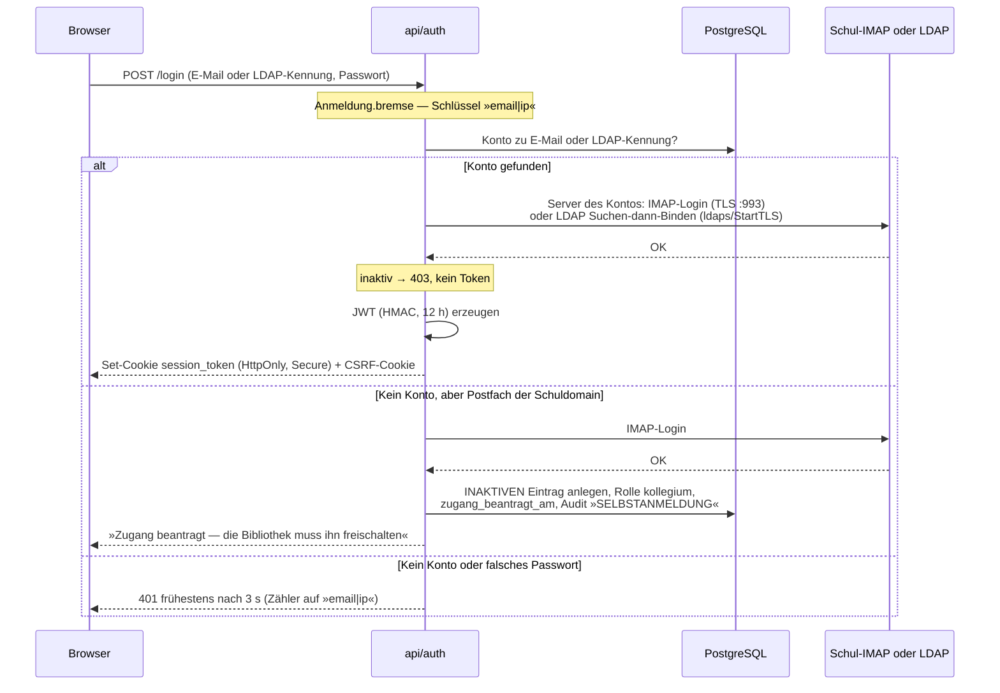
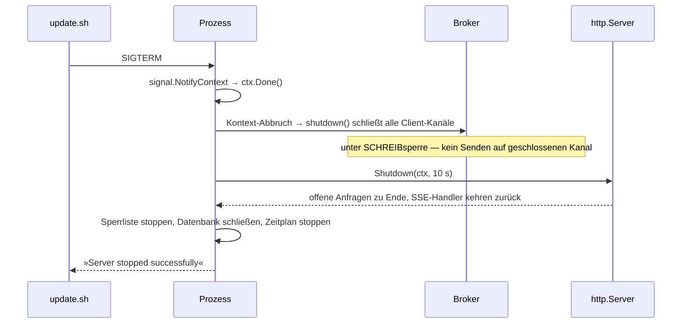

# arc42-Architekturdokumentation — Bibliothek (Schulbibliotheks-Software)

Stand: 24.11.2026 · Gliederung nach [arc42](https://arc42.org) (Template 8.2, deutsch) · jedes
Kapitel nennt seinen eigenen Stand

---

## Was das hier ist

Die Architektur des gebauten Stands, nach arc42 in einer Datei: wie die Teile zusammenhängen
und warum sie so gebaut sind. Was eine Datei tut, sagt ihr Kommentar im Code. Jede Aussage ist
am Code, an `schema.sql`, den Migrationen, dem `Dockerfile`, der CI oder einem Gate
nachgelesen; die Fundstelle steht dabei.

| Frage                                     | Antwort                                                                                  |
| ----------------------------------------- | ---------------------------------------------------------------------------------------- |
| Wie ist das System gebaut, und warum so?  | hier                                                                                     |
| Wo steht der Code zu einem Menüpunkt?     | [WEGWEISER.md](WEGWEISER.md)                                                             |
| Wie heißt etwas im Code?                  | [STIL.md](STIL.md)                                                                       |
| Welche fachliche Regel gilt?              | [FACHKONZEPT.md](FACHKONZEPT.md)                                                         |
| Wie bediene ich das System?               | [HANDBUCH.md](HANDBUCH.md)                                                               |
| Wie betreibe und sichere ich es?          | [DEPLOYMENT.md](DEPLOYMENT.md), [resilience_and_recovery.md](resilience_and_recovery.md) |
| Welche Schutzmaßnahme greift wo?          | [SECURITY.md](SECURITY.md), [PII_MATRIX.de.md](PII_MATRIX.de.md)                         |
| Was muss immer wahr sein?                 | [invarianten.md](invarianten.md)                                                         |
| Welche Fehlerarten haben welchen Detektor? | [sweeps.md](sweeps.md)                                                                   |
| Was ist offen?                            | [OFFEN.md](OFFEN.md), die einzige Liste                                                  |

Neu im Projekt: Kapitel 1, 4, 5 (Level 1 und 2) und 12. Vor einer Änderung: Kapitel 5, 8 und 9.

Pflege: Jedes Kapitel trägt eine `Stand:`-Zeile, und kein Datum im Text ist jünger als der Kopf
(`docs/stand_angaben_test.go`). Fundstellen stehen mit Namen (Datei, Paket, Constraint), nicht
mit Zeilennummer; `docs/dateiverweise_test.go` hält jeden Pfad gegen das Repository.

---

## 1. Einführung und Ziele

Stand: 01.11.2026

---

### 1.1 Aufgabenstellung

**Bibliothek** verwaltet die Schulbibliothek einer Gesamtschule und löst die Windows-Anwendung
**Littera** ab: Ausleihe und Rückgabe an der Scanner-Theke, Katalog, Lernmittel (LMF),
Mahnwesen, Vormerkungen, Inventur, Bestellwesen, Geräte, Leserdatei und die Löschroutinen der
DSGVO. Es ist für einen Betrieb gebaut, kein Produkt; wirkt eine Entscheidung seltsam, steht
der Grund meist als Randbedingung in Kapitel 2 oder in [Kapitel 9](#9-architekturentscheidungen).

#### Die tragenden fachlichen Anforderungen

| #   | Anforderung                                                                                          | Fundstelle                                                                     |
| --- | ---------------------------------------------------------------------------------------------------- | ------------------------------------------------------------------------------ |
| F1  | Ein Eingabefeld für alle Scans (Omnibox); ohne Vorsilbe der Reihe nach Buch, Ausweis, Suche          | `internal/service/omnibox.go`, FACHKONZEPT §1                                  |
| F2  | Fristen je Medienart: Lernmittel auf Stichtag oder LMF-Termin, Freihand rollierend, Kollegium als Dauerleihe | `internal/service/frist.go`, `internal/pkg/lmf`, `internal/pkg/lmfplan`  |
| F3  | Bis zu acht Stationen gleichzeitig, ohne Doppelbuchung und ohne Phantom-Erfolg                       | `migrations/033_unique_active_loan.sql`, `internal/sse/`                       |
| F4  | Mahnstufe steigt nur beim PDF-Druck; Listen gehen an die Klassenleitung                              | `internal/api/mahnwesen/mahnbriefe.go`                                         |
| F5  | Schülerdaten unter DSGVO: Fristen, Karenz, Anonymisierung, verschlüsselte Fotos, Auskunft, Protokoll | `internal/jobs/cron_dsgvo*.go`, `internal/crypto`, [SECURITY.md](SECURITY.md) |
| F6  | Öffentliche Seiten (`/katalog`, `/monitor`) mit Titeldaten, nie Personendaten                        | `internal/api/portal/opac.go`, `internal/api/portal/monitor.go`                |
| F7  | Kollegiums-Portal mit Selbstanmeldung, Klassensatz-Reservierung und Meldungen                        | `internal/auth/selbstanmeldung.go`, `frontend/src/lib/components/portal/KollegiumPortal.svelte` |
| F8  | Übernahme des Littera-Altbestands, verlustfrei und nachweisbar                                       | `internal/littera`, `internal/uebernahme`, `cmd/littera-altbestand`            |
| F9  | Bestellwesen bis zum Wareneingang, mit Bestätigungslink für Händler                                  | `internal/api/bestellung/bestellbestaetigung*.go`                              |
| F10 | Eine Funktion, die still nichts tut, meldet sich                                                     | `internal/bereitschaft/bereitschaft.go`, FACHKONZEPT §15                       |

---

### 1.2 Qualitätsziele

Bei einem Konflikt gewinnt das höhere Ziel: Eine Buchung scheitert lieber mit 409, als still
durchzugehen (Q1 vor Q5), und eine Löschroutine läuft, auch wenn eine Statistik dadurch Zahlen
verliert (Q2 vor Q4).

| Prio | Ziel                               | Gemeint                                                                       | Nachweis                                                                                   |
| ---- | ---------------------------------- | ----------------------------------------------------------------------------- | ------------------------------------------------------------------------------------------ |
| Q1   | Korrektheit unter Nebenläufigkeit  | Kein Exemplar mit zwei aktiven Ausleihen, kein Doppelscan, kein Fehler als Erfolg | Partielle Unique-Indizes, Idempotenz-Schlüssel, `*_pg_test.go`, `phantom_erfolg_test.go` |
| Q2   | Datenschutz                        | Fristgerecht getilgt, Fotos verschlüsselt, jede Route nach Personendaten eingestuft | `internal/api/pii_matrix_test.go` gegen [PII_MATRIX.de.md](PII_MATRIX.de.md)        |
| Q3   | Betriebstransparenz                | Eine eingerichtete, nicht laufende Funktion meldet sich                       | Selbstprüfung, täglicher Bereitschafts-Wächter, `/health`                                  |
| Q4   | Bedienbarkeit an der Theke         | Ein Scan, eine Reaktion, ohne Maus; ohne Netz geht es weiter                  | Offline-Warteschlange und Nachbuch-Tür, Tastaturbedienung, axe-Gate (WCAG 2.1 AA)          |
| Q5   | Änderbarkeit ohne Rückfall         | Jede Fehlerart bekommt einen Detektor, nicht nur einen Fix                    | [sweeps.md](sweeps.md), Drift-Gates, Deadcode-Gate                                          |

#### Was ausdrücklich **kein** Ziel ist

- Mandanten: eine Schule, eine Datenbank, ein Stack.
- Konfigurierbarkeit als Merkmal: Was das Kollegium darf, steht fest in
  `internal/db/rechte_vorgabe.go`.
- Skalierung über einen Host hinaus: ausgelegt auf etwa 1.900 Leser und acht Arbeitsplätze;
  der Prozess hält Zustand im Speicher ([Kapitel 11](#11-risiken-und-technische-schulden)).
- Mehrsprachigkeit: Oberfläche, Fachsprache und Code sind deutsch.

---

### 1.3 Stakeholder

| Rolle                              | Erwartung                                                         | Folge in der Architektur                                                                   |
| ---------------------------------- | ----------------------------------------------------------------- | ------------------------------------------------------------------------------------------ |
| Bibliotheksleitung                 | Überblick, Mahnwesen, Bestellung, Statistik; keine Systempflege   | Rolle `leitung` = Admin ohne `manage_users`/`manage_settings`, abgeleitet (Migration 122)  |
| Mitarbeiter                        | Tagesgeschäft an der Theke ohne Systemwissen                      | Omnibox; Fehler sagen auf Deutsch die nächste Handlung                                     |
| Helfer (Eltern, Hilfskräfte)       | Ausleihe, Rückgabe, Auskunft zum Bestand                          | Zwei Rechte (`perform_actions`, `view_books`); die Akte hängt an `view_students`           |
| Kollegium (~160 Lehrkräfte)        | Selbst anmelden, Klassensätze reservieren, LMF-Termine, Meldungen | Selbstanmeldung mit Freischaltung durch die Bibliothek; Portal am Recht `create_reservations` |
| Schüler und Eltern                 | Sehen, ob ein Buch da ist, ohne Konto                             | Öffentlicher Katalog und Monitor nur mit Titeldaten                                        |
| Sekretariat                        | Schülerdaten ohne Doppelerfassung; Versetzung und Abgang          | LUSD-Import mit Zuordnung, Umbenennung und Karenz ([LUSD.md](LUSD.md))                     |
| Datenschutzbeauftragte(r)          | Fristen, Rechtsgrundlagen, Verzeichnis, Auskunft                  | PII-Matrix mit Gate, Löschroutinen, Entwürfe unter `docs/datenschutz/`                     |
| Schulträger                        | Zugangs- und Abgangsbuch, Bestandsnachweis, getrennte Töpfe       | Bestandsbücher mit Druckblatt, Mittelherkunft an der Bestellung ([mittel_konzept.md](mittel_konzept.md)) |
| Land (Lernmittelfreiheit)          | Fristen, Ersatzwert-Staffel, Bescheid statt Bargeld               | `internal/pkg/ersatzwert`, `internal/api/schaden/bescheid_*.go`, `docs/ersatzwert_staffel_test.go` |
| Betreiber und Entwickler (eine Person) | Kein Deploy zerstört still etwas; Fehler melden sich          | Gates, Drift-Tests, Selbstprüfung, `OFFEN.md` als einzige Liste                            |

---

### 1.4 Umfang in Zahlen (gemessen 01.11.2026)

| Gegenstand                         | Umfang                                                      |
| ---------------------------------- | ----------------------------------------------------------- |
| Go-Produktivcode                   | 80.600 Zeilen                                               |
| Go-Tests                           | 147.138 Zeilen in 1.027 Testdateien                         |
| Svelte/JavaScript (`frontend/src`) | 101.414 Zeilen in 898 Dateien, davon 318 `.svelte`          |
| e2e (Playwright, `frontend/e2e`)   | 198 Dateien, davon 189 Specs                                |
| Registrierte HTTP-Routen           | 225                                                         |
| Datenbank-Migrationen              | 173 Dateien, die höchste Nummer ist 170                     |
| Tabellen / Sichten in `schema.sql` | 43 Tabellen, 2 Sichten (`schueler`, `view_buecher_bestand`) |

Die Befehle zum Nachmessen stehen im [Anhang von Kapitel 5](#anhang-die-zahlen-selbst-nachmessen).

---

## 2. Randbedingungen

Stand: 21.10.2026

Was nicht zur Diskussion stand. Hier steht der Grund für die Omnibox, für IMAP und LDAP als
Anmeldequelle und für die Nachsicht mit alten Barcodes.

---

### 2.1 Technische Randbedingungen

| #   | Randbedingung                                  | Folge                                                                                                  |
| --- | ---------------------------------------------- | ------------------------------------------------------------------------------------------------------ |
| T1  | Go 1.27.4, gleich in `go.mod` und `Dockerfile` | Methoden-Routing im `net/http`-Mux, `os.OpenRoot` gegen Path-Traversal, `slog`                         |
| T2  | Kein Web-Framework, `net/http` mit `ServeMux`  | Routing, Kette und Rechte sind Eigenbau (`internal/api/router.go`, `internal/api/middleware.go`, `internal/api/tuer/`); die Reihenfolge hält `geschuetzte_routen_test.go` |
| T3  | PostgreSQL 18 über `pgx/v5`, kein ORM          | SQL steht sichtbar im Repository-Paket; Constraints sind Entwurfsmittel ([invarianten.md](invarianten.md)) |
| T4  | `CGO_ENABLED=1` für das Hauptprogramm          | `chai2010/webp` braucht CGO; die Kommandozeilen-Werkzeuge bauen ohne                                   |
| T5  | Svelte 5, Tailwind 4, Vite, kein TypeScript    | Typprüfung über JSDoc und `svelte-check --fail-on-warnings` (A22)                                      |
| T6  | Ein Host, ein Prozess                          | SSE-Abonnenten, Rechte-Cache und Rate-Limit liegen im Speicher, die Idempotenz-Schlüssel in der Datenbank; eine zweite Instanz wäre ein Umbau |
| T7  | Anmeldung über IMAP oder LDAP, je Konto        | Keine Passwortspalte; für die Dauer einer Anmeldung ein Prüfwert (A2, A30). Die E-Mail, bei LDAP auch die Kennung, ist die Identität: wer sie schreiben darf, kann ein Konto übernehmen |
| T8  | Barcodes des Altbestands bleiben               | Littera-Nummern ohne Vorsilbe: die Omnibox löst der Reihe nach auf, alte Prüfzeichen werden nachsichtig gelesen (A14) |
| T9  | Docker Compose hinter Caddy, TLS per ACME      | Die maßgebliche Caddy-Konfiguration liegt auf dem Server ([DEPLOYMENT.md](DEPLOYMENT.md), Abschnitt 3) |
| T10 | Betrieb nur über HTTPS                         | Sitzungs- und CSRF-Cookie tragen fest `Secure`; auch ein Server, den die Schule nur per IP erreicht, braucht ein Zertifikat. Lokal genügt `http://localhost` |
| T11 | Fachlich Europe/Berlin, technisch UTC          | Fristen pinnen `Europe/Berlin` (`schulzeit.TagesEnde`), der Cron läuft auf UTC (A16)                   |
| T12 | Lizenz EUPL-1.2                                | Text in `LICENSE` (englisch, damit GitHub ihn erkennt); die PDF-Schriften stehen unter SIL OFL 1.1 mit Lizenztext in `internal/pkg/pdfzeichen/schriften/` |

---

### 2.2 Organisatorische und fachliche Randbedingungen

| #   | Randbedingung                                  | Folge                                                                                                  |
| --- | ---------------------------------------------- | ------------------------------------------------------------------------------------------------------ |
| O1  | Ein Entwickler und Betreiber, dieselbe Person  | Was nur durch Disziplin hält, hält nicht: Gates statt Checklisten, `OFFEN.md` als einzige Liste        |
| O2  | Der Betrieb läuft, während gebaut wird         | Migrationen laufen idempotent beim Start; ein Deploy beendet SSE sauber (A6)                           |
| O3  | Lernmittelfreiheit ist Landesrecht             | Schuljahresende, Ersatzwert-Staffel und Bescheid sind Vorgaben; die Staffel ist ein Vorschlag mit Herleitung |
| O4  | ~160 Lehrkräfte legt niemand von Hand an       | Selbstanmeldung über die Schuldomain, Freischaltung bei der Schule                                    |
| O5  | Anforderungsprotokoll der Schule               | Alte Aufdrucke bleiben lesbar (A14); ein Lernmittel kann mehrere Jahre beim Kind bleiben (`mehrjahresband`); Abweichungen im Mahnwesen in [mittel_konzept.md](mittel_konzept.md), Abschnitt 3 |
| O6  | Kein Passwort-Selbstservice                    | Passwörter und Konten liegen beim Schul-IT-Betrieb                                                     |
| O7  | Littera-Altbestand verlustfrei übernehmen      | Eigenes Kommando, Savepoint je Datensatz, Abgleich gegen den Zeilenzuwachs                             |
| O8  | Datenschutz ist nachweispflichtig              | Die Einstufung je Route ist ein Dokument mit Gate (`internal/api/pii_matrix_test.go`)                  |

---

### 2.3 Konventionen

| Konvention                         | Regel                                                                                       | Durchsetzung                                                                 |
| ---------------------------------- | ------------------------------------------------------------------------------------------- | ---------------------------------------------------------------------------- |
| Namen, Sichtbarkeit, Kommentare    | [STIL.md](STIL.md) nach Googles Regelwerk für Go; Fachwörter deutsch, je Sache ein Wort     | `stil_ratsche_test.go`, `golangci-lint` (revive)                             |
| Migrationen                        | `NNN_beschreibung.sql`, idempotent; die Seed-Liste in `schema.sql` entspricht den Dateien   | `internal/db/migrationen_drift_test.go`, `migrationen_nummern_test.go`, `migrationen_schema_paritaet_pg_test.go` |
| Zeilen lesen                       | Jede `rows.Next()`-Schleife endet mit `rows.Err()`, sonst gilt ein Abbruch als Erfolg       | `golangci-lint`                                                              |
| Paketkommentar, Empfängername      | Ein Kommentar über `package`; ein Empfänger heißt in allen Methoden gleich, die Türen `t`   | `golangci-lint` (revive), `empfaenger_ratsche_test.go`                       |
| Dateigröße der Oberfläche          | Höchstens 200 Zeilen je Komponente und JS-Modul; der Altbestand darüber wächst nicht        | `frontend/src/lib/frontend-hygiene-dateigroesse.test.js`                     |
| Menü und Router                    | Welche Seite eine Rolle erreicht, entscheidet nur `darfSehen()` in `frontend/src/lib/menue.js` | `frontend/e2e/menue-fuehrt-irgendwohin.spec.js`                           |
| Rechte je Route                    | Jede nicht öffentliche Route trägt `verlangeRecht(...)` oder `VerlangeAnmeldung()`          | `internal/api/geschuetzte_routen_test.go`                                    |
| Fundstellen mit Namen              | Constraint-, Index-, Datei- und Paketnamen, keine Zeilen- oder Migrationsnummer als Beleg   | `docs/invarianten_fundstellen_test.go`                                       |
| Keine Changelog-Datei              | Die Commit-Historie ist Dokumentation; Erledigtes wird aus `OFFEN.md` gelöscht (A24)        | —                                                                            |
| Jedes Gate einmal rot gesehen      | Ein Detektor wird gegen den echten Fehlerfall gehalten, bevor er grün bleiben darf          | [sweeps.md](sweeps.md), Regel 2                                              |

---

### 2.4 Werkzeuge, die zur Architektur gehören

| Werkzeug                                                    | Rolle                                                                                   |
| ----------------------------------------------------------- | --------------------------------------------------------------------------------------- |
| `golangci-lint` (`.golangci.yml`)                           | Läuft in der CI zuerst und im Hook vor dem Push                                         |
| `scripts/deadcode_gate.sh` mit Baseline                     | Findet Code, den niemand aufruft                                                        |
| `govulncheck`, `scripts/govulncheck-gate.sh`, `security/vuln-ausnahmen.json` | Schwachstellen-Gate mit benannten, begründeten Ausnahmen                  |
| `gosec`, CodeQL, Trivy, `npm audit`                         | Unabhängige Blickwinkel; begründete Nicht-Befunde in `.jules/sentinel.md`               |
| Playwright gegen den gebauten Container                     | e2e misst, was ausgeliefert wird                                                        |
| `internal/pgtest`, `*_pg_test.go`                           | Constraints lassen sich nicht mocken; ohne `TEST_DATABASE_URL` meldet der Hook die übersprungenen Tests |
| `internal/smtptest`, `internal/pdftest`                     | Mail und PDF werden am Ergebnis geprüft                                                 |
| `scripts/api_inventar.sh`                                   | Erzeugt [api_inventar.md](api_inventar.md): Routen gegen Aufrufer, in beide Richtungen  |

---

## 3. Kontextabgrenzung

Stand: 26.10.2026

---

### 3.1 Fachlicher Kontext

```mermaid
graph TB
    subgraph Schule
        MA[Bibliotheks-<br/>Mitarbeiter]
        LTG[Bibliotheks-<br/>leitung]
        HELF[Helfer]
        KOLL[Kollegium<br/>~160 Lehrkräfte]
        SEK[Sekretariat]
    end
    subgraph Öffentlich
        SCH[Schüler & Eltern]
        MON[Flur-Monitor]
    end
    subgraph Extern
        HAENDL[Buchhändler]
        MZ[Schulträger]
        DSB[Datenschutz-<br/>beauftragte]
    end

    SYS[("Bibliothek<br/>(dieses System)")]

    MA -->|Scan, Ausleihe, Rückgabe, Mahnwesen, Inventur| SYS
    LTG -->|Bestellung, Statistik, Bescheide| SYS
    HELF -->|Ausleihe/Rückgabe, Katalog lesen| SYS
    KOLL -->|Klassensatz-Reservierung, LMF-Plan, Anliegen| SYS
    SEK -->|LUSD-Bericht (Schülerdaten)| SYS
    SCH -->|Katalog /katalog, ohne Anmeldung| SYS
    SYS -->|Slideshow /monitor| MON
    SYS -->|Bestellmail + Barcodebogen| HAENDL
    HAENDL -->|Bestätigungslink /bestellung/token| SYS
    SYS -->|Zugangs-/Abgangsbuch, Bestandsnachweis| MZ
    SYS -->|Auskunft, VVT, Löschnachweis| DSB
    SYS -->|Mahnliste an Klassenleitung, Abgängerbrief, Bescheid| KOLL
```

Besonderheiten der Nachbarn:

- **Personal** bedient mit Tastatur und Scanner; die Maus ist entbehrlich.
- **Kollegium**: Ein selbst angelegter Zugang entsteht inaktiv und wird von der Bibliothek
  freigeschaltet.
- **Sekretariat** liefert den LUSD-Bericht als `.xlsx` oder Semikolon-CSV; die Kopfzeile wird
  gesucht, weil Berichte Titelzeilen darüber tragen.
- **Schüler und Eltern** sehen nie Ausleiherdaten (PII-Stufe 0, `internal/api/pii_matrix_test.go`).
- **Buchhändler** bestätigen über einen Token im Pfad; gespeichert wird nur sein Hash, im Log
  steht er maskiert (`maskiereToken`).
- **Schulträger**: Bücher ohne hinterlegte Bestellung stehen „ohne Zuordnung“ im Zugangsbuch.
- **Datenschutz**: Die Tilgung im Protokoll ist die bewusste Ausnahme vom Nur-Anhängen.

---

### 3.2 Technischer Kontext

```
                   ┌──────────────────────────────────────────┐
  Browser          │  Caddy (Host, ACME/Let's Encrypt)        │
  (SPA, PWA)  ────► │  <Adresse der Schule> :443              │
                   │  response_header_timeout 300s            │
                   │  read/write_timeout 600s                 │
                   └───────────────┬──────────────────────────┘
                                   │ HTTP, Docker-Netz
                                   ▼
        ┌───────────────────────────────────────────────────────────┐
        │  backend (Go, alpine, non-root »appuser«)                 │
        │  :8083 (Produktion) / :8084 (lokaler Stack)               │
        │  /api  JSON · /events SSE · /uploads Cover · /login       │
        │  /health                                                  │
        └───┬───────────┬────────────┬───────────┬──────────────────┘
            │ pgx/v5    │ IMAP 993   │ SMTP      │ HTTPS (Allowlist)
            ▼           ▼            ▼           ▼
     ┌────────────┐  ┌────────┐  ┌────────┐  ┌──────────────────────┐
     │ PostgreSQL │  │ Schul- │  │ Schul- │  │ DNB · OpenLibrary ·  │
     │ 18-alpine  │  │ Mail-  │  │ SMTP   │  │ Google Books         │
     │ :5432      │  │ server │  │ STARTTLS│ │ (Cover + Metadaten)  │
     └────────────┘  └────────┘  └────────┘  └──────────────────────┘
            │                                        ▲
            │ pg_dump → gzip → AES-256-GCM           │ nur öffentliche IPs
            ▼                                        │ (internal/pkg/safehttp)
     ┌────────────────────┐   optional   ┌────────────────────────┐
     │ Volume /app/backups│ ───────────► │ S3-kompatibler Speicher│
     └────────────────────┘              └────────────────────────┘
```

#### Schnittstellen technisch

| Schnittstelle           | Protokoll                                  | Absicherung                                                                                       |
| ----------------------- | ------------------------------------------ | ------------------------------------------------------------------------------------------------- |
| Browser → Backend       | HTTPS, JSON über `/api`, `POST /login`     | Security-Header und CSP, CORS auf die Schuldomain, Body-Limits, Timeouts, Rate-Limit, CSRF, JWT im HttpOnly-Cookie |
| Backend → Browser       | Server-Sent Events, `GET /events`          | Nur angemeldet, geprüft beim Aufbau und vor jedem Heartbeat (15 s); kein `WriteTimeout`, der Strom endet nie |
| Statische Auslieferung  | SPA aus `frontend/dist`, Service-Worker    | An `dist/` gebunden (`os.OpenRoot`); ein unbekannter `/api/`-Pfad antwortet 404                   |
| Cover                   | `GET /uploads/...`                         | Bewusst ohne Anmeldung (Katalog, Monitor); in der Allowlist von `geschuetzte_routen_test.go`      |
| Backend → PostgreSQL    | `pgx/v5`-Pool                              | Nur internes Netz; `pg_dump` bekommt das Passwort über eine temporäre `.pgpass`                   |
| Backend → IMAP / LDAP   | IMAP über TLS (993), LDAP mit einfachem Bind | Mindestens TLS 1.2; `IMAP_HOST=mock` nimmt in Entwicklung und Test jedes Passwort, laut protokolliert |
| Backend → SMTP          | SMTP mit erzwungenem STARTTLS              | Ohne STARTTLS bricht der Versand ab (`errSMTPKlartext`), außer `SMTP_ALLOW_PLAINTEXT=true`; Kopfzeilen gegen CR/LF geprüft |
| Backend → Katalogdienste | HTTPS an eine Host-Allowlist              | `internal/pkg/coverquelle` baut die URL neu auf; `internal/pkg/safehttp` lehnt nicht öffentliche IPs ab |
| Backend → S3 (optional) | S3-API über `minio-go`                     | Nur mit vollständigen `S3_*`-Werten; sonst sagt der Job, dass er überspringt                      |
| Littera-Altbestand      | CSV aus `mdb-export`, einmalig             | Kommando `cmd/littera-altbestand`, am Server über `scripts/littera_uebernahme.sh`                 |
| Bestellbestätigung      | `GET/POST /bestellung/<token>` ohne Anmeldung | Token einmalig, nur der Hash gespeichert; atomar über `WHERE bestaetigt_am IS NULL`            |
| Scanner, Kamera         | USB-HID als Tastatur, `html5-qrcode`       | Kein Gerätetreiber                                                                                |
| Drucker                 | PDF im Browser                             | Feste Bogenmaße; `npm run test:druck` prüft die Drucksektionen                                    |

Nicht angebunden: kein Single-Sign-On, keine Schnittstelle zur Schulverwaltung außer dem
LUSD-Bericht als Datei, keine Zahlungsschnittstelle (Forderungen über Bescheid und Rechnung),
keine Nachricht an Schüler oder Eltern (Mahnlisten gehen an die Klassenleitung), kein externer
Monitoring-Agent (Handgriff in [OFFEN.md](OFFEN.md) 7.5).

---

## 4. Lösungsstrategie

Stand: 08.10.2026

Die tragenden Entscheidungen in Kurzform; die ausführliche Fassung steht in
[Kapitel 9](#9-architekturentscheidungen).

---

### 4.1 Die acht Leitentscheidungen

| #   | Entscheidung                                         | Trägt      | Grund                                                                                                       |
| --- | ---------------------------------------------------- | ---------- | ----------------------------------------------------------------------------------------------------------- |
| L1  | Geschichteter Monolith: Handler → Service → Repository | Q5, Betrieb | Die Ausleihe ist eine Transaktion über Schüler, Ausleihe und Exemplar; Dienste würden sie zerreißen       |
| L2  | Die Datenbank ist die letzte Instanz                 | Q1         | Erst der partielle Unique-Index macht die zweite aktive Ausleihe unmöglich, auch über einen zweiten Schreibpfad |
| L3  | Rechte je Route, nicht global                        | Q2         | `verlangeRecht` sitzt hinter dem Routing und prüft Recht, Kontostatus und UUID; ein Gate zählt ungeschützte Routen |
| L4  | Echtzeit über SSE, ohne Event-Loop                   | Q1, Q4     | Alle Stationen sehen denselben Stand nach dem Commit; der Broker lässt sich sauber herunterfahren (A6)     |
| L5  | Idempotenz als Vertrag der Schreibtüren              | Q1, Q4     | Ein doppelt ankommender Scan bekommt die gespeicherte Antwort; 5xx wird nie gespeichert                    |
| L6  | Die Theke arbeitet ohne Netz weiter                  | Q4         | Scans warten in IndexedDB und gehen über die Nachbuch-Tür, die jede Abweichung meldet                      |
| L7  | Jede Fehlerart bekommt einen Detektor                | Q5         | Register und Landkarte der Ratschen in [sweeps.md](sweeps.md)                                              |
| L8  | Das System meldet sich selbst                        | Q3         | Gegen die fertige Funktion, die still nichts tut: Selbstprüfung, Bereitschafts-Wächter, Restore-Probe      |

---

### 4.2 Wie die Qualitätsziele technisch erreicht werden

| Ziel | Mittel                                                                                                      | Näheres                              |
| ---- | ----------------------------------------------------------------------------------------------------------- | ------------------------------------ |
| Q1   | Constraints und Fremdschlüssel, Zeilensperren in fester Reihenfolge, Idempotenz; eine Unique-Verletzung wird 409 | 6.4, 8.4, 8.5, 8.6, A5, A7, A8   |
| Q2   | Tabelle `leser` mit Sicht `schueler`, Verschlüsselung, Löschfristen im Nachtlauf, Einstufung je Route, keine IP und kein Token im Log | 8.3, A10, A17, A20 |
| Q3   | `/health`, Selbstprüfung, Bereitschafts-Wächter, Restore-Probe, Start-Verweigerung bei Beispiel-Geheimnissen | 8.11, 8.14, A15, A17                |
| Q4   | Ein Feld für alle Scans, Vorsilben, Nachsicht für alte Aufdrucke, Sperre statt Abmeldung, Barrierefreiheit | 5.4.2, 6.5, 8.8, 8.13, A13, A14, A21 |
| Q5   | Testebenen, Drift-Gates, Deadcode-Gate, je Fehlerart eine Ratsche, je Frage eine Wahrheitsquelle            | 2.3, 8.14, [sweeps.md](sweeps.md), A12 |

---

### 4.3 Bewusst nicht gewählte Alternativen

| Alternative                       | Warum nicht                                                                                  |
| --------------------------------- | -------------------------------------------------------------------------------------------- |
| Microservices                     | Die Ausleihe hängt an einer Transaktion über drei Tabellen                                   |
| ORM (GORM, ent)                   | Gerade Sperren, partielle Indizes und Sichten mit `CHECK OPTION` verdeckt ein ORM            |
| Web-Framework (Gin, Chi, Echo)    | Methoden-Routing und sechs Middlewares kann `net/http` selbst                                |
| WebSockets statt SSE              | Der Fluss ist einseitig; SSE geht ohne Upgrade durch den Proxy und verbindet sich selbst neu |
| Eigene Passwortverwaltung         | Ein zweiter Passwortspeicher an der Schule ist Risiko ohne Nutzen (A2)                       |
| Redis oder Memcached              | Ein Prozess auf einem Host braucht keinen; der Preis steht in Kapitel 11                     |
| TypeScript                        | JSDoc mit `svelte-check` prüft ohne Umbau von rund 300 Komponenten                           |
| Kubernetes                        | `docker compose` und `update.sh` versteht eine Person auch im Ernstfall                      |
| Soft-Delete überall               | Wo die DSGVO Löschung verlangt, ist Soft-Delete keine; die Abgänger-Tilgung löscht hart      |

---

## 5. Bausteinsicht

Stand: 16.11.2026 · Befehle zum Messen im [Anhang](#anhang-die-zahlen-selbst-nachmessen)

---

### 5.1 Level 1 — Whitebox Gesamtsystem

```
┌──────────────────────────────────────────────────────────────────────────────┐
│  Bibliothek (ein Deployable)                                                 │
│                                                                              │
│  ┌────────────────────────────┐        ┌───────────────────────────────────┐ │
│  │  Frontend (SPA + PWA)      │        │  Backend (Go)                     │ │
│  │  Svelte 5 Runes, Tailwind  │◄──────►│  net/http, pgx/v5                 │ │
│  │  Ansichten, Stores, Druck  │  JSON  │  Türen, Fachlogik, Abfragen       │ │
│  │  IndexedDB-Warteschlange   │  SSE   │  Nachtläufe, Migrationen          │ │
│  └────────────────────────────┘        └──────────────┬────────────────────┘ │
│           ausgeliefert AUS dem Backend                │                       │
│           (frontend/dist, os.OpenRoot)                │ pgx-Pool              │
│                                                        ▼                      │
│                                          ┌───────────────────────────────┐   │
│                                          │  PostgreSQL 18                │   │
│                                          │  Tabellen, Sichten, Indizes   │   │
│                                          └───────────────────────────────┘   │
│                                                                              │
│  ┌──────────────────────────────────────────────────────────────────────────┐│
│  │  Einmal-/Betriebswerkzeuge (cmd/, 6 Kommandos) — NICHT über HTTP        ││
│  └──────────────────────────────────────────────────────────────────────────┘│
└──────────────────────────────────────────────────────────────────────────────┘
```

| Baustein      | Verantwortung                                                                      | Nicht verantwortlich für                                  |
| ------------- | ---------------------------------------------------------------------------------- | --------------------------------------------------------- |
| Frontend      | Bedienung, Ansichten, Offline-Warteschlange, Sichtbarkeit im Menü, Druck           | Rechte: die Oberfläche blendet nur aus, entscheiden tut das Backend |
| Backend       | Routing, Anmeldung und Rechte, Fachlogik, Persistenz, PDF, Mail, Nachtläufe, SSE, Auslieferung der SPA | Darstellung; Zustand über Prozessgrenzen      |
| PostgreSQL    | Daten und Invarianten (Constraints, partielle Unique-Indizes, Sichten)             | Regeln mit Ermessen (Ersatzwert, Übergehen eines Hinweises) |
| `cmd/`        | Littera-Übernahme, Backup verschlüsseln und zurückspielen, Schlüsselwechsel (5.2.3) | Was im Betrieb über die Oberfläche gehen muss            |

---

### 5.2 Level 2 — Backend, Whitebox

#### 5.2.1 Die Anfragekette

```
HTTP-Anfrage
   │
   ├─ Log ────────────────────── jede Anfrage: Methode und Pfad, Token maskiert, ohne IP
   ├─ 0 Adresse ──────────────── Client-IP hinter dem Proxy (internal/pkg/clientip)
   ├─ 1 PanicRecovery ────────── 500 statt Prozess-Ende
   ├─ 2 SecurityHeaders ──────── CSP, HSTS, X-Content-Type-Options … (internal/middleware)
   ├─ 3 CORS ─────────────────── nur ALLOWED_ORIGIN
   ├─ 4 Logging ──────────────── nur 5xx: Status, Methode, Pfad, Route, Ursache
   ├─ 5 HTTPSRedirect ────────── außer lokal und /health
   ├─ 6 Lesefrist-Erweiterung ── längeres ReadTimeout für Importe, vor dem Lesen des Rumpfs
   ├─ 7 BodyLimit (100 MB) ───── MaxBytesReader; JSON an der Tür 5 MB
   ├─ 8 Timeout ──────────────── Frist je Route (bearbeitungsfristVorgabe)
   ├─ 9 RateLimit ────────────── je Client-IP
   ├─10 CSRF ─────────────────── Double-Submit-Cookie, Refresh ausgenommen
   ├─11 Null-Zeichen ─────────── U+0000 in Pfad, Abfrage oder JSON: 400
   ├─12 Kompression ──────────── gzip für JSON, CSV und Textdateien; SSE läuft vorbei
   ├─13 Route ────────────────── das Muster der Route für die Zeile zu einem 5xx (merkeRoute)
   │
   ▼  http.ServeMux (Methoden-Routing)
   │
   ├─ verlangeRecht("…")
   │     └─ UUID im Pfad prüfen → Cookie → JWT → Kontostatus → Recht (Cache 60 s, Epoche)
   ├─ VerlangeAnmeldung() — nur Routen ohne UUID im Pfad (internal/api/uuid_pfadparameter_test.go)
   ▼
  Tür (internal/api/<Thema>/, internal/auth/)
   ▼
  Fachlogik (internal/service/) — Regeln, Transaktionsklammer
   ▼
  Abfragen (internal/repository/) — SQL, pgx
   ▼
  PostgreSQL ── nach dem Commit: SSE an alle Stationen
```

Die Rechteprüfung sitzt hinter dem Routing, weil erst dort `r.PathValue` gefüllt ist (A4); eine
Allowlist neben der Rechtetabelle gibt es nicht (A3).

#### 5.2.2 Pakete des Backends

Was ein Paket tut, sagt sein Kommentar (`go doc ./<paket>`). Pakete stehen unter `internal/`,
Programme unter `cmd/` ([go.dev/doc/modules/layout](https://go.dev/doc/modules/layout), „Server
project“); oben daneben nur `pruefung/`, `docs/` und `scripts/`.

| Paket                    | Verantwortung                                                                                     |
| ------------------------ | ------------------------------------------------------------------------------------------------- |
| `cmd/server/main.go`     | Konfiguration lesen und hart prüfen, Pool, Migrationen, Rechte ab Werk, erster Admin, Broker, Zeitplan, Server, geordnetes Ende |
| `internal/api/`          | Router und Routenlisten (`routen_*.go`), Middleware, CSRF, Bremsen, Abmeldung                     |
| `internal/api/tuer/`     | Was jede Tür braucht: Eingabe und Antwort, Sitzung, Rechteprüfung (5.4.3), Protokoll, Uhr; `Basis` trägt Datenbank, Anmeldung, Live-Leitung und Uhr |
| `internal/api/<Thema>/`  | Türen je Menüpunkt (A26): `lernmittel`, `inventurlauf`, `benutzer`, `portal`, `system`, `mahnwesen`, `schaden`, `katalog`, `druck`, `bestellung`, `leser`, `theke` |
| `internal/service/`      | Fachlogik mit Transaktionsklammer: Ausleihe (5.4.1), Omnibox (5.4.2), Nachbuchen, Geräte, Cover, Ersatzwert, Bestellungen, LMF-Plan, Importe |
| `internal/repository/`   | Datenbankschicht (A25): Abfragen, Schreibpfade, Sperren, Protokoll, Einstellungen, Nachtläufe      |
| `internal/auth/`         | Anmeldung über IMAP und LDAP, Token, Sperrliste, Sperre nach Inaktivität, Selbstanmeldung         |
| `internal/jobs/`         | Zeitplan (UTC) und Nachtläufe (5.4.5)                                                             |
| `internal/lusd/`         | Abgleich mit dem LUSD-Export ([LUSD.md](LUSD.md))                                                 |
| `internal/bereitschaft/` | Selbstprüfung: eine reine Funktion über eine Lage, je Bereich Befund, Folge und Abhilfe; die Lage sammelt `internal/api/system`       |
| `internal/auskunft/`, `internal/bestandsbuch/`, `internal/buchetikett/` | Auskunft nach Art. 15; Zeilen der Bestandsbücher; Eingabe der Buchetiketten (8.9) |
| `internal/littera/`, `internal/uebernahme/` | Übernahme des Littera-Altbestands (5.2.3)                                      |
| `internal/crypto/`, `internal/backupkrypto/`, `internal/ausweis/`, `internal/middleware/` | AES-256-GCM; Format der Backups; Gültigkeit eines Ausweises; Security-Header |
| `internal/pdf/`, `internal/mailservice/`, `internal/sse/`, `internal/apierrors/` | Dokumente (8.9); Mail (8.10); SSE (5.4.4); Fehlerantworten (8.6)    |
| `internal/db/`           | Pool, Migrationen, Rechte je Rolle ab Werk (`rechte_vorgabe.go`), erster Admin                    |
| `internal/pkg/`          | Regeln und Hilfen ohne Abhängigkeit nach oben (Tabelle unten)                                     |
| `internal/pgtest/`, `smtptest/`, `pdftest/`, `xlsxtest/`, `testdaten/`, `testweg/`, `tuertest/`, `routertest/` | Prüfhilfen, nur von Tests eingebunden |
| `migrations/`, `docs/` (Go) | Schritte des Schemas, laufen beim Start; Gates der Dokumente                                   |

##### Themen unter `internal/api/`

- Ein Thema trägt seine Türen als Methoden am Typ `Tueren`, der einen Zeiger auf die `tuer.Basis`
  des Servers einbettet; Typ und Paketkommentar stehen in der Datei, die wie das Paket heißt.
- Eine Tür gehört zu dem Thema, dessen Stelle der Oberfläche sie ruft; rufen mehrere, zu dem,
  dessen Daten sie liest.
- Adresse und Recht stehen in `internal/api/routen_*.go`; ein Thema erreicht man über einen
  Zugang des Servers (`s.lernmittel().LMFPlanSchreiben()`, `internal/api/zugaenge_basis_test.go`).
- Eine Tür ist eine Fabrik (`func (t *Tueren) X() http.HandlerFunc`); ein langer Rumpf steht als
  klein geschriebene Methode daneben, weil eine Closure für `komplexitaet_ratsche_test.go` als eigene
  Ebene zählt; eine exportierte Methode, die selbst Antwort und Anfrage nimmt, weist
  `internal/api/themen_ratsche_test.go` ab. Kein Thema bindet ein anderes oder `internal/api/` ein;
  Gemeinsames steht in `internal/api/tuer` oder darunter (derselbe Test).
- Tests eines Themas stehen in seinem Ordner und bauen die Türen selbst; ein Test über den Router
  steht als eigenes Testpaket daneben (`routertest.MitSitzung`).

##### Wo ein Test steht

- Bei dem Paket, dessen Regel er prüft: eine Abfrage in `internal/repository/`, auch über eine Tür
  erreicht; eine Migration in `internal/db/`. Braucht er eine Prüfhilfe, die sein Paket einbindet,
  als Testpaket daneben ([Googles Regelwerk](https://google.github.io/styleguide/go/decisions#test-package)).
- Daten an der Datenbank legt `internal/testdaten` an; eigenes SQL nur, wo kein Helfer dieselbe
  Zeile anlegt. `testdaten` bindet kein Paket des Programms ein.
- In `internal/api/` stehen Tests an Router, Middleware und CSRF, Prüfungen über alle Routen und
  Tests über zwei Themen; was den ganzen Baum liest und keinem Paket gehört, in `pruefung/`
  (Pfade ab der Wurzel über `wechsleInDieWurzel(t)`, Blindheit in der Landkarte von [sweeps.md](sweeps.md)).

##### Tür und Abfrage

- **Die Tür** prüft Eingabe und Recht, öffnet die Transaktion, ordnet die Schritte, entscheidet
  Status und Meldung, schreibt ins Protokoll. Was nur sie braucht, steht neben ihr; eine Regel,
  die ohne Anfrage gilt, bei ihrem Fach.
- **Die Fachlogik** (`internal/service`) entscheidet, was gilt, und formuliert kein SQL. In der
  Transaktion einer Tür bekommt sie diese und keinen Pool daneben; wer Zeilen sperrt, nimmt `pgx.Tx`.
- **Die Abfrage** steht in `internal/repository/` über `repository.Datenbank` und liefert ihren
  eigenen Zeilentyp. Gemeinsames steht einmal (Bedingungen, `repository.LadeEinstellungen`,
  `repository.SchreibeAdminProtokoll`); Lesefehler tragen `repository.ErrZeileUnlesbar`.
- **`internal/repository/` und `internal/pdf/` kennen einander nicht:** Die Tür füllt die Eingabe der
  Erzeuger; ein Blatt entsteht aus derselben Antwort wie die Ansicht (`internal/api/bestellung/bestellung_fuellen_test.go`).
- **Regeln für mehrere Schichten** stehen in `internal/pkg/` (`leserart`, `mitteltopf`, `lmfplan`).
- **Nachtläufe:** `internal/jobs/` bestimmt Zeitpunkt und Protokoll, die Anweisungen stehen in
  `internal/repository/nachtlauf.go` mit den Fristen aus `loeschfristen.go` (`nachtlauf_ratsche_test.go`).
- **`internal/auth/` formuliert kein SQL.**

`schichtung_ratsche_test.go` hält, dass nur die Datenbankschicht Anweisungen formuliert und
schickt; dazu zählen neben `internal/repository` auch `internal/db`, `internal/littera`, die
Prüfhilfen `pgtest`, `testdaten` und `testweg`, `scripts` und `cmd/`; `internal/api/schichtung_test.go` führt die Dateien ohne Tür als Bestand, der nur sinkt.
Die Datenbankschicht bleibt ein Paket (A25).

##### Die `internal/pkg/`-Pakete

| Paket                                   | Zweck                                                                                  |
| --------------------------------------- | -------------------------------------------------------------------------------------- |
| `clientip`                              | Client-IP; `X-Forwarded-For` nur von konfigurierten Proxies                            |
| `safehttp`                              | Clients für fremde Ziele, ohne nicht öffentliche IPs (SSRF)                            |
| `ratelimit`                             | Bremse je Adresse                                                                      |
| `coverquelle`, `coverdatei`, `coverablage` | Allowlist und Abruf der Cover; WebP für die PDFs; Ablageort ohne Bildbibliothek     |
| `betrag`                                | Geld in ganzen Cent, deutsch geschrieben (`geld_in_cent_ratsche_test.go`)              |
| `imageutil`                             | Bilder umwandeln und verkleinern                                                       |
| `csvutil`                               | Schutz vor Formel-Injection im Export (CWE-1236)                                       |
| `pdfzeichen`                            | Schriften aller PDFs (Arimo, Tinos, Cousine), Textform, Kürzen nach Breite (`pdfzeichen_ratsche_test.go`) |
| `xlsxgrenze`                            | Die eine Tür zu hochgeladenen XLSX, mit Grenzen                                        |
| `isbnutil`, `strichcode`, `code39`, `kennung` | ISBN; Code 128 und QR; altes Prüfzeichen (A14); UUID wie Postgres                |
| `schulzeit`, `lmf`, `lmfplan`           | „Jetzt“ der Schule und Stichtage; Wissen über Lernmittel; Feiertage, Ferien, Schultage |
| `bestelllink`, `leserart`, `mitteltopf`, `ersatzwert` | Bestätigungslink; Leserart; die zwei Töpfe; Ersatzwert-Vorschlag mit Herleitung |
| `httpresp`, `closeutil`, `logger`, `safego` | Antwort nach dem Kopf; Schließen mit Log; Zeilenumbrüche aus Log-Werten (CWE-117); Goroutinen überleben ein Panic |

#### 5.2.3 Neben der Anfragekette: die Einmal-Werkzeuge

Sechs Kommandos laufen für sich gegen die Datenbank oder eine Sicherung ([SCRIPTS.md](SCRIPTS.md)):

| Kommando / Paket                                    | Aufgabe                                                                     |
| --------------------------------------------------- | --------------------------------------------------------------------------- |
| `cmd/littera-altbestand`, `internal/littera`        | Littera-Export lesen, abbilden, schreiben: Bestand, Personen, Barcodes, Verleih, Abgang |
| `cmd/littera-import`                                | Ein Katalogisat aus Littera (MAB2 als XML)                                  |
| `internal/uebernahme`                               | Gemeinsames jeder Übernahme: Savepoint je Datensatz, SQLSTATE, Protokoll    |
| `cmd/encrypt-backup`, `cmd/restore-backup`, `cmd/rotate-encryption-key` | Sicherung verschlüsseln, zurückspielen, Schlüssel wechseln; im Image (7.2) |

#### 5.2.4 Fremdbibliotheken des Backends

Maßgeblich ist `go.mod`.

| Modul                                              | Rolle                                                                    |
| -------------------------------------------------- | ------------------------------------------------------------------------ |
| `jackc/pgx/v5`                                     | Postgres-Treiber und Pool (T3)                                           |
| `golang-jwt/jwt/v5`                                | Sitzungs-Token HS256, nur HMAC akzeptiert (`internal/auth/token.go`)     |
| `emersion/go-imap`                                 | Anmeldung am Schul-Mailserver (A2)                                       |
| `go-playground/validator/v10`                      | Prüfung der Request-Körper                                               |
| `chai2010/webp`                                    | WebP der Cover, der Grund für CGO (T4)                                   |
| `phpdave11/gofpdf`, `johnfercher/maroto/v2`        | Dokumente (8.9)                                                          |
| `boombuler/barcode`                                | Code 128 und QR (A14)                                                    |
| `xuri/excelize/v2`                                 | Excel lesen, nur über `internal/pkg/xlsxgrenze`                          |
| `robfig/cron/v3`, `minio/minio-go/v7`              | Zeitplan auf UTC (A16); optionaler S3-Upload (A17)                       |
| `google/uuid`, `klauspost/compress`                | Kennungen; gzip der Antworten                                            |
| `golang.org/x/crypto`, `x/image`, `x/net`, `x/text` | Argon2id und scrypt; Cover skalieren; Zeichensatz; Unicode-Normalform und Sortierung |
| `pgxmock/v5`, `go-cmp`, `gocognit`, `x/tools`      | Nur in Tests                                                             |

---

### 5.3 Level 2 — Frontend, Whitebox

```
frontend/src
├─ main.js               Einstiegspunkt, Service-Worker-Registrierung
├─ App.svelte            App-Shell: Layout, Menü, SSE-Abonnement, Sperrbildschirm
├─ lib/                  Ansichten, Komponenten, Stores, Metadaten
│   ├─ Router.svelte     Client-Routing; fragt erlaubteBildschirme() aus menue.js
│   ├─ menue.js          einzige Wahrheitsquelle: welche Rolle erreicht welche Seite
│   ├─ Omnibox.svelte    Das Eingabefeld der Theke
│   ├─ stores/*.svelte.js Geteilter Zustand (Runes-Singletons)
│   └─ …                 Fachansichten
├─ inventur/             Oberfläche des Medienkatalogs (eigene lib/ + routes/)
└─ styles/, assets/
```

| Baustein                    | Verantwortung                                                                  |
| --------------------------- | ------------------------------------------------------------------------------ |
| `App.svelte`                | Rahmen, Navigation, SSE samt Wiederverbinden, Sperre nach Inaktivität          |
| `Router.svelte`, `menue.js` | Pfad → Ansicht mit derselben Sichtbarkeit wie das Menü (`darfSehen()`)         |
| `stores/omnibox`            | Zustand der Theke hinter einer Fassade, in Teilen `omnibox<Teil>.svelte.js`    |
| `stores/offlineSync`        | IndexedDB-Warteschlange; ein Eintrag geht nur bei einem endgültigen Urteil des Servers |
| `stores/authStore`          | Sitzung, Rechte für die Blende, Abmeldung                                      |
| `stores/druckWarteschlange` | Etiketten und Ausweise für den Stapeldruck                                     |
| `inventur/`                 | Katalogpflege, Import, Cover; die Türen in `internal/api/katalog`              |

**Regeln der Oberfläche.** Maßstab ist Material 3 (CLAUDE.md, Abschnitt 1); welche Google-Seite
gegen den ganzen Code gehalten ist, steht in [sweeps.md](sweeps.md) (Abdeckung der Google-Seiten).

*Aufbau und Zustand*

- Die Autorität ist das Backend: Das Menü blendet aus, jede Abfrage ist geschützt, eine
  erzwungene Ansicht endet in 403. Was jemand sieht, entscheidet das Recht (`hatRecht` aus
  `menue.js`, `frontend-hygiene-rechte.test.js`), nicht die Rolle.
- Höchstens 200 Zeilen je Komponente und JS-Modul (`frontend-hygiene-dateigroesse.test.js`).
  Wiederholtes Markup als `{#snippet}`, Datenlisten in `.js`-Dateien.
- Geteilter Zustand nur in `stores/*.svelte.js`. Ein Store in Teilen hat eine Fassade: Bauteile
  und Tests laden nur `stores/omnibox.svelte.js` (`frontend-hygiene-omnibox-teile.test.js`), ein
  Zustand lebt in genau einem Teil, die anderen bekommen Funktionen, kein geteiltes Objekt; den
  Ausweis-Merker ohne Netz setzt ein eigener Setter, weil sein Setzen die wartenden Scans verwirft.
  An `/api/action` schickt nur `omniboxBuchung` (`frontend-hygiene-action-endpunkt.test.js`).
- Ein Objektliteral mit Gettern trägt `/** @satisfies {object} */`, sonst meldet svelte-check
  keinen Zugriff auf einen fehlenden Namen (`frontend-hygiene-geschlossene-typen.test.js`).
- Ein Stil im `<style>` eines Bauteils schlägt jede Tailwind-Klasse des Aufrufers (Tailwind liegt
  in `@layer utilities`); was der Aufrufer bestimmen soll, setzt das Bauteil nicht selbst.
- Suchen, Sortieren und Filtern einer gekappten Liste geschehen am Server (`ui/TabelleSortierKopf.svelte`).

*Flächen und Form*

- Flach: Trennung über `border-b`; Karten nur für Dialoge, Meldungen und Menüs. Ein Textfeld läuft
  nicht über die volle Breite eines großen Bildschirms.
- Rahmen oder Erhebung, nie beides (`frontend/e2e/m3-bauform.spec.js`); Schatten nur in Googles
  Stufen `shadow-level1` bis `5`, je Bauteil die Stufe seines Tokens (`frontend/e2e/erhebung.spec.js`,
  `frontend-hygiene-erhebung.test.js`).
- Eine Karte ist umrandet, ohne Flächenton, Ecke 12 px (`frontend-hygiene-karten.test.js`).
  Buchkacheln sind keine Karten: das Cover ohne Rahmen wie bei Google Play (`KACHEL`,
  `RASTER_ABSTAND` in `BuchKarte.svelte`); in Mein Portal öffnet die Kachel ein Seitenblatt
  (`ui/Seitenblatt`) statt eines Dialogs.
- Zwei Bereiche nebeneinander (Bestellseite, Leserakte, Signaturen, Klassensatz-Dialog) trennt
  eine senkrechte Linie in `outline-variant`, keine getönte Fläche. M3, Layout, Parts of layout,
  lässt beides zu: „Explicit grouping uses distinct colors or outlines to visually delineate
  content.“ Entschieden an Bildern beider Fassungen; die Fläche hätte je Bereich 15 bis 56 px
  Breite und oben 24 px gekostet.
- Ein Cover kommt aus `ui/BuchCover`, immer im Format 2:3 (`frontend-hygiene-cover.test.js`).
- Farben nur aus den Rollen in `styles/rollen.css`, hell und dunkel; `.schema-dunkel` steht an
  `<html>` und an Bereichen, die immer dunkel sind (Flur-Monitor, Kamera-Sucher), und gilt nur in
  `@media screen`, gedruckt wird hell; ein Papier-Bereich trägt `.schema-hell` (`rollen-schema.test.js`, `frontend/e2e/barrierefreiheit-axe.spec.js`).
  „Dunkles Design“ schaltet jeder Rechner für sich wie bei Gemini, als Schalter unten in der
  Seitenleiste; die Wahl steht im Browser (`bibliothek.darstellung`), `public/darstellung.js`
  setzt sie vor dem ersten Bild (`darstellung.test.js`).

*Knöpfe, Menüs, Dialoge*

- Ein Knopf ohne Fläche steht in der Hauptfarbe (`ghost`), ein Symbolknopf in on-surface-variant
  (`symbol`, `frontend-hygiene-knoepfe.test.js`); die Beschriftung nennt die Handlung.
- Ein Knopf steht bei dem Inhalt, den er betrifft („<Sache> anlegen“ vorn bei der Liste). Die
  Aktionen einer Zeile sind Symbolknöpfe mit Sprechblase, 16 px Abstand; Text bleibt, wo ein Symbol
  den Zustand nicht sagt („Defekt melden“).
- Ein Menü (`ui/Menue`) ist 112 bis 280 px breit, ein langer Eintrag bricht um (die Fläche setzt
  `whitespace-normal`, sonst erbte sie das `whitespace-nowrap` einer Tabellenzelle); die Liste von
  `ui/Select` bleibt einzeilig (48 px je Zeile, `selectGeometrie.js`). Beide bleiben im Fenster
  (`menueGeometrie.test.js`); `ui/Select`, `ui/VorschlagFeld`, `ui/MenueVorschau` und `ui/Datumsfeld`
  folgen ihrem Auslöser über `ui/lageFolgen.js`.
- Ein Dialog-Titel trägt `dialog-titel` (Headline small), im Vollbild `dialog-titel-vollbild`;
  keine getönte Kopfzeile, keine Linie, Knöpfe rechts mit 8 px (`frontend-hygiene-dialogtitel.test.js`).
  Ausgenommen sind die zwei Alarme der Theke.
- „Abbrechen“ ist nie gesperrt; ein abgeschickter Auftrag läuft zu Ende, und ein Dialog, der Fehler
  bei sich zeigt, meldet nach dem Schließen Erfolg und Fehler über die Snackbar; eine späte Antwort trifft nur das, wofür sie abgeschickt wurde (`ui/dialogAnfrage.svelte.js`,
  `frontend-hygiene-abbrechen.test.js`).
- Meldungen gehen über `snackbars.addToast` und stehen unten mittig, eine zur Zeit (eine neue ersetzt die
  stehende, auch eine mit Folgehandlung), 5 s, mit Folgehandlung 10 s, Maus oder Fokus halten die Zeit an; eine Leiste am Rand trägt sich mit `use:meldungenWeichenAus` ein
  (`frontend/e2e/meldungen-unten.spec.js`).

*Felder und Eingabe*

- Ein leeres Pflichtfeld sperrt den Knopf nicht: Der Klick nennt am Feld, was fehlt (`verlangt` in
  `BuchFormular.svelte`). Pflicht trägt `required` oder `aria-required` an `ui/Feld` (`aria-required` nimmt, wer die Pflicht
  selbst prüft; es sperrt im Browser nichts), das Sternchen
  hängt ohne Leerzeichen an der Beschriftung, `ui/Pflichthinweis` steht am Anfang der Maske.
- Ein Betrag ist `ui/Feld` mit `type="number"` und `step="0.01"`: Das Feld zeigt ihn dann wie
  `formatEuro` mit zwei Nachkommastellen („7,90“, `ui/nachkommastellen.js`), wer tippt, behält
  seine Eingabe bis zum Verlassen des Feldes.
- Den Fehlerzustand setzt `ungueltig` an `ui/Feld`, immer true oder false, nie undefined: Davon hängt
  die Hülle der Symbole ab, und käme sie erst mit dem Fehler, baute Svelte das Feld neu und nähme ihm
  den Fokus. Dann erscheint das Fehlersymbol im Feld (`frontend/e2e/feld-fehlersymbol.spec.js`).
- Enter speichert eine Maske ohne `<form>` über `use:enterSpeichert` (`scanErkennung.js`); ein Feld,
  das Enter selbst braucht, ruft `preventDefault`, und das Enter eines Scans speichert nie.
  Container-Lauscher hängen mit `on` aus `svelte/events`.
- Vorschläge zeigt `ui/VorschlagFeld`, nicht `<datalist>`: die Liste von `ui/Select` unter dem Feld,
  höchstens 320 px; bei leerem Feld bleibt sie zu, bis jemand tippt, Pfeil abwärts drückt oder den Pfeil
  im Feld anklickt; Escape schließt zuerst die Liste. Am Menü der Signatur
  zeigt `ui/MenueVorschau` bis zu zwei Cover wie ein Untermenü nach 400 ms
  (`VorschlagFeld.test.js`, `ChipFeld.test.js`, `frontend/e2e/signatur-cover-vorschau.spec.js`).
- Jede Liste mit Kästchen trägt `use:mehrfachauswahl` (Umschalt+Klick, Strg/Cmd+A;
  `frontend-hygiene-mehrfachauswahl.test.js`).

*Zustände und Text*

- Eine leere Liste zeigt `ui/SuchZustand`; ein Abschnitt, der nicht geladen wurde, zeigt nie den
  Leerzustand, sondern `ui/LadeFehler` knapp („Ladenhüter nicht geladen“, `Statistik.test.js`).
- Eine gekürzte Liste sagt es in einem Satz darüber („50 von 312 Treffern. Ein Suchwort grenzt ein.“).
- Ein Text, der wartet, endet mit „ …“ und nennt den Zustand („Wird gespeichert …“).
- **Gekürzter Text braucht einen Weg zum Rest** (Material 3, Text truncation: „Don't cut off text
  without providing a way for users to view it.“); ohne einen läuft er um, auf Papier immer. Die
  Sprechblase des Hauses (`data-tip`, `actions/tooltip.js`) erscheint an einer Zelle nur mit der
  Maus. An gekürztem Text erscheint sie nur, wenn er wirklich abgeschnitten ist
  (`actions/blaseUeberfluessig.js`).

---

### 5.4 Level 3 — Ausgewählte Bausteine im Detail

#### 5.4.1 `internal/service` — Ausleihe

| Datei                      | Aufgabe                                                                            |
| -------------------------- | ---------------------------------------------------------------------------------- |
| `ausleihe.go`, `abfragen.go` | Der Dienst; die Abfragen, die er braucht ([STIL.md](STIL.md) 14)                 |
| `ausleihe_am_leser.go`     | Transaktionsklammer: Sperren Schüler → Ausleihe → Exemplar, Limits, Vormerkungen   |
| `ausleih_vorgang.go`, `ausleih_einstellungen.go` | Ausleiher, Leihfrist und Einstellungen laden               |
| `ausleih_sperren.go`       | Ein Prüfweg für die Sperren von Buch, Gerät und Nachbuchen; Übergehen mit Protokoll |
| `ausleihe_faelle.go`       | Ausleihe, eigene und fremde Rückgabe; ein Doppelscan wird 409 (`deuteAnlegeFehler`) |
| `rueckgabe.go`             | Rückgabe; stellt das Buch dem nächsten Wartenden bereit                            |
| `frist.go`, `fehler.go`    | Fristen je Medien- und Leserart; Fehlerarten mit ihrem HTTP-Status                 |

`BucheAmLeser` ist eine Tür für Ausleihe und Rückgabe: Bei einem ausgeliehenen Exemplar
entscheidet sie zwischen Rückgabe, Fremdrückgabe und Konflikt. Zwei Türen wären zwei
Sperrreihenfolgen.

#### 5.4.2 `internal/service/omnibox.go` — der Scan-Dispatcher

```
VerarbeiteEingabe(eingabe)
   ├─ verarbeite(eingabe)        ← Vorsilbe B- / A- / S- / L- / G-, sonst Buch → Ausweis → Suche
   ├─ istOhneTreffer(erg, err)?  ← ErrNichtGefunden oder stille leere Trefferliste
   └─ ja → Prüfzeichen abschneiden, einmal erneut verarbeiten
           (nur als zweiter Versuch: jeder 43. gültige Code sähe aus wie mit Prüfzeichen)
```

Ein anderer Fehler (Datenbank weg, Sperre) gilt nicht als „ohne Treffer“; ihn zu wiederholen
schriebe eine Sperrmeldung doppelt oder verdeckte eine Störung.

#### 5.4.3 `internal/api/tuer/rechte.go` — Rechteprüfung mit Epoche

```
Rechte.aktuelleEpoche()  ──►  DB lesen  ──►  nur cachen, wenn die Epoche unverändert ist
Rechte.Leere()           ──►  Cache leeren UND Epoche erhöhen
```

Ohne Epoche schriebe ein Leser, der vor einer Rechteänderung startet, den alten Stand nach dem
Leeren zurück, und er wirkte bis zu 60 s weiter. `PruefeRecht` (Route) und `HatRecht` (Tür)
lesen denselben Zwischenspeicher `Basis.Rechte`; `verlangeRecht` steht beim Router
(`internal/api/middleware.go`), `VerlangeAnmeldung` in `internal/api/tuer/sitzung.go`.

#### 5.4.4 `internal/sse/sse.go` — Broker ohne Event-Loop

| Eigenschaft             | Ausführung                                                                       |
| ----------------------- | -------------------------------------------------------------------------------- |
| Zustand                 | `map[chan string]struct{}` hinter `sync.RWMutex`, keine eigene Goroutine          |
| Verteilen               | In der Goroutine des Aufrufers unter Lesesperre                                  |
| Abmelden, Herunterfahren | Kanäle schließen unter Schreibsperre, nie gleichzeitig mit dem Senden           |
| Rückstau                | Puffer 10 je Client; ein langsamer Client wird übersprungen                      |
| Lebenszeichen           | Heartbeat alle 15 s; davor prüft die Tür die Sitzung (`IstSitzungGueltig`)       |
| Abbruch                 | Kontext-Abbruch beim Shutdown, 10 s in `cmd/server/main.go`                      |

Ein „zentraler Event-Loop“ mit Register-Kanälen machte jeden Deploy zum `os.Exit(1)` (A6).

#### 5.4.5 `internal/jobs/` — der Zeitplan

| Job                              | Zeitplan (UTC)            | Inhalt                                                                          |
| -------------------------------- | ------------------------- | ------------------------------------------------------------------------------- |
| `fuehreNaechtlicheDSGVOAus`      | `0 0 * * *`               | In dieser Reihenfolge: Ausleihen anonymisieren → fällige Schülerdaten anonymisieren → Abgänger löschen → Papierkorb der Kollegen → Lesehistorie → Anliegen → Klassensatz-Reservierungen → Nachbuch-Meldungen |
| `fuehreProtokollAufbewahrungAus` | `0 3 * * *`               | Protokoll jenseits der Frist löschen (Vorgabe 24 Monate)                        |
| `BackupLauf.FuehreAus`           | `30 2 * * *`              | `pg_dump` → gzip → AES-256-GCM, Volume, optional S3                             |
| Idempotenz-TTL                   | `17 * * * *`              | Schlüssel älter als 24 h entfernen                                              |
| Vormerkungs-Verfall              | `23 * * * *`              | Abgelaufene „abholbereit“-Reservierungen abräumen                              |
| Cover-Sync                       | `0 */6 * * *` und auf Anstoß | Acht Worker, Schutz vor Doppellauf, Wiederholung für FAILED                 |
| `fuehreRestoreProbeAus`          | `30 3 * * 0`              | Jüngstes Backup in eine Wegwerf-Datenbank; das Ergebnis wird Befund der Selbstprüfung |

Daneben im Prozess: `starteDSGVOLauf` (beim Start und alle 24 h, nur Bearbeiter-Anonymisierung
und Abgänger-Löschung) und `starteBereitschaftsWaechter` (3 Minuten nach dem Start, dann alle
24 h), damit ein Deploy mit kaputter Umgebung sich noch am selben Tag meldet.

---

### 5.5 Wichtige Datenstrukturen (Auszug)

Vollständig: `schema.sql` und [invarianten.md](invarianten.md).

| Tabelle / Sicht                | Bedeutung                                                                         |
| ------------------------------ | --------------------------------------------------------------------------------- |
| `buecher_titel`                | Katalog mit `erweiterte_eigenschaften JSONB`                                      |
| `buecher_exemplare`            | Das physische Stück (Barcode, Zustand, Standort, Ausleihbarkeit, letzte Bewegung) |
| `geloeschte_exemplare`         | Was die Bestandsbücher von einem gelöschten Exemplar behalten, ohne Person; nur über `repository.loescheExemplareMitBuchzeile` |
| `ausleihen`                    | Ausleihen; `exemplar_id` XOR `geraet_id`; aktiv = `rueckgabe_am IS NULL`          |
| `leser`, `schueler` (Sicht)    | Alle Entleiher mit `art`; die Sicht filtert `art = 'schueler'` mit `WITH CHECK OPTION` (A10) |
| `ausweisnummern_ausgeschieden` | Jede `A-`-Nummer, die eine Leserzeile verlassen hat, ohne Person (A13)            |
| `benutzer`, `role_permissions` | Anmeldekonten mit `UNIQUE lower(email)`, ohne Passwort; Rechtematrix mit Vorgabe aus `internal/db/rechte_vorgabe.go` |
| `vormerkungen`, `klassensatz_reservierungen` | Vormerkungen mit Abholfrist; Reservierungen des Kollegiums          |
| `lmf_plaene`, `lmf_termine` und Verwandte | Büchertausch und -ausgabe je Klasse                                    |
| `inventur_sessions`, `inventur_erfassungen`, `inventur_verluste` | Zählung je Sitzung                              |
| `schadensfaelle`, `schadensersatz_bescheide`, `schadensersatz_nummern` | Schaden, Forderung, Bescheid                |
| `bestellungen_verlauf`, `bestellungen_positionen`, `lieferanten` | Bestellwesen mit Topf                           |
| `idempotency_keys`             | Schlüssel → gespeicherte Antwort, 24 h                                            |
| `audit_logs`                   | Protokoll; Nur-Anhängen als Konvention, DSGVO-Tilgung als Ausnahme                |
| `revoked_tokens`, `sitzungen`  | Gesperrte Token; eine Zeile je Anmeldung mit Sperre und Prüfwert des Passworts     |
| `schueler_fotos`               | Verschlüsselte Passbilder (A20)                                                   |
| `system_einstellungen`, `mail_settings_config`, `mail_vorlagen` | Schalter (FACHKONZEPT §17) und abgelegte Ergebnisse; SMTP-Zugang und Vorlagen |
| `view_buecher_bestand` (Sicht) | Bestandszahlen je Titel                                                           |

---

### Anhang: Die Zahlen selbst nachmessen

```bash
ls migrations/*.sql | wc -l                                              # Migrationen
find . -name '*.go' -not -name '*_test.go' -not -path '*/node_modules/*' | xargs cat | wc -l   # Go-Code
find . -name '*_test.go' -not -path '*/node_modules/*' | xargs cat | wc -l                      # Go-Tests
find frontend/src \( -name '*.svelte' -o -name '*.js' \) -not -path '*/node_modules/*' | xargs cat | wc -l
ls frontend/e2e | wc -l
grep -rhoE '\.(Handle|HandleFunc)\(' internal/api --include='*.go' --exclude='*_test.go' | wc -l   # Routen
grep -c '^CREATE TABLE' schema.sql
```

`node_modules` bleibt draußen: Vitest legt unter `frontend/src/lib/node_modules` einen Cache an.
Routen gegen Aufrufer: `./scripts/api_inventar.sh` → [api_inventar.md](api_inventar.md).

---

## 6. Laufzeitsicht

Stand: 28.10.2026

Zehn Abläufe, in denen die Architektur arbeitet; der Normalfall „Liste laden“ erklärt nichts.

---

### 6.1 Anmeldung (IMAP oder LDAP → JWT → CSRF)



Jede folgende Anfrage prüft `verlangeRecht`: JWT (nur HMAC), Sperrliste, Kontostatus live in der
Datenbank, die Sperre in `sitzungen` (nach Inaktivität oder 10 Stunden nach der letzten
Passworteingabe: 423 bis zur Eingabe), das Recht (60 s Cache mit Epoche) und die UUID im Pfad.
Ein Aussetzer der Datenbank ergibt 503, nicht 401, und „gesperrt“ ist 423: Beides soll den
Arbeitsplatz nicht abmelden.

---

### 6.2 Scan an der Theke (der Kernablauf)

```mermaid
sequenceDiagram
    participant K as Kiosk (Omnibox)
    participant H as api/action
    participant S as internal/service
    participant DB as PostgreSQL
    participant SSE as SSE-Broker

    K->>H: POST /api/action  { eingabe, idempotenz-key }
    H->>DB: Idempotenz-Schlüssel prüfen / belegen
    alt Schlüssel schon beantwortet
        DB-->>H: gespeicherte Antwort
        H-->>K: dieselbe Antwort (kein zweiter Schreibvorgang)
    else neu
        H->>S: VerarbeiteEingabe(eingabe)
        Note over S: Präfix? B- / A- / S- / L- / G-<br/>sonst: Buch → Ausweis → Volltextsuche
        S->>DB: BEGIN; SELECT … FOR UPDATE (Schüler → Ausleihe → Exemplar)
        S->>S: Sperre, Überfälligkeit, Limit, Vormerkung, Frist
        S->>DB: INSERT ausleihen / UPDATE rueckgabe_am; Protokoll; COMMIT
        H-->>K: 200 + Ergebnis (oder 409 bei Unique-Verletzung)
        H->>SSE: Broadcast nach dem Commit
    end
```

Idempotenz kommt vor der Fachlogik; die Nachsicht für Prüfzeichen greift nur, wenn der Scan so
nichts ergab; eine Tür bucht Ausleihe und Rückgabe; gesendet wird erst nach dem Commit, sonst
verkündete die Theke einen Stand, den ein Rollback zurücknimmt.

---

### 6.3 Rückgabe mit Vormerkung

```
Rückgabe wird gebucht
   ├─ SELECT … FROM vormerkungen v … FOR UPDATE OF v SKIP LOCKED   ← die Rückgabe wartet nie
   ├─ nächste Vormerkung rückt nach → »abholbereit«, Abholfrist gesetzt
   ├─ Exemplar bleibt reserviert im Abholfach
   └─ Theke bekommt den Abholfach-Hinweis: Titel und Frist
```

Läuft die Abholfrist ab, räumt der stündliche Lauf ab; bis dahin geht das Exemplar an niemand
anderen (`pruefeVormerkungKonflikt`, mit PG-Test).

---

### 6.4 Doppelscan von zwei Stationen

```
Station 1: Exemplar X → Schüler A        Station 2: Exemplar X → Schüler B
      ├─ FOR UPDATE auf Schüler A              ├─ FOR UPDATE auf Schüler B
      ├─ keine gemeinsame Sperre ──────────────┤
      ├─ INSERT ausleihen (X, A) ✓             ├─ INSERT ausleihen (X, B)
      │                                        │      └─ uniq_ausleihen_aktiv_exemplar → 23505
      └─ 200                                   └─ deuteAnlegeFehler → 409 Conflict
```

Zwei Stationen, die dasselbe Exemplar für verschiedene Leser scannen, teilen keine Zeile; der
partielle Unique-Index ist hier der einzige Schutz.

| Pfad                                   | gesperrte Zeile                                                          | Fundstelle                                                          |
| -------------------------------------- | ------------------------------------------------------------------------ | ------------------------------------------------------------------- |
| Scan eines Exemplars                   | die aktive Ausleihe                                                      | `AusleihAbfragen.SperreOffene` (`internal/repository/ausleihe.go`)  |
| Ausleihe an einen Schüler, Sperren am Leser | die Leser-Zeile                                                     | `SperreLeserzeile` (`internal/repository/ausleihe_zeilensperren.go`), `LeserSperren` |
| Rückgabe mit Vormerkung, Nachrücken    | die Vormerkung, `FOR UPDATE OF v SKIP LOCKED`: `OF v`, damit der JOIN nicht auch die nur gelesene Leser-Zeile sperrt (sie könnte sich mit der Ausleihe verklemmen, und mit `SKIP LOCKED` fiele ein Wartender aus der Reihe); ein Verbund nennt seine Tabelle (`zeilensperre_verbund_ratsche_test.go`) | `SperreNaechsteWartendeVormerkung`, `bedieneNaechstenWartenden` |
| Geräte-Ausleihe                        | die aktive Geräte-Ausleihe                                               | `SperreOffeneGeraeteAusleihe`                                       |
| Nachbuchen                             | erst `leser`, dann `buecher_exemplare`                                   | `internal/service/nachbuchen.go`                                    |
| Verlust oder Schaden melden            | die Ausleihe-Zeile; sonst legten zwei Klicks zwei Schadensfälle an       | `internal/repository/schaden_melden.go`                             |
| Rückgabe (Trigger)                     | die Leser-Zeile nach der Ausleihe, gegen die Folge (R2)                  | `trg_leser_stempel_rueckgabe` (`schema.sql`)                        |
| Verlängerung                           | die Ausleihe-Zeile                                                       | `verlaengereAusleihe` (`internal/api/theke/ausleihe.go`)            |
| Endgültig löschen                      | die Leser-Zeile schon bei der Prüfung                                    | `LoescheLeserEndgueltig`, `LoescheAusDemPapierkorb`                 |
| Auflagen zusammenfassen und lösen      | erst die Advisory-Sperre der Auflagen, dann die Titel nach `id`          | `sperreAuflagen`                                                    |
| LMF-Plan speichern                     | erst die Advisory-Sperre der Pläne, dann die Zeile des neuesten Plans der Art; die Zeile allein hielte ein zweites Speichern nicht auf, solange es keinen Plan gibt oder das erste den Plan eines neuen Schuljahrs anlegt | `SperreNeuestenPlan`                                           |
| Schlagworte                            | Titel- oder Schlagwort-Zeilen nach `id`                                  | `SetzeSchlagworte`, `sperreSchlagwort`, `LoescheSchlagworte`        |
| Bescheid, Inventur-Abschluss, Zusammenführen, Bestellmittel | jeweils die betroffene Zeile                        | `internal/repository/bescheid_*.go`, `inventurlauf_abschluss.go`, `leser_zusammenfuehren.go`, `bestellung_mittel.go` |

---

### 6.5 Theke ohne Netz — und das Nachbuchen

```mermaid
sequenceDiagram
    participant K as Kiosk (offline)
    participant IDB as IndexedDB
    participant N as POST /api/action/nachbuchen
    participant DB as PostgreSQL

    Note over K: Netz weg. Die Vorsilbe entscheidet allein,<br/>ob ein Scan Buch oder Ausweis ist.
    K->>IDB: Scan + gescannt_am + performance.now()-Marke
    Note over K: Netz zurück
    K->>N: Portion von 1–50 Einträgen (gescannt_am, gesendet_am, Schlüssel)
    N->>N: Uhrenversatz messen; ab Schwelle Logzeile »Uhr stellen«
    N->>DB: je Eintrag buchen, Schlüssel genau einmal
    N-->>K: 8 endgültige Urteile + »wiederholen«
    K->>IDB: nur endgültig beurteilte Einträge entfernen
    Note over K: Abweichungen bleiben als Nachbuch-Meldung,<br/>bis jemand sie quittiert.
```

- Die Uhr eines Theken-Rechners springt oft genau, wenn das Netz zurückkommt; deshalb rechnet die
  Theke den Scan-Zeitpunkt aus `performance.now()` und der Wanduhr von jetzt, solange der Eintrag
  aus demselben Seitenaufruf stammt: `gescannt_am` und `gesendet_am` müssen von derselben Uhr kommen.
- Ein Scan mit geladener oder gemerkter Person bucht wie am Netz und trägt die Dauer des Besuchs
  (`besuch_seit_ms`); lag das Buch schon vor dem Besuch auf dem Konto, nimmt der Server es zurück
  (`ausleiheVorDemBesuch`). Was erst im Besuch ausgeliehen wurde, kehrt ein zweiter Scan nicht um
  (`bereits_ausgeliehen`).
- 502, 503 und 504 (Neustart hinter dem Proxy) und 423 (Sperre der Anmeldung: Die Tür lehnte vor der
  Buchung ab, nach dem Aufschließen bucht die Warteschlange nach) legen den Scan ab wie ein
  Netzausfall (`nichtErreicht` in `omniboxBuchung.svelte.js`); ein 500 wird gezeigt.
- Endgültig sind `ausgeliehen`, `umgebucht`, `bereits_ausgeliehen`, `zurueckgegeben`,
  `nur_reaktiviert`, `nicht_gebucht`, `veraltet`, `bereits_gebucht`; bei `wiederholen` oder ohne
  Antwort bleibt der Eintrag liegen, und die Runde endet, statt gegen dieselbe Wand zu laufen.
  Schweigen ist kein Erfolg.

---

### 6.6 LUSD-Import zum Schuljahreswechsel

```
Datei (xlsx oder Semikolon-CSV mit BOM)
   ├─ Kopfzeile suchen (bis 10 Zeilen darüber)
   ├─ Zuordnungsstufe nennen: LUSD-ID > Name + Geburtsdatum > nur Name
   │     Schlüssel ist die Normalform »suchnorm« (Müller ≡ Mueller ≡ MÜLLER)
   ├─ Vorschau: neu · geändert · »vermutlich dieselbe Person«; mehrdeutig → gemeldet, nicht angefasst
   ├─ Anwenden: jede gefundene oder angelegte Zeile stempelt lusd_bestaetigt_am
   └─ Abgänger = war bestätigt, fehlt jetzt
         ├─ offene Ausleihe oder Schaden → gesperrt, Name und Anschrift bleiben
         ├─ nichts offen, Karenz > 0     → gesperrt; abgaenger_seit startet die Uhr
         └─ nichts offen, Karenz = 0     → sofort anonymisiert
```

Import, Nachtlauf und Selbstprüfung lesen denselben Schlüssel (`abgaenger_karenz_tage`, Vorgabe
90 Tage) und dasselbe Prädikat (`repository.PraedikatAnonymisierung`). Handanlagen, die nie im
Export standen, bleiben unangetastet. Mehr in [LUSD.md](LUSD.md).

---

### 6.7 Mahnlauf und die Mahnstufe

Überfällige ergeben eine Mahnliste je Klasse. Die Mail an die Klassenleitung lässt die Mahnstufe,
der PDF-Druck (`internal/api/mahnwesen/mahnbriefe.go`) erhöht sie: Was nicht gedruckt wurde, ist
nicht gemahnt. `ErhoeheMahnstufe` ist die einzige Schreibstelle; eine neue Frist in der Zukunft
beginnt die Mahnfolge neu (A18).

---

### 6.8 Der Nachtlauf: DSGVO, Backup, Restore-Probe

```
00:00 UTC  fuehreNaechtlicheDSGVOAus
             1. Bearbeiter nach 14 Tagen entfernen     2. fällige Schülerdaten tilgen
             3. Abgänger löschen (ab 30. Januar des Folgejahres, nur anonymisierte Zeilen)
             4. Papierkorb nach 180 Tagen   5. Lesehistorie   6. Anliegen
             7. Klassensatz-Reservierungen   8. quittierte Nachbuch-Meldungen
           └─ Löschung NACH Anonymisierung, damit die Karenz für beides gilt
02:30      Backup → Volume, optional S3; ohne BACKUP_ENCRYPTION_KEY überspringt es sich,
           und die Selbstprüfung meldet das
03:00      Protokoll-Aufbewahrung
So 03:30   Restore-Probe in eine Wegwerf-Datenbank; das Ergebnis wird Befund der Selbstprüfung
```

Der Zeitplan läuft auf UTC: In der Nacht der Zeitumstellung gäbe es 02:30 Ortszeit nicht (A16).

---

### 6.9 Bestellbestätigung durch den Händler

Die Bestellmail trägt Positionsliste, Barcodebogen und den Link `/bestellung/<token>` für
Händler ohne Konto. Gespeichert wird nur der Hash des Tokens, das Log maskiert ihn
(`maskiereToken`), und die Bestätigung ist atomar (`UPDATE … WHERE bestaetigt_am IS NULL`). Es ist
der einzige schreibende Pfad ohne Anmeldung (Allowlist in `geschuetzte_routen_test.go`). Token,
Hash und Frist entstehen in `internal/pkg/bestelllink`, die eingestellte Frist liest
`service.LadeBestelllinkTage` beim Bestellen wie bei „Neuen Link erzeugen“. Ob eine öffentliche
Adresse hinterlegt ist, fragt jede Stelle über `SystemEinstellungen.AdresseFuerLinks`; ein Feld aus
lauter Leerzeichen ist keine Adresse.

---

### 6.10 Deploy und Graceful Shutdown



Die 10 s sind kürzer als der Heartbeat-Abstand und länger als jede normale Anfrage; die
Migrationen laufen beim Start des neuen Containers (A6).

---

## 7. Verteilungssicht

Stand: 31.10.2026 · Betriebsanleitung: [DEPLOYMENT.md](DEPLOYMENT.md)

---

### 7.1 Produktion: ein Host, drei Prozesse

```
┌─────────────────────────────────────────────────────────────────────────────────┐
│ Schulserver (Linux, Docker)                                                     │
│                                                                                 │
│  ┌──────────────────────────────┐                                               │
│  │ Caddy (Host bzw. eigener     │  :80/:443 öffentlich                          │
│  │ Container)                   │  ACME/Let's Encrypt, Zertifikat selbst geholt │
│  │ /root/caddy/Caddyfile        │  response_header_timeout 300s                 │
│  │ Abschnitt aus update_caddy.sh│  read_timeout 600s, write_timeout 600s        │
│  └──────────────┬───────────────┘                                               │
│                 │ Docker-Netz »caddy_global_net« (extern)                       │
│                 ▼                                                               │
│  ┌──────────────────────────────────────────────┐                               │
│  │ bibliothek-backend                           │  127.0.0.1:8083 → :8083      │
│  │ alpine:3.24, USER appuser (non-root)          │  restart: unless-stopped     │
│  │ HEALTHCHECK wget /health (10s/3s/30s, 3×)     │  logging json-file 3×10 MB   │
│  │ Volumes: /app/uploads, /app/backups           │  ENV GIT_COMMIT (Build-Arg)  │
│  └──────────────┬───────────────────────────────┘                               │
│                 │ postgres-db:5432 (nur Docker-Netz)                            │
│                 ▼                                                               │
│  ┌──────────────────────────────────────────────┐                               │
│  │ bibliothek-db — postgres:18-alpine            │  127.0.0.1:5434 → :5432      │
│  │ Volume postgres_data:/var/lib/postgresql      │  healthcheck pg_isready      │
│  └──────────────────────────────────────────────┘                               │
│                                                                                 │
│  Volumes: postgres_data · bibliothek_uploads · bibliothek_backups (benannt)      │
└─────────────────────────────────────────────────────────────────────────────────┘
```

| Entscheidung                                   | Grund                                                                                  |
| ---------------------------------------------- | -------------------------------------------------------------------------------------- |
| Alle Host-Ports auf `127.0.0.1`                | Sonst wäre die Datenbank mit dem DSN aus der `.env` für jeden im Netz erreichbar; von außen per SSH-Tunnel |
| `restart: unless-stopped`, im Repository       | Nach einem Neustart des Docker-Daemons laufen die Container wieder an (R9)             |
| Log-Rotation 3 × 10 MB                         | Eine volle Platte nähme die Datenbank mit                                              |
| `GIT_COMMIT` im Image                          | Sagt, ob der Container aus diesem Commit läuft; „gesund“ heißt nicht „aktuell“         |
| Volume auf `/var/lib/postgresql`               | Seit Postgres 18 liegt `PGDATA` darunter; der alte Mount landete in einem anonymen Volume |
| `bibliothek_backups` benannt                   | Sicherungen überleben einen Neubau                                                     |
| Von außen nur die Bestellseite                 | Caddy lässt von außerhalb von `SCHULNETZ` nur die Seite des Hauptlieferanten und `/health` durch (A29) |

Fristen, die zueinander passen müssen:

| Ort                                  | Frist                              | Grund                                                              |
| ------------------------------------ | ---------------------------------- | ------------------------------------------------------------------ |
| `ReadHeaderTimeout`                  | 5 s                                | Slowloris                                                          |
| `ReadTimeout`                        | `api.LesefristVorgabe`             | Begrenzt das Senden des Rumpfs; eine Kontext-Frist bricht kein blockierendes Lesen |
| `erweitereLesefristFuerLangeUploads` | länger für Importe                 | Steht vor dem Body-Limit, also vor jedem Lesen                     |
| `IdleTimeout`                        | 120 s                              | Getrennt von `ReadTimeout`                                         |
| `WriteTimeout`                       | nicht gesetzt                      | `/events` endet nie                                                |
| `fristMiddleware`                    | `bearbeitungsfristVorgabe` je Route | Bearbeitungsdauer; `/login` und `/api/auth/entsperren` bekommen `anmeldungsFrist`, mehr als `auth.AnmeldeFrist`, ohne längere Lesefrist |
| Caddy                                | 300 s Header, 600 s Lesen/Schreiben | Mindestens so lang wie die längste Frist der Anwendung            |

---

### 7.2 Das Image (mehrstufiger Build)

| Stufe                | Basis                  | Erzeugnis                                                                  |
| -------------------- | ---------------------- | -------------------------------------------------------------------------- |
| 1 `frontend-builder` | `node:26-alpine`       | `npm ci`, `npm run build` → `frontend/dist`                                |
| 2 `backend-builder`  | `golang:1.27.4-alpine` | `main` mit CGO; `rotate-encryption-key`, `restore-backup`, `encrypt-backup`, `littera-altbestand` ohne |
| 3 Laufzeit           | `alpine:3.24`          | `ca-certificates`, `tzdata`, `postgresql18-client`, `mdbtools-utils`; Programme, Schema, Migrationen, `dist`; `USER appuser`; `HEALTHCHECK` |

Die Werkzeuge liegen im Image, weil der Schulserver kein Go hat (`docs/werkzeuge_im_image_test.go`).
Die Go-Version ist auf den Patch gepinnt und gleich in `go.mod` und `Dockerfile`
(`docs/umgebung_paritaet_test.go`), weil Sicherheitskorrekturen in Stdlib-Patches stecken. Der
Postgres-Client muss mit jedem Server-Upgrade mitziehen, sonst scheitert die Restore-Probe.

---

### 7.3 Lokale Entwicklung

| Variante                | Kommando                                           | Erreichbar                                                          |
| ----------------------- | -------------------------------------------------- | ------------------------------------------------------------------- |
| Vollständiger Stack     | `docker compose -f docker-compose.local.yml up -d` | `http://localhost:8084`, Datenbank `127.0.0.1:5434`                 |
| Frontend mit Hot Reload | `cd frontend && npm ci && npm run dev`             | `http://localhost:5173`, reicht `/api`, `/login`, `/uploads`, `/events` an 8084 durch |
| Backend von Hand        | `go run ./cmd/server`                              | Port aus der `.env`, dann `VITE_API_TARGET=… npm run dev`           |

Lokal läuft dieselbe Postgres-Version wie in Produktion und CI. `IMAP_HOST=mock` nimmt jedes
Passwort für jede vorhandene E-Mail und sagt das beim Start.

---

### 7.4 Konfiguration (Umgebungsvariablen)

Jede Variable steht in [DEPLOYMENT.md](DEPLOYMENT.md), Abschnitt 1; was in die Umgebung gehört
und was in die Datenbank, in 8.12.

- Fehlt `DATABASE_URL`, `JWT_SECRET` (mindestens 32 Zeichen), `APP_ENCRYPTION_KEY` (32 Byte),
  `PORT` oder `IMAP_HOST`, startet der Server nicht.
- `ENFORCE_PROD_SECRETS` ist von selbst scharf (A15); `Secure` an den Cookies ist kein Schalter (T10).
- `TRUSTED_PROXIES` ist praktisch Pflicht: Ohne sieht das Backend nur den Proxy, und 50
  Fehlversuche aus der ganzen Schule sperrten die Anmeldung für alle.

`docs/compose_variablen_test.go` prüft, dass jede Variable, die der Code liest, in Compose ankommt.

---

### 7.5 Deployment-Wege

| Weg                    | Was er tut                                                                                    |
| ---------------------- | --------------------------------------------------------------------------------------------- |
| `./update.sh`          | Der gepflegte Weg: Vorabsicherung, Code (Release oder `git pull`), Bau, Start, Prüfung von Gesundheit und Commit, Aufräumen; bei Fehler Abbruch mit ausgedrucktem Rückweg ([DEPLOYMENT.md](DEPLOYMENT.md)) |
| `scripts/stack-neu.sh` | Stack neu aufsetzen                                                                           |
| `update_caddy.sh`      | Caddy-Konfiguration des Testservers                                                           |

`update.sh` steht ganz in `{ … }` mit einem `exit` darin, weil es sich beim `git pull` selbst
überschreibt; eine Änderung am Skript wirkt deshalb erst im nächsten Lauf.

---

### 7.6 CI/CD

| Workflow             | Auslöser                          | Inhalt                                                                                   |
| -------------------- | --------------------------------- | ---------------------------------------------------------------------------------------- |
| `ci.yml`             | Push, Pull Request                | `actionlint`; Go: gofmt, golangci-lint, Deadcode-Gate, `go test -race -shuffle=on`, Skip-Bilanz; Oberfläche: ESLint, Prettier, `svelte-check`, Vitest gemischt; e2e am gebauten Stack |
| `security-scan.yml`  | Push, Pull Request, Zeitplan      | `govulncheck`, `gosec`, `npm audit` über Gates mit benannten Ausnahmen; Trivy am Image mit Smoke-Test |
| `docker-publish.yml` | Push auf `main`, `v*.*.*`, manuell | Image (`linux/amd64`) nach `ghcr.io/uuuxy/bibliothek`                                  |
| `release.yml`        | Tag `v*.*.*`                      | Release nur bei grüner CI auf `main`                                                     |
| `fuzz.yml`           | nachts, manuell                   | Je Fuzz-Test 15 Minuten; ein Fund macht den Lauf rot                                     |

`scripts/install-hooks.sh` installiert pre-commit (Formatierung, ESLint, golangci-lint) und
pre-push (Tests, Linter, `svelte-check`, Vitest, Scanner, Deadcode, Skip-Bilanz). Der Linter
läuft in der CI vor den Tests; bricht er ab, laufen auch die Tests nicht, deshalb kennt ihn der
Hook vor dem Push: `go vet` meldet ungenutzte Typen nicht.

---

### 7.7 Datensicherung im Betrieb

```
täglich 02:30        pg_dump → gzip → AES-256-GCM (scrypt) → Volume bibliothek_backups, optional S3
vor jedem Deploy     Vorabsicherung (update.sh), danach verschlüsselt
sonntags 03:30       Restore-Probe in eine Wegwerf-Datenbank → Befund der Selbstprüfung
Aufbewahrung         14 Nächte, 12 Wochenstände; Vorabsicherungen 30 Tage
```

- Die Nachtsicherung hängt am Schalter `sicherung_an` (Vorgabe aus), weil der Schulserver selbst
  gesichert wird. Aus heißt: keine Sicherung, keine Probe, und was älter als 98 Tage ist, wird im
  Volume und außer Haus gelöscht (`internal/jobs/sicherung_aus.go`). Die Vorabsicherung bleibt.
- Gesichert wird nur die Datenbank: Cover lassen sich neu holen, Schülerfotos liegen
  verschlüsselt in der Datenbank.
- `pg_dump` bekommt das Passwort über eine temporäre `.pgpass`, nicht über `PGPASSWORD`.

Der Rückweg steht in [resilience_and_recovery.md](resilience_and_recovery.md).

---

## 8. Querschnittliche Konzepte

Stand: 16.11.2026

Was hier steht, gilt quer über alle Bausteine; wer es anfasst, ändert das System an vielen
Stellen zugleich.

---

### 8.1 Domänenmodell und Sprache

- **Katalog und Bestand sind getrennt:** `buecher_titel` ist der Titel einer Auflage,
  `buecher_exemplare` das Stück. Eine Ausleihe hängt immer am Exemplar; daher „1 von 3 verfügbar“
  und „Keine Exemplare“.
- **Ein Werk fasst Auflagen zusammen** (`buecher_titel.werk_id`, gelesen als
  `COALESCE(werk_id, id)`, geschrieben nur in `internal/repository/auflagen.go`). An der Auflage
  bleiben Exemplar, Etikett und Ausleihe, am Werk zählen Bedarf und Nachbestellung. Die zehn- und
  die dreizehnstellige ISBN sind dieselbe Nummer; die Datenbank führt sie dreizehnstellig
  (`isbn_normalform`).
- **Rolle und Art sind zwei Fragen:** Die Rolle sagt, was jemand im Programm darf, die Art, wer an
  der Theke Bücher bekommt. Eine Lehrkraft kann in der Leserdatei stehen, ohne ein Konto zu haben.
- **`schueler` ist eine Sicht** (`WHERE art = 'schueler'` mit `WITH CHECK OPTION`): Klassenlisten,
  LUSD, Mahnlauf und Löschfristen sehen das Kollegium nicht. Die Kehrseite: Ein Pfad, der alle Leser
  meint und gegen `schueler` schreibt, meldet beim Kollegen eine stille 404
  (`docs/schreibpfade_gegen_sicht_test.go`, R3).
- `benutzer_rolle` ist ein ENUM in Kleinbuchstaben; SQL vergleicht über `LOWER(rolle::text)`.
- Fachwörter sind deutsch, je Sache ein Wort ([STIL.md](STIL.md)); Adressen, JSON-Felder, Tabellen
  und Spalten behalten ihre Namen. Das [Glossar](#12-glossar) nennt den Namen im Code.

---

### 8.2 Sicherheit

#### Die Hürden in der Reihenfolge, in der eine Anfrage sie trifft

| Hürde              | Ausführung                                                                                      |
| ------------------ | ----------------------------------------------------------------------------------------------- |
| Security-Header    | CSP `default-src 'self'`, `frame-ancestors 'none'`, HSTS ein Jahr, `X-Frame-Options: DENY`, Kamera nur `self`; `Cache-Control: no-store` unter `/api/` (OWASP ASVS 5.0, 14.3.2); Einzelheiten in [SECURITY.md](SECURITY.md) |
| CORS               | Nur `ALLOWED_ORIGIN`                                                                            |
| Body-Limit         | 100 MB über `MaxBytesReader` für Importe; JSON an der Tür 5 MB, darüber 413 (`maxRumpfJSON`, `rumpfgrenze_tueren_test.go`), weil der Decoder ihn im Speicher hält; jede Tür liest JSON über `tuer.LeseAnfrage`, `LeseAnfrageStreng` oder `DekodiereRumpf` (`rumpfgrenze_ratsche_test.go`); `/login` 16 KB |
| Fristen            | Siehe 7.1                                                                                       |
| Rate-Limit         | 50 Anfragen je Sekunde und IP, ohne Bilder und Barcodes (`/api/images/cover`, `/uploads/`, `/api/barcode`); der Aufbau der Live-Leitung (`/events`) zählt mit; je Konto höchstens 20 SSE-Ströme, zusammen 1000 (429); der teure Zweig des Cover-Proxys hat eine eigene Bremse |
| CSRF               | Double-Submit-Cookie; `GET /api/csrf-token` vor der ersten Änderung                             |
| Anmeldung          | IMAP über TLS oder LDAP; kein gespeichertes Passwort (A2, A30)                                  |
| Brute-Force        | Schlüssel `lower(email)\|ip`, 5 Fehlversuche je 15 Minuten, je Adresse allein 50; nur nach IP sperrte eine Schul-NAT die ganze Schule aus (`internal/api/anmelde_bremse.go`) |
| Sitzung            | JWT nur HMAC, 12 h, erneuert ab der Hälfte; 10 h nach der Passworteingabe 423; Cookie `HttpOnly`, `SameSite=Strict`, `Secure`; Sperrliste |
| Fail-closed        | Ist Sperrliste oder Kontostatus nicht lesbar: 503, nicht durchlassen und nicht 401              |
| Rechte             | `verlangeRecht` je Route: Recht, Kontostatus, UUID                                              |
| Eskalationsschutz  | Ein Admin-Konto bleibt der Leitung auch mit `manage_users` verschlossen (`internal/api/benutzer/admin_schutz.go`), ebenso beim Löschen in der Leserdatei (`kontoregel`) |
| Secret-Guard       | Außerhalb von `APP_ENV=local/development/test` kein Start mit Beispiel-Geheimnissen; eine Liste (`bereitschaft.IstBeispielGeheimnis`) für Start und Selbstprüfung (A15) |

#### Injection und Datenausgänge

| Klasse                 | Maßnahme                                                                                    |
| ---------------------- | ------------------------------------------------------------------------------------------- |
| SQL-Injection          | Nur parametrisierte Abfragen über `pgx`                                                     |
| XSS                    | Svelte escapet; die eine Naht ist das erzeugte HTML des Drucks, dort wird kodiert           |
| CSV-/Formel-Injection  | `internal/pkg/csvutil.EntschaerfeZeile` (CWE-1236)                                          |
| SSRF, Parsing-Differential | `internal/pkg/safehttp` ohne nicht öffentliche IPs; `coverquelle` baut die URL aus geprüften Teilen neu |
| Path-Traversal         | `os.OpenRoot` bindet Dateizugriffe an ein Verzeichnis                                       |
| Log-Injection          | `slog` mit JSON-Handler: ein Zeilenumbruch bleibt im JSON-String                            |
| SMTP-Header            | `mailservice.kopfzeilenWert` weist CR/LF ab                                                 |
| Dekompressionsbombe    | Pixelmaße werden vor dem Dekodieren geprüft                                                 |
| Token im Pfad          | `maskiereToken` hält den Bestätigungslink aus dem Log                                       |
| Panics                 | `panikMiddleware`, `internal/pkg/safego`, `cron.WithChain`; wer auf ein Ergebnis wartet, fängt keins, damit er nicht hängen bleibt |

Ohne Anmeldung erreichbar, jeweils in der Allowlist von `internal/api/geschuetzte_routen_test.go`:
`/katalog`, `/monitor`, `GET /api/images/cover`, `/uploads/`, `POST /login`, `GET /api/csrf-token`,
`GET /health`, `/bestellung/<token>`.

---

### 8.3 Datenschutz (DSGVO)

#### Einstufung als Gate, nicht als Zusage

[PII_MATRIX.de.md](PII_MATRIX.de.md) stuft jede Route nach Schülerdaten ein (Stufe 0–3):

- `internal/api/pii_matrix_test.go`: Route ohne Zeile und Zeile ohne Route werden rot, das Recht
  wird gegen die Registrierung geprüft.
- `internal/api/pii_antwort_pg_test.go`: ruft jede lesende Route über den echten Router mit dem
  Recht ihrer Zeile und prüft die Antwort, auch PDFs, gegen Kanarienwerte je Stufe.
- `internal/api/rechte_schreibwege_pg_test.go`: fährt jede Schreibroute mit einer Rolle ohne das
  Recht und verlangt 403.

#### Verschlüsselung

| Gegenstand        | Verfahren                                      | Ort                    |
| ----------------- | ---------------------------------------------- | ---------------------- |
| Schülerfotos      | AES-256-GCM (`internal/crypto`)                | in der Datenbank       |
| SMTP-Passwort     | AES-256-GCM                                    | `mail_settings_config` |
| Backups           | gzip und AES-256-GCM mit scrypt-Schlüssel      | Volume, optional S3    |
| Transport         | HTTPS, IMAP über TLS, SMTP mit STARTTLS        | —                      |

Den Schlüssel wechselt `cmd/rotate-encryption-key` mit Probelauf, im Image. Ist der frühere
Zweitname der Variable abweichend gesetzt, startet der Server nicht.

#### Fristen und Löschung

```
Ausleihbearbeiter (bearbeiter_id)  →  nach 14 Tagen entfernt
Schülerdaten fällig                →  anonymisiert (auch im Protokoll)
Abgänger ohne offene Vorgänge      →  Karenz (Vorgabe 90 Tage) → Anonymisierung
Anonymisierte Abgänger             →  gelöscht ab 30. Januar des Folgejahres
Protokoll                          →  gelöscht nach der Frist (Vorgabe 24 Monate)
Lesehistorie, Anliegen             →  eigene Läufe in derselben Nachtkette
```

Löschung läuft nach der Anonymisierung, damit die Karenz für beides gilt. Import, Nachtlauf und
Selbstprüfung lesen denselben Schlüssel und dasselbe Prädikat (`repository.PraedikatAnonymisierung`);
jede Frist hat eine Zeile im Wächter des Rückstands. Die Uhr der Karenz liest `letzter_vorgang_am`
am Leser, damit keine Frist eine andere verkürzt. Offene Vorgänge schlagen die Frist: gesperrt,
Name und Anschrift bleiben, damit die Forderung zustellbar bleibt.

#### Audit-Trail und Datenminimierung

- `audit_logs` ist Nur-Anhängen als Konvention; die DSGVO-Tilgung ist die bewusste Ausnahme.
- Ausleihe und Rückgabe schreiben ihre Zeile in derselben Transaktion: ohne Spur keine Buchung.
- Einträge der Verwaltung nennen Bearbeiter, Zeit, Gegenstand und geänderte Felder, keine
  Mailadresse (`internal/api/tuer/verwaltung_protokoll.go`); ein Speichern ohne Änderung schreibt nichts.
- Keine IP in der Logzeile einer Anfrage.
- Öffentliche Seiten liefern nur Titeldaten; der Abholfach-Hinweis nennt Titel und Frist ohne IDs;
  Statistiken kommen ohne Klarnamen; Mahnlisten gehen an die Klassenleitung.
- Kein öffentliches Fotoverzeichnis: `/uploads/` liefert nur Dateien direkt im Verzeichnis, keinen
  Unterordner (A20).

---

### 8.4 Persistenz und Invarianten

[invarianten.md](invarianten.md) fragt je Invariante, auf welcher Ebene sie durchgesetzt ist:

| Ebene    | Bedeutung                             | Umgehbar?                                    |
| -------- | ------------------------------------- | -------------------------------------------- |
| 🟢 DB    | CHECK, UNIQUE, FK, Enum, NOT NULL     | Nein                                         |
| 🟡 Code  | Logik in Go                           | Ja, sobald ein zweiter Schreibpfad sie auslässt |
| 🔴 Doku  | nur im Kommentar                      | Ja                                           |

Kritisches wandert nach 🟢 (`uniq_ausleihen_aktiv_exemplar`, `check_loan_item`,
`chk_leser_nur_schueler_werden_abgaenger`, `UNIQUE lower(email)`); bewusst 🟡 bleibt die
Sperrreihenfolge (A7, R2).

Migrationen sind nummeriert, idempotent und laufen beim Start; die Seed-Liste in `schema.sql`
entspricht genau den Dateien. Doppelte Präfixe (003, 008, 021, 022) sortieren deterministisch.
Eine Migrationsnummer ist kein haltbarer Beleg; die Dokumentation nennt das lebende Objekt.
`erweiterte_eigenschaften` an Titel und Exemplar und `audit_logs.details` sind `JSONB` für
Attribute ohne Schemaschritt.

---

### 8.5 Nebenläufigkeit

1. **Transaktion und Zeilensperre:** `READ COMMITTED` mit `SELECT … FOR UPDATE` in der Folge
   Schüler → Ausleihe → Exemplar (A7); Vormerkungen mit `SKIP LOCKED` (6.3).
2. **Struktur:** Die partiellen Unique-Indizes sind beim Doppelscan der einzige Schutz (6.4).
3. **Idempotenz:** Ein paralleler Aufruf mit demselben Schlüssel wartet bis zu 3 s auf den
   laufenden; 5xx wird nie gespeichert; Aufbewahrung 24 h, Aufräumen stündlich.
4. **Rechte-Cache mit Epoche** (5.4.3).

Der Bewegungsstempel `letzte_bewegung_am` läuft nie rückwärts, auch nicht mit einem früheren
Scan-Zeitpunkt aus dem Nachbuchen; `erfasst_am` trägt den Scan-Zeitpunkt, höchstens die Serverzeit.

---

### 8.6 Fehlerbehandlung

| Regel                                                        | Warum                                                                       |
| ------------------------------------------------------------ | --------------------------------------------------------------------------- |
| Unique-Verletzung wird 409                                   | Ein Doppelscan ist ein Fachfall (`deuteAnlegeFehler`)                       |
| Aussetzer bei der Sitzungsprüfung wird 503                   | 401 meldete den Arbeitsplatz ab                                             |
| Unbekannter `/api/`-Pfad wird 404, nicht die App-Shell       | Sonst scheiterte der Aufrufer erst beim JSON-Parsen                         |
| `index.html`, `sw.js`, Manifest mit `no-cache`, ohne Datum   | Nach einem Rückbau sind sie älter als die im Browser; unter `assets/` trägt jeder Name einen Prüfwert |
| `rows.Next()` endet mit `rows.Err()`                         | Sonst gilt ein Abbruch als vollständige Liste                               |
| Schweigen ist kein Erfolg                                    | Ein Nachbuch-Schlüssel ohne Antwort bleibt liegen                           |
| Eine gekappte Liste sagt es                                  | Kopf `X-Grenze` (`tuer.AntworteListe`), die Oberfläche hat keine eigene Zahl (`utils/listenGrenze.js`) |
| Fehlt eine Quelle, sagt die Liste es                         | Kopf `X-DNB-Ausfall`; ist ein fremder Dienst die einzige Quelle: 502        |
| Ein Lesefehler ist keine Vorgabe                             | Wer aus Einstellungen ein Blatt oder eine Mail füllt, verweigert bei einem Fehler (`einstellungen_lesefehler_ratsche_test.go`) |
| Ein Fehler wird am Namen erkannt                             | `errors.Is`, `errors.As`, SQLSTATE; nie am Text (`fehler_am_wortlaut_test.go`) |
| Fehlertext und Meldung sind getrennt                         | Fehlertext klein, ohne Satzzeichen; den Satz nennt die Tür ([STIL.md](STIL.md), Abschnitt 11; `sperre_ratsche_test.go`) |
| Keine Antwort verrät den Server                              | `apierrors.AntworteFehler` schickt nur die Meldung eines `apierrors.Fehler`; ein 500 bleibt neutral, eine Diagnose braucht 400, 409 oder 502 |
| Netzausfall heißt „Keine Verbindung zum Server“              | `apiFetch` übersetzt den `TypeError` des Browsers (`apiFetch.test.js`)      |
| Eine Ablehnung nennt den Grund des Servers                   | `leseApiFehler(res, satz)`; der eigene Satz nur für einen leeren Rumpf (`frontend-hygiene-fehlerantwort.test.js`) |
| Ein gescheitertes Laden ist kein Leerzustand                 | `ui/LadeFehler`; scheitert nur das Auffrischen, bleibt die Liste (`frontend-hygiene-leerzustand.test.js`) |
| Ein Fehler der Kamera heißt deutsch                          | `utils/kamerafehler.js`                                                     |
| Ein Panic beendet nicht den Prozess                          | `panikMiddleware`, `safego` (`panik_ueber_den_router_pg_test.go`)           |

`phantom_erfolg_test.go` und `fehler_kollaps_test.go` halten, dass „hat es geklappt?“ beantwortbar
bleibt und verschiedene Fehler nicht in eine Meldung zusammenfallen.

---

### 8.7 Zeit und Kalender

| Frage                     | Antwort                                                                                     |
| ------------------------- | ------------------------------------------------------------------------------------------- |
| Zeitzone der Fristen      | `Europe/Berlin`, im Code gepinnt (`schulzeit.TagesEnde`)                                    |
| Zeitzone des Zeitplans    | UTC (A16)                                                                                   |
| „Jetzt“ der Fachlogik     | `internal/pkg/schulzeit`; in Tests über `Server.Uhr` gestellt                               |
| Lernmittel-Stichtag       | Bis Jahrgang 10 der Donnerstag vor den Sommerferien, Oberstufe 31. Juli; nennt der LMF-Plan einen Termin, der nächste nach dem Ausleihtag (`internal/repository/lmf_stichtag.go`) |
| Feiertage                 | Osterformel und bewegliche Feiertage in `internal/pkg/lmfplan`                              |
| Bestandsstichtage         | 15.3. und 15.9., geprüft an den Rändern                                                     |
| Uhr des Theken-Rechners   | Beim Nachbuchen gemessen und herausgerechnet (6.5)                                          |

Eine Frist nach Tagen endet an einem Schultag; fällt sie auf Wochenende, Feiertag oder Ferien, gilt
der nächste (`lmfplan.Ferientabelle.Tagesfrist`, A19). Stichtage rücken nicht. Für Bücher über die
Sommerferien gibt es den Ferien-Leseclub: eine feste Rückgabefrist bis zum Zieldatum für alles außer
Lernmitteln, solange das Datum nicht vorbei ist (`leseclubFrist`); das Mahnwesen wird nur von Hand bedient.

---

### 8.8 Echtzeit und Offline

#### SSE

- Nach dem Commit schickt eine Tür ein Ereignis, wenn andere Arbeitsplätze etwas anderes zeigen
  müssten: `action`, `lmf-plan`, `sitzungsfristen`, `nachbuch-meldungen`, `bestellstand`.
  `action` nennt weder Namen noch Buch; die Kennung des Lesers sieht nur, wer `perform_actions`
  oder `view_students` hat (`sse.VerteileNachVertrauen`, `tuer.SiehtLeserKennung`; gefragt beim
  Aufbau und nach jedem Stück des Stroms).
- Nach jedem Abriss fragt der Client `/api/auth/me` (`stores/leitungsAbriss.js`): gesperrt kommt
  der Sperrbildschirm, abgemeldet die Anmeldung, sonst baut `liveEvents.js` neu auf.
- Was während einer Unterbrechung geschah, kommt nicht nach: Eine Ansicht, die auf ein Signal nur
  neu holt, abonniert mit `abonniereNeuladen`, das bei jedem Aufbau und nach einem gescheiterten
  Holen mit wachsendem Abstand nachholt.
- Regeln fürs Nachladen während der Arbeit: Es gilt die jüngste Anfrage; scheitert nur das
  Auffrischen, bleibt der Inhalt; Zeilen hängen an ihrer Kennung; verschwindet der Fokus, fängt
  ihn `ui/fokusAuffangen.svelte.js` auf; eine Vorbelegung aus einem Prop liest ihn mit `untrack`;
  ein Abo in einem Store endet mit der Anmeldung (`starteHintergrundAbrufe`).

#### Offline

- PWA mit `vite-plugin-pwa`: Nach einem Update lädt nur ein Fenster neu, in dem noch niemand etwas
  bedient hat; die anderen zeigen „Neu laden“, sobald der Server einen anderen Stand nennt
  (`stores/programmstand.svelte.js`). Der Knopf lässt erst den Browser den neuen Service Worker
  holen (`registration.update()`) und lädt neu, wenn dieser aktiv ist, höchstens nach 30 s: Sofort
  neu geladen, bekäme das Fenster die alte App-Shell aus dem Cache.
- Die IndexedDB-Warteschlange gibt einen Eintrag nur bei einem endgültigen Urteil frei (6.5),
  in Portionen von höchstens 50.
- Ohne Netz unterscheidet nur die Vorsilbe einen Buch- von einem Ausweisscan (A13).

---

### 8.9 Dokumente und Druck

| Dokument                         | Erzeuger                                              | Besonderheit                                                           |
| -------------------------------- | ----------------------------------------------------- | ---------------------------------------------------------------------- |
| Mahnliste                        | `internal/pdf/mahnliste.go`                           | Anhang der Mail an die Klassenleitung; der Versand zählt keine Mahnung |
| Mahnbrief                        | `internal/pdf/mahnbrief.go`                           | Der Druck erhöht die Mahnstufe (A18); DIN 5008, Text aus der Vorlage der Schule |
| Bestellanschreiben               | `internal/pdf/bestellanschreiben.go`                  | Betreff und Vermerk nennen den Topf                                    |
| Kontoauszug                      | `internal/pdf/kontoauszug.go`                         | „überfällig“ fett statt farbig, die Schule druckt schwarz-weiß        |
| Rechnung, Schadensfall, LMF-Plan | `internal/pdf/`                                       | Rechnung und Schadensfall nennen den Zahlungsweg je Topf (`internal/pdf/zahlungsweg.go`) |
| Bescheid                         | `internal/pdf/bescheid.go`                            | Nennt das Konto, eigene Nummernfolge                                   |
| Etiketten, Ausweise              | `internal/pdf/etikett_*.go`, `internal/pkg/strichcode` | Aufschrift nach Art des Lesers; Gültigkeit nur beim Schülerausweis    |
| Zugangs- und Abgangsbuch         | `internal/pdf/abgangsbuch.go`, `zugangsbuch.go`       | Nach Topf getrennt; nennt, was es nicht weiß („ohne Zuordnung“)        |
| DSGVO-Auskunft                   | `internal/auskunft/blatt*.go`                         | Aus derselben Antwort wie die abgerufene Auskunft                      |
| Barcodebogen für den Händler     | `internal/api/bestellung/bestellbestaetigung_etiketten.go` | Für Händler, die selbst etikettieren                              |

- Strichcodes sind Code 128 ohne Prüfzeichen; alte Code-39-Aufdrucke liest `internal/pkg/code39`
  (A14). Cover gehen als WebP-Umwandlung in die PDFs (`coverdatei.BindeEin`).
- Eine Tabellenzeile prüft vor dem Zeichnen ihren Platz und beginnt sonst selbst eine Seite mit
  Spaltenköpfen; Folgeseiten von Mahnliste und Mahnbrief nennen, wem sie gehören. Text wird auf
  die gedruckte Breite seiner Zelle gekürzt (`pdfzeichen.KuerzeAufZelle`), nicht auf eine Zahl von
  Zeichen, denn gofpdf druckt Überlanges über die Nachbarzelle; Buch- und Lernmittel-Etikett kürzen
  zusätzlich auf ihre Obergrenze in Zeichen (`kuerzeAufEtikett`).
- Der LMF-Plan wählt den größten Schriftgrad, mit dem alles auf ein Blatt geht (`internal/pdf/lmfplan_satz.go`).
- **Ausweise:** Der Designer zeichnet am Bildschirm `designer/CanvasElement.svelte` und fürs Papier
  `designer/Kartenseite.svelte`, die eine Quelle aller Druckwege. Eine neue Elementart entsteht an
  drei Stellen (`Kartenseite`, `CanvasElement`, `Eigenschaften`), der Server speichert das Layout als
  Ganzes und prüft die Arten nicht; Platzhalter zeichnet nur der
  Designer; die Größe des Strichcodes rechnet eine Funktion für beide; Farbflächen sind Elemente `box`.
- **Das Design liegt am Server** (`GET`/`PUT /api/ausweis-layout`) mit Name und Anschrift der Schule.
  Steht nur `schule` in der Antwort, ist noch keines gespeichert; ein gescheitertes Lesen beantwortet
  der Server deshalb mit einem Fehler. Ohne `manage_settings` ist das Speichern gesperrt, Ansehen und
  Testdruck bleiben offen.
  Gespeichert wird nur eine Änderung und nur auf dem geladenen Stand (`?stand=`; sonst 409 und
  „Neu laden und verwerfen“, `repository.SchreibeAusweisLayout`), nacheinander. Vor jedem Druck
  holt `designFuerDruck` das Design neu; bleibt die Antwort aus, gilt der Stand im Speicher, gibt es
  keinen, wird nichts gedruckt. Bilder liegen als Data-URL im Design (`designer/kartenBild.js`): bis
  300 kB und als SVG unverändert, größere auf höchstens 1200 Pixel verkleinert, was danach über 1 MB
  liegt, mit dem Namen der Datei abgewiesen; der Server nimmt für das ganze Design 5 MiB an
  (`MaxAusweisLayoutBytes`). Das
  Design steht nicht in `repository.LadeEinstellungen`, weil jede Ausleihe die Einstellungen liest.
- **Etiketten:** zwei Wege zum selben Blatt, Druck-Center und Händler; beide füllen
  `buchetikett.PDFEtiketten` (`TestEtikettenDatenSindAufBeidenWegenGleich`). Eine LMF-Nummer kommt
  auf kein Etikett (`chk_exemplar_barcode_keine_lmf_nummer`). Nichts reicht über die Kante eines
  Etiketts (`TestBuchEtikett_NichtsReichtUeberSeineKante`).
- **Die Vorschau im Druck-Center ist das Druck-PDF,** gezeichnet von pdf.js (`etiketten/pdfSeite.js`);
  der Browser kennt die Maße der Etiketten nicht.
- **Ein PDF geht im Tab auf, nicht in den Download-Ordner,** damit nichts auf dem Arbeitsplatz
  liegen bleibt: `zeigePdf` öffnet den Tab beim Klick, vor der Anfrage; blockiert der Browser ihn,
  geht keine Anfrage hinaus. Die Adresse im Speicher gibt `zeigePdf` erst frei, wenn der Tab zu ist,
  sonst bricht „Speichern“ im Tab ab; Bescheide öffnet die Oberfläche über ihre Adresse, damit sie
  den Dateinamen des Servers behalten. Als Datei kommen nur Dokumente ohne Personendaten und die
  Sicherung der Offline-Scans. Köpfe über
  `tuer.AntworteDatei` mit `tuer.Zeigen` oder `tuer.Speichern` (`frontend-hygiene-downloads.test.js`,
  `internal/api/anhang_ratsche_test.go`).

---

### 8.10 Mail

- **Konfiguration aus der Datenbank:** Der Postausgang liest sie vor jedem Versand
  (`mailservice.KonfigAusDatenbank`); `UebernimmMailKonfig` übernimmt beim Start die Umgebung nur,
  solange die Vorgabe des Schemas steht. Ein leerer Server in der Zeile heißt im Versand „Umgebung“
  (`ladeSMTPKonfig`), deshalb lehnt das Speichern einen leeren Server ab; ein leerer Port heißt 587.
- **Eine Tür ruft `t.Post().Sende`**; ohne Postausgang lehnt `Post()` ab. Tests fangen Mails mit
  `tuertest.FangeMailAb`.
- **Zwei Absender, ein Postausgang:** Jede Mail nennt ihre Art (`portal`, `mahnliste`,
  `abgaenger`, `bestellung`); `portal_absender_fuer` sagt, welche über den zweiten Absender gehen
  (ab Werk `portal`). Eine unbekannte Art lehnen Tür und Datenbank ab. Ein unlesbares Passwort des
  zweiten Absenders hält nur dessen Mails auf; ein Speichern ohne `portal` lässt ihn stehen, eines
  ohne `fuer` seine Arten.
- **Adressen aus dem Webmail:** `internal/adressabgleich` liest das globale Adressbuch des Roundcube
  der Schule (nur lesend, nur über https, auf dem eigenen Rechner auch http) und trägt aktiven Konten
  mit Platzhalter die Adresse ein; eine echte Adresse ändert er nie. Gesucht wird der Reihe nach das
  Kürzel gegen die LDAP-Kennung, dann der Name genau, tolerant und als Teil eines Doppelnamens; ein
  Treffer muss in beide Richtungen eindeutig sein. Geschrieben wird über `KontoAbfragen.Aendere` mit
  `EmailBisher`: Eine inzwischen von Hand gesetzte Adresse bleibt. Jede Übernahme steht als
  `ADRESSE_AUS_WEBMAIL` im Protokoll. Am Ersten jedes Monats (`zeitAdressabgleich`, 04:30 UTC) und
  auf Knopfdruck, ohne Bestätigung je Konto; der Probelauf rechnet nur.
- **STARTTLS erzwungen** mit Zertifikatsprüfung (`errSMTPKlartext`, Ausnahme nur mit
  `SMTP_ALLOW_PLAINTEXT=true`); Kopfzeilen an der Schreibstelle gehärtet.
- **Jede Verbindung hat eine Frist:** 10 s Aufbau, 60 s Sitzung (`internal/mailservice/versand.go`).
- **Eine Mail nach dem Speichern meldet ihr Ergebnis:** „Klassensatz liegt bereit“ und „Meldung
  erledigt“ gehen nach dem Commit hinaus; das Feld `mail` der Antwort nennt `versendet`,
  `fehlgeschlagen` oder `keine_adresse`, und die Oberfläche warnt.
- **Die Bestellmail hält ihr Scheitern fest** (`mail_gescheitert_am`); `POST /api/bestellungen/{id}/mail`
  sendet erneut über dieselbe Funktion (`sendeBestellmail`) mit einem neuen Bestätigungs-Link; ein
  zweiter Klick bekommt 409 (`repository.BeanspruchBestellmail`). `DELETE` nimmt den Vermerk ohne
  Versand, nur bei Bestellungen ohne Bestätigungs-Link.
- **Die Domain der Schule hat eine Quelle:** `SELBSTANMELDUNG_DOMAIN` (`auth.SelbstanmeldeDomain`,
  `auth.ErgaenzeSchulDomain`); die Oberfläche holt sie über `GET /api/auth/domain`. Die Anmeldung
  ergänzt vor allem anderen: Bremse, Mailserver, Kontosuche und Selbstanmeldung sehen dieselbe
  volle Adresse.
- Post bekommen Klassenleitung, Händler, Admins und Lehrkräfte, nie Schüler.
- **Ein Alarm ohne neuen Punkt geht erst 23 Stunden nach dem letzten wieder hinaus,** auch wenn der
  Wächter nach einem Neustart früher läuft (`erinnerungsAbstand` in `internal/bereitschaft/alarm.go`),
  wie `repeat_interval` im Alertmanager. Was gemeldet ist, steht in `bereitschafts_alarm_gemeldet`:
  je Befund der Bereich, je Fehlermeldung Text und Route, ohne Zahlen und Uhrzeiten. Ein
  gescheiterter Versand zählt nicht als gemeldet.
- Vorlagen mit Platzhaltern liegen in `mail_vorlagen`.

---

### 8.11 Protokollierung und Beobachtbarkeit

| Mittel                      | Inhalt                                                                                     |
| --------------------------- | ------------------------------------------------------------------------------------------ |
| `slog` als JSON auf stdout  | Stufen ERROR, WARN, INFO, Ursache im Feld `fehler` ([STIL.md](STIL.md), Abschnitt 11); `forbidigo` sperrt `log` |
| Logzeile je Anfrage         | Methode und Pfad, Token maskiert, keine IP; bei 5xx eine zweite Zeile mit Status, Route und Ursache (ERROR; WARN bei Abbruch des Browsers) |
| 500er                       | Den Stack schreibt `panikMiddleware`                                                       |
| Docker-Logs                 | 3 × 10 MB je Container; `update.sh` legt das Log des alten Backends unter `logs/` ab, 14 Tage |
| `GET /health`               | Prozess und Datenbank                                                                      |
| Selbstprüfung, Bereitschafts-Wächter | Was eingerichtet, aber nicht in Betrieb ist; der Wächter mailt kritische Befunde 3 Minuten nach dem Start und dann täglich; auf Spielwiesen schweigt er von selbst |
| Fehler im Log               | `logger.Fehlerstand` zählt die Zeilen der Stufen ERROR und WARN je Meldung und Route über 24 Stunden, sichtbar auf der Seite „Fehler im Log“; der Wächter mailt die Fehler, die Warnungen nur mit dem Schalter `alarm_warnungen`. Über 500 Gruppen zählt eine Sammelgruppe weiter; der Stand liegt alle zehn Sekunden in `system_einstellungen` (`fehler_im_log`). Eine Zeile, deren Ursache ein Abbruch ist (`context.Canceled`), geht als WARN hinaus und zählt nicht. `internal/pkg/laufvermerk` meldet beim Start, wie der vorige Lauf endete (Absturz, hart beendet, Ausfall des Rechners); der Vermerk ist eine Datei im Container, keine Zeile in der Datenbank, denn hält Docker an, endet die Datenbank im selben Augenblick wie der Server |
| `GIT_COMMIT`, `X-Oberflaechenstand` | Welcher Commit läuft; welcher Stand der Oberfläche, für „Neu laden“: der Name der Programmdatei aus `index.html`, nicht der Commit, der verriete, welcher Stand des öffentlichen Repositorys läuft |

---

### 8.12 Konfiguration

| Ort                                               | Inhalt                                                             | Änderbar durch           |
| ------------------------------------------------- | ------------------------------------------------------------------ | ------------------------ |
| Umgebung (`.env`, Compose)                        | Was der Start braucht und Sicherheitsentscheidungen: DSN, Geheimnisse, Ports, IMAP, Proxy, Backup und S3 | Betrieb, mit Neustart |
| Datenbank (`system_einstellungen`, `mail_settings_config`, `role_permissions`) | Fachliche Schalter (FACHKONZEPT §17), SMTP-Zugang, Rechtematrix | Oberfläche, sofort |

Die Vorgabe ist die sichere Richtung: Secret-Guard scharf, `Secure` kein Schalter, ohne
`BACKUP_ENCRYPTION_KEY` überspringt sich das Backup und die Selbstprüfung meldet es. Was das
Kollegium darf, steht fest in `internal/db/rechte_vorgabe.go`; die Rechte der Leitung sind abgeleitet (A12).

---

### 8.13 Barrierefreiheit und Bedienung

- WCAG 2.1 AA, gemessen mit axe über alle Hauptansichten, dazu Fokusfalle, Tabellen und Bewegung
  (`frontend/e2e/barrierefreiheit-*.spec.js`); Umfang und Lücken in [FACHKONZEPT.md §19](FACHKONZEPT.md).
- Tastatur ist der Normalfall, ein Handscanner ist eine Tastatur.
- Sperre statt Abmeldung: nach 5 Minuten wird die Theke geleert, nach 15 der Sperrbildschirm; der
  Server antwortet bis zum Passwort mit 423. Als Bedienung zählen Zeiger, Tastatur, Berührung und
  Rad, nicht SSE. Beide Fristen sind Einstellungen (0 = aus).
- Fehlermeldungen sind deutsch und sagen die nächste Handlung.

---

### 8.14 Teststrategie

| Ebene              | Beweist                                                      | Preis                                                      |
| ------------------ | ------------------------------------------------------------ | ---------------------------------------------------------- |
| Unit (Go)          | Regeln, Grenzfälle, Fehlerabbildung                          | Sieht keine Constraints                                    |
| `*_pg_test.go`     | Constraints, Sichten, Sperren, Trigger an echtem Postgres    | Ohne `TEST_DATABASE_URL` still übersprungen                |
| Vitest             | Stores, Regeln, Komponenten                                  | Kein echter Browser                                        |
| `svelte-check`     | Typfehler über JSDoc                                         | Nur so gut wie die JSDoc                                   |
| Playwright e2e     | Den gebauten Container                                       | Langsam, braucht den Stack                                 |
| Ratschen, Gates    | Dass ein behobener Fehler behoben bleibt                     | Einmal rot gesehen, sonst prüfen sie nichts                |
| Drift-Gates        | Dass zwei Wahrheiten nicht auseinanderlaufen                 | Nur die Drift, die sie kennen                              |

Der Hook vor dem Push sagt, was er übersprungen hat (Skip-Bilanz). Die Landkarte in
[sweeps.md](sweeps.md) nennt je Ratsche, was sie nicht sieht.

#### Handgriffe beim Prüfen

*Go*

- **Datenbank am Arbeitsplatz:** Der Hook nimmt den lokalen Stack (5434, `bibliothek_test`, Passwort
  aus `.env`), sonst `TEST_DATABASE_URL` oder der Wegwerf-Container aus [SCRIPTS.md](SCRIPTS.md) §5.
  `internal/pgtest` lädt `schema.sql`, sperrt über alle Pakete und verweigert Namen ohne „test“; ein
  zweiter Lauf daneben braucht eine eigene Datenbank.
- **Eine Tür über den Router prüfen,** mit Sitzung und CSRF (`routertest.MitSitzung`,
  `tuertest.SetzeGenauEinRecht`, `tuertest.MitCSRF`).
- **Gegenprobe am Rückbau** mit der erwarteten Meldung, nicht nur dem Exit-Code:
  `go test -overlay probe.json -run <Test> ./<paket>/`; Ratschen, die Quelltext lesen, sehen das
  Overlay nicht. Je weitergereichtem Wert gleichen Typs eine Probe mit dem Nachbarwert.
- **Fuzz-Tests prüfen eine Eigenschaft** („zweimal ist einmal“, „Go wie SQL“;
  `internal/pkg/isbnutil/normalform_test.go`, `internal/lusd/klassen_schluessel_test.go`). Ohne
  `-fuzz` laufen die Startwerte und die Funde unter `testdata/fuzz` des Pakets. Gesucht wird mit
  `go test -run '^$' -fuzz '^FuzzName$' -fuzztime 10m ./<paket>/`, nachts in `.github/workflows/fuzz.yml`;
  ein Fund kommt als Startwert unter `testdata/fuzz` mit der Korrektur ins Repository. Ziele an der
  Datenbank brauchen `-parallel 1`, weil `internal/pgtest` seine Sperre je Prozess bis zum Ende hält
  und ein zweiter Arbeitsprozess für immer wartete, und `-fuzzminimizetime 5s`, weil Go die
  Minimierung (bis 60 s) nicht als Fortschritt zählt; am Arbeitsplatz eine eigene Datenbank.
- **Eine Migration, die Daten ändert,** wird mit ihrer echten Datei zweimal ausgeführt
  (`internal/db/lmf_kurze_nummer_migration_pg_test.go`).
- **Abdeckung:** die ganze Suite mit `-coverpkg`; eine Datei unter 50 % bekommt einen Test über ihre Tür.
- **Neue Tabelle oder Route:** danach die ganze Suite, weil Register rot werden, die ein gezielter
  Lauf nicht sieht: `phantom_erfolg_test.go`, [PII_MATRIX.de.md](PII_MATRIX.de.md), `bauePIIAufrufe`,
  Ende von `schema.sql`, `schema_gegenrichtung_pg_test.go` und `schema_gegenrichtung_sperren_pg_test.go`,
  `listenGrenze`, [api_inventar.md](api_inventar.md), die Bauteile in `CLAUDE.md`. Ein Eintrag ist
  eine Antwort, keine hochgesetzte Zahl.
- **Code zieht um:** vorher und nachher dieselben Tests mit demselben Ausgang
  (`go test -json -count=1 ./...`), der Code Token für Token (`go/scanner`), bei SQL die geschickten
  Anweisungen als Menge (`PGOPTIONS="-c log_statement=all"`), bei PDFs der entpackte Inhalt, zum
  Schluss `./scripts/gosec-gate.sh` ([PFLEGEKONZEPT.md](PFLEGEKONZEPT.md) 5).
- **Umbenennen** mit `gopls rename`. Nicht von selbst mit: Attrappen in Tests anderer Pakete
  (`go vet ./...` meldet sie), Dateien hinter Build-Tags, Zwillingsfelder bei Typumwandlung,
  Kommentare im SQL, Namen als Text in Dokumenten, Tests und `scripts/deadcode_baseline.txt`.
  `gofmt -r` verliert Kommentare, `goimports` rät für `pgx` den Pfad ohne `/v5`. Eine Prüfung, die
  den Baum ab einem Ordner liest, trägt eine Untergrenze; sonst bleibt sie nach einem Umzug grün.
- **Regeln über Titeltexte** werden an Sätzen der DNB gemessen (SRU, 100 je Abruf), alte und neue
  Regel nebeneinander in einem Wegwerf-Test in `internal/katalogdienste`.

*Oberfläche und Browser*

- Messende Browser-Tests warten auf die Daten (`frontend/e2e/messhilfe.js`); `networkidle` tritt
  nie ein, weil die Live-Leitung offen bleibt. `gehZu` belegt, dass die Seite blieb.
- Scanfelder werden getippt (`page.keyboard.type`, Enter), nicht gefüllt
  (`frontend/e2e/kiosk-scannerfokus.spec.js`).
- Eine Spec räumt ab, was sie anlegt (`raeumtNachJedemFallAuf`); am Arbeitsplatz füllen Reste
  gekappte Listen.
- Ein Rennen gegen einen Zeitgeber bei angehaltener Uhr (`page.clock.pauseAt`, dann `runFor`;
  `frontend/e2e/abmelden-ungespeichertes.spec.js`); eine Antwort hält `page.route` bis zur Freigabe zurück.
- Nach dem Speichern auf den gespeicherten Stand warten, nicht auf die Meldung (`expect.poll`).
- Druckseiten in der Druckansicht messen (`page.emulateMedia({ media: 'print' })`).
- Eine Einblendung (`starting:`, `@starting-style`) ab dem nächsten Bild messen: Firefox meldet beim
  ersten `getComputedStyle` eines eben eingefügten Elements den Endwert, zeichnet aber den Startwert.
- Fehlerfälle herbeiführen: blockiertes Fenster `window.open = () => null`, Fehlerantwort über
  `route.fulfill`, Netzausfall `route.abort('failed')`, verlorene Antwort `route.fetch()` und dann
  `abort`. In WebKit greift `page.route` nur mit `serviceWorkers: 'block'`; ein Tab der Seite lädt an
  `page.route` vorbei (`context.route`). Ein Doppelklick von Hand ist `mouse.down`/`mouse.up` mit
  `clickCount: 2`. Vor einem Klick auf einen sperrbaren Knopf `isDisabled()` fragen; Knöpfe außerhalb
  des Bilds vorher `scrollIntoViewIfNeeded()`. Kamera als Attrappe über `captureStream`
  (`frontend/e2e/passbild-ausschnitt.spec.js`), Dateien über den Dateidialog
  (`frontend/e2e/cover-aendern.spec.js`). Proben stellen Zeilen mit `UPDATE` in einer Transaktion
  zurück, nie mit `DELETE` und `INSERT`. Lange Läufe mit `caffeinate -is`.
- **Eine Attrappe von `apiFetch.js` behält `leseApiFehler`:** `vi.mock('…/apiFetch.js', async
  (importOriginal) => ({ ...(await importOriginal()), apiFetch: vi.fn() }))`; sonst wirft der
  Fehlerweg beim Lesen des Grundes, und der Test besteht, ohne dass der Weg lief. Antworten über
  `serverAntwort(status, rumpf)`; wer Einmal-Antworten vorbereitet, setzt mit `mockReset()` zurück.
- Eine neue Datei heißt auch ohne Groß- und Kleinschreibung anders als jede vorhandene.
- Eine Prüfung über `go/types` lädt mit `NeedDeps` und bricht bei einem Ladefehler ab
  (`sichtbarkeit_ratsche_test.go`): Sonst sind die Typen einer neueren Go-Fassung ungültig, und
  `types.Implements` sagt für einen ungültigen Typ ja. Eine Prüfung, die ab einem relativen Ordner
  liest, trägt eine Untergrenze, sonst bleibt sie nach einem Umzug grün.
- Ein Schuljahreswechsel sperrt den nächsten über den Eintrag `SCHULJAHRESWECHSEL` in `audit_logs`;
  Tests löschen ihn vorher.
- Browser-Tests verschicken keine Mail (`frontend/e2e/mailserver.js`); eine Probe mit eigener
  Konfiguration läuft ohne das Setup der Suite und erreicht den eingetragenen Mailserver, Türen, die
  Mail verschicken, beantwortet sie deshalb selbst (`route.fulfill`). Die Rollen stehen in
  `role_permissions` in Großbuchstaben; eine Probe stellt geänderte Rechte mit `UPDATE` in einer
  Transaktion zurück, nie mit `DELETE` und neuem `INSERT`.
- Ein Umbau ohne sichtbare Änderung wird am Bau belegt (Prüfsummen zweier `vite build`); Namen der
  Oberfläche werden am Syntaxbaum umbenannt, die Commits stehen in `.git-blame-ignore-revs`.
- Ansehen ohne Neubau: `npm run dev` und `E2E_BASE_URL=http://localhost:5173 npx playwright test e2e/<Datei>`.
- Hinter dem Proxy: ein Wegwerf-Caddy mit dem Block aus `update_caddy.sh` vor dem lokalen Stack; in
  Playwright dazu `ignoreHTTPSErrors` und `--ignore-certificate-errors`, sonst scheitert der Service
  Worker am Zertifikat.

*Unter Last*

- Der Lasttest (10.3) läuft mit k6 gegen die Kopie aus `scripts/generalprobe/generalprobe.sh …
  --behalten`, mit HTTPS davor (Wegwerf-Caddy, die Cookies tragen `Secure`), einer Adresse je Theke
  über `X-Forwarded-For` und `TRUSTED_PROXIES`, einem Postfach ohne Anmeldung und den Ausleihen der
  Sicherung auf die letzten Wochen gelegt. Die Skripte liegen außerhalb des Repositorys und geben
  nur Zahlen aus.
- CSV aus Excel für Mac über AppleScript (`save workbook as … file format CSV file format`).
- Ein Wegwerf-Backend braucht einen freien Port; sonst antwortet still das alte.

---

### 8.15 Abhängigkeits-Hygiene

- Go: `go mod verify` in der CI, gepinnte Toolchain gleich in `go.mod` und `Dockerfile`; Build-Tags
  nur an Nachstellungen von Hand (`raster`) und an Skripten (`ignore`).
- npm: `npm ci`, `overrides` für transitive Korrekturen, `npm audit` in CI und Hook.
- Schwachstellen: `govulncheck` mit benannten, begründeten Ausnahmen (`security/vuln-ausnahmen.json`).
- Dependabot gruppiert Updates; bei Go hebt es nur `go.mod`, die `Dockerfile`-Zeile erzwingt
  `docs/umgebung_paritaet_test.go`.
- Lehren aus Sicherheitsbefunden stehen in `.jules/sentinel.md`.

---

## 9. Architekturentscheidungen

Stand: 29.10.2026

Alle Einträge gelten; eine aufgehobene Entscheidung fällt weg, ihre Nummer wird nicht neu
vergeben. Je Eintrag: Entscheidung, Grund, Folge, Fundstelle; die Geschichte steht in den
Commits. ⚠️ heißt: sieht aus wie ein Fehler, ist die Antwort auf einen Vorfall.

| #   | Entscheidung                                                          |
| --- | --------------------------------------------------------------------- |
| A1  | Geschichteter Monolith, `net/http` statt Framework                    |
| A2  | Anmeldung gegen IMAP, keine Passwortspalte                            |
| A3  | Autorisierung pro Route; `RBACBlockMiddleware` entfernt               |
| A4  | UUID-Prüfung hinter das Routing verlegt                               |
| A5  | Die Datenbank ist die letzte Instanz                                  |
| A6  | ⚠️ SSE-Broker ohne Event-Loop                                         |
| A7  | Feste Sperrreihenfolge Schüler → Ausleihe → Exemplar (🟡)             |
| A8  | Idempotenz-Keys als Vertrag der Schreibtüren                          |
| A9  | Rechte-Cache mit Epochenzähler                                        |
| A10 | Eine Tabelle `leser`, `schueler` als Sicht                            |
| A11 | `kollegium` ist Grundzustand, keine Rolle                             |
| A12 | Rolle `leitung` wird abgeleitet, nicht abgeschrieben                  |
| A13 | Eine Vorsilbe `A-` für alle Ausweise; die Vorsilbe bleibt             |
| A14 | Code 128 ohne Prüfzeichen, mit Nachsicht für alte Aufdrucke           |
| A15 | Secret-Guard von selbst scharf                                        |
| A16 | Cron auf UTC genagelt                                                 |
| A17 | Backup: nur die Datenbank, verschlüsselt, mit Restore-Probe           |
| A18 | Mahnstufe steigt nur beim PDF-Druck                                   |
| A19 | Frist nach Tagen endet an einem Schultag; Ferien als Tabelle          |
| A20 | Schülerfotos verschlüsselt in der Datenbank                           |
| A21 | Offline-Sync über die Nachbuch-Tür                                    |
| A22 | Kein TypeScript                                                       |
| A24 | Keine Changelog-Datei; `OFFEN.md` ist die einzige Liste               |
| A25 | `internal/repository/` bleibt ein Paket                               |
| A26 | Die Türen stehen je Menüpunkt in einem Paket unter `internal/api/`    |
| A27 | Keine Swagger-Beschreibung; die Routenliste ist das Verzeichnis       |
| A28 | Keine erzeugten Typen für die Antworten des Servers                   |
| A29 | Von außen nur die Bestellseite; die Grenze zieht Caddy                |
| A30 | LDAP neben IMAP, je Konto; erst das Konto, dann der Server            |

---

### A1 — Geschichteter Monolith, `net/http` statt Framework

Ein Deployable mit Tür → Fachlogik → Abfragen, geroutet über `http.ServeMux`, die Kette von Hand.
Eine Schule, ein Server, ein Betreiber; die Ausleihe ist eine Transaktion über drei Tabellen. Kein
Framework-Update verändert das Routing, die Reihenfolge der Kette hält ein Gate
(`geschuetzte_routen_test.go`). Fundstelle: `internal/api/router.go`, `internal/api/middleware.go`.

### A2 — Anmeldung gegen IMAP, keine Passwortspalte

Das Passwort prüft der Mailserver der Schule (seit A30 je Konto auch LDAP); gespeichert wird keins.
Für die Dauer einer Anmeldung hält der Server einen Prüfwert (`sitzungen.passwort_pruefwert`,
Argon2id hinter HMAC, Migration 155), damit ein Ausfall des Mailservers die gesperrte Theke nicht
zusperrt; eine neue Anmeldung prüft weiter nur der Server. Folge: Die E-Mail ist die Identität;
wer `benutzer.email` schreiben darf, übernimmt ein Konto (daher A12 und der Eskalationsschutz).
Das Passwort geht bei jeder Anmeldung und jedem Aufschließen über den Server; er braucht denselben Schutz wie der
Mailserver. Fundstelle: `internal/auth/anmelden.go` (`pruefeZugang`), `internal/auth/pruefwert.go`,
`internal/auth/sperre.go`.

### A3 — Autorisierung pro Route; `RBACBlockMiddleware` entfernt

Jede nicht öffentliche Route trägt `verlangeRecht(...)` oder `VerlangeAnmeldung()`; es gibt keinen
globalen Wächter nach der Rolle. Die frühere Pfad-Allowlist überstimmte die Rechtetabelle. Die
Rechte haben eine Quelle (`role_permissions`); die Vollständigkeit hält
`internal/api/geschuetzte_routen_test.go`.

### A4 — UUID-Prüfung hinter das Routing verlegt

`uuidPfadMiddleware` sitzt in `verlangeRecht`: Vor dem Routing ist `r.PathValue` leer, die Prüfung
lief dort nie. `internal/pkg/kennung` prüft die Form, die Postgres annimmt (nicht `uuid.Parse`).
Gate: `internal/api/uuid_pfadparameter_test.go`.

### A5 — Die Datenbank ist die letzte Instanz

Zwei aktive Ausleihen auf demselben Exemplar oder Gerät verhindern partielle Unique-Indizes; die
Verletzung wird 409. Beim Doppelscan sind sie der einzige Schutz (6.4). ⚠️ Wer sie entfernt,
verliert Q1, und nur die PG-Tests merken es. Fundstelle: `uniq_ausleihen_aktiv_exemplar`,
`uniq_ausleihen_aktiv_geraet`, `check_loan_item`, `deuteAnlegeFehler`.

### A6 ⚠️ — SSE-Broker ohne Event-Loop

Der Broker hat keine eigene Goroutine; der Zustand liegt hinter einem `sync.RWMutex`. Mit
Register-Kanälen blieb beim Herunterfahren jeder SSE-Handler hängen, und jeder Deploy endete mit
`os.Exit(1)`. Senden unter Lese-, Schließen unter Schreibsperre schließt sich gegenseitig aus.
Fundstelle: `internal/sse/sse.go`.

### A7 — Feste Sperrreihenfolge Schüler → Ausleihe → Exemplar

Jeder Schreibpfad, der Zeilen sperrt, sperrt in dieser Folge, sonst verklemmen sich Online-Scan
und Nachbuchen. Das ist Konvention ohne Gate (🟡). Der Rückgabe-Trigger
`trg_leser_stempel_rueckgabe` hält sie nicht; das bleibt so (R2, 11.5). Fundstelle:
`internal/service/ausleihe_am_leser.go`, `nachbuchen.go`, `internal/repository/ausleihe_zeilensperren.go`,
der Stempel in `internal/repository/bewegungsstempel.go`; [invarianten.md](invarianten.md) Abschnitt 1.

### A8 — Idempotenz-Keys als Vertrag der Schreibtüren

Schreibende Scans tragen einen Schlüssel; die Antwort wird gespeichert und bei Wiederholung
zurückgegeben, 5xx nie. Offline ist der Schlüssel die `item.id` der Warteschlange und wandert beim
Nachbuchen als `schluessel` mit; eine zweimal eingespielte Sicherung bucht nichts doppelt.
Fundstelle: `internal/repository/idempotenz.go`, `internal/api/theke/nachbuchen_schluessel.go`.

### A9 — Rechte-Cache mit Epochenzähler

Eine Entscheidung kommt nur in den Cache, wenn seit ihrem Start nicht geleert wurde (5.4.3).
Fundstelle: `internal/api/tuer/rechte.go`.

### A10 — Eine Tabelle `leser`, `schueler` als Sicht

Schüler und Kollegium stehen in `leser` mit `art` (`schueler`, `lehrkraft`, `liv`, `praktikum`,
`sekretariat`, `uplus`, `fachbereich`; `chk_leser_art`), mit einem Nummernkreis. Lehrkräfte standen
vorher über die Klasse `lehrer` und teils doppelt in der Datei. Was wirklich Schüler meint, liest die
Sicht; Preis ist die stille 404 (R3). `chk_leser_nur_schueler_werden_abgaenger` hält die Art eines
Schülers fest. Fundstelle: `docs/schreibpfade_gegen_sicht_test.go`,
`internal/db/sicht_schueler_vollstaendig_pg_test.go`, `internal/api/leser/leser_klasse_regel.go`.

### A11 — `kollegium` ist Grundzustand, keine Rolle

Vergeben werden vier Rollen (Admin, Leitung, Mitarbeiter, Helfer); `kollegium` ist der Zustand
jeder freigeschalteten Lehrkraft mit genau einem Recht (`create_reservations`), fest in
`internal/db/rechte_vorgabe.go`. „Mein Portal“ hängt am Recht, nicht an der Rolle.

### A12 — Rolle `leitung` wird abgeleitet, nicht abgeschrieben

`leitung` = Admin ohne `manage_users` und `manage_settings`; Migration 122 erzeugt die Zeilen aus
denen des Admins, `internal/db/rolle_leitung_test.go` leitet dasselbe ab. `manage_users` fehlt, weil
es die E-Mail eines Kontos ändert (A2); ein Admin-Konto bleibt der Leitung auch mit dem Recht
verschlossen (`internal/api/benutzer/admin_schutz.go`).

### A13 — Eine Vorsilbe `A-` für alle Ausweise; die Vorsilbe bleibt

Neue Ausweise tragen `A-`, `S-` und `L-` werden weiter gelesen; Bücher `B-` und `LMF-`, Geräte `G-`.
Ausgeschiedene Nummern vergibt der Generator nicht neu (`ausweisnummern_ausgeschieden`); von Hand
lassen sie sich wieder eintragen (11.5). Die Vorsilbe bleibt, weil sie
ohne Netz die einzige Unterscheidung von Buch und Ausweis ist. Fundstelle:
`internal/service/omnibox.go`, `internal/service/vorsilben_zwilling_test.go`.

### A14 — Code 128 ohne Prüfzeichen, mit Nachsicht für alte Aufdrucke

Gedruckt wird Code 128 ohne Prüfzeichen. Alte Code-39-Aufdrucke trugen eines, das der Scanner als
Teil der Nummer liefert; die Theke sah dann aus, als täte sie nichts. Ohne Treffer wird ein
mögliches Prüfzeichen abgeschnitten und einmal neu aufgelöst, an einer Stelle in
`VerarbeiteEingabe`, nur als zweiter Versuch. Alle alten Aufdrucke bleiben dauerhaft nutzbar.
Fundstelle: `internal/pkg/code39`, `frontend/e2e/barcode-lesbar.spec.js`.

### A15 — Secret-Guard von selbst scharf

Außerhalb von `APP_ENV=local/development/test` startet der Server nicht mit Beispiel-Geheimnissen; nur
`ENFORCE_PROD_SECRETS=false` schaltet das mit Warnung ab. Eine vergessene Zeile hätte sonst Admin-
Token fälschbar und Fotos lesbar gemacht. Eine Liste für Start und Selbstprüfung
(`bereitschaft.IstBeispielGeheimnis`). Fundstelle: `leseKonfig` in `cmd/server/main.go`,
`internal/bereitschaft/geheimnisse.go`.

### A16 — Cron auf UTC genagelt

`cron.WithLocation(time.UTC)`: In der Nacht der Zeitumstellung gäbe es 02:30 Ortszeit nicht. Die
fachliche Zeit steht bei `Europe/Berlin` im Code; in SQL ist der Tag der Schule
`schulzeit.SQLHeute`, nie `CURRENT_DATE` (`docs/kalendertag_bestand_test.go`). Fundstelle:
`internal/jobs/cron.go`, `internal/pkg/schulzeit/schulzeit.go`.

### A17 — Backup: nur die Datenbank, verschlüsselt, mit Restore-Probe

Gesichert wird nur die Datenbank, verschlüsselt, optional außer Haus; wöchentlich wird das jüngste
Backup in eine Wegwerf-Datenbank eingespielt, und das Ergebnis wird Befund der Selbstprüfung. Die
Nachtsicherung ist ein Schalter, vorgegeben aus (7.7). Fundstelle: `internal/jobs/backup.go`,
`internal/backupkrypto`, `internal/jobs/restore_probe.go`, [resilience_and_recovery.md](resilience_and_recovery.md).

### A18 — Mahnstufe steigt nur beim PDF-Druck

Der Druck ist der Verwaltungsakt; der Mailversand bleibt wiederholbar. Einzige Schreibstelle ist
`ErhoeheMahnstufe`; eine neue Frist in der Zukunft setzt die Stufe auf 0. Fundstelle:
`internal/api/mahnwesen/mahnbriefe.go`.

### A19 — Frist nach Tagen endet an einem Schultag; Ferien als Tabelle

Fällt eine Frist in Tagen (Buch, Medium, Gerät, Verlängerung, Abholfrist) auf Wochenende, Feiertag
oder Ferien, gilt der nächste Schultag. Die Ferien stehen als Tabelle im Programm; Stichtage,
Fristen von Hand und die Dauerleihe rücken nicht. Zwei Jahre vor dem Ende der Tabelle meldet es die
Selbstprüfung. Fundstelle: `lmfplan.Ferientabelle.Tagesfrist`, `repository.BestimmeAbholfrist`,
`internal/pkg/lmfplan/sommerferien.go`, [FACHKONZEPT.md §2.1](FACHKONZEPT.md).

### A20 — Schülerfotos verschlüsselt in der Datenbank

Passbilder liegen verschlüsselt in `schueler_fotos`; `/uploads/` ist ohne Anmeldung lesbar und
liefert keine Unterordner, `uploads/fotos` wird nicht angelegt. Fotos dort trügen die Ausweisnummern
als Namen. Fundstelle: `internal/api/katalog/uploads.go` (`neuteredFileSystem`), `internal/api/katalog/uploads_test.go`,
`internal/api/uploads_auslieferung_pg_test.go`.

### A21 — Offline-Sync über die Nachbuch-Tür

Die Warteschlange geht an `POST /api/action/nachbuchen`: Sie bucht den Scan-Zeitpunkt, einen
Schlüssel genau einmal, löst offline gescannte Ausweise auf und meldet jede Abweichung (6.5). Die
Stapel-Tür ist entfernt. Fundstelle: `internal/api/theke/nachbuchen.go`, `internal/service/nachbuchen.go`.

### A22 — Kein TypeScript

JavaScript mit JSDoc, geprüft über `checkJs` und `svelte-check --fail-on-warnings` in CI und Hook;
der Umbau von rund 300 Komponenten brächte nichts dazu. Fundstelle: `frontend/jsconfig.json`.

### A24 — Keine Changelog-Datei; `OFFEN.md` ist die einzige Liste

Offenes steht an einem Ort, Erledigtes wird gelöscht; zwei Listen driften. Die Historie ist
`git log`. Auch dieses Dokument führt keine Offen-Liste. Fundstelle: [OFFEN.md](OFFEN.md).

### A25 — `internal/repository/` bleibt ein Paket

Die Datenbankschicht wird nicht nach Themen geteilt: Gemessen blieben 103 von 151 Dateien mit
72 % der Zeilen gemeinsam, 21 Tabellen bekämen Schreiber in mehreren Paketen. Die Schreiber einer
Tabelle stehen in einem Paket, gefunden wird über den Dateinamen ([Googles Regelwerk, Package
size](https://google.github.io/styleguide/go/best-practices#package-size)).

### A26 — Die Türen stehen je Menüpunkt in einem Paket unter `internal/api/`

Je Menüpunkt ein Paket mit einem Typ `Tueren`; Router, Routenlisten und Middleware bleiben in
`internal/api/`, Gemeinsames in `internal/api/tuer`. Vorher waren alle 349 Türen Methoden eines Typs.
Kein Thema bindet ein anderes ein (`internal/api/themen_ratsche_test.go`). Fundstelle: 5.2.2.

### A27 — Keine Swagger-Beschreibung; die Routenliste ist das Verzeichnis

Das Verzeichnis ist [api_inventar.md](api_inventar.md) aus `scripts/api_inventar.sh`; der ZAP-Scan
liest dieselbe Liste (`--routen`). Swagger beschrieb 88 von 228 Routen mit rund 18.000 erzeugten
Zeilen; eine unvollständige Liste, die vollständig aussieht, ist schlechter als keine.

### A28 — Keine erzeugten Typen für die Antworten des Servers

Die Oberfläche liest Antworten so, wie die Tür sie schreibt; die Browser-Tests gegen den echten
Server prüfen das. Ein Erzeuger wüsste nicht, welche Adresse welche Struktur schickt, und 77 von
rund 195 Antwortstellen schicken eine Map. Die wiederkehrenden Formen sind an der Quelle
geschlossen: Antwort ohne Hülle (`antwort_huelle_ratsche_test.go`, `frontend-hygiene-antwortform.test.js`),
Fehlertext über `leseApiFehler`, leere Listen über `httpresp.alsListe` (oberste Ebene und Werte einer Map; eine Liste in einem Feld
einer Struktur, die `nil` bleibt, kommt weiter als `null` an).

### A29 — Von außen nur die Bestellseite; die Grenze zieht Caddy

Von außerhalb des Schulnetzes sind nur die Bestätigungsseite des Hauptlieferanten und `/health`
erreichbar, auch nicht die Anmeldung. Caddy sieht Absenderadresse und Pfad, eine Firewall bei HTTPS
nur den Port (`update_caddy.sh`, `SCHULNETZ`; ohne Wert ist alles offen). Neue Türen für den
Lieferanten gehören unter `/api/public/bestellung/`, Seiten unter `/bestellung/`. Einrichtung:
DEPLOYMENT.md 3. Ob die Firewall der Schule die Absenderadresse stehen lässt, zeigt nur die Probe an der
echten Anlage. Fundstelle: `update_caddy.sh`, `internal/api/routen_oeffentlich.go`.

### A30 — LDAP neben IMAP, je Konto; erst das Konto, dann der Server

Jedes Konto nennt sein Verfahren (`benutzer.anmeldeverfahren`: `imap` oder `ldap`, Migration 172);
ein LDAP-Konto trägt seine Kennung (`ldap_kennung`). Geprüft wird mit Suchen-dann-Binden
(`LDAP_BIND_DN`, `LDAP_FILTER`, `LDAP_BASIS_DN`). Erst wird das Konto gelesen, dann sein Server
gefragt; eine Eingabe ohne Konto erreicht keinen Server, damit ein Verzeichnis, das nach
Fehlversuchen sperrt, keine Konten sperrt. Die Ausnahme ist die Selbstanmeldung, die den
Mailserver fragt, ob es das Postfach gibt.

- Die Kennung öffnet ein Konto wie die E-Mail und geht durch dieselbe Tür (`manage_users`,
  Admin-Schutz, Protokoll); das eigene Verfahren und die eigene Kennung ändert niemand selbst (`pruefeSelbstschutz`).
- `uniq_benutzer_ldap_kennung_lower` hält die Kennung eindeutig, die Tür lehnt eine Kennung ab, die
  die E-Mail eines anderen Kontos ist (`IstLDAPKennungVergeben`); trifft eine Eingabe zwei
  Konten, wird keines angemeldet (`repository.ErrAnmeldungMehrdeutig`).
- Die Absage kommt frühestens nach drei Sekunden (`mindestdauerAbsage`), sonst verriete die
  Antwortzeit, welche Eingaben ein Konto haben; antwortet ein Server langsamer, ist der Unterschied
  wieder messbar. Die Bremse zählt je Eingabe und Adresse: Wer abwechselnd E-Mail und Kennung tippt,
  hat zehn statt fünf Versuche. Ein offener Antrag der Selbstanmeldung zählt keinen Fehlversuch.
- Nur über TLS (`ldaps://` oder StartTLS), Zertifikatsprüfung nicht abschaltbar (`LDAP_CA_DATEI`);
  ein leeres Passwort erreicht den Server nicht (RFC 4513, 5.1.2).
- Rollen kommen nicht aus LDAP-Gruppen. Die Selbstanmeldung prüft nur am Mailserver.
- `INITIAL_ADMIN_LDAP_KENNUNG` legt den ersten Admin ohne Mailserver an.

Fundstelle: `internal/auth/ldap.go`, `internal/auth/anmelden.go`, `internal/api/benutzer/konto_pruefungen.go`;
Gates `internal/auth/ldap_test.go`, `internal/auth/anmelden_verfahren_test.go`,
`internal/repository/anmeldeverfahren_pg_test.go`.

---

## 10. Qualitätsanforderungen

Stand: 08.11.2026

---

### 10.1 Qualitätsbaum

```
Qualität
├── Q1 Korrektheit                                   ← höchste Priorität
│   ├── Keine Doppelbuchung bei parallelen Stationen          → S1, S2
│   ├── Kein Phantom-Erfolg                                   → S3
│   ├── Fristen fachlich richtig                              → S4
│   ├── Wiederherstellbarkeit nachgewiesen                    → S5
│   └── Eine abgebrochene Abfrage liefert keine halbe Liste    → S24
├── Q2 Datenschutz
│   ├── Öffentliche Pfade ohne Personendaten                  → S6
│   ├── Rechte greifen am Server                              → S7
│   ├── Löschfristen laufen unbeaufsichtigt in Folge          → S8
│   └── Kein Passwort, kein Beispiel-Geheimnis im Betrieb      → S9
├── Q3 Betriebstransparenz
│   ├── Eine untätige Funktion meldet sich                    → S10
│   └── „Läuft der Container aus diesem Commit?“              → S11
├── Q4 Bedienbarkeit
│   ├── Ein Scan, eine Reaktion, auch bei alten Aufdrucken    → S12
│   ├── Netzausfall hält den Betrieb nicht an                 → S13
│   ├── Bedienbar ohne Maus, WCAG 2.1 AA                      → S14
│   └── Sperre am Mehrplatzrechner                            → S15
└── Q5 Änderbarkeit
    ├── Ein behobener Fehler bleibt behoben                   → S16
    ├── Zwei Wahrheiten laufen nicht auseinander              → S17
    ├── Ein Deploy unterbricht nicht dauerhaft                → S18
    └── Nach einem Deploy läuft kein Fenster still alt weiter  → S25
```

---

### 10.2 Qualitätsszenarien

Der Nachweis nennt das Gate, das rot wird, wenn die Zusage nicht mehr gilt.

| ID  | Situation                                                     | Erwartete Reaktion                                             | Nachweis                                                             |
| --- | ------------------------------------------------------------- | -------------------------------------------------------------- | -------------------------------------------------------------------- |
| S1  | Zwei Stationen, dasselbe Exemplar, zwei Leser, zugleich       | Eine Buchung, die andere 409                                   | `uniq_ausleihen_aktiv_exemplar`, `ausleihe_konflikt_pg_test.go`      |
| S2  | Derselbe Scan kommt zweimal                                   | Gespeicherte Antwort, kein zweiter Schreibvorgang              | `idempotenz_uebernahme_pg_test.go`, `idempotenz_fristen_test.go`     |
| S3  | Ein `UPDATE` trifft null Zeilen                               | Fehler oder 404, nie „erfolgreich“                             | `phantom_erfolg_test.go`, `docs/schreibpfade_gegen_sicht_test.go`    |
| S4  | Lernmittel nach dem Rückgabetermin der Klasse ausgeliehen     | Frist ist der Stichtag des folgenden Schuljahres               | `internal/service/frist_test.go`, `lmf_termine_frist_pg_test.go`     |
| S5  | Das jüngste Backup soll zurück                                | Wöchentliche Probe; ein Fehlschlag wird Befund                 | `restore_probe_pg_test.go`, `backup_drill_pg_test.go`, `docs/rueckweg_anleitungen_test.go` |
| S24 | Verbindung bricht mitten in einer Liste ab                    | Fehler, keine gekürzte Liste                                   | `rows.Err()` und `golangci-lint`; kein eigenes Gate                  |
| S6  | Aufruf von `/katalog`, `/monitor`, `/uploads/` ohne Anmeldung | Nur Titeldaten und Cover                                       | `pii_matrix_test.go`, `pii_antwort_pg_test.go`                       |
| S7  | Rolle ohne Recht ruft eine Schreibroute direkt                | 403                                                            | `rechte_schreibwege_pg_test.go`, `geschuetzte_routen_test.go`        |
| S8  | Abgänger ohne offene Vorgänge                                 | Sperre, Karenz, Anonymisierung, Löschung, in dieser Folge      | `cron_dsgvo_karenz_pg_test.go`, `cron_dsgvo_abgaenger_pg_test.go`, `nachtlauf_ratsche_test.go` |
| S9  | Start mit Beispiel-Geheimnis                                  | Start verweigert                                               | `internal/bereitschaft/geheimnisse.go`, `scripts/pruefe_secrets.sh`  |
| S19 | Mailserver ohne STARTTLS                                      | Versand abgebrochen                                            | `internal/mailservice/versand_test.go`                               |
| S20 | Zeilenumbruch aus einer Anfrage im Log                        | Ein JSON-Eintrag, kein gefälschter zweiter                     | `slog` mit JSON-Handler; am laufenden Server nachgemessen            |
| S10 | Eine Funktion tut still nichts (SMTP, Backup-Schlüssel)       | Befund der Selbstprüfung, kritisch per Mail                    | `internal/api/system/betriebsbereitschaft*.go`, `frontend/e2e/betriebsbereitschaft.spec.js` |
| S11 | Läuft nach dem Deploy der aktuelle Commit?                    | `update.sh` vergleicht `GIT_COMMIT` mit `HEAD`                 | `update.sh`                                                          |
| S21 | Lauf ohne `TEST_DATABASE_URL`                                 | Der Lauf sagt, was er übersprang                               | `scripts/git-hooks/pre-push`, CI-Schritt „Skip-Bilanz“               |
| S12 | Ausweis mit altem Aufdruck                                    | Trifft über den zweiten Versuch                                | `omnibox_altes_etikett_pg_test.go`, `frontend/e2e/barcode-lesbar.spec.js` |
| S13 | Netz fällt aus                                                | Scans warten lokal, die Nachbuch-Tür bucht später              | `offlineSync.test.js`, `internal/api/theke/nachbuchen_*_pg_test.go`  |
| S14 | Bedienung mit Tastatur und Screenreader                       | Keine axe-Verstöße, keine Fokusfalle                           | `frontend/e2e/barrierefreiheit-axe.spec.js`, `…-dialog.spec.js`      |
| S15 | Theke bleibt unbedient                                        | Nach 5 min Theke leer, nach 15 min Sperre, 423 bis zum Passwort | `internal/auth/sperre_pg_test.go`, `leerlaufSperre*.test.js`, `frontend/e2e/sperrbildschirm.spec.js` |
| S22 | Ein Menüpunkt ist sichtbar                                    | Der Klick führt irgendwohin                                    | `frontend/e2e/menue-fuehrt-irgendwohin.spec.js`                      |
| S16 | Eine behobene Fehlerart kehrt zurück                          | Ihre Ratsche wird rot                                          | [sweeps.md](sweeps.md)                                               |
| S17 | Zwei Orte behaupten dasselbe                                  | Drift wird rot                                                 | `migrationen_drift_test.go`, `docs/compose_variablen_test.go`, `docs/stand_angaben_test.go` |
| S18 | Deploy bei offenen Verbindungen                               | Geordnet in 10 s, kein `os.Exit(1)`                            | `internal/sse/sse_test.go`, `main_test.go`                           |
| S23 | Toter Code bleibt liegen                                      | Deadcode-Gate wird rot                                         | `scripts/deadcode_gate.sh`                                           |
| S25 | Nach einem Update ist das alte Programm offen                 | „Neu laden“ über dem Inhalt                                    | `oberflaechenstand_test.go`, `programmstand.test.js`, `frontend/e2e/neue-fassung.spec.js` |

---

### 10.3 Leistungsanforderungen (Größenordnung)

| Kennzahl             | Auslegung                                                                     |
| -------------------- | ----------------------------------------------------------------------------- |
| Leser                | ~1.900 (LUSD-Simulation mit 1.890 Schülern über drei Schuljahre)               |
| Arbeitsplätze        | bis 8 Stationen mit dauerhafter SSE-Verbindung                                |
| Scan                 | Die Theke soll nicht warten; die Fristen der Middleware begrenzen die Dauer   |
| Rate-Limit           | 50 Anfragen je Sekunde und IP                                                 |
| Nachbuchen           | 1–50 Einträge je Aufruf                                                       |
| Lasttest             | Mit k6 am Stand b8080659 (Aufbau in 8.14): zehn Theken über sechs Stunden mit 1.398 Besuchen, Fehlerantworten nur während eines Neustarts mit 20 s Pause, danach keine verlorene oder doppelte Buchung, Scan p95 16 ms, Speicher ohne Wachstum (22–42 MiB); 25 Theken eine Stunde mit 103.076 Anfragen ohne Fehler, Scan p95 4 ms, daneben 56 Katalogsuchen je Sekunde und die Nachtsicherung. Gleichzeitige Scans prüfen `internal/repository/ausleihe_zeilensperren_pg_test.go` und `internal/service/nachbuchen_pg_test.go` |

Nicht zugesagt: horizontale Skalierung, Mandanten, Hochverfügbarkeit ohne Wartungsfenster; ein
Deploy ist ein geordneter Abriss von höchstens 10 s.

---

### 10.4 Was diese Zusagen **nicht** abdecken

- Ratschen sind lexikalisch: Das Gate sieht, dass an einer Route ein Recht steht, nicht ob es das
  richtige ist. Die Blindheit jeder Ratsche steht in [sweeps.md](sweeps.md).
- PG-Tests laufen lokal nur mit Datenbank; dagegen steht die Skip-Bilanz.
- Die Sperrreihenfolge (A7) ist Konvention (R2).
- Barrierefreiheit ist im Anfangszustand gemessen ([FACHKONZEPT.md §19](FACHKONZEPT.md)).

---

## 11. Risiken und technische Schulden

Stand: 08.11.2026

Kein Arbeitsplan: Was zu tun ist, steht nur in [OFFEN.md](OFFEN.md). Hier stehen Risiken aus der
Bauweise und in 11.5 bekannte Grenzen. Bewertet nach Auswirkung und Sichtbarkeit; ein Risiko,
das niemand merkt, wiegt schwerer.

---

### 11.1 Risiken aus der Bauweise

#### R1 — Ein Prozess hält Zustand im Speicher (keine zweite Instanz möglich)

Auswirkung hoch, wenn skaliert werden soll · Sichtbarkeit gering. SSE, Rechte-Cache und
Rate-Limit liegen im Speicher; zwei Instanzen verteilten Ereignisse nur an die Hälfte. Eine
zweite Instanz ist ein Umbau, keine Einstellung; für acht Arbeitsplätze richtig.

#### R2 — Die Sperrreihenfolge ist Konvention ohne Gate

Auswirkung hoch (Deadlock) · Sichtbarkeit mittel. Ein neuer Pfad mit anderer Folge verklemmt
sich. Eingetreten am Rückgabe-Trigger (A7): Postgres bricht eine Buchung ab (40P01), erneutes
Scannen bucht. Einen Detektor gibt es nicht.

#### R3 — Die gefilterte Sicht `schueler` erzeugt stille 404

Auswirkung mittel · Sichtbarkeit gering. Detektoren `docs/schreibpfade_gegen_sicht_test.go` und
`docs/lesepfade_gegen_sicht_test.go` lesen Text; SQL aus Variablen sehen sie nicht.

#### R4 — Große Pakete

Auswirkung gering · Sichtbarkeit hoch. `internal/repository/` bleibt das größte Paket (A25), das
größte Thema ist `internal/api/katalog`; `komplexitaet_ratsche_test.go` begrenzt jede Funktion.

#### R5 — Die Rechtematrix ist konfigurierbar und damit verstellbar

Auswirkung hoch · Sichtbarkeit mittel. Eine falsche Einstellung erweitert Rechte wirklich. Die
Selbstprüfung vergleicht die Matrix mit der Vorgabe und warnt (`pruefeRechteVorgabe`); jede
Änderung steht im Protokoll (`RECHT_GEAENDERT`).

#### R6 — Die E-Mail ist die Identität

Auswirkung hoch · Sichtbarkeit gering. Wer `benutzer.email` schreibt, übernimmt ein Konto (A2);
der gefährlichste Fall ist abgesichert, jede künftige Rechteänderung muss ihn mitdenken.

#### R7 — Ein Betreiber, ein Wissensstand (Bus-Faktor 1)

Auswirkung sehr hoch · Sichtbarkeit hoch. Gegenmittel sind Teil der Architektur: Gates,
Selbstprüfung, Begründungen im Code, Rückweg beim Deploy, Werkzeuge im Image. Eine Vertretung ist
für zwei Handgriffe vorgesehen, Update und Wiederherstellung ([PFLEGEKONZEPT.md](PFLEGEKONZEPT.md));
offen sind das Blatt mit den Schlüsseln und die Probe ([OFFEN.md](OFFEN.md) 9.9 und 7.4).

#### R8 — Offsite-Backup ist optional und standardmäßig aus

Auswirkung hoch · Sichtbarkeit hoch. Ohne S3 liegen alle Sicherungen auf demselben Host; die
Selbstprüfung führt es als kritisch (`pruefeAuslagerung`). Einrichten: [OFFEN.md](OFFEN.md) 7.3.

#### R9 — Kein externes Uptime-Signal

Auswirkung mittel · Sichtbarkeit gering bei Totalausfall. Der Wächter läuft im Prozess, den er
überwacht. Ein Neustart des Docker-Daemons ließ den Dienst einmal zwölf Stunden stillstehen
(Gegenmittel `restart: unless-stopped`); ein externes Signal: [OFFEN.md](OFFEN.md) 7.5.

#### R10 — Alte Aufdrucke bleiben ein Sonderfall

Auswirkung mittel · Sichtbarkeit hoch. Die Nachsicht für Prüfzeichen (A14) ist eine Heuristik;
ein falscher Treffer bleibt möglich, wo der gekürzte Wert existiert und der volle nicht.

---

### 11.2 Technische Schulden

| #   | Schuld                                                | Warum sie steht                                                         |
| --- | ----------------------------------------------------- | ----------------------------------------------------------------------- |
| D1  | Invarianten auf Ebene 🟡 (Sperren, Limit, Sperrfolge) | Teils Ermessen, teils über Funktionen verteilt                          |
| D3  | Doppelte Migrationsnummern (003, 008, 021, 022)       | Umnummerieren träfe gelaufene Migrationen                               |
| D4  | Oberflächen-Dateien über 200 Zeilen                   | Die Ratsche friert sie ein; kleiner werden sie beim fachlichen Anfassen |
| D5  | Gemischte Sprache an der Grenze (Adressen, JSON, Spalten) | Der Vertrag wird nicht umbenannt ([STIL.md](STIL.md) 9)             |
| D6  | `docs/` ist Go-Paket und Dokumentordner               | Die Gates liegen neben ihren Dokumenten                                 |
| D7  | PG-Tests lokal still übersprungen                     | Gegenmittel Skip-Bilanz                                                 |
| D11 | Cover nicht im Backup                                 | Reproduzierbar (A17)                                                    |
| D12 | Ratschen sind lexikalisch                             | Die Blindheit steht in [sweeps.md](sweeps.md)                           |

---

### 11.3 Externe Abhängigkeiten als Risiko

| Abhängigkeit                 | Risiko                                         | Abfederung                                                     |
| ---------------------------- | ---------------------------------------------- | -------------------------------------------------------------- |
| Schul-Mailserver (IMAP)      | Ist er weg, kann sich niemand neu anmelden     | Bewusst (A2); laufende Sitzungen bleiben gültig                |
| Schul-SMTP                   | Kein Versand                                   | Der Druckweg geht unabhängig (A18)                             |
| LUSD-Bericht                 | Format nicht in eigener Hand, keine Schüler-ID | Kopfzeile gesucht, drei Zuordnungsstufen, Karenz               |
| DNB, OpenLibrary, Google Books | Cover und Daten fehlen oder ändern sich      | Allowlist, Wiederholung, Pflege von Hand; nie betriebskritisch |
| Postgres-Major-Upgrade       | Altes Volume startet nicht, alter Client verweigert | Umzug per Dump; der Client im Image zieht mit             |
| CGO/WebP                     | Der Hauptbau braucht CGO                       | Auf eine Stufe begrenzt                                        |
| `ghcr.io`                    | Ausfall beim Deploy                            | `update.sh` baut auf dem Server                                |

---

### 11.4 Was am Schulserver noch aussteht

Der Echtbetrieb beginnt am Schulserver mit leerer Datenbank und der Littera-Übernahme. Die
Übernahme ist mit der Sicherung von 2010 erprobt, mit der der Schule noch nicht; was an Ausweisen,
offenen Ausleihen, Standorten und Salden mitkommt, zeigt erst die Generalprobe. Datenschutz-Nachweis
und Pflegekonzept sind Entwürfe. Schritte: [OFFEN.md](OFFEN.md), Etappe 1.

---

### 11.5 Bekannte Grenzen — beschrieben, gebaut wird nur mit Anlass

Keine geplante Arbeit: Jeder Punkt beschreibt eine Grenze mit Beleg und, wo es einen gibt, den
Anlass, bei dem gebaut würde. Tritt er ein, kommt der Schritt nach [OFFEN.md](OFFEN.md).

#### Daten und Abläufe

- **Klassensätze** zählen nur Ausleihen auf die Ausweise der Kinder, nicht einen Stapel auf dem
  Ausweis der Lehrkraft; dafür gibt es die Handliste (FACHKONZEPT 4.3).
- **Kurze Nummer alter Littera-Etiketten:** Die Theke findet nur die EAN-13; die kurze Nummer
  steht ungelesen als `littera_exemplarnr`. Entschieden wird nach der Generalprobe
  ([OFFEN.md](OFFEN.md) 7.2).
- **Vormerkungen und Schadensfälle an Kollegen** sehen die Lesepfade der Sicht `schueler` nicht;
  am Testserver gab es keine. Auf einer anderen Anlage vorher zählen:

  ```
  SELECT count(*) FROM vormerkungen v JOIN leser l ON l.id = v.schueler_id WHERE l.art <> 'schueler';
  SELECT count(*) FROM schadensfaelle sf JOIN leser l ON l.id = sf.schueler_id WHERE l.art <> 'schueler';
  ```
- **Das Feld „Auflage“** trägt aus Littera auch Heftnummern; keine Suche vergleicht es.
- **Der Katalogisat-Import** legt Einträge über den Titeltext zusammen, und ein zweiter Lauf schreibt
  die Angaben des zuletzt passenden Eintrags darüber (`SchreibeTitel`); der Import aus CSV und Excel
  gleicht ebenso ab, die Übernahme aus der Sicherung nicht. Anlass: Das Katalogisat wird wieder ein Weg in den Betrieb.
- **Stand-Merker der Barcode-Liste** rechnet mit dem Beginn der Transaktion (nachgestellt hinter
  dem Build-Tag `raster`); heute schreibt nur ein kurzer Einzelbefehl.
- **Eine ausgeschiedene `A-`-Nummer** lässt sich von Hand wieder eintragen, ohne Hinweis.
- **Anmeldungen stehen nicht im Protokoll;** das wären neue Personendaten des Personals.
- **Ausleihe und Rückgabe stempeln den Beginn ihrer Transaktion;** im Lasttest überlappten so
  Paare um wenige Millisekunden. Anlass: eine Abfrage „wer hatte das Exemplar wann“; dann
  `clock_timestamp()`.

#### Theke, Netz und Zwischenspeicher

- **Zwei Rückgaben über Kreuz** können sich am Rückgabe-Trigger verklemmen (R2); Abhilfe wäre der
  Stempel in einer eigenen Tabelle.
- **Ein Altausweis ohne Vorsilbe** ist ohne Netz „unklar“ ([OFFEN.md](OFFEN.md) 7.2).
- **Schreibweise der Nummern:** Der Server schlägt exakt nach, die Theke vereinheitlicht vorher
  (`normalisiereScan`). Anlass: ein zweiter Aufrufer mit rohen Nummern.
- **Antwortet der Server nicht,** wartet jeder eingereihte Scan seine 10 s ab.
- **Ungespeichertes übersteht die Sperre,** nicht aber das Leeren der Theke nach fünf Minuten und
  eine abgelaufene Sitzung; ob etwas ungespeichert ist, weiß die Anwendung nur an einigen Masken
  (`uiStore.verlassenSperre`). Anlass: eine verlorene Eingabe.
- **Das Band „Keine Verbindung“** unterscheidet einen fehlenden Ping nicht von einem
  eingefrorenen Tab.
- **Die Sperrprüfung liest aus dem Pool,** während die Ausleihe ihre Transaktion offen hat; bei
  50 Verbindungen ohne Wirkung.
- **Rate-Limiter** räumen erst ab 5.000 Einträgen.
- **Katalogdienste** in einer Anfrage, die die Oberfläche nach 10 s aufgibt (`aus-isbn`,
  „Cover herunterladen“).
- **Der Medienkatalog lädt die ganze Titelliste** (gekappt bei 50.000). Anlass: Er öffnet spürbar
  langsam; dann 304 wie bei den Buchnummern der Theke.
- **Cover:** Eine ISBN-Abfrage ohne Speichern und ein ersetztes Cover lassen Dateien in `uploads/`
  zurück; für Schulbücher liefern die Dienste wenig. Die DNB fragt nur der Cover-Abgleich, und der
  fragt eine ISBN, die kein Dienst kennt, bei jedem Lauf neu (`verarbeiteCover` setzt `FAILED`).
- **Das Anfrage-Log** nennt weder Dauer noch Kennung.

#### Oberfläche

- **Die eingeklappte Navigation bleibt 64 px breit** mit Symbolen ohne Namen, gegen Material 3
  („All navigation items require a one word label text“), weil der Platz für den Inhalt gebraucht
  wird. Wie bei Gmail klappt sie nach 200 ms unter der Maus über dem Inhalt auf, „System“ ist ein
  Eintrag mit Pfeil, der Bildlauf ein Daumen von 8 px nur unter der Maus
  (`e2e/navigation-aufklappen.spec.js`, `e2e/navigation-bildlauf.spec.js`). Ohne Maus, am Tablet,
  bleibt es bei den Symbolen und ihrem `title`.
- **Ein Balken für jeden Bildlauf,** überall dieselbe Pille (`e2e/bildlauf-einheitlich.spec.js`).
- **Lange Listen und schmale Fenster:** In „Titel bearbeiten“ gibt es keine Suche in den
  Exemplaren; unter 1066 px wird der Titel in der Leserakte schmal; Autor und Nummer stehen dort nur
  in der Sprechblase. Anlass: Tablet oder Fenster unter 1280 px.
- **Schmale Breiten:** `ui/AuswahlLeiste` hat kein Überlaufmenü.
- **Die Ausleih-Quittung der Leserakte** erscheint nur beim Druck über den Browser.
- **Browser-Gates** öffnen die Planer-Dialoge nicht, messen nur wenige gefüllte Zustände, kein
  Screenreader-Durchgang, und der Ausweis-Designer geht nur per Maus; ob eine Erklärung zur
  Barrierefreiheit und barrierefreie PDFs nötig sind, ist offen
  ([FACHKONZEPT.md](FACHKONZEPT.md), Abschnitt 19).
- **Gesperrter Knopf und Tastatur:** Ein während seiner Anfrage gesperrter Knopf verliert den
  Fokus; scheitert sie, kann Tab einen Dialog verlassen. Anlass: Bedienung nur mit Tastatur; dann
  in `ui/fokusFalle.js`.

#### Code und Werkzeuge

- **gosec nimmt sechs Regeln global aus** (G706, G704, G703, G120, G115, G101; Gründe in
  `scripts/gosec-gate.sh`); eine neue Stelle dieser Regeln meldet gosec nicht. Abhilfe mit Anlass:
  je Stelle ein `#nosec` mit Grund, dann die Regel aus `-exclude` nehmen.
- Der Paritätstest vergleicht keine COMMENTs und Seeds.
- Die Textsuche der DNB für Titel ohne ISBN (`SucheTextDNB`, heute nur in der Bestellsuche) nur mit
  Bestätigung durch einen Menschen. Titel aus der DNB tragen deren Platzhalter für eine fehlende
  Zählung und den Zusatz zum Sachtitel im Titel statt im Untertitel; die Altersangabe der DNB wird
  gelesen und nicht gespeichert.
- Inline-Felder in Tabellen: eine Variante `size="sm"` von `Feld` erst bei Bedienbefund.
- **Dieselbe Regel von Hand an mehreren Stellen:** rund zehn Suchfelder entprellen je selbst
  (`frontend-hygiene-spaete-pruefung.test.js`), rund fünfzehn Türen setzen PDF-Köpfe je selbst,
  drei Importe bauen die Dateiwahl je selbst. Anlass: ein Fehler in einer Kopie.
- **Zwei Ordner heißen nicht nach ihrem Thema:** `frontend/src/inventur/` (Medienkatalog, `$lib`
  zeigt dort hinein) und `frontend/src/lib/components/admin/` (Einstellungen).
- **Abweichungen von Googles Regelwerk für Go:** Hilfsfunktionen in `cmd/server/main.go`
  beenden das Programm an 13 Stellen selbst (`os.Exit`), statt den Fehler an `main` zu geben
  (Best Practices, „Program initialization errors“); 47 Funktionen des Programms (ohne `cmd/` und
  Prüfhilfen) haben sechs oder sieben Parameter; keine `Example…`.

#### Bewusst nicht entschieden

Bundle-Splitting · API-Versionierung · Mandanten (RLS) · Trennlinien-Durchgang · Ausdruck der
Bestandskartei zum 15.3. und 15.9. ([mittel_konzept.md](mittel_konzept.md), Abschnitt 7.1) · ein
Schüler wird Lehrkraft (die Datenbank verbietet es) · Schlagwortliste drucken und als Datei
tauschen · Verweise für Autoren · Statistik nach Zweigen.

---

## 12. Glossar

Stand: 05.11.2026

Wo ein Begriff im Code anders heißt als in der Oberfläche, steht beides.

---

### 12.1 Fachbegriffe der Bibliothek

| Begriff                | Bedeutung                                                                   | Im Code / in der DB                                     |
| ---------------------- | --------------------------------------------------------------------------- | ------------------------------------------------------- |
| Abgänger               | War bestätigt in der LUSD, fehlt im neuen Export; Sperre, Karenz, Löschung  | `abgaenger_seit`, `internal/jobs/cron_dsgvo_abgaenger.go` |
| Abgangsbuch            | Ausgegangene Bücher je Halbjahr mit Grund, nach Topf                        | `internal/api/katalog/abgangsbuch.go`, `internal/pdf/abgangsbuch.go` |
| Abholfach              | Wo ein vorgemerktes Exemplar wartet                                         | `vormerkungen`                                          |
| Abwertung              | Minderung des Ersatzwerts nach Alter und Zustand                            | `internal/pkg/ersatzwert`, `internal/repository/ersatzwert_groessen.go`                               |
| Art (des Lesers)       | `schueler`, `lehrkraft`, `liv`, `praktikum`, `sekretariat`, `uplus`, `fachbereich`; entscheidet keine Rechte | `leser.art`                   |
| Auflage, Werk          | Ausgabe mit eigener ISBN, im Katalog ein eigener Titel; Auflagen desselben Buchs bilden ein Werk | `buecher_titel.auflage`, `buecher_titel.werk_id` |
| Aussonderung           | Ausbuchen mit Grund                                                         | `internal/repository/aussonderung_paritaet_test.go`     |
| Ausweis                | Karte des Lesers, neue Nummern mit `A-`, Aufschrift nach Art; „Ausweisnummer“ ist `leser.barcode_id` | `internal/ausweis`, `internal/api/druck/ausweis_layout.go`                    |
| Bescheid               | Schadensersatz für Landes-Lernmittel, nennt das Konto                       | `schadensersatz_bescheide`, `internal/pdf/bescheid.go`  |
| Bestand, Katalog       | Die Stücke; die Titel, einer je Auflage (in der Oberfläche „Titel“)         | `buecher_exemplare`, `buecher_titel`                    |
| Betriebsbereitschaft   | Die Selbstprüfung                                                           | `internal/api/system/betriebsbereitschaft*.go`          |
| Dauerleihe             | Ausleihe ans Kollegium, nie überfällig, „ohne Frist“; gespeichert ein Jahr  | `internal/service/ausleih_vorgang.go`                   |
| Ersatzwert             | Was ein Buch heute wert ist, als Vorschlag mit Herleitung                   | `internal/pkg/ersatzwert`                               |
| Exemplar               | Ein Stück mit eigenem Barcode                                               | `buecher_exemplare`                                     |
| Freihand               | CDs, DVDs, Hörbücher mit rollierender Frist                                 | `internal/service/frist.go`                             |
| Gerät                  | Ausleihbare Hardware mit Zubehör-Checkliste, Vorsilbe `G-`                  | `geraete`, `internal/service/geraet.go`                 |
| Inventur               | Zählung je Sitzung; im Code auch Inventurlauf                               | `inventur_sessions`, `internal/repository/inventurlauf.go` |
| Jahrgang (am Titel)    | „Im Unterricht von … bis“, ganz oder gar nicht                              | `jahrgang_von`, `jahrgang_bis`                          |
| Karenzzeit             | Frist bis zur Anonymisierung eines Abgängers (Vorgabe 90 Tage)              | `abgaenger_karenz_tage`, `PraedikatAnonymisierung`      |
| Klassensatz            | Exemplare eines Titels für eine Klasse                                      | `class_books`, `klassensatz_reservierungen`             |
| Kollegium              | Grundzustand jeder Lehrkraft mit einem Recht                                | `benutzer_rolle = 'kollegium'`                          |
| Leser, Leserdatei      | Jeder Entleiher; die Liste in der Oberfläche                                | `leser`, `components/leser/Schuelerdatei.svelte`        |
| Leitung                | Admin ohne `manage_users`, `manage_settings`, abgeleitet                    | Migration 122                                           |
| Littera                | Die Vorgängersoftware; ihre Barcodes bleiben                                | `internal/littera`                                      |
| LiV                    | Lehrkraft im Vorbereitungsdienst                                            | `leser.art = 'liv'`                                     |
| LMF, LMF-Plan          | Lernmittelfreiheit mit Stichtag; Termine je Klasse verschieben die Frist    | `internal/pkg/lmf`, `lmf_plaene`, `internal/pkg/lmfplan` |
| LUSD                   | Schulverwaltung des Landes, Bericht ohne Schüler-ID                         | `internal/lusd`, [LUSD.md](LUSD.md)                     |
| Mahnstufe              | Zahl der gedruckten Mahnungen                                               | `internal/api/mahnwesen/mahnbriefe.go`                  |
| Mehrjahresband         | Lernmittel, das über seine Jahrgänge beim Kind bleibt                       | `buecher_titel.mehrjahresband`                          |
| Meldung                | Was eine Lehrkraft im Portal meldet; im Code „Anliegen“                     | `lehrer_anliegen`                                       |
| Mittel, Topf           | Landes- oder Trägermittel                                                   | `internal/pkg/mitteltopf`, [mittel_konzept.md](mittel_konzept.md) |
| Nachbuchen             | Einbuchen offline erfasster Scans                                           | `internal/api/theke/nachbuchen.go`                      |
| Omnibox                | Das eine Eingabefeld der Theke                                              | `internal/service/omnibox.go`, `components/omnibox/Omnibox.svelte` |
| OPAC                   | Der öffentliche Katalog `/katalog`                                          | `internal/api/portal/opac.go`                           |
| Regaladresse, Signatur | Teil der Signatur vor „ / “; Ordnungsbegriff im Regal                       | `internal/repository/signatur_praefix.go`               |
| Schlagwort, Verweis    | Freies Wort am Titel; eine Schreibweise, die auf ein Schlagwort umleitet    | `schlagworte`, `schlagworte.verweis_auf`                |
| Schnellrückgabe        | Theke nimmt nur zurück, bis ein Ausweis kommt                               | `OmniboxSchnellrueckgabe.svelte`                        |
| Standort               | Wo ein Exemplar abweichend steht                                            | `buecher_exemplare.standort`                            |
| Theke                  | Der Arbeitsplatz mit Scanner („Kiosk“)                                      | `components/omnibox/Omnibox.svelte`, `stores/thekeLeeren.js`                     |
| Vormerkung             | Reservierung durch einen Leser, rückt nach                                  | `vormerkungen`, `internal/repository/vormerkung_nachruecken.go`                                          |
| Zugangsbuch            | Eingegangene Bücher je Halbjahr mit Lieferant                               | `internal/api/katalog/bestandsbuch.go`                  |

---

### 12.2 Technische Begriffe des Projekts

| Begriff               | Bedeutung                                                                  |
| --------------------- | -------------------------------------------------------------------------- |
| Gate, Ratsche         | Ein Test, der eine Zusage verlieren kann; eine Ratsche hält einen erreichten Stand fest |
| Sweep, Fehlerart      | Ein Durchgang über den Bestand nach einer Fehlerart ([sweeps.md](sweeps.md)) |
| Phantom-Erfolg        | „Erfolgreich“, obwohl nichts geschrieben wurde                             |
| Fehler-Kollaps        | Verschiedene Fehler fallen in eine unbrauchbare Meldung                    |
| Skip-Bilanz           | Was ein Testlauf nicht geprüft hat                                         |
| Drift                 | Zwei Orte, die dasselbe behaupten und auseinanderlaufen                    |
| Rot-Beweis, Blindheit | Nachweis, dass ein Gate rot wird; was es aus seiner Mechanik nicht sieht   |
| Invariante            | Was immer wahr sein muss, mit Ebene (🟢 DB, 🟡 Code, 🔴 Doku)              |
| Zwilling              | Zwei Umsetzungen derselben Regel, deren Gleichheit ein Gate hält           |
| Selbstprüfung, Bereitschafts-Wächter | Was eingerichtet, aber nicht in Betrieb ist; deren Mail      |
| Restore-Probe, Secret-Guard | Wöchentliches Einspielen des Backups; Start-Verweigerung bei Beispiel-Geheimnissen |
| Nachbuch-Tür          | `POST /api/action/nachbuchen`                                              |
| Idempotenz-Schlüssel  | Kennzeichen eines Vorgangs mit gespeicherter Antwort                       |
| Omnibox-Vorsilbe      | `B-` Buch, `A-` Ausweis (`S-`, `L-` gelesen), `G-` Gerät                   |
| PII-Stufe             | Einordnung einer Route nach Schülerdaten (0–3)                             |
| Übernahme             | Einmaliger Import mit Savepoint je Datensatz                               |
| Schulzeit             | „Jetzt“ der Schule (`internal/pkg/schulzeit`)                              |

---

### 12.3 Rollen und Rechte auf einen Blick

| Rolle / Zustand | Vergeben durch                    | Kurzbeschreibung                                    | Rechte (Vorgabe)                                 |
| --------------- | --------------------------------- | --------------------------------------------------- | ------------------------------------------------ |
| Admin           | Admin                             | Uneingeschränkt                                     | alle                                             |
| Leitung         | Admin                             | Führt die Bibliothek ohne Systempflege              | Admin ohne `manage_users`, `manage_settings`     |
| Mitarbeiter     | Admin                             | Tagesgeschäft                                       | Fachrechte ohne Systemeinstellungen              |
| Helfer          | Admin                             | Theke und Katalog lesen                             | `perform_actions`, `view_books`                  |
| Kollegium       | niemand, Grundzustand             | Eigenes Portal                                      | `create_reservations`                            |

Ein Helfer braucht ein Postfach am Schul-Mailserver oder ein LDAP-Konto (A2, A30). Welche Seiten
eine Rolle erreicht, entscheidet nur `darfSehen()` in `frontend/src/lib/menue.js`.

---

### 12.4 Abkürzungen

| Kürzel | Bedeutung                                                    |
| ------ | ------------------------------------------------------------ |
| DSB    | Datenschutzbeauftragte(r)                                    |
| EAN-13 | 13-stelliger Strichcode der Buchetiketten                    |
| EUPL   | European Union Public Licence 1.2                            |
| LANIS  | Schulnetz-Verwaltung in Hessen, liefert Klassenlisten als CSV |
| LMF    | Lernmittelfreiheit                                           |
| LUSD   | Lehrer- und Schülerdatenbank des Landes                      |
| OPAC   | Online Public Access Catalogue                               |
| PII    | Personenbezogene Daten                                       |
| RBAC   | Rollenbasierte Zugriffskontrolle                             |
| SSE    | Server-Sent Events                                           |
| TOM    | Technische und organisatorische Maßnahmen                    |
| VVT    | Verzeichnis von Verarbeitungstätigkeiten                     |
| WCAG   | Web Content Accessibility Guidelines (2.1 AA)                |